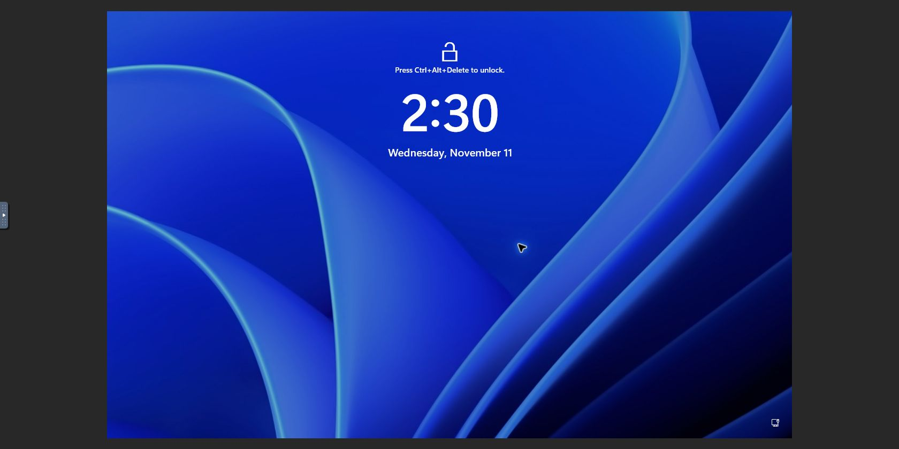
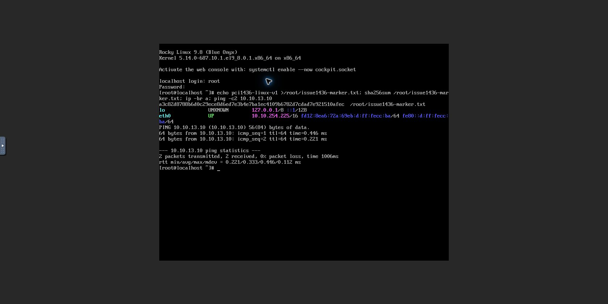

# #1436 Q35 가상머신 생성·부팅 검증

검증일: 2026-11-11 KST. SharedFS Epic과 분리한 브랜치 `dhslove/fix-1436-q35-topology-policy`.
기준 브랜치 `ablestack-europa` / upstream: `2d34af8f8a9b76eb9b143ef42e775883aaa630d0`.
실제 빌드·배포한 코드: `c91f8a90daa299d74f86c910d9d692a21ca06201`.

## 최종 수용 범위

사용자의 2026-11-11 지시에 따라 **VM 생성 및 정상 부팅**을 수용 기준으로 확정했다. 백업 기능의 추가 검증·수정, SharedFS 기능 개발은 수행 범위에서 제외한다. 백업 복원과 전체 NIC 수명주기 매트릭스를 완료했다고 주장하지 않는다.

## 구현

- Q35 root-port 선택을 XML 출력부에서 불변 정책/계획으로 분리했다. 신규 Windows는 검증한 16포트, 신규 Linux는 기존 32포트 정책을 선택한다. 16은 PCI 규격의 한계가 아니다.
- 기존 VM details에 프로파일·버전과 실제 시작에 사용한 canonical machine type을 보존한다. 신규 배포 여부는 `deployvm=true`로 구분하며, 기존 VM을 임의로 신규 정책에 전환하지 않는다.
- 관리 서버가 프로파일을 보내지 않는 순차 배포 구간과 비대상 아키텍처·SystemVM의 기존 동작을 유지한다.
- XML 변환 훅 이후 및 실제 시작 XML의 BDF·포트 수·여유를 검사한다. NIC 추가는 실행 중 XML의 실제 남은 포트를 검사하며 기존 오류 전달·실패 NIC 정리를 유지한다.
- 기존 백업 메타데이터 경로는 원본 정책·머신 버전을 잃지 않도록 보존한다. 이 경로는 자동 회귀로 확인했으며, 실환경 백업 복원 인수 완료를 의미하지 않는다.
- UI 및 SharedFS 코드는 변경하지 않았다. 새 DB 테이블/컬럼은 없다.

## 로컬 빌드·회귀

41개 의존 모듈 reactor package: BUILD SUCCESS. GitHub Actions 빌드는 실행하지 않았다.

| 실제 실행 시험 | 통과 | 실패/오류/생략 |
|---|---:|---|
| PciTopologyProfileTest | 2 | 0/0/0 |
| PciTopologyDetailsDaoTest — 격리 MariaDB 실제 저장·재조회 | 6 | 0/0/0 |
| PciTopologyPolicyTest | 6 | 0/0/0 |
| PciTopologyInspectorTest | 4 | 0/0/0 |
| PciTopologyStartContractTest — Start wrapper/XML/StartAnswer 직렬화 | 3 | 0/0/0 |
| LibvirtNicHotplugTopologyTest | 8 | 0/0/0 |
| LibvirtPlugNicFailureTest | 8 | 0/0/0 |
| 합계 | 37 | 0/0/0 |

새 Java 파일 10개 Checkstyle 8.18 위반 0건, git diff --check 통과. 전체 CloudStack 시험 전부를 실행했다는 의미는 아니다. 시험 전용 MariaDB(127.0.0.1:13346)는 종료했다.

## 13번 배포

현재 관리 서버의 SharedFS 배포본에 영향이 없도록 해당 배포본을 기준으로 필요한 클래스만 반영했다. VirtualMachineManagerImpl의 다른 292개 메서드와 UserVmManagerImpl의 다른 484개 메서드 바이트코드는 동일함을 검사했다. 각 호스트도 해당 호스트의 기존 API/KVM JAR에 필요한 클래스만 반영했다. 최종 배포 JAR의 실제 classpath에서 링크·시그니처 사전 검사 후 배포했다.

관리 서버 JAR SHA-256: `f077b695d8851c090d18d89ccf79cc61b22c4e442afffe535c8052ea20e7c365`.
관리 서버 mold.service 정상, UI HTTP 200, 호스트 3대 모두 Up. libvirtd·기존 QEMU는 재시작하지 않았다.

기존 실행 VM 53대(호스트별 21/10/22대)의 libvirt ID·실행 상태·주요 하드웨어 XML 해시가 배포 전후 및 최종 확인에서 모두 동일했다. 기존 Windows VM 234·235도 정지 상태로 보존했다. 기존 SharedFS 10.10.13.220과 Linux 10.10.254.194 연속 통신은 각각 16,456/16,457 패킷 수신, 손실 0%였다. 관측하지 않은 모든 업무 트래픽의 무중단을 의미하지 않는다.

## 실제 UI 생성·부팅 결과

| 항목 | Windows | Linux |
|---|---|---|
| 시험 VM | i1436-win-1111 | i1436-linux-1111 |
| UUID | da65851f-affe-4938-89c7-e5d88bdd6fce | 11c29856-ee7a-4c54-a1a9-d30d7b39f253 |
| 내부 이름 | i-2-236-VM | i-2-240-VM |
| OS | Windows Server 2025 | Rocky Linux 9.8 |
| 실제 root-port | 16 | 32 |
| 실제 machine | pc-q35-rhel9.8.0 | pc-q35-rhel9.8.0 |
| ROOT | 101GiB QCOW2/SPARSE | 11GiB QCOW2/SPARSE |
| 주 IP/MAC | 10.10.254.219 / 02:0d:00:cc:00:b9 | 10.10.254.225 / 02:0d:00:cc:00:ba |
| 실제 UI 결과 | 생성·실행 중·noVNC 잠금 화면 | 생성·실행 중·noVNC root 로그인 |
| 추가 관측 | UI 재부팅 및 정지→시작 후 잠금 화면·QGA·기존 IP 재확인 | 콘솔에서 관리 서버 ping 성공, QGA 응답 |

Windows 원본 디스크 컨트롤러는 SCSI를 유지했다. 임의 MAC 변경은 하지 않았다. 기존 BIOS 전용 Rocky9 템플릿을 변경하지 않고, EFI 파티션·QGA가 있는 Rocky 공식 GenericCloud 이미지를 별도 등록했다. 공식 체크섬과 다운로드 SHA-256 `92c206cc6f790c61583247eefe87890f8828420662c17cacf247cec78ab4eec8` 일치를 확인했다.

범위 확정 전에 진행한 추가 관측: Windows NIC 2·3·4를 UI로 추가하여 게스트 4개 Up, 각 격리 게이트웨이·관리 서버 통신, 재부팅 후 같은 결과를 확인했다. NIC 3·4를 UI로 제거한 뒤 기존 주 NIC의 MAC/IP·통신도 유지됐다. Windows 시험 파일 SHA-256은 재시작 전후 `2396f11a650c26f68e6bb6e2299aa66dc6b0846bace2f7c5de609110a73ef4d7`로 동일했다. Linux NIC 2·3 추가 작업은 완료됐으나, 이후의 NIC 4·제거·재시작 전체 매트릭스는 추가 진행하지 않았다.

불필요하게 시작한 백업 검증은 취소하고 해당 시험 백업만 정리했다. 복원 VM은 생성하지 않았다. 실패한 빈 시험 템플릿과 임시 HTTP 서버·중복 다운로드 파일도 정리했다. 시험 VM 2대와 등록 완료된 Linux 시험 템플릿, 시험 네트워크 3개는 결과 확인용으로 남겼다.

### 실제 콘솔 증거

Windows UI 정지→시작 후 정상 부팅:

Linux 신규 생성 후 콘솔 로그인·관리망 통신:

