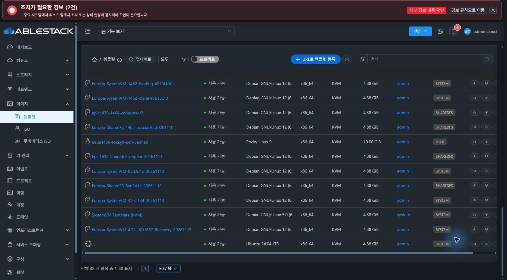
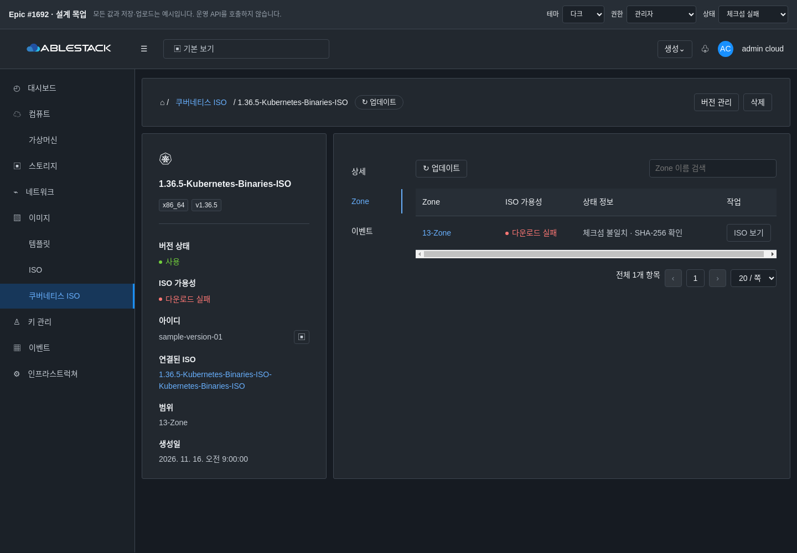
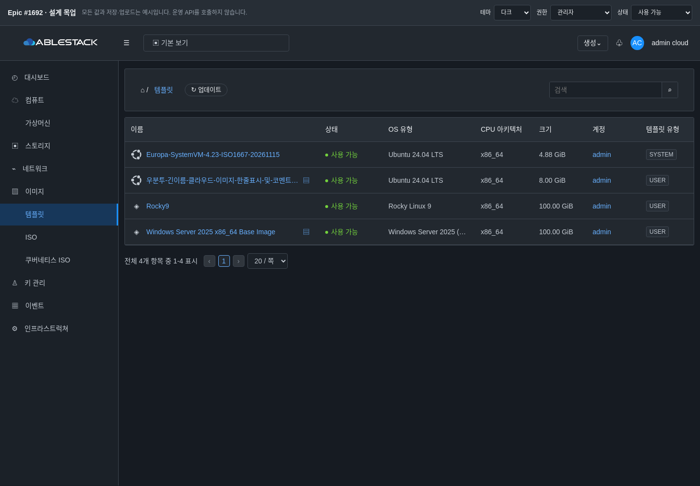

<!--
Licensed to the Apache Software Foundation (ASF) under one
or more contributor license agreements.  See the NOTICE file
distributed with this work for additional information
regarding copyright ownership.  The ASF licenses this file
to you under the Apache License, Version 2.0 (the
"License"); you may not use this file except in compliance
with the License.  You may obtain a copy of the License at

  http://www.apache.org/licenses/LICENSE-2.0

Unless required by applicable law or agreed to in writing,
software distributed under the License is distributed on an
"AS IS" BASIS, WITHOUT WARRANTIES OR CONDITIONS OF ANY
KIND, either express or implied.  See the License for the
specific language governing permissions and limitations
under the License.
-->

# Epic #1692 개발 준비

준비일: 2026-11-16 (KST)

[쿠버네티스 ISO Epic #1692](https://github.com/ablecloud-team/ablestack-cloud/issues/1692)의 기존 8개 작업과 추가 우분투 템플릿 이름 오류를 **실제 하위 이슈 9개**로 생성했습니다. GitHub의 상하위 관계와 **Blocked by 의존 관계 21개**를 등록하고 재조회했습니다. 제품 구현은 시작하지 않았습니다.

**첫 구현은 [#1694](https://github.com/ablecloud-team/ablestack-cloud/issues/1694) 우분투 템플릿 이름 표시 보정**입니다. 주 식별 정보가 사라지는 운영 UI 오류이며 선행 의존성이 없어 가장 먼저 처리합니다. KISO 기능 자체의 첫 단계는 #1695 공통 계약입니다.

| 개발 순서 | 이슈/패키지 | 우선순위 | 선행 | 범위 |
| --- | --- | --- | --- | --- |
| 1 | [#1694](https://github.com/ablecloud-team/ablestack-cloud/issues/1694) TPL-01 | P1 · 가장 먼저 | 없음 | 템플릿 목록 이름 셀만 우선 보정하고 쿠버네티스 ISO 목록에도 사용할 이름 배치 기준을 확정합니다. |
| 2 | [#1695](https://github.com/ablecloud-team/ablestack-cloud/issues/1695) KISO-01 | P1 · 기반 | 없음 | 목록/상세/등록/상태/삭제가 공유할 API capability·읽기 범위·응답 정규화·오류 상태를 마련합니다. |
| 3 | [#1696](https://github.com/ablecloud-team/ablestack-cloud/issues/1696) KISO-02 | P1 | #1695 | URL 등록에서 서버가 허용하는 값과 UI 검증을 맞추고 등록 접수와 실제 ISO 가용성을 구분합니다. |
| 4 | [#1697](https://github.com/ablecloud-team/ablestack-cloud/issues/1697) KISO-03 | P1 | #1695, #1696 | 파일 미선택 무한 로딩과 ARM 선택값 유실을 해결하고 전송·Ready·감사·부분 실패 정리를 일관되게 처리합니다. |
| 5 | [#1698](https://github.com/ablecloud-team/ablestack-cloud/issues/1698) KISO-04 | P1 | #1695 | 최소 버전 필터의 잘못된 count/page를 고치고 검색·필터·페이지 컨텍스트를 보존합니다. |
| 6 | [#1699](https://github.com/ablecloud-team/ablestack-cloud/issues/1699) KISO-05 | P1 | #1695, #1696, #1697 | 버전 상태와 ISO 가용성을 분리하고 VM 표준 상세/Zone 탭에서 진행·실패·범위·식별 정보를 읽을 수 있게 합니다. |
| 7 | [#1700](https://github.com/ablecloud-team/ablestack-cloud/issues/1700) KISO-06 | P1 | #1695, #1699 | 대상과 영향을 확인할 수 있는 상태/삭제 흐름을 만들고 기존 참조 잠금과 부분 실패 복구를 보존합니다. |
| 8 | [#1701](https://github.com/ablecloud-team/ablestack-cloud/issues/1701) KISO-07 | P2 | #1694, #1698, #1699, #1700 | 선행 기능의 최종 배치를 운영 VM 표준과 맞추고 이름/부가 정보의 가시성·테마·반응형·키보드 경계를 마무리합니다. |
| 9 | [#1702](https://github.com/ablecloud-team/ablestack-cloud/issues/1702) KISO-08 | P1 · 최종 완료 게이트 | #1694, #1695, #1696, #1697, #1698, #1699, #1700, #1701 | 선행 8개 구현의 기능·권한·환경·스타일·정리를 실제 UI로 통합 확인하고 Epic 완료 근거를 확정합니다. |

## 준비한 산출물

- [단계별 구현 계획](implementation-plan.ko.md): 의존 그래프, 모듈·배포 경계, 단계별 진입/완료 조건, 개발 환경
- [API·권한·수명주기 계약](api-contracts.ko.md)
- [운영 VM 표준 UI 설계](ui-spec.ko.md)
- [UI 중심 검증 행렬](validation-plan.ko.md)
- [첫 구현 #1694의 재현·수정 설계](first-issue-1694.ko.md)
- [실행 가능한 HTML 목업](mockup.html), [동작 코드](mockup.js), [레이아웃](mockup.css), [운영 테마 토큰 CSS 사본](theme-tokens.css)
- [하위 이슈별 확정 요구사항](issues/)
- [우분투 실제 UI 관측](evidence/ubuntu-ui-review.json)

목업은 브라우저에서 여는 독립 문서이며 실제 운영 API·클립보드·업로드를 호출하지 않습니다. 위 검토 도구에서 테마/권한/오류 상황을 바꾸고, 목록/상세/Zone/이벤트, URL/로컬 등록/고급 검색/상태/삭제 창을 확인할 수 있습니다. 입력 검사와 저장은 메모리 내 예시 데이터만 바꿉니다. 실제 제품 기능의 테스트 통과 근거로 합산하지 않습니다.

저장소 루트에서 `python3 -m http.server 8769 --bind 127.0.0.1`로 열고 브라우저로 `http://127.0.0.1:8769/docs/design/kubernetes-iso-1692/mockup.html`에 접속합니다. 종료 시 서버를 중지합니다. GitHub HTML 미리보기는 코드를 보여주므로 저장소를 내려받아 로컬 서버로 확인합니다.

## 확인된 추가 결함

13번 UI의 템플릿 전체 48개를 50개/쪽으로 보면 마지막 **Ubuntu 24.04 LTS** 행이 아이콘 옆 `…`로만 표시됩니다. 이름 열에는 충분한 여유가 있고 같은 표의 Debian·Rocky·Windows 행은 이름을 표시합니다. 실제 이름 `Europa-SystemVM-4.23-ISO1667-20261115`과 ID `1cce97d2-a4b6-49c7-871a-3f52d70ce858`는 접근성 정보와 상세에서 온전합니다. 원본 데이터 손상이 아니라 표시 결함입니다. 원본을 수정하지 않고 조회만 했습니다.

## 목업 검토

[목업 QA 기록](mockup-qa.ko.md): 18개 화면 상태·양 테마·실제1440/810/390 CSS viewport, 이름 가시 폭·모달 경계·예시 권한/파일 오류를 확인했습니다. 제품/실계정/업로더 검증을 대신하지 않습니다. 후속 [내장 브라우저 키보드 검증20개 그룹](keyboard-review.ko.md)을 별도로 완료하고 모달/탭 초점2건을 보정했습니다.

## 기준과 구현 범위

- 단일 활성 소스: `/root/work/ablestack-cloud`, RockyLinux-9.7 WSL ext4.
- fetch 후 로컬/origin/upstream `ablestack-europa`: `b777311a708e0e652f05025fecb2660dfa90f74d`, 로컬/업스트림 divergence `0 0`.
- 문서 브랜치: `dhslove/epic-1692-ui-design`. 제품 변경·13번 배포·DB/Agent/SystemVM 수정 없음.
- 목업은 운영 `tokens.less`, VM `InstanceTab.vue`, 기존 템플릿/ISO 스타일을 참고합니다. 스타일 토큰 사본의 출처와 검증은 [UI 설계](ui-spec.ko.md)를 참조합니다.
- 실제 4.21/4.23 업로드·ACL 전체 행렬·참조 보호 검증은 구현 단계의 게이트입니다. 미실행 환경을 완료로 표시하지 않습니다.
- CI 부채 #926·#1044는 별도 관리합니다.
