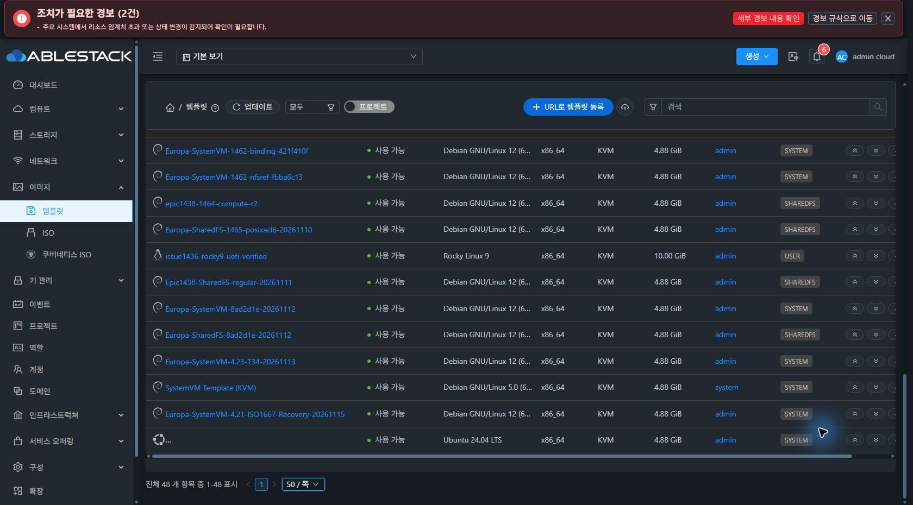
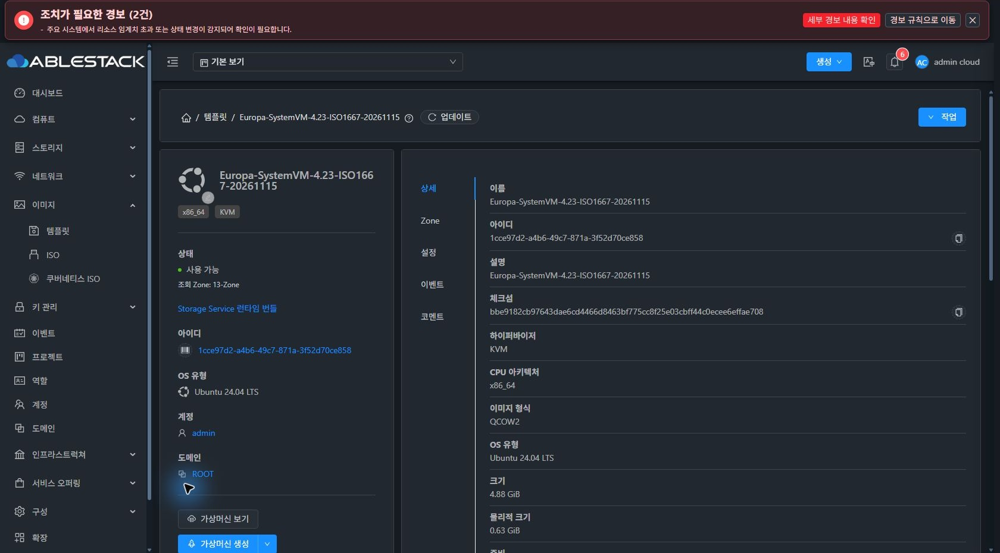

<!--
Licensed to the Apache Software Foundation (ASF) under one
or more contributor license agreements.  See the NOTICE file
distributed with this work for additional information
regarding copyright ownership.  The ASF licenses this file
to you under the Apache License, Version 2.0 (the
"License"); you may not use this file except in compliance
with the License.  You may obtain a copy of the License at

  http://www.apache.org/licenses/LICENSE-2.0

Unless required by applicable law or agreed to in writing,
software distributed under the License is distributed on an
"AS IS" BASIS, WITHOUT WARRANTIES OR CONDITIONS OF ANY
KIND, either express or implied.  See the License for the
specific language governing permissions and limitations
under the License.
-->

# #1694 첫 구현 준비 — 우분투 템플릿 이름 표시

## 재현

- UI: 13번 이미지→템플릿, 전체48개, 50개/쪽, 하단 마지막 행.
- 대상: `Europa-SystemVM-4.23-ISO1667-20261115`, `1cce97d2-a4b6-49c7-871a-3f52d70ce858`.
- OS: Ubuntu 24.04 LTS. 넓은 이름 열에서 Ubuntu 아이콘 옆 `…`만 보입니다.
- 같은 표의 Debian/Rocky/Windows 이름은 표시됩니다. 접근성 링크 이름과 상세 이름은 온전합니다. 이름의 데이터 훼손으로 판단하지 않습니다.
- `ubuntu` 이름 검색은0개입니다. 이 대상은 OS가 Ubuntu이고 템플릿 이름에는 ubuntu 문자열이 없으므로 **이름 검색0개를 별도 검색 결함으로 등록하지 않습니다.**
- 현재 조사에서는 원본 템플릿/계정/VM 생성·수정·삭제를 하지 않았습니다.

## 원인 후보와 확인 방법

현행 `ListView.vue`의 이름 셀은 inline span 안에 OS 아이콘과 `.template-primary-name {display:inline-flex;width:calc(100% - 32px)}`를 배치하고 내부 링크에 flex/ellipsis를 적용합니다. 부모의 사용 가능 폭과 아이콘의 고유 폭이 계산에 어떻게 참여하는지 확인해야 합니다. 실제 faUbuntu SVG의 viewBox는576×512이며 다른 OS 아이콘과 폭이 다릅니다.

**이번에는 DOM/computed-style 계측으로 정확한 픽셀 원인을 확정하지 않았습니다.** 특정 SVG 폭만 줄이면 해결된다고 단정하지 않고, 다음 구현에서 실제 브라우저 레이아웃 재현과 테스트 fixture로 원인을 확정합니다.

## 보정 설계

하나의 block/flex 이름 셀에서 아이콘 `flex:0 0 24px`, 링크 `flex:1 1 0;min-width:0`, 코멘트 `flex:0 0 22px`로 영역을 분리합니다. 임의의 inline 부모에 percentage/calc 이름 폭을 의존하지 않습니다. 주 열의 최소폭을 유지하고 실제 텍스트가 길 때만 말줄임합니다.

공통 ListView 전체를 일괄 덮어쓰기보다 template 주 목록 범위에 먼저 한정합니다. OsLogo 공통 수정이 필요하면 VM/VNF/ISO·OS 선택기 소비 경계를 추가 확인합니다. Ubuntu 데이터/이름을 바꾸거나 아이콘을 제거하지 않습니다.

## 검증과 배포

1. 원인 재현 fixture와 실제 Ubuntu 행의 before를 보존합니다.
2. UI 범위 변경 Lint, 기존 TemplateSearch/ListView 관련 의미 있는 회귀를 실행합니다. jsdom의 텍스트 존재 검사는 CSS 가시 폭을 증명하지 못하므로 실제 UI 확인이 필수입니다.
3. UI만 빌드해 변경 산출물만13번에 반영하고 Backend/DB/Agent/SystemVM은 보존합니다.
4. Root UI에서 실제 이름 앞부분과 클릭 영역·hover/focus 전체 이름·breadcrumb 복귀를 확인합니다.
5. Ubuntu/Debian/Rocky/Windows/커스텀 아이콘/아이콘 없음·짧은/긴 이름·코멘트 동시 표시를 다크/라이트 및1440/1280/810/390 폭에서 확인합니다.
6. 공통 VM/VNF/일반 ISO 화면과 부가 열의 한 줄/툴팁을 확인한 후 #1694를 닫습니다. 테스트 fixture를 만들었다면 전용 자원만 정리합니다.

## 첫 순서 선정 이유

현재 주 식별 정보가 없어 목록에서 대상을 구분하기 어렵고, 다른 KISO API/Backend 작업을 기다릴 필요가 없습니다. 좁은 UI 변경으로 독립 검증이 가능하며 이후 #1701의 이름 셀 회귀에 검증된 패턴을 제공합니다. 따라서 #1694 다음 #1695부터 KISO 본 작업을 진행합니다.
