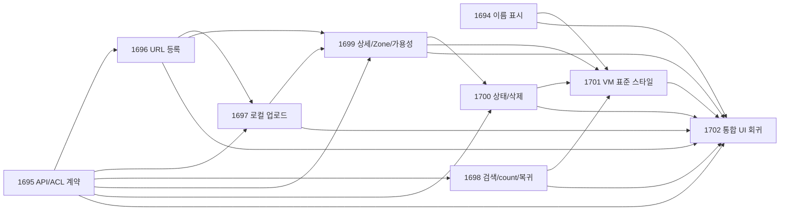

<!--
Licensed to the Apache Software Foundation (ASF) under one
or more contributor license agreements. See the NOTICE file
distributed with this work for additional information
regarding copyright ownership. The ASF licenses this file
to you under the Apache License, Version 2.0 (the
"License"); you may not use this file except in compliance
with the License. You may obtain a copy of the License at

  http://www.apache.org/licenses/LICENSE-2.0

Unless required by applicable law or agreed to in writing,
software distributed under the License is distributed on an
"AS IS" BASIS, WITHOUT WARRANTIES OR CONDITIONS OF ANY
KIND, either express or implied. See the License for the
specific language governing permissions and limitations
under the License.
-->

# 단계별 구현 계획

## 순서와 의존 관계

우선순위는 운영 UI의 주 식별 정보 오류를 먼저 복구하고, KISO 공통 계약을 마련한 뒤 등록/업로드·검색·가용성·안전한 변경·최종 스타일·통합 회귀로 진행합니다. P1 최종 게이트 #1702는 가장 뒤에서 실행합니다.

| 개발 순서 | 이슈/패키지 | 우선순위 | 선행 | 범위 |
| --- | --- | --- | --- | --- |
| 1 | [#1694](https://github.com/ablecloud-team/ablestack-cloud/issues/1694) TPL-01 | P1 · 가장 먼저 | 없음 | 템플릿 목록 이름 셀만 우선 보정하고 쿠버네티스 ISO 목록에도 사용할 이름 배치 기준을 확정합니다. |
| 2 | [#1695](https://github.com/ablecloud-team/ablestack-cloud/issues/1695) KISO-01 | P1 · 기반 | 없음 | 목록/상세/등록/상태/삭제가 공유할 API capability·읽기 범위·응답 정규화·오류 상태를 마련합니다. |
| 3 | [#1696](https://github.com/ablecloud-team/ablestack-cloud/issues/1696) KISO-02 | P1 | #1695 | URL 등록에서 서버가 허용하는 값과 UI 검증을 맞추고 등록 접수와 실제 ISO 가용성을 구분합니다. |
| 4 | [#1697](https://github.com/ablecloud-team/ablestack-cloud/issues/1697) KISO-03 | P1 | #1695, #1696 | 파일 미선택 무한 로딩과 ARM 선택값 유실을 해결하고 전송·Ready·감사·부분 실패 정리를 일관되게 처리합니다. |
| 5 | [#1698](https://github.com/ablecloud-team/ablestack-cloud/issues/1698) KISO-04 | P1 | #1695 | 최소 버전 필터의 잘못된 count/page를 고치고 검색·필터·페이지 컨텍스트를 보존합니다. |
| 6 | [#1699](https://github.com/ablecloud-team/ablestack-cloud/issues/1699) KISO-05 | P1 | #1695, #1696, #1697 | 버전 상태와 ISO 가용성을 분리하고 VM 표준 상세/Zone 탭에서 진행·실패·범위·식별 정보를 읽을 수 있게 합니다. |
| 7 | [#1700](https://github.com/ablecloud-team/ablestack-cloud/issues/1700) KISO-06 | P1 | #1695, #1699 | 대상과 영향을 확인할 수 있는 상태/삭제 흐름을 만들고 기존 참조 잠금과 부분 실패 복구를 보존합니다. |
| 8 | [#1701](https://github.com/ablecloud-team/ablestack-cloud/issues/1701) KISO-07 | P2 | #1694, #1698, #1699, #1700 | 선행 기능의 최종 배치를 운영 VM 표준과 맞추고 이름/부가 정보의 가시성·테마·반응형·키보드 경계를 마무리합니다. |
| 9 | [#1702](https://github.com/ablecloud-team/ablestack-cloud/issues/1702) KISO-08 | P1 · 최종 완료 게이트 | #1694, #1695, #1696, #1697, #1698, #1699, #1700, #1701 | 선행 8개 구현의 기능·권한·환경·스타일·정리를 실제 UI로 통합 확인하고 Epic 완료 근거를 확정합니다. |

#1698은 #1695 완료 후 등록/업로드와 독립적으로 개발할 수 있지만 기본 실행 순서는 표를 따릅니다. #1701은 #1694의 검증된 이름 슬롯 배치를 소비합니다. #1695는 #1694에 기능상 종속되지 않습니다.

## 단계별 진입·완료와 변경 모듈

| 단계 | 구현 후보 | 배포 경계 | 단계 완료 근거 |
| --- | --- | --- | --- |
| #1694 | ListView.vue의 template 전용 이름 셀, 필요 시 OsLogo/AutogenView | UI만 | 실제 Ubuntu 이름 가시성·클릭/툴팁, 여러 OS/아이콘/코멘트·공통 소비 화면 |
| #1695 | KISO 전용 capability/model 유틸·액션 구성·요청 소유 범위 | 우선 UI, API 계약 변경이 생긴 모듈만 | 독립 capability/응답 정규화/거절·만료·false·0·오래된 응답 경계 |
| #1696 | 등록 폼·공통 체크섬/자원 경계·URL/Edge 정책 | UI, 서버 검증 변화가 있으면 kubernetes-service만 추가 | URL 정상/음성·payload·범위·등록 접수와 Ready 구분 |
| #1697 | local command arch·manager 전달/감사·XHR 수명주기 | UI + kubernetes-service, 실제 의존 변경 모듈 | 실제 4.21·4.23 전송/Ready·arch 저장·중단/만료/정리 |
| #1698 | manager/DAO 필터/count/page 및 UI 복귀 모델 | UI + kubernetes-service, DAO 변경 모듈만 | 최소 조건 전체 대상/count/page·여러 페이지·계정별 복귀 |
| #1699 | KISO 상세/Zone 컴포넌트·허용된 child ISO 읽기 | UI, 응답 계약 변화가 생기면 실제 모듈 | 실패/권한/미조회 구분·범위·원문·테마 |
| #1700 | 상태/삭제 창·job/결과 불명·기존 참조 잠금 | UI, 참조/프리플라이트 API가 필요하면 해당 모듈 | 저장 현재값/권한·참조 삭제 거절·ISO 실패 보존·정리 |
| #1701 | 위 결과를 운영 VM 레이아웃에 통일 | UI만 | 목록/탭/모달 전후·양 테마·크기/키보드·공통 회귀 |
| #1702 | 실계정/양 계열/실제 참조·통합 UI 행렬 | 필요한 최종 보정만 | 원래 자원 보존·시험 잔여 0·Epic/PR 업데이트 |

명시적 DB 스키마 변경은 현재 설계에 없습니다. 필요해질 경우 테이블/컬럼·이행·롤백을 별도 설계하고 누락된 migration으로 503이 발생하지 않도록 합니다. 카탈로그 arch 전달을 위해 전체 Cloud/Agent를 재배포하지 않습니다.

## 개발 환경과 재개 절차

준비 시 확인: Node v20.20.2 / npm 10.8.2, Java 17.0.19, Maven 3.6.3. UI 디렉터리에서 Vue CLI 경로, Vue 3.2.37, ant-design-vue 3.2.20 로딩을 확인했습니다. lockfile/의존성은 변경하지 않았습니다. 제품 빌드/제품 테스트는 이번 문서 준비에서 실행하지 않았습니다. 목업 JS 구문 검사와 로컬 HTTP 200만 별도 확인하며 실제 브라우저 확인 결과는 QA 기록에 둡니다.

구현을 재개할 때마다 다음을 수행합니다.

1. 원격 upstream/origin을 각각 fetch하고 로컬 기준 브랜치를 먼저 upstream에 맞춥니다. divergence `0 0` 확인 후 작업 브랜치를 생성/재기반합니다.
2. 문서 PR과 동시 변경을 반영해 #1694의 현재 ListView/OsLogo 스타일을 다시 확인합니다. Windows 체크아웃의 기존 수정·미추적 파일은 건드리지 않습니다.
3. 구현 브랜치 제안: `dhslove/epic-1692-kubernetes-iso`. 이슈별 한글 커밋과 기능별 검증 결과를 누적하고 origin에만 push하여 upstream PR로 검토합니다.
4. 시작 전 현재 배포 index/변경 정적 파일·Backend jar·설정/PID·기존 자원 ID를 읽기 기준으로 기록합니다. 비밀 값은 파일/보고서에 저장하지 않습니다.
5. UI만 바뀐 #1694에서는 Maven/서버 재시작 없이 변경 UI 빌드만 수행합니다. 제품 전체 빌드를 준비 검사로 실행하지 않습니다.
6. Backend 단계에서는 실제 변경 모듈에 Maven `-pl plugins/integrations/kubernetes-service -am`를 적용하되, 선행 산출물/테스트 의존을 확인하고 필요한 범위만 확장합니다.
7. 기능별 UI 검증·정리 이후에만 해당 이슈를 닫고 PR/Epic에 증거를 갱신합니다. 준비 문서/목업 완료만으로 구현 이슈를 닫지 않습니다.

집중 검사 예시는 [검증 계획](validation-plan.ko.md)에 있습니다. #926·#1044의 전체 기준 CI 실패는 별도 비교하고 이 Epic의 신규 진단·실패와 분리합니다.
