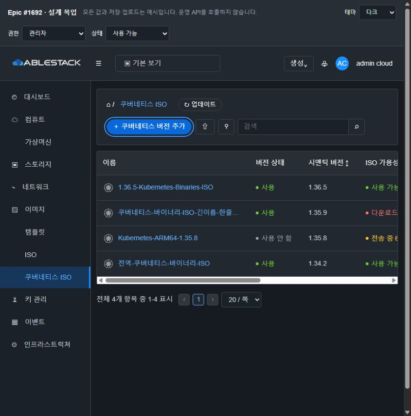

<!--
Licensed to the Apache Software Foundation (ASF) under one
or more contributor license agreements.  See the NOTICE file
distributed with this work for additional information
regarding copyright ownership.  The ASF licenses this file
to you under the Apache License, Version 2.0 (the
"License"); you may not use this file except in compliance
with the License.  You may obtain a copy of the License at

  http://www.apache.org/licenses/LICENSE-2.0

Unless required by applicable law or agreed to in writing,
software distributed under the License is distributed on an
"AS IS" BASIS, WITHOUT WARRANTIES OR CONDITIONS OF ANY
KIND, either express or implied.  See the License for the
specific language governing permissions and limitations
under the License.
-->

# 내장 브라우저 키보드·초점 복귀 검증

2026-11-16 · 사용자에게 열려 있던 내장 브라우저 tab 4에서 확인

## 최종 결과

**K01~K20의20개 검증 그룹을 통과**했습니다. 정방향/역방향 순환을 따로 기록한 최종 PASS 관측은21개입니다. 발견한 목업 보정2건은 재검증으로 해소했으며 미해결 항목은0개입니다.

- 기존 URL의 탭을 선택했고 goto/back/new tab 등 다른 페이지 이동은 하지 않았습니다.
- 정적 스크립트 보정 반영과 예시 상태 정리를 위해 같은 URL을 새로고침했습니다.
- Browser Use의 Tab·Shift+Tab·Enter·Escape·ArrowDown 입력과 읽기 전용 DOM의 activeElement/선택 상태를 대조했습니다.
- 브라우저에서 실제로 확인한 목업 입력 결과입니다. 별도 Windows Chrome/Sky 경로의 네이티브 OS 검증으로 표현하지 않습니다.
- 운영 Mold API·계정·클러스터·실제 파일/클립보드를 변경하지 않았습니다. 예시 상태는 마지막에 기본4행·관리자·다크·모달 닫힘으로 초기화했습니다.

## 발견과 보정

| 발견 | 보정 | 최종 관찰 |
| --- | --- | --- |
| 모달 첫/마지막 요소에서 Shift+Tab/Tab이 BODY로 빠짐 | 활성·표시된 모달 컨트롤만 순환하고 disabled 버튼은 제외 | 첫 요소→마지막, 마지막→첫 요소 유지. 참조 삭제 차단 창은 취소가 마지막 요소 |
| Zone 탭 Enter 선택 시 재렌더 후 BODY로 초점 유실 | 렌더 후 선택 탭에 초점 유지 | Zone→이벤트로 Tab/Enter 이동 지속 |

정적 목업의 이전 스크립트가 재사용되지 않도록 스크립트 URL 버전을 갱신한 뒤 같은 탭에서 다시 확인했습니다. 초기 NEEDS_FIX 관측은 [원시 기록](evidence/keyboard/keyboard-results.json)에 resolvedBy와 함께 보존합니다.

## 항목별 결과

| ID | 확인한 입력/동작 | 최종 |
| --- | --- | --- |
| K01 | 갱신 버튼에서 Tab | PASS |
| K02 | 등록 버튼에서 Enter | PASS |
| K03 | 닫기 버튼에서 Tab | PASS |
| K04 | 입력 필드에서 Shift+Tab | PASS |
| K05 | URL 등록 입력에서 Escape | PASS |
| K06 | 로컬 등록 Enter 제출(파일 없음) | PASS |
| K07 | 로컬 모달 첫 요소에서 Shift+Tab / 로컬 모달 마지막 요소에서 Tab | PASS |
| K08 | 로컬 등록 Escape | PASS |
| K09 | 로컬 모달 취소 Enter | PASS |
| K10 | 고급 검색 Enter 제출 | PASS |
| K11 | 상세에서 Tab 후 Zone Enter | PASS |
| K12 | Zone에서 Tab 후 이벤트 Enter | PASS |
| K13 | 상태 선택 Tab/ArrowDown/Tab/Tab/Enter 저장 | PASS |
| K14 | 참조 중 삭제 모달 Shift+Tab/Tab 순환 | PASS |
| K15 | 참조 중 삭제 모달 Escape | PASS |
| K16 | 라이트 URL 모달 Enter/Shift+Tab/Tab/Escape | PASS |
| K17 | 고급 검색 Escape | PASS |
| K18 | 최종 로컬 모달 파일 없는 Enter 제출 후 Escape | PASS |
| K19 | 모달 닫기 버튼 Enter | PASS |
| K20 | 상태 변경 모달 Escape | PASS |

## 화면 증거

- [모달 Tab 순환의 닫기 버튼 초점](evidence/keyboard/local-tab-loop-close-focus.jpg)
- [Zone 탭 선택 후 초점 유지](evidence/keyboard/zone-enter-focus.jpg)
- [상태 저장 후 관리 버튼 복귀](evidence/keyboard/state-save-focus-return.jpg)
- [참조 중 삭제 창에서 비활성 삭제 버튼 제외](evidence/keyboard/delete-disabled-tab-loop.jpg)
- [라이트 테마 URL Esc 복귀](evidence/keyboard/url-light-escape-focus.jpg)

## 제품 구현과 CI 범위

이번 변경은 docs/design/kubernetes-iso-1692 아래 목업·문서·증거입니다. #1694~#1702의 제품 구현·실계정 ACL·4.21/4.23 업로드·실제 참조 삭제·13번 배포의 통과로 대신하지 않으며 이슈를 닫지 않습니다. 첫 구현 순서는 #1694, 이후 #1695~#1702를 유지합니다.

마지막 완료된833bf7 CI의 [Lint](https://github.com/ablecloud-team/ablestack-cloud/actions/runs/43777628868)는 기존16개 훅 실패이며 새 문서 경로의 진단은0개입니다. [License Check](https://github.com/ablecloud-team/ablestack-cloud/actions/runs/43777628848)는 미승인4,077개로 기존과 동일합니다. [충돌 검사](https://github.com/ablecloud-team/ablestack-cloud/actions/runs/43777631196)는 성공했습니다. [구분 기록](evidence/keyboard/ci-separation.json)은 검사한 head를 명시합니다.

후속 변경14개 파일의 JS 구문·상대 Markdown 링크52개·JSON/HTML 자산 경로·적용 pre-commit 훅18개를 확인해 통과/해당 없음 처리했습니다. 전체 CI 녹색으로 표시하지 않습니다. 기존 CI 부채 #926·#1044는 계속 별도 OPEN으로 유지합니다.
