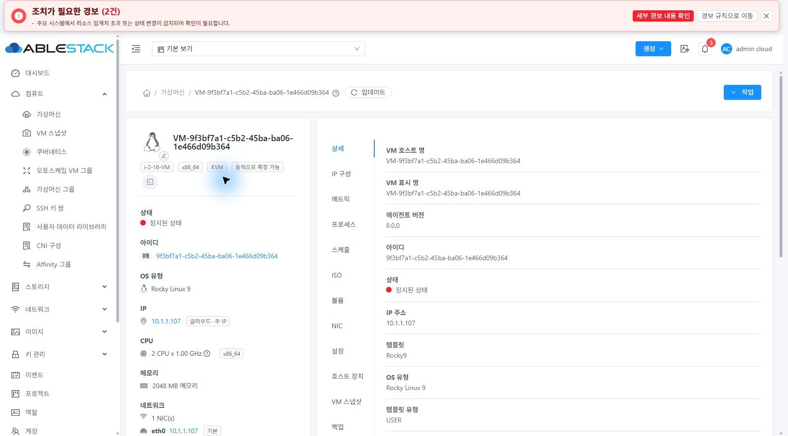
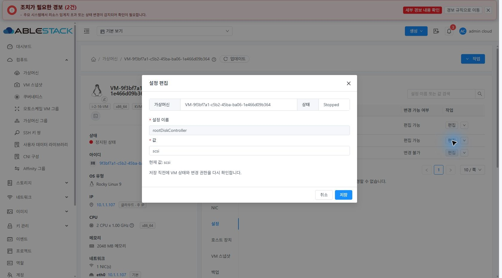

<!--
Licensed to the Apache Software Foundation (ASF) under one
or more contributor license agreements.  See the NOTICE file
distributed with this work for additional information
regarding copyright ownership.  The ASF licenses this file
to you under the Apache License, Version 2.0 (the
"License"); you may not use this file except in compliance
with the License.  You may obtain a copy of the License at

  http://www.apache.org/licenses/LICENSE-2.0

Unless required by applicable law or agreed to in writing,
software distributed under the License is distributed on an
"AS IS" BASIS, WITHOUT WARRANTIES OR CONDITIONS OF ANY
KIND, either express or implied.  See the License for the
specific language governing permissions and limitations
under the License.
-->

# 운영 VM 표준 UI 설계와 목업 명세

## 적용 기준

현재 기준은 Europa `b777311a708e0e652f05025fecb2660dfa90f74d`입니다. 같은 날 13번에서 관찰한 VM 목록/상세/설정/모달과 `InstanceTab.vue`, 공통 `AutogenView.vue`, `ListView.vue`, 최근 템플릿/ISO 컴포넌트를 기준으로 했습니다. 새 제품의 시각 언어를 만들지 않고 이미 사용 중인 구조를 재사용합니다.

| 영역 | 운영 VM 기준 | KISO 적용 |
| --- | --- | --- |
| 목록/상단 | 같은 breadcrumb 카드·갱신·우측 생성/검색 액션 | 추가 설명 띠 없이 같은 밀도/높이/간격. 검색 상태 복귀 보존 |
| 이름 셀 | OS/리소스 아이콘 + 주요 링크 + 선택 코멘트 | 아이콘 24px 고정·이름 유연·코멘트 고정. 이름 열 최소320px, 부가 열은 고정 폭/한 줄/툴팁 |
| 상세 전체 | 좌측 요약 카드 + 우측 탭 카드 | 약 28.5% 요약/나머지 탭, 최소 폭 이하에서 순서대로 쌓기 |
| 탭 | 데스크톱 세로, rail 약100px, 라벨 상태 표시 | 상세→Zone→이벤트. 콘텐츠 상단22px·본문24px 기준 |
| 상세 값 | 라벨 위/값 아래, 구분선·상태/링크/원문 | raw true/Enabled/Ready를 의미 있는 한국어·상태로 표시 |
| Zone | 탭 콘텐츠 안 툴바·표·우측 페이지네이션 | 범위/Zone·가용성·원인·허용된 ISO 보기. 조회 실패/권한 제한 별도 |
| 모달 | 제목/대상 정보/본문/하단 취소·저장 | 720px 이내 내용 폭, 작은 창 최대폭/높이, 본문 스크롤/고정 footer |
| 테마 | 운영 semantic token | `theme-tokens.css`는 현행 `tokens.less`의 토큰 선언을 보존하고 // 주석만 CSS 주석으로 변환한 사본. 제품에 새 테마를 추가하지 않음 |

### 색상·타이포그래피

기존 light surface `#ffffff`, dark surface `#22282f`, dark page `#161b22`, border `#d9dfe7/#3e4650`, text `#1f2937/#f0f3f6`, link `#0969da/#69b1ff` 토큰을 사용합니다. 기본 글꼴은14px Arial/Malgun Gothic, modal 제목16px, 요약 제목16px이며 현재 Ant Design 컴포넌트의 간격/테두리를 따릅니다.

목업은 CSS/HTML로 구조와 상태를 보여주는 독립 문서입니다. Vue/Ant Design 실행 번들을 복제하거나 운영 API와 연결하지 않았습니다. 제품 구현에서는 실제 공통 Vue 컴포넌트와 토큰을 사용하며 목업 HTML을 제품 라우트로 가져오지 않습니다.

## 화면과 전이

| 목업 진입 | 포함한 검토 항목 |
| --- | --- |
| 쿠버네티스 ISO 목록 | 이름 우선 폭, Enabled/가용성 분리, 특정/모든 Zone, 긴 이름, 숫자 정렬·검색 |
| 상세 | 이름/ID/버전/상태/범위/연결 ISO/arch/자원/HA/오토스케일링/directdownload·Root 예시 URL |
| Zone | 툴바·표·원인·진행률·페이지네이션, 조회 실패/권한 없음/재시도 예시 |
| 이벤트 | 로컬 ADD/상태 변경의 감사 연결 예시, 공통 표와 페이지네이션 |
| URL 등록 | 버전·이름·Zone·URL·체크섬·CPU/RAM·arch·directdownload 및 필드 오류 |
| 로컬 등록 | 파일 필수 검증·파일 선택 예시·arch와 체크섬·단계 분리 |
| 고급 검색 | 최소 버전 텍스트/ID 기준 상호 배타·Zone/arch |
| 상태 변경 | 대상명/버전/ID/현재 상태·변경값 |
| 삭제 | 연결 ISO 영향·위험 버튼·참조 중/결과 불명 차단 |
| 템플릿 목록 | Ubuntu/Debian/Windows 대용 행·긴 이름·코멘트 슬롯. 운영 결함 보정 후의 배치 예시 |
| 읽기 전용/로컬만 허용 | 기능별 액션 독립 노출·URL 필드/쓰기 제한의 예시 |

“샘플 ISO 선택”은 로컬 파일을 읽거나 전송하지 않고 예시 파일명만 설정합니다. 복사 버튼도 OS 클립보드를 바꾸지 않고 예시 메시지를 표시합니다. 이 단순화는 실제 제품 기능 축소 요구가 아니며 실제 파일/클립보드는 구현 단계에서 검증합니다.

## 반응형·초점

- 데스크톱: 세로 탭/두 카드, 기존 VM 툴바 밀도. 목록 표는 이름 최소폭과 부가 폭을 유지합니다.
- 810px: 축소 메뉴·줄바꿈 툴바/검색, 표 안 가로 스크롤. 이름/버튼이 페이지 왼쪽으로 잘리는 방식은 허용하지 않습니다.
- 390px: 요약/탭 순차 배치·가로 탭·본문 안 표 스크롤·단일 열 모달. 입력/하단 버튼에 접근할 수 있어야 합니다.
- 긴 이름/URL/UUID/오류: 목록은 한 줄 말줄임과 전체 title/초점, 상세는 값의 의미에 맞게 줄바꿈/복사.
- Enter/Tab/Esc·닫기 후 호출 버튼 초점, 오류 필드 근처 메시지, 읽기 전용/로딩/실패를 색상만으로 구분하지 않습니다.

## 의도적으로 추가하지 않는 탭

KubernetesSupportedVersion 설정 API와 코멘트 entity 계약이 없으므로 설정/코멘트/메트릭 탭을 VM과 이름만 맞춰 추가하지 않습니다. KISO 탭은 `상세 → Zone → 이벤트`입니다. 일반 템플릿의 탭 구성을 바꾸는 작업이 아닙니다.

Font Awesome 아이콘 저작권: Fonticons, Inc. (https://fontawesome.com). Ubuntu 아이콘은 현재 `OsLogo.vue`가 소비하는 Font Awesome Free Brands의 `faUbuntu` 경로를 목업에 사용했습니다. 아이콘은 Font Awesome Free의 CC BY 4.0 적용 대상이며 저작권/라이선스는 [Font Awesome Free](https://fontawesome.com/license/free)를 따릅니다. 로고는 저장소의 기존 ABLESTACK 이미지를 상대 경로로 읽고 변경하지 않습니다.
