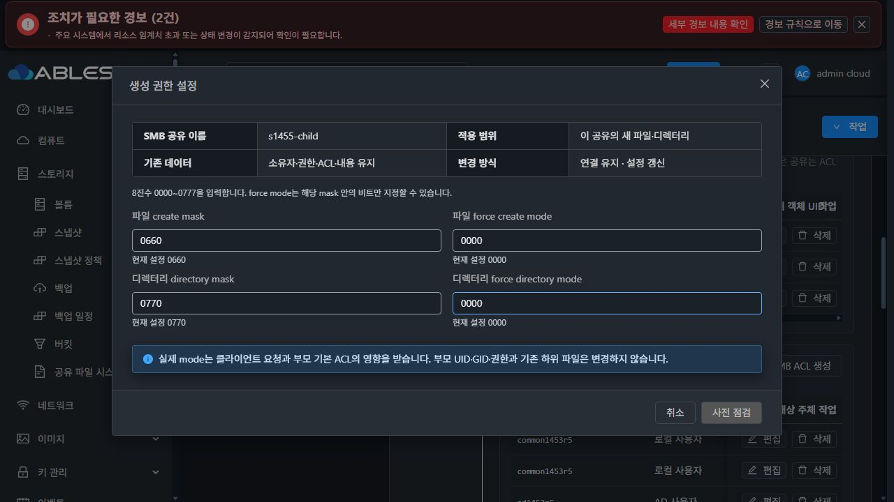
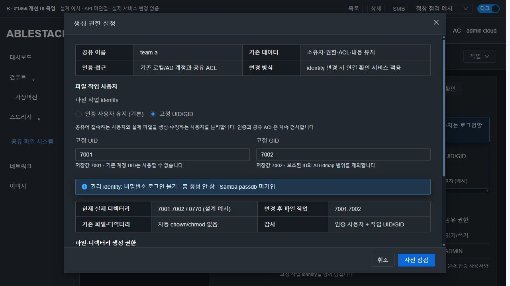
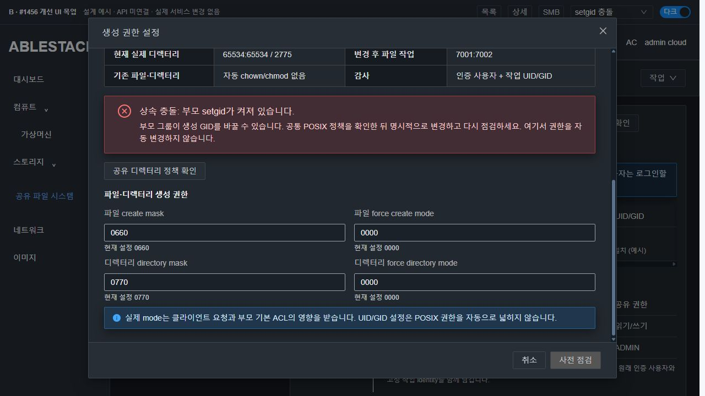
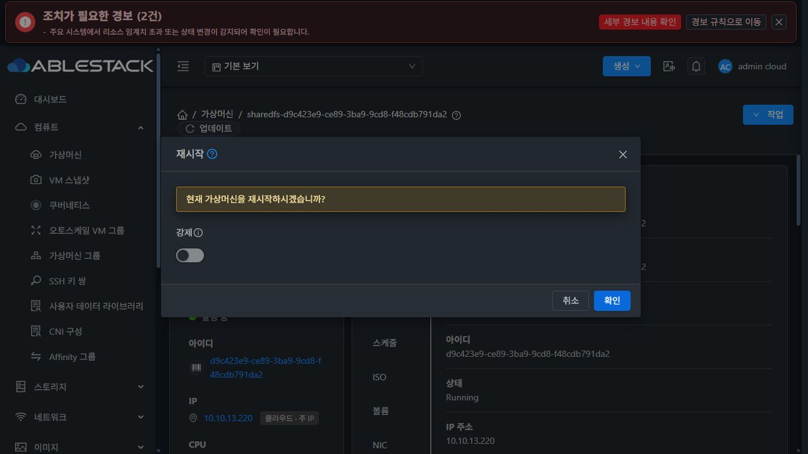

# #1456 코드 수준 설계 — 공유별 고정 POSIX UID/GID

**설계·실제 코드/배포 대조·SystemVM 격리 주입·VM 표준 목업까지만 완료했습니다. 제품 구현·모듈 배포·실서비스 정책 변경은 시작하지 않았습니다.** 이슈는 OPEN, 인수 체크5개는 미완료로 유지합니다. 이 문서는 구현 방침과 사전 실증이며 기능 완료 보고가 아닙니다.

상위 Epic #1438, 기존 브랜치 epic/1438-sharedfs. 로컬 Europa/upstream **1c5b169cd6283da23cc3e155d4b6d14e39e42793**를 먼저 동기화(divergence0/0)하고, 설계 기준 **cc67ac7656a9230ce0e238862a6932897f40e281**에서 조사했습니다. 새 이슈·기능 브랜치·목업 PR를 만들지 않습니다.

## 1. 실제 배포/소스 확인

대상 SharedFS **3f0056db-4dfe-4f13-908d-b809dd565d34**, instance **c1eca707-a554-4c42-85cd-1e9e9744d804**, SystemVM **d9c423e9-ce89-3ba9-9cd8-f48cdb791da2 / i-2-195-VM /13.2**, IP13.220입니다. DATA는 **10GiB SPARSE XFS**, e070a0aa-dbf5-48c0-83e0-09f874446277, FS UUID9c8ddfe9-3e23-46f0-9476-5c794b004841입니다. 디스크 생성·포맷·MAC 변경은0입니다.

- 관리 JAR SHA256 **9e55bac7f538941a481cba326e68ff5bf12d8701307649c8cbb79ae67aa1f153**. 배포 StorageFileSharePaths/StorageSmbParentInheritance/StorageSmbCreationPolicy class3개와 Manager/Coordinator/Preflight/API 명령·응답6개, 총9개를 현재 컴파일 결과와 바이트 hash 대조해 일치했습니다. UI index도 기존cf287119ee2540d32d21b889cbc996504469a3bb0f0432c10d923067e76bac21 그대로입니다.
- 활성 guest **1455.paths.3 / baseline8**, Samba/smbclient/samba-libs **2:4.17.12+dfsg-0+deb12u4**입니다. active CLI SHA52283e7ec4bac675ca81b455ebf1a5c69f722d21dc6d9fd34003953653d0b57c, helper SHAc47a57262646007602025870c8fdcf68a1d5bbb8bb452b2976d6701b4d46465d.
- 실제 SMB 리스너2개는 inherit owner=no, force user/group 없음, 기본 smbd inactive입니다. AD 계정 ABLESTACK\\epic1453ad는 NSS UID10000/GID10003으로 해석됩니다. 현재 idmap * 범위는 **10000–999999**입니다.
- 현재 s1455-child의 실제 디렉터리는65534:65534/2775입니다. 이 경로는 setgid 충돌을 명시적으로 해소하기 전까지 게시된 고정 GID 모드로 바꿀 수 없습니다. 이번 설계 작업에서 이 정책을 변경하지 않았습니다.
- 실제 UI에서 SMB 목록·생성 권한 설정을 열어 보았습니다. 현재 대화상자는 mask4개만 다루며 고정 identity 입력은 없습니다. 목록은 생성자/상위 소유자 방식을 표시합니다. 현재 기능 범위의 확인이며 이를 기존 제품의 회귀 오류라고 판정하지 않습니다.
- 실제 UI가 발생시킨 listStorageSmbShares를 관측했습니다. 응답 키는 liststoragesmbsharesresponse.storagesmbshare, config는 **JSON 문자열**입니다. 새 UI도 실제 serializer fixture와 문자열/legacy 누락값을 기준으로 설계합니다.

## 2. 현재 코드의 정확한 접점

| 위치/함수 | 현재 동작 | 설계 변경 |
|---|---|---|
| API CreateStorageSmbShareCmd / UpdateStorageSmbShareCmd | inheritowner·mask·guestok 등 optional 입력 | optional identity mode·UID·GID 추가 |
| StorageServiceManagerImpl.create/updateStorageSmbShareCandidate | buildSmbConfigJson→inheritance/mask merge→공통 정책/경로 guard→기존 apply | 전용 typed merge/검증을 끼우고 기존 builder/transaction 재사용 |
| StorageServiceManagerImpl.buildSmbDesiredStatePayload | share config 전체와 원래 ACL principal/permission 전달 | typed identity를 유지; 인증 principal을 강제 사용자로 교체하지 않음 |
| StorageServiceConfigurationPreflight.commandIntent/parseIntent | 허용 intent와 필드 형식 검증 | smbfileidentity의 엄격한 schema·fingerprint·미게시 구분 추가 |
| StorageServiceConfigurationPreflightResponse | creationpreview 등 JsonObject 직렬화 | optional fileidentitypreview 추가 |
| StorageSmbCreationPolicy.optionsOnly/query | mask/RO/browseable/inheritowner는 targeted reload 가능 | identity 입력을 optionsOnly allowlist에 넣지 않음; 기존 단순 옵션 reload는 계속 사용 |
| storagectl SMB renderer 약5051–5188 | path pin·상속/mask 검증·AD NSS 준비·ACL·설정/서비스 | NSS 준비 뒤 관리 identity 확보; typed FIXED에만 force/audit/ADMIN 보호 렌더링 |
| storagectl 약5117–5169 | 원래 ACL로 valid users/write list/admin users 작성 | FIXED는 valid users/write list 유지, admin users는 명시적으로 비움 |
| shared_directory_policy.inheritance_conflict 약720 | force와 inherit owner 또는 setgid 동시 사용 거부 | 기존 보호 유지·새 typed 정책의 gate로 재사용 |
| DirectoryPolicies.apply_acl_batch 약636 | 기존 공통 POSIX ACL 요구·mode/mask 보호 | 기존 엔진 유지; 강제 identity에 새 POSIX 권한을 자동 부여하지 않음 |
| configuration_transaction.RuntimeAdapter / SmbListenerProfiles | snapshot·적용·검증·원복·owned 리스너 | identity 영수증/registry 상태 추가; 기본 smbd 기동 방지 유지 |
| runtime_updater.py baseline8 | 관리 파일10개와 기존 feature downgrade 보호 | baseline9·새 helper capability/owned identity 보호 추가 |
| tools/appliance/systemvmtemplate/scripts/install_systemvm_packages.sh:87 | samba/smbclient/winbind 설치 | 정렬된 감사 모듈의 SystemVM baseline 공급 |
| SharedFSTab.vue / SmbCreationPolicyDialog.vue / utils | 생성 권한 대화상자·guard·기존 작업 추적 | 공통 identity 입력·변경값만 제출·실제 관측 분리 |

#1455의 Boolean 응답·경로 영수증 수정, NFS 설정/포맷, AD 가입 알고리즘, Volume API, 공통 offering은 변경 대상이 아닙니다.

## 3. 공개 입력·저장 모델

새 mutation API·새 작업 유형·새 SQL 테이블/열은 만들지 않습니다. 기존 명령의32자 이내 resourceType과 상위 setJobId(), Boolean 삭제/영수증 계약은 유지합니다. 기존 create/updateStorageSmbShare와 requestid/expectedrevision/impactack, 기존 설정 operation/recovery를 사용합니다.

| 입력 | 계약 |
|---|---|
| fileidentitymode | optional STRING, AUTHENTICATED 또는 FIXED. 누락 시 현재 값 보존; legacy는 AUTHENTICATED |
| fixeduid / fixedgid | optional LONG, FIXED 신규 지정 시 둘 다 필요. 정수·범위·보호 ID·NSS/AD 범위·소유 registry 검사 |
| AUTHENTICATED 명시 | 활성 고정 정책을 해제. 기존 파일/계정을 재귀 변경하지 않고 관리 identity는 안전하게 보존 |
| raw force user/group | 공개 입력으로 받지 않음. 서버가 검증된 관리 이름만 도출 |

기존 storage_file_share.config_json에 다음 typed 값만 보존합니다.

```json
{"fileIdentity":{"version":1,"mode":"FIXED","uid":7001,"gid":7002}}
```

API에 제출한 값과 현재 config를 합친 **동일한 effective policy**로 사전 점검·실제 candidate를 만듭니다. 누락 필드를 기본 추천값으로 덮지 않습니다. 기존 호출에 fileIdentity 필드를 불필요하게 새로 쓰지 않습니다.

UID/GID는 현재 공통 POSIX 입력과 맞춰1000–65533의 정수로 제한하고, 시스템/예약 ID·nobody·systemd 동적 범위·현재 AD idmap 범위·NSS에서 이미 쓰는 비소유 identity는 제외합니다. 현 환경은 AD 범위가10000–999999라, 예시7001/7002는 범위 충돌이 없음을 확인했습니다. **상한을 전역 확장하거나 AD idmap 범위를 변경하지 않습니다.**

같은 소유 UID/GID 쌍은 동일 instance 내 여러 공유가 재사용할 수 있습니다. 같은 UID를 다른 GID 쌍으로 재지정하거나 외부 계정을 덮어쓰지 않습니다. 기존 관리 사용자의 primary/supplementary group을 몰래 바꾸지 않습니다.

## 4. 인증·인가와 파일 작업 권한

Samba는 접속 인증 뒤 force user를 파일 작업에 적용하고, admin users는 root 권한으로 동작합니다. 따라서 FIXED에서도 원래 ACL 검사를 유지하고 admin users를 별도로 억제해야 합니다. [Samba 공식 설정 문서](https://www.samba.org/samba/docs/current/man-html/smb.conf.5.html#FORCEUSER)

- 원래 LOCAL_USER/LOCAL_GROUP/AD_USER/AD_GROUP와 permission은 SQL·desired·valid users/write list·감사에 유지합니다.
- FIXED renderer는 검증된 관리 사용자/그룹을 force user/group에 쓰고, **admin users= 빈 값**을 명시해 전역 상속도 막습니다. Mold의 ADMIN ACL은 원래 이름으로 허용/쓰기 판단을 하되 POSIX root 우회로 렌더링하지 않습니다. FIXED가 아닌 기존 ADMIN 동작은 유지합니다.
- FIXED와 guestok=true·inheritowner=true·충돌 setgid·위험한 권한 우회 옵션은 동시에 허용하지 않습니다. 상속/게스트를 자동으로 해제하지 않고 UI와 서버에서 원인을 보여줍니다.
- 관리 identity는 UID/GID와 소유 기록이 일치해야 하며 locked password·nologin·home 미생성·passdb 미가입입니다. 보호된 prefix/소유 identity를 기존 ensure_local_smb_user/group 경로에서 인증 계정으로 전환하는 것도 거부합니다.
- 파일 권한은 실제 강제 UID/GID의 kernel 권한을 사용합니다. 사전 점검과 적용 직전에 supplementary group 없는 실제 credential로 root/경로의 필요한 read/search/write 권한을 확인합니다. root나 인증 사용자로 점검해서 통과시키지 않습니다.
- 기존 공통 ACL 엔진을 유지합니다. identity 변경만 있으면 기존 ACL 요구가 동일하므로 물리 ACL은 no-op입니다. 명시적인 ACL 변경의 기존 처리는 유지하되, **강제 identity용 ACL/owner/mode를 자동 추가하거나 넓히지 않습니다.**
- force user/group만으로 setgid를 덮을 수 있다고 가정하지 않습니다. 주입 시험에서 요청 GID7002인데 SGID 부모 때문에 실제 GID7004가 됐습니다. 기존 guard를 유지하고 대상 root와 기존 하위 디렉터리의 충돌을 읽기 전용으로 확인합니다. 범위/시간/1MiB snapshot 한도를 넘거나 관측이 불명확하면 UNKNOWN/차단입니다. FD 기반 경로·mount·inode 보호와 적용 전 fingerprint 재검사를 재사용합니다.
- 이후 공통 POSIX 정책 변경도 활성 FIXED 참조를 확인해 상속 충돌/권한 상실을 적용 전에 거부합니다. 외부 NFS 관리자에 의한 chmod/chown 등 플랫폼 밖 변경은 drift로 관측하고 사용자 판단 없이 권한을 되돌리지 않습니다.

## 5. 미게시→권한 준비→게시 순서

기존 #1455의 의도된 미게시 처리를 재사용해, ACL 전 섹션 부재를 제품 고장으로 오인하지 않습니다.

1. **새 FIXED 공유 / ACL0 / guest=false:** typed 정책과 UID/GID 예약·관리 identity 보호를 준비할 수 있습니다. 실제 섹션/force 설정은 게시하지 않습니다. 미게시 row에는 실행용 forceUser/forceGroup을 아직 주입하지 않고 typed 정책만 보관합니다. 새 경로가 아직 강제 identity에 권한을 주지 않으면 ‘POSIX 권한 준비 필요·ACL 대기’로 표시합니다.
2. 공통 디렉터리 정책에서 사용자가 UID/GID/mode를 명시적으로 조정합니다. 기존 파일은 자동 chown하지 않습니다. 현재 포맷·부트스트랩·신원 보호도 유지합니다. 현재 s1455-child처럼2775인 경우 SGID 충돌 해소도 이 명시적 흐름을 거칩니다.
3. ACL 추가/게시 또는 이미 게시된 FIXED 변경 때는 실제 강제 UID/GID 접근·상속·감사 모듈·모든 소유 리스너의 일치를 전부 확인합니다. 미준비 상태로 게시하지 않습니다.
4. 기존 경로가 이미 권한 준비됐으면 최초 create+initial ACL도 지원합니다. 새 경로가 준비되지 않았는데 초기 ACL까지 즉시 게시하려는 요청은 구체적인 준비 안내로 거부합니다.

미게시 desired의 신원·ACL0·guest=false·전체 리스너의 의도된 부재가 확인된 경우만 예외를 허용합니다. 게시된 섹션 누락·예상 밖 게시·신원 불일치는 계속 차단합니다.

## 6. 계정 수명주기·멱등성·원복

전용 helper(예: smb_file_identity.py)에 한정하고 기존 서비스 매니저를 재작성하지 않습니다.

- guest registry /var/lib/ablestack-storage/smb-fixed-identities.json: root0600·비symlink·bounded JSON·fsync+atomic rename. instance/UID/GID/관리 이름/소유 operation/참조 공유와 RESERVED→CREATED→ACTIVE→RETIRED 상태를 기록합니다. 원문 password·shadow는 기록하지 않습니다.
- instance SQL writer와 별도로 NSS 전역 identity lock을 잡고, useradd/groupadd 직전에 local/NSS/Winbind·idmap 범위·registry 지문을 다시 확인합니다.
- AD NSS는 기존 prepare_smb_ad_resolution 뒤에 준비합니다. 관리 identity 확보를 ACL/SMB 설정 렌더링·리스너 게시보다 먼저 완료합니다.
- useradd/groupadd는 검증된 숫자와 생성한 이름을 argv로 전달합니다. -r -M -N -l, nologin, 존재하지 않는 home을 사용하고 기존 계정에 usermod하지 않습니다.
- 재시도/부팅은 같은 registry/숫자/name의 소유 identity를 검증·재사용합니다. 다른 계정이 같은 ID를 점유했거나 passdb/로그인/group drift가 있으면 실패하고 진단합니다.
- operation snapshot은 개별 identity의 존재/부재·소유 지문·registry와 기존 desired/리스너를 기록합니다. **전체 /etc/passwd 등을 복사 복구하지 않습니다.**
- 실패 원복은 기존 서비스 설정과 SQL 정책을 원래대로 복구하고, 새 파일/기존 파일은 그대로 보존합니다. 생성된 UID/GID가 이미 데이터 owner가 됐을 가능성을 부정할 수 없으므로, 새 관리 identity는 재귀 삭제/ID 재할당 대신 **RETIRED·인증 불가**로 보존하고 이 사실을 진단에 기록합니다. 공유 삭제/고정 모드 해제도 같은 원칙입니다.
- registry가 남으면 이전 런타임이 이를 인증 계정으로 바꾸지 못하도록 downgrade 보호도 유지해야 합니다. ‘정책을 껐으니 구버전으로 무조건 원복 가능’으로 처리하지 않습니다.

이 수명주기는 구현 예정입니다. 이번 시험에서 실제 제품 registry/SQL operation을 구현하거나 검증 완료했다고 주장하지 않습니다.

## 7. 감사 모듈·서명/부팅 보호

현재 SystemVM에는 samba-vfs-modules/full_audit가 없습니다. 동일 버전 공식 Debian 패키지에서 추출한 module64,472 bytes를 **private RAM namespace에만** 넣어 실제 로딩·파일 작업을 시험했습니다. 시스템 패키지·운영 라이브러리는 변경하지 않았습니다.

- 공식 snapshot package version2:4.17.12+dfsg-0+deb12u4, amd64.
- deb SHA256584588aa53ff1780cfd601b63410c6633ac2217a0af74e7ac74d68d6dbfb7141.
- full_audit.so SHA2562c3cd14ad32b124dc3ea7d40b3554aebd53edc1472290fb7fbd513f61b6b4675.
- 시험한 절대 경로(.so 포함) VFS 지정은 실제 INVALID_PARAMETER로 거부됐습니다. 표준 Samba VFS 경로의 이름 full_audit로 로딩해야 합니다.
- 전체 success/failure=all 시험은 생성에서 실패했습니다. 일반 공유는 정상이고, 같은 모듈을 **검증된 성공 연산 허용 목록 + failure=none**으로 제한한 비교 시험은 통과했습니다. 전체 실패 감사 경로의 부작용으로 범위를 좁혔으며, errno 처리까지 정확히 입증한 것은 아닙니다. 이를 Samba 본체 수정으로 확장하지 않습니다.
- 검증한 정책: success=connect disconnect openat mkdirat pwrite renameat unlinkat, failure=none. prefix는 인증 사용자와 실제 작업 사용자/그룹·공유·client IP를 분리합니다. 원래 인증/거부는 Samba 인증 감사, Mold 적용 실패는 기존 operation 진단에 남깁니다. 실패한 모든 개별 파일 syscall이 VFS 감사에 남는다고 약속하지 않습니다.
- full_audit의 prefix는 표준 치환값을 지원하며 잘못된 연산명은 연결 실패를 만들 수 있어 자유 입력으로 노출하지 않습니다. [공식 full_audit 문서](https://www.samba.org/samba/docs/current/man-html/vfs_full_audit.8.html)
- 시험한 debug-log 방식(syslog=false)을 사용하고 필요한 log level/auth audit를 FIXED 활성 instance에서만 설정합니다. 기존 로그 위치·회전과 root 전용 접근을 재사용하고 bounded log size를 검증합니다. 로그에는 원문 password/NTLM 비밀을 남기지 않습니다.
- 신규 SystemVM은 기존 package 설치 단계에 버전 정렬된 감사 모듈을 포함합니다. 기존13번은 같은 버전 module만 baseline maintenance의 명시된 파일 whitelist·서명/ABI/hash 검증으로 공급합니다. Samba/Winbind 패키지 전체를 임의 업그레이드하지 않습니다.
- baseline9에 native dependency의 경로/hash/패키지 버전을 기록합니다. 새 helper를 managed set에 추가하고, 기존9/10파일 bundle은 FIXED 정책/소유 registry가 없을 때만 기존 호환 흐름을 허용합니다.
- 활성/retired 소유 identity나 진행 중 예약이 있으면 AST로 새 helper capability를 확인해 구버전/부적합 target을 차단합니다. 후보 코드를 import해 보호 결정을 맡기지 않고 기존 서명·complete manifest·부트스트랩 보호를 유지합니다.
- bootstrap→AD NSS→관리 identity 검증/확보→경로/정책→SMB 리스너 게시의 같은 경로를 최초·재적용·부팅에서 재사용합니다. cold boot용 별도 사용자 생성 알고리즘은 만들지 않습니다.

모듈을 포함할 native baseline 공급과 서명 profile 업데이트는 **구현 단계의 선행 작업**입니다. 현재13번에서 FIXED를 즉시 쓸 수 있다고 보고하지 않습니다.

## 8. UI 설계와 A/B/S 목업

**A: 실제 현재 UI / B: 개선 목업(API 미연결) / S: 실제 컴퓨트>가상머신 표준**을 분리합니다.

- 실제 Breadcrumb, ResourceLayout, MoldDialog, MoldDialogActions와 Vue3/AntD·Mold theme CSS를 import해 목업을 만들었습니다. 제품 UI src는 수정하지 않았습니다.
- 목록: VM 목록과 같은 상단 생성/필터/검색·표 구조. 상세: 요약 정보만 표시. 세로 탭과 탭 본문 구성을 유지합니다.
- SMB 탭: 별도 중복 탭 타이틀 없음. 주요 버튼은 좌측 그룹, 파란 main action이 첫 번째. 업데이트는 아이콘+‘업데이트’, ‘넓게 보기’는 같은 좌측 그룹의 마지막입니다.
- 기존 생성 권한 설정 대화상자를 재사용해 파일 작업 사용자 섹션만 추가합니다. 기존 mask4개의 배치/정책은 유지합니다. 초기 생성에도 같은 입력 컴포넌트를 사용합니다.
- AUTHENTICATED 기본 / FIXED 선택, UID/GID, 저장값과 실제 POSIX/리스너 관측 분리, 관리 identity의 non-login·home/passdb 금지, 자동 권한 변경 없음 안내를 넣습니다.
- 충돌/감사 준비/기존 미게시 상태를 구분하고 서버가 막은 것을 UI 체크박스로 우회하지 않습니다. 변경/보호/모달 재진입·stale 응답 처리는 기존 instance 보호를 유지합니다.
- 목업의7001:7002/0770 ‘준비 예시’는 private 시험 fixture입니다. 실제 운영 경로2775는 별도 setgid 차단 화면에 반영했습니다. 실서비스를 바꿨거나 실제 API가 새 기능을 지원하는 것처럼 표현하지 않습니다.

| 검토 | 결과 |
|---|---|
| 헤더·푸터 고정, 본문 스크롤 | 실제 DOM before/after 좌표 동일·본문 scrollTop 증가 |
| 라이트/다크 | 두 테마 실제 렌더링·이미지 확인 |
| 다크 본문·도움말·오류 대비 | 13.35 /9.18 /9.33 :1 (새 문구 범위,4.5 이상) |
| 간격 | 폼 gutter16px·섹션16px·툴바 gap8px |
| 세로 탭/버튼 | ant-tabs-left, primary 첫 항목, 업데이트/넓게보기 동일 좌측 그룹 |
| 구현 상태 | 목업 Vue build만 수행, API 미연결, 제품 UI/배포 변경0 |






추가 이미지는 images/의 라이트·신규 생성·목록·상세·UID 충돌·본문 스크롤 예시를 참고합니다. 로컬 검토 주소: http://localhost:8796/index.html?view=smb&dialog=policy&theme=dark

## 9. 실제 SystemVM 사전 실증과 한계

native-summary.json에 **24 PASS**가 있습니다. private mount/network namespace와 RAM의 /etc/account/passdb/VFS overlay, 같은 SPARSE DATA의 전용 임시 디렉터리·bind anchor·전용 loopback Samba를 사용했습니다.

확인한 항목: 고정7001:7002 파일/디렉터리 생성, 허용/비허용 계정·실제 POSIX 거부·guest/관리 identity 로그인 거부, UID 중복 생성 거부, 보호 ID/AD 범위/상속 충돌 prototype gate, passdb 미가입, 일반 인증 creator UID7003 유지, 기존 ADMIN root 우회의 private 대조, SGID의 실제 GID7004 관측, private reload/데몬 restart, 원래 인증 사용자와 작업 identity의 감사 분리, 기존 파일 보존입니다.

또한 **배포된 실제 inheritance_conflict 함수3검사 PASS**로 force+SGID/상속 차단과 일반 setgid 허용을 확인했습니다. proto의 입력 검사와 기존 제품의 보호 함수 검사를 구분했습니다.

- 운영 account4파일·active CLI/helper·기존 리스너 설정/PID·기존54객체와 이전 시험 파일/디렉터리·설정 hash·FS UUID·OS boot ID가 불변입니다.
- 임시 계정과 passdb는 RAM/private /etc에만 존재했고 namespace 종료로 폐기했습니다. 운영 useradd/passdb 변경0·기본 smbd 기동0·실서비스 적용0입니다. 감사 모듈도 여전히 전역 미설치입니다.
- 초기 주입 준비/모듈 로딩·전체 감사 설정을 조사하며 실패한 probe와 최종 통과를 구분해 보존합니다. 실패를 제품 구현 성공으로 계산하지 않습니다.
- 현재 AD NSS 해석은 확인했지만 **새 고정 모드의 AD 인증, 실제 API/DAO/제품 UI, 두 운영 포트·SystemVM 전체 재부팅, coordinator 원복/동시 요청은 아직 구현 후 인수 대상**입니다. 오늘의 private daemon 재시작을 SystemVM 재부팅 검증으로 대체하지 않습니다.

## 10. 구현 후 회귀·배포·인수 순서

1. API의 실제 입력 dispatcher/serializer→effective policy→실제 coordinator/DAO 저장·재조회 계약. legacy 미입력/부분 수정·재개·Boolean 삭제 영수증 회귀 유지, UID/GID0·범위/보호/충돌·ADMIN/guest/상속 반대 시험.
2. 실제 SystemVM 격리 주입에서 최종 helper·정확한 패키지/감사 모듈·초기/반복 bootstrap·서명 downgrade 보호·absent/owned/drift/중간 실패 계정 journal을 시험합니다. private 로컬과 실제 AD 계정·ADMIN/권한 상승 시도도 확인합니다.
3. 관리/API·UI·guest/baseline 모듈을 빌드하고,13번에는 필요한 변경분만 배포합니다. 현재 runtime/code와 무관한 호스트·DB/Volume 변경은 하지 않습니다.
4. 실제 UI에서 SPARSE 이상의 전용 VM/DATA와 client2대를 준비합니다. 기본 NFS·SMB가 정상인 것을 확인한 뒤 미게시 FIXED 생성→명시 POSIX 준비→ACL 게시, 기존 공유 FIXED 변경/해제를 시험합니다. 모든 자원·설정 동작은 UI로 수행합니다.
5. 로컬/AD 허용 사용자 각각 두 포트445/1445에서 파일·디렉터리를 만들고 숫자 UID/GID 확인. 비허용 사용자와 POSIX 권한 없는 forced identity의 접근, guest·ADMIN 우회를 각각 거부합니다. NFS 교차 읽기와 기존 owner/ACL/mode/hash 보존, 원래 사용자 감사와 실제 작업 identity를 대조합니다.
6. UID/GID 충돌·동시/중복 요청·관측 단절·모달 재진입·세션/drain ACK·원복 및 계정 RETIRED 보호를 확인합니다. 실제 UI SystemVM 재시작과 관리 서비스 재시작 후 같은 identity/작업/데이터가 유지돼야 합니다.
7. 제품 오류면 원인과 증거를 보존하고 중단합니다. 모두 통과한 뒤에만 Epic PR에 구현/완료 증거를 반영하고 이슈를 닫습니다.

## 오류 전달·관측 계약

입력과 현재 config가 malformed/불명확하면 AUTHENTICATED로 조용히 대체하지 않습니다. 기존 SMB_PARENT_IDENTITY_CONFLICT를 재사용하고, UID/GID 보호·NSS/소유 registry 충돌·실제 POSIX 거부·감사 준비·관측 불명확은 별도 원인으로 전달합니다.

fileidentitypreview는 설정 모드/UID/GID, POSIX 실제값, 미게시/게시 상태, 소유 identity 상태, idmap/상속 충돌, 감사 준비, 영향받는 리스너·ACK/drain을 분리합니다. 요청·영향·정책 지문이 바뀌면 점검/ACK를 무효화하고 모달 재진입에도 instance 보호를 유지합니다.

현재 storagectl snapshot show의 fileSharePaths/smbParentInheritanceObservations와 같은 수집 경로에 smbFileIdentityObservations를 추가합니다. 모드/기대 값과 port별 실제 numeric UID/GID·audit/protection status를 분리하고, 조회 실패는 UNKNOWN이지 저장값 복사 성공이 아닙니다. 실제 config가 JSON 문자열인 응답으로 UI 회귀를 작성합니다.

FIXED가 활성인 상태의 순수 mask/RO/browseable 변경은 기존 targeted reload가 force/audit 설정을 그대로 보존하는지 검증합니다. identity 변경 자체를 optionsOnly allowlist에 추가하지 않으며, inheritowner나 guest 변경만 들어와도 현재 FIXED 정책과 합쳐 상충을 검사합니다.

## 11. 종료 상태

이번 commit은 docs/design 아래의 설계·증거·목업만 포함합니다. 제품 api/server/systemvm/ui 코드는 기준 commit 대비 불변입니다. #1456은 설계 완료·구현 대기이며 인수 체크를 완료 처리하지 않습니다.
