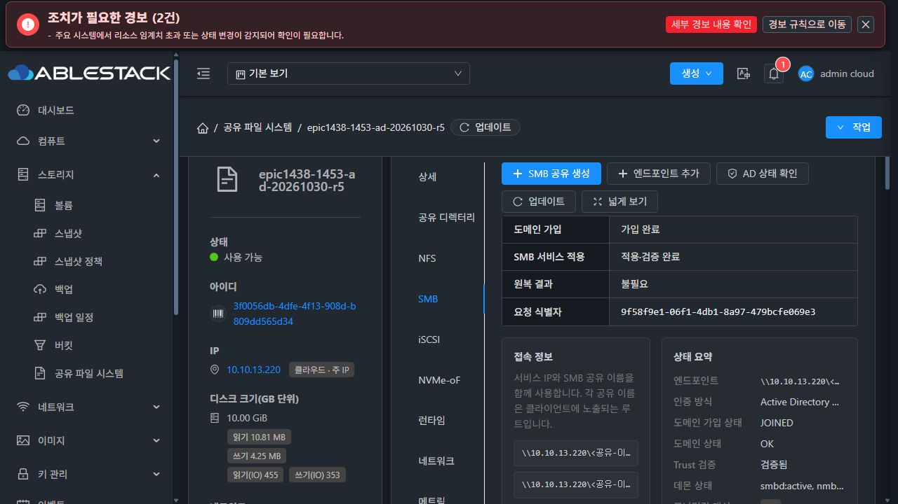
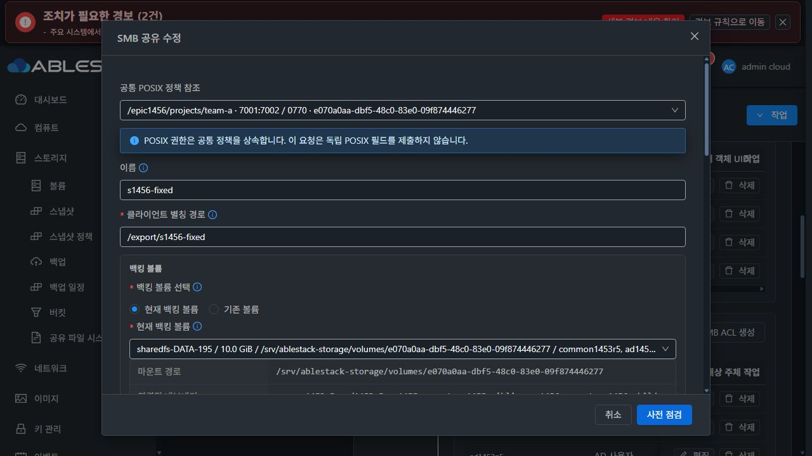
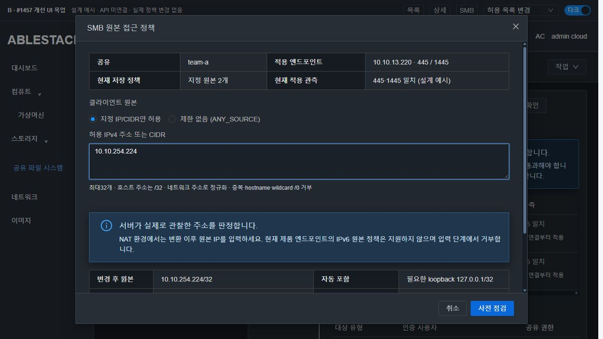
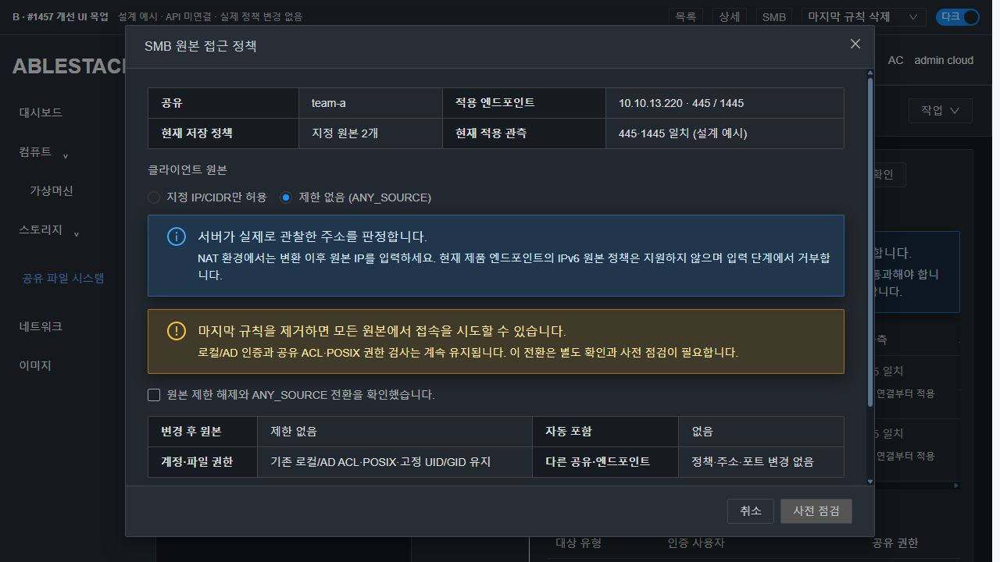
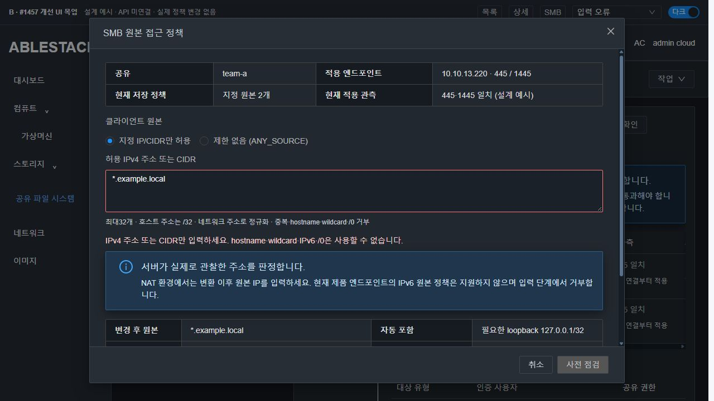
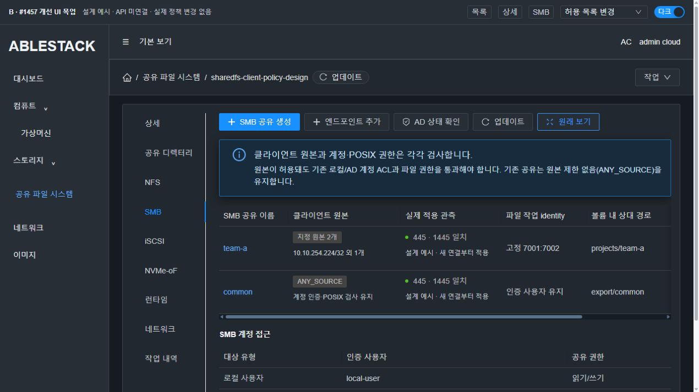
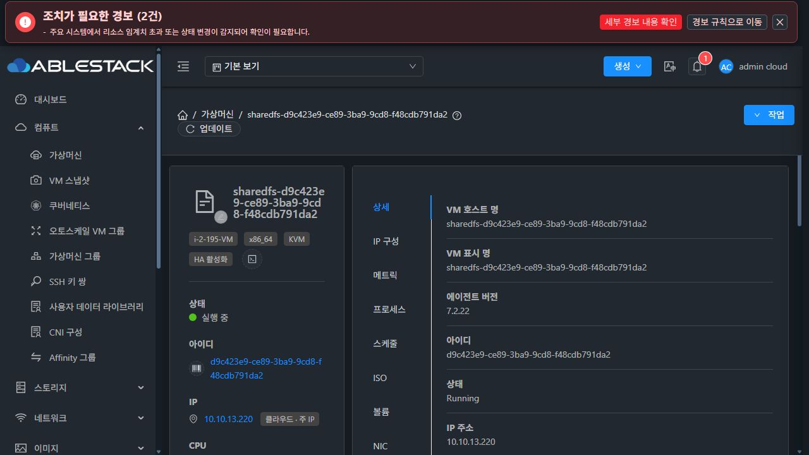
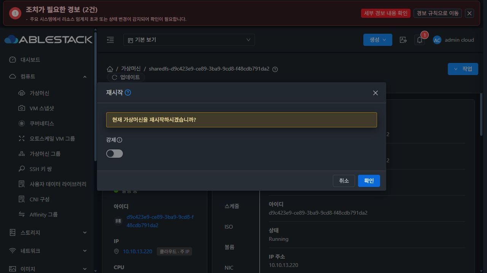

# #1457 코드 수준 설계 — SMB 공유별 클라이언트 IP/CIDR 허용 정책

2026-11-02 KST / Epic #1438 / 기존 브랜치 `epic/1438-sharedfs`.

**설계와 격리 사전 실증만 완료했습니다. 제품 구현·빌드·배포·기능 인수는 시작하지 않았습니다.** 이슈는 OPEN이며 인수5항목은 미체크로 유지합니다. 신규 이슈·기능 브랜치·목업 PR을 만들지 않습니다.

## 1. 범위와 현재 배포의 실측

목표는 **SMB 공유별 클라이언트 원본 정책을 계정 ACL과 독립적으로 관리**하는 것입니다. 로컬/AD 인증 공유는 원본 허용 AND 로컬/AD 계정 ACL AND 실제 POSIX 권한을 모두 만족해야 합니다. NFS 정책·네트워크 NIC·listener 전역 방화벽·AD 가입·고정 UID/GID를 다시 개발하지 않습니다.

- 시작 시 upstream/origin을 fetch하고 로컬 Europa를 먼저 갱신했습니다. local base/upstream divergence **0/0**, base **1c5b169cd6283da23cc3e155d4b6d14e39e42793**입니다. 작업 소스는 **e52dd63248e014cffafe7ebd99e0e2cd0c5813c9**입니다.
- 관리 JAR SHA **cda2c91bd86fc5accf79863be4a383cf3439f728c22b148908972c940624bb3f**. Manager/Coordinator/Preflight·기존 SMB policy helper2개·Create/Update Cmd·Response의 **8개 class**가 현재 WSL 컴파일 결과와 일치합니다.
- 실제 SystemVM `d9c423e9-ce89-3ba9-9cd8-f48cdb791da2 / i-2-195-VM / 13.2`, SharedFS `3f0056db-4dfe-4f13-908d-b809dd565d34`, instance `c1eca707-a554-4c42-85cd-1e9e9744d804`입니다.
- 활성 guest **1456.identity.1**, Samba **4.17.12-Debian**입니다. CLI·transaction/preflight·공통 디렉터리·고정 identity·protected updater의 **6파일 hash**가 현재 소스와 같습니다.
- 실제 소유 리스너 **445/PID1839, 1445/PID1854**, IP **10.10.13.220**. 두 소스의 global 및 기존 `common1453r5/s1456-fixed` 섹션에 `hosts allow/deny`는 비어 있습니다. 계정 ACL·고정7001:7002·admin users 빈 값은 기존 상태입니다.
- 실제 UI의 SMB 공유 편집에는 원본 정책 입력이 없습니다. 실제 UI 업데이트가 호출한 API는 HTTP200이며, `StorageSmbShareResponse.config`는 **JSON 문자열**입니다. 새 필드를 객체 응답으로 오인하지 않습니다.
- 볼륨 UI의 프로비저닝=sparse를 확인한 기존 **10GiB SPARSE XFS DATA e070a0aa-dbf5-48c0-83e0-09f874446277**, FS UUID **9c8ddfe9-3e23-46f0-9476-5c794b004841**를 사용했습니다. 디스크 생성·포맷·VM 재시작·MAC 변경0입니다.

[관리 class 무결성](evidence/management-before.json), [guest 소스 무결성](evidence/source-integrity.json), [실제 배포 관측](evidence/actual-systemvm-inventory.json), [현재 볼륨 UI의 sparse 정책](images/A-current-sparse-volume.jpg), [실제 UI API wire](evidence/actual-ui-api.json).

## 2. 확정하는 사용자 의미

| 입력/상황 | 동작 |
|---|---|
| 기존 config에 정책 없음 | ANY_SOURCE. 현재 계정 인증·공유 ACL·POSIX 권한은 유지 |
| CREATE의 clientcidrs 생략 | 기존 호환 기본값 ANY_SOURCE. 미게시/ACL 전 게시 보호 유지 |
| UPDATE의 clientcidrs 생략 | 기존 정책을 그대로 보존. 다른 옵션 수정이 원본 제한을 지우지 않음 |
| 명시적 JSON 배열 `[]` | ANY_SOURCE 전환 요청. 현재 규칙이 있으면 별도 확인 필수 |
| 빈 문자열·JSON null·다른 타입 | INVALID. 생략이나 제한 해제와 혼동하지 않음 |
| 허용 목록 있음 | 해당 공유의 허용 원본 + 필요한 IPv4 loopback만 허용, 그 외 거부 |
| 마지막 규칙 삭제 | UI의 전환 경고/명시 확인 + API confirmanysource=true + 기존 revision/ACK 보호 |
| hostname/wildcard/EXCEPT/ALL/제어문자 | 거부. DNS 조회나 smb.conf 원문 삽입을 하지 않음 |
| `0.0.0.0/0` | 거부. 전체 허용은 명시적 ANY_SOURCE 전환으로만 표현 |
| NAT | Samba가 관찰하는 변환 이후 TCP 원본 IP로 판정. 프록시 전달 헤더/변환 전 IP를 추정하지 않음 |
| 기존 연결 | **새 연결/새 tree connect 기준**. 이미 열린 연결은 자동 종료하지 않음. 즉시 철회는 기존 세션 확인/종료 기능의 별도 명시 작업 |
| IPv6 | 현재 제품 엔드포인트/제한 실증 범위에서는 미지원. 입력에서 분명히 거부하고, IPv6 노출이 있는 listener에 제한 정책을 허용하지 않음 |

ANY_SOURCE는 guest 허용이나 계정 ACL 제거가 아닙니다. 기존의 명시적 guestOk 설정은 바꾸지 않으며, 그 공유에서도 원본 제한과 guest 주체의 POSIX 검사를 우회할 수 없습니다. FIXED 모드의 기존 guest 금지는 그대로입니다. 제한 해제도 계정·POSIX를 넓히지 않습니다. 정책은 공유의 **모든 소유 SMB endpoint**에 적용하며 endpoint별로 서로 다른 원본 정책을 만들지 않습니다.

### IPv6를 지원한다고 가정하지 않는 이유

현재 Manager의 `resolveProtocolListenAddress():6228`는 구체 listen IP를 IPv4로만 검증합니다. 실제13번도 구체 IPv4 두 리스너입니다.

격리 native 시험에서 IPv6 연결 자체는 가능했지만, `fd00:1457::11/128 + loopback / hosts deny=ALL` 구성에서 비허용 `::12`도 쓰기에 성공했습니다. 설정 조회와 두 client의 IPv6 source route를 함께 보존했습니다. 이전 ANY_SOURCE와 같은 초의 파일 변경 가능성을 배제하려고 mtime을 분리한 측정에서도 같았습니다. **구성 파싱 성공을 IPv6 접근 차단 성공으로 취급하지 않습니다.** 현재 증거만으로 Samba 자체 결함이나 정확한 하위 원인을 단정하지 않습니다.

이번 기능은 IPv4로 한정합니다. 제한 정책의 preflight/guest 적용과 endpoint 변경 경로에서 **구체 IPv4 바인딩 + AF_INET6 비노출**을 확인합니다. wildcard/혼합/관측 불가 IPv6 listener에서는 `SMB_CLIENT_ACCESS_LISTENER_FAMILY_UNSUPPORTED`로 변경 전 차단합니다. 기존 ANY_SOURCE 공유의 listener/IPv6 동작을 전역으로 끄거나 바꾸지 않습니다. 향후 IPv6 endpoint 지원과 실제 거부 실증 전까지 UI/API의 지원 표시를 켜지 않습니다.

## 3. API·저장 계약 — 새 mutation API/DB DDL 없음

기존 `createStorageSmbShare/updateStorageSmbShare`와 기존 configuration coordinator·requestid/expectedrevision/impactack·작업 이력을 재사용합니다. 계정용 `createStorageSmbAcl`에 CIDR principal을 끼워 넣지 않습니다.

### 입력과 정규화

- 새 optional **clientcidrs**: `@Parameter(type=STRING,length=1024)`. 값은 JSON 문자열 배열, 최대32개입니다. IPv4의 최대 정규형32개도1024자 안에 들어갑니다.
- 새 optional **confirmanysource**: BOOLEAN. 비어 있던 정책에는 요구하지 않지만 기존 제한→빈 목록 전환에는 true가 필요합니다. 혼자 제출해 정책을 변경할 수 없습니다.
- API/guest는 IPv4 literal과 숫자 prefix만 파싱하며 DNS 해석 API를 쓰지 않습니다. IP는 /32, CIDR host bit는 network address로 정규화하고 숫자 IP/prefix 순서로 정렬합니다.
- 예: `["10.10.254.224","10.10.13.27/24"]` → `["10.10.13.0/24","10.10.254.224/32"]`.
- 정규화 후 정확한 중복은 거부합니다. 겹치는 subnet은 의미상 OR이고 허용하되 UI에서 중복 범위 안내를 합니다. 임의 병합으로 사용자가 입력한 범위를 바꾸지 않습니다.
- leading zero/비정상 prefix·multicast/unspecified·broadcast literal·zone scope·hostname·와일드카드·공백 삽입은 거부합니다. IPv6는 capability 제한으로 거부합니다.
- 기존 preflight intent4096자/byte 보호와 모든 JSON byte 제한은 유지합니다. 이 파라미터 외의 공통 제한을 늘리지 않습니다.

저장은 기존 `storage_file_share.config_json`의 optional 객체입니다. 실제 VO는 MEDIUMTEXT 매핑이며 새 table/column/migration은 없습니다.

```json
{
  "clientAccess": {
    "version": 1,
    "cidrs": ["10.10.254.224/32"]
  }
}
```

mode는 목록으로부터 도출합니다. 정책 부재/빈 목록은 ANY_SOURCE이며 UPDATE에서 생략한 필드는 유지합니다. raw hosts allow/deny나 확인 플래그는 저장하지 않습니다. 명시 해제는 정책 키 제거로 정규화할 수 있으나, 전환 확인은 **기존 제한 상태를 읽은 뒤** 먼저 검증해야 합니다.

```text
updateStorageSmbShare:
  id=<share>
  clientcidrs=["10.10.254.224/32"]
  requestid=<same logical request>
  expectedrevision=<observed instance revision>
  impactack=<matching preflight fingerprint>

제한 해제:
  clientcidrs=[]
  confirmanysource=true
  (위 revision/ACK 조건도 동일하게 필요)
```

전용 UPDATE는 원본 정책만 변경합니다. 새 파라미터와 이름/경로/identity/계정/생성 mask 등의 혼합 UPDATE는 `SMB_CLIENT_ACCESS_SEPARATE_REQUEST_REQUIRED`로 거부해 기존 full apply를 우회하지 않습니다. 기존 요청에 새 파라미터가 없으면 동작을 바꾸지 않습니다. CREATE는 초기 생성과 정책을 함께 설정할 수 있습니다.

## 4. 실제 코드 접점과 최소 변경

| 접점 | 구현 시 변경 |
|---|---|
| CreateStorageSmbShareCmd / UpdateStorageSmbShareCmd | 위 optional 필드/getter만 추가. 상위 setJobId()·기존 BaseStorageServiceConfigurationCmd 계약 유지 |
| 새 StorageSmbClientAccessPolicy.java | fields/parse/normalize/merge/effective/only/query/requireCapability를 한 helper로 모음. public request·후보 저장·preflight에서 같은 정규형 사용 |
| StorageServiceManagerImpl:1262 /1321 | CREATE typed merge. UPDATE에 network-only 분기를 기존 optionsOnly 앞에 추가. 경로·볼륨·계정·POSIX 변경 없이 candidate에 원본 정책만 반영 |
| Manager applySmbDesiredState / 기존 desired builder | 기존 share config를 그대로 전달. 제멋대로 계정 ACL이나 listener 전역 규칙으로 변환하지 않음 |
| StorageServiceConfigurationPreflight:commandIntent/parseIntent/observe | typed clientAccess intent와 target 공유·effective before/after·확인 의도를 지문화. 잘못된 정책은 BLOCKED, 통신/관측 장애는 UNKNOWN |
| Coordinator admission/plan | 현재 인스턴스 lease/revision/ACK/멱등성 재사용. requested policy 또는 기존 RESTRICTED 공유가 있으면 새 capability/protection을 요구 |
| Guest 새 smb_client_access.py | 숫자 정책 파서·render·owned profile 관측·정확한 단일 공유 diff·preview/snapshot/apply/verify/restore를 격리 |
| ablestack-storagectl:SMB renderer5172부근 | 게시되는 해당 share 섹션에만 검증된 hosts allow/deny 추가. loopback은127.0.0.1/32, public IP/전체127/8로 넓히지 않음. ANY_SOURCE에는 새 제한 directive를 추가하지 않음 |
| configuration_transaction.py:ProductionAdapter | network-only snapshot/적용/검증/원복 분기. 기존 SMB full apply·options-only·identity/계정·디렉터리 분기를 재작성하지 않음 |
| shared_directory_policy.py:SmbCreationPolicies | 이미 검증된 read_file/write_file/profiles/require_profiles/reload primitive를 새 helper가 재사용. 기존 SMB_OPTION_NAMES와 options-only 허용 범위는 넓히지 않음 |
| Guest inventory / StorageSmbShareResponse | 현재 배치 inventory에 optional clientAccess 관측 추가. list response에는 optional clientaccess JSON 객체를 채우고 config 문자열은 유지. 별도 QGA 호출을 share마다 추가하지 않음 |
| runtime_updater/bootstrap·서명 package | 새로운 helper와 호출부를 signed managed payload로 공급. baseline/protection과 capability 버전을 올리고 제한이 남은 downgrade·비호환 boot apply를 차단 |
| SharedFSTab.vue / 새 SmbClientAccessDialog.vue / 공통 fields·params helper | 기존 표/행 작업에 원본 정책 요약·전용 대화상자 추가. CREATE optional 입력 재사용. 미변경 값은 보내지 않으며 점검/실제 제출을 같은 params에서 생성 |

### Capability·관측의 정확한 계약

구현 시 protected baseline은 현재9에서 **10**으로 올릴 계획입니다. `configuration transaction capability`에 **smbClientAccessPolicyVersion=1**, **smbClientAccessPolicyProtectionVersion=1**, **smbClientAccessAddressFamilies=["IPv4"]**를 추가합니다. 기존 non-policy 요청에 새 필드를 강요하지 않지만, 요청/저장 상태에 제한 정책이 있으면 버전·보호·family 조건을 반드시 확인합니다. 서명 managed 파일 목록에 새 helper를 추가하고 실제 payload hash와 manifest/signature를 맞춥니다.

응답의 optional **clientaccess**는 예를 들어 `{mode:"RESTRICTED",cidrs:["10.10.254.224/32"],status:"CONFIG_VERIFIED",applyscope:"NEW_CONNECTIONS",profiles:[{ip:"10.10.13.220",port:445,status:"CONFIG_VERIFIED"}]}`입니다. 조회 불가/구성 불일치/지원 불가를 구분하고 현재 boot ID·관측 시각을 연결합니다. response의 기존 config 문자열과 상위 jobid는 그대로입니다. 실제 serializer를 거쳐 UI fixture를 생성합니다.

**onlineSmbClientAccess**는 새 전용 분기 표식입니다. flag만 신뢰하지 않고 payload 전체 의미 diff로 share1개의 clientAccess만 바뀌는지 재검증합니다. 기존 **onlineSmbOptions**와 그 허용 범위는 유지합니다. preflight fingerprint에는 target UUID·canonical policy·확인 의도·설정 revision·원본 base hash·소유 profile 신원·지원 family/적용 범위가 들어가며, UI/실제 command 양쪽이 같은 helper 결과를 사용해야 합니다.

### Guest 적용 불변식

전체 SMB apply에서는 payload를 읽은 직후, 기존 path_engine.prepare·계정/디렉터리 작업 **이전**에 모든 새 정책·capability/family를 검증합니다. 잘못된 정책이 먼저 디렉터리나 계정을 만든 뒤 실패하지 않도록 합니다.

1. RESTRICTED 예시는 해당 `[share]` 안의 `hosts allow = <정규형> 127.0.0.1/32`, `hosts deny = ALL`입니다. **[global]에는 쓰지 않습니다.**
2. 현재 base에 출처 불명의 global hosts 규칙·include/copy·대소문자 충돌/중복 섹션이 있으면 BLOCKED로 보존합니다. 값을 지워 성공시키지 않습니다.
3. before/candidate의 차이는 share1개의 clientAccess뿐이어야 합니다. 계정 ACL/passwordSupplied 관측·관측성 health/state 정규화는 기존 계약과 동일하게 제한하고 권한 필드는 무시하지 않습니다.
4. 소유 config의 no-follow/uid/mode/nlink·PID/executable/cmdline/starttime·profile topology/hash를 기존 primitive로 검증합니다.
5. candidate를 testparm으로 검증하고 단일 섹션의 두 파라미터만 atomic replace합니다. 나머지 공유 섹션·계정·DATA·POSIX·고정 identity/audit는 바이트/의미를 보존합니다.
6. **모든 소유 리스너 PID에 targeted reload-config/ping**을 전달합니다. 전체 smbd restart/전역 smbcontrol all/다른 listener 서비스의 종료를 하지 않습니다.
7. 결과는 CONFIG_VERIFIED 등 **소유 설정 관측의 출처**와 포트별 일치를 명시합니다. testparm 값만으로 실제 클라이언트 허용/거부까지 시험했다고 표시하지 않습니다.
8. 포트 일부 실패는 기존 durable operation에 최초 오류를 남기고 base/desired bytes를 복원한 뒤 소유 리스너를 reload·검증합니다. 신원이 바뀌면 기존 보호대로 차단/복구 필요를 표시하며 무조건 성공으로 만들지 않습니다.
9. 새 상태를 durable desired에 보존해 boot reconcile이 같은 정책을 재렌더링합니다. 기존 DATA 포맷/디렉터리 chown/chmod/ACL 조정은 없습니다.
10. 제한 정책이 남은 상태에서 capability 없는 runtime으로 downgrade하거나 IPv6가 노출되는 endpoint로 전환하는 경로도 변경 전 차단합니다. ANY_SOURCE의 기존 동작은 유지합니다.

미게시 공유는 기존 smb_publication_state/ACL 대기 판정을 재사용합니다. 저장 정책·ACL0·guest=false·모든 소유 섹션 부재가 일치할 때만 WAITING_FOR_ACL로 관측하고 정책 저장/수정을 허용합니다. ACL 등록 시 새 정책을 포함해 게시합니다. 게시된 섹션 누락·예상 밖 게시·관측 실패는 계속 차단합니다. 대기 상태를 CONFIG_VERIFIED나 접속 성공으로 표시하지 않습니다.

옵션 전용 온라인 갱신이 hosts 파라미터를 삭제하지 않는지, 계정 ACL·endpoint 생성/변경·부팅 full renderer가 제한을 누락하지 않는지를 회귀에 넣습니다. 새 정책을 처음 만드는 경로만 시험하지 않습니다.

## 5. SystemVM 사전 주입 실증 — 구현 전 타당성 확인

실제 위 SystemVM에서 **private mount+network namespace**를 사용했습니다. /etc와 Samba passdb/state는 RAM overlay이고 두 client network namespace·veth/bridge는 외부망에 연결하지 않았습니다. 시험 파일만 기존 SPARSE DATA의 임의 전용 디렉터리에 만들고 제거했습니다. 실제 계정·공유·포트/리스너에는 적용하지 않았습니다. VM MAC을 설정하거나 변경하지 않았습니다.

**31개 검사/관측 중 기능/보존30개 PASS + IPv6 지원불가 판단용 관측1개**입니다. IPv6 비허용 접속이 성공한 결과를 통과한 거부 시험으로 세지 않습니다.

- 원본2개(10.145.7.11/.12), 실제 Samba 리스너445/1445에서 ANY_SOURCE의 두 원본 허용.
- /32 제한에서 허용 원본 쓰기/읽기 성공, 비허용 원본 거부. 두 포트 일치.
- 실제 /24 CIDR에서 두 원본 허용. 숫자 literal·정규화/중복·hostname/wildcard/삽입/0-prefix 거부의 설계 예시 확인.
- 원본이 허용돼도 미허용 계정은 거부, 허용 계정이어도 고정7001:7002의 POSIX가 root0700 경로에 쓰지 못함.
- 다른 공유의 C2 접속 유지, 해당 섹션 bytes와 두 소유 프로세스 유지.
- 명시적 loopback 접속. 제한 C1→C2 변경 뒤 새 C1 접속 거부/새 C2 허용, **이미 연결한 C1 tree의 쓰기는 유지**.
- 첫 리스너 reload 후 제어된 두 번째 실패를 모사하고 이전 bytes/reload로 허용·거부 복원. 이것은 private rollback 가능성 실증이며 제품 coordinator 원복 인수 완료가 아님.
- 빈 목록에서 두 원본 허용, private daemon 재시작 후 제한 재적용·기존 파일 내용/owner/mode/inode 보존.
- IPv6 source route·실제 정책 조회와 비허용 쓰기 성공을 확인하여 지원 표시를 보류했습니다. mtime 분리 후도 같았으므로 단순 동일 초 갱신 문제로 단정하지 않습니다.

시험 후 기존 **54객체 + 이전 중첩19객체 + 현재22객체**, 계정4파일·desired/config·registry·active files·실제 리스너 PID·FS·boot ID·MAC이 모두 불변입니다. 주입 파일·시험 데이터·private daemon·namespace/overlay를 정리했습니다.

[격리 시험 코드](evidence/native-prototype.py), [검사/IPv6 관측](evidence/native-summary.json), [최초 IPv6 예상 거부와 실제 결과](evidence/native-initial-ipv6-observation.json), [mtime 대조 이전 관측](evidence/native-measured-before-barrier.json), [실제 서비스 보존 대조](evidence/preservation.json).

이 시험은 새 제품 API→DAO→UI·실제13번 두 클라이언트·실제 SystemVM 재부팅의 인수를 대체하지 않습니다. 아직 그 단계는 진행하지 않았습니다.

## 6. UI 설계 — A/B/S를 명확히 구분

**A는 현재13번 실제 UI, B는 Vue3+AntD API 미연결 목업, S는 실제 컴퓨트>가상머신 표준**입니다. 목업의 예시 상태·revision·접속 결과를 실제 서비스 결과와 섞지 않습니다.

- 현재 VM과 같은 Breadcrumb/업데이트/작업 영역, ResourceLayout 좌측 정보 카드와 우측 세로 탭을 사용합니다. 상세 탭에는 정보를 보여주며 작업 섹션을 넣지 않습니다.
- 목업 표는 추가 필드 중심의 발췌이며 기존 mask·UNC·볼륨 등 전체 열을 삭제하는 설계가 아닙니다. SMB 표에 원본 모드/개수·포트별 소유 설정 관측 요약을 추가하고 행의 ‘원본 접근 정책’으로 관리합니다. 계정 ACL은 기존 별도 영역을 유지합니다.
- 추가 탭 타이틀 없음. 주 툴바는 파란 ‘SMB 공유 생성’이 좌측 첫 버튼, 아이콘+‘업데이트’, ‘넓게 보기’는 **같은 좌측 버튼 그룹 마지막**입니다.
- 전용 MoldDialog의 제목은 헤더, 취소/사전 점검/변경 적용은 푸터에 고정하고 본문만 스크롤합니다. 기존 생성 폼의 다른 항목/배치는 유지하고 optional 원본 입력만 공통 fields로 추가합니다.
- 저장 정책·변경 후 정규형·포트별 관측·관측 불가·실패 원복을 구분합니다. ANY_SOURCE는 ‘계정 인증 유지’를 같이 표시합니다.
- 마지막 규칙 삭제는 경고와 전환 확인 체크가 있어야 사전 점검할 수 있습니다. 이 확인은 실제 제출과 동일 intent를 만들 때 포함되며 점검 이후 입력 변경 시 ACK를 폐기합니다.
- NAT 이후 주소·loopback 자동 포함·새 연결 적용/기존 세션 유지·IPv6 미지원/리스너 제약을 안내합니다. 새 세션 강제 종료 기능을 이 이슈에서 만들지 않습니다.
- 본문/섹션 간격16px, 툴바8px, 실제 테마 CSS 토큰을 사용합니다. 다크 본문/도움말/경고 대비 **11.12/9.18/9.19:1**입니다.
- 실제 목업에서 header top33·footer top622가 본문 스크롤 전후 같고 body scrollTop이0→248로 증가했습니다. 라이트/다크·좁은 탭/넓게 보기·오류/제한 해제 상태를 확인했습니다.
- 전면 UI 정리 #1468은 착수하지 않습니다.

### A · 현재 실제 UI — 원본 정책 입력이 없음




### B · 개선 목업 — 공유별 정책과 세션 적용 범위






### S · 실제 VM 표준




[라이트](images/B-policy-light.jpg) / [스크롤 후 고정 영역](images/B-policy-dark-scrolled.jpg) / [관측 불가](images/B-unknown-dark.jpg) / [실패 원복](images/B-rollback-dark.jpg) / [목록](images/B-list-light.jpg) / [정보 상세](images/B-details-dark.jpg) / [초기 생성에 추가할 영역](images/B-create-light.jpg).

[로컬 검토용 목업](http://localhost:8797/index.html?view=smb&dialog=policy&theme=dark). [재현용 Vue/빌드 소스](mockup/App.vue). 이 목업을 위한 별도 PR은 만들지 않습니다.

## 7. 구현 후의 시험·배포·중단 조건

| 층 | 반드시 확인할 경로 |
|---|---|
| API/DTO/DAO | literal/정규화·중복·생략/빈 배열/마지막 확인·IPv6/hostname/wildcard 거부. 실제 API 입력 바인딩→공통 helper→candidate→전용 실제 DAO 저장·재조회·기존 config 보존·실제 serializer fixture |
| UI 컴포넌트 | 실제 SharedFSTab/전용 Dialog의 점검·submit 공통 params와 실제 API commandIntent/guest 지문 동등성. 생성/생략/빈 목록/명시 확인·ACK 만료/입력 변경·BLOCKED/UNKNOWN·Boolean/상위 jobid 계약 |
| Guest | 실제 SystemVM의 capability/주입 뒤 parser·renderer·목록 무관측 실패 안전·section/global 경계·두 소유 포트·IPv6 노출 차단. mask-only/ACL/full apply/boot에도 hosts 정책 보존 |
| Transaction | 같은 요청/동시 요청·stale revision·중복 POST·첫/두 번째 reload 실패·원복/관측 실패·진단/보호 상태 보존. 계정/DATA/다른 share/endpoint 변경0 |
| 실제 UI·클라이언트 | UI에서 전용 공유 정책 설정→C1 허용/C2 거부→실제 CIDR 변경→역전/철회→마지막 규칙 해제 확인→계정/POSIX 교차→두 포트/다른 공유 보존 |
| 세션/NAT | 기존 연결 유지/새 연결 거부를 별도로 시험. 변환 후 원본 관측이 필요한 NAT 경로를 준비해 확인하며 private source-route 측정으로 대체하지 않음 |
| 부팅·배포 | 변경 모듈·signed guest/보호 baseline 공급 후 실제 UI VM 재시작·원래 IP/두 포트·원본 정책/이력·데이터/권한 보존. 신규 이미지/VM을 시험했다면 Ready/출처·디스크 provisioning을 별도로 증명 |

구현 순서는 typed 계약/서명 capability → 실제 SystemVM private 주입 보완 → API/DAO·wire/컴포넌트 회귀 → 모듈 빌드/13번 최소 배포 → 실제 UI/두 클라이언트/재시작 인수 → 기록/기존 Epic PR 반영입니다. 디스크는 SPARSE 이상, MAC은 Mold 정책을 그대로 사용합니다.

제품 오류가 나타나면 증거와 원인/개선 방향을 분석한 뒤 중단합니다. 시험 입력·주입 코드·사전 점검 실수는 스스로 바로잡되 같은 제품 실패를 감춘 채 반복하지 않습니다. 현재는 **설계 완료·제품 미구현·미인수**이며 다음 구현 지시를 기다립니다.

## 참고한 공식 계약

공유 섹션과 global의 hosts 정책 범위·계정 인증의 별도 필요성은 [Samba smb.conf 공식 문서](https://devel.samba.org/samba/docs/current/man-html/smb.conf.5.html#HOSTSALLOW)를, reload/지정 공유 연결 종료의 구분은 [smbcontrol 공식 문서](https://devel.samba.org/samba/docs/current/man-html/smbcontrol.1.html)를 참고했습니다. 실제4.17.12 동작과 이번 native 증거를 우선하여 지원 범위를 정했습니다.
