# #1458 SharedFS 고유 백킹 용량 — 코드 수준 설계

작성: 2026-11-02 / 상위 Epic #1438 / 상태: **설계·사전 실증 완료, 구현·배포·제품 인수 미착수**.

이 문서는 #1458의 집계·표시 범위만 다룬다. 이 디렉터리의 Vue 목업과 격리 시험은 제품 구현이 아니다. #1458의 네 인수 항목은 구현 후 검증하기 전까지 미완료로 둔다.

## 1. 기준 코드와 실제 배포 확인

- 작업 트리: WSL `/root/work/ablestack-cloud`, 브랜치 `epic/1438-sharedfs`.
- fetch 후 로컬 `ablestack-europa`를 `50d666d1113ddbc50f0b632eb69e0d72d82faba4`로 갱신했다. 로컬 base와 upstream 차이는 0/0이다.
- 기존 Epic 브랜치를 로컬 base에 `--rebase-merges`로 반영했다. 설계 직전 HEAD: `4dccae0b9fc89a96ecfc691e90e7fd09f921f61c`.
- 13번 관리 서버 JAR의 SharedFSServiceImpl, SharedFSJoinDaoImpl, SharedFSResponse, StorageServiceManagerImpl 클래스 SHA-256이 로컬 target의 동일 클래스와 각각 일치한다. 전체 JAR 또는 최신 UI 전체가 새 base와 동일하다고 확대 해석하지 않는다.
- 배포 JAR SHA-256: `c34b3ec27fe163b6b2246ec46d4f835907d3bf71f12c16d5299f32134250a458`.
- 배포 UI index SHA-256: `f68719a8d5e9984218d813b367227b177c1a977b6b1df9583cdb85ef8f14b95e`.
- 실제 활성 CLI·monitor도 해당 원본 코드와 비교했다. 모듈 빌드, 제품 배포, 활성 CLI 수정은 이번 설계에서 하지 않았다.
- 실제 SharedFS: `3f0056db-4dfe-4f13-908d-b809dd565d34`, VM `d9c423e9-ce89-3ba9-9cd8-f48cdb791da2` / i-2-195-VM / 13.2.
- DATA: `e070a0aa-dbf5-48c0-83e0-09f874446277`, **10 GiB SPARSE XFS**. ROOT도 SPARSE이다. 기존 파일·설정·권한·IP·MAC을 보존했다.

근거: [배포 무결성](evidence/integrity.json), [실제 UI 응답 발췌](evidence/actual-ui-api-excerpt.json), [보존 비교](evidence/preservation.json).

## 2. 실제 문제와 발생 경로

### 최초 볼륨만 보이는 이유

`api/.../response/SharedFSResponse.java`의 기존 `size`와 `sizegb`는 초기 DATA 하나를 표현한다. `sizegb`는 숫자가 아니라 실제 API에서 `"10.00 GiB"`인 문자열이다.

`server/.../sharedfs/query/dao/SharedFSJoinDaoImpl.java:143-152`는 이 한 볼륨과 디스크 오퍼링 크기로 응답을 만든다. 기반 `shared_filesystem.volume_id`와 `shared_filesystem_view`도 초기 볼륨 하나의 관계다. `ui/src/config/section/storage.js:874-894`는 목록/상세에 이 `sizegb`를 연결한다. 추가 DATA를 붙이거나 여러 공유가 같은 DATA를 참조해도 전체 고유 용량으로 바뀌지 않는다.

`InfoCard.vue:513-528`의 일반 크기 렌더링도 이 필드를 사용한다. `virtualsize/physicalsize`는 초기 볼륨의 하이퍼바이저 할당 통계이지 파일시스템 사용량이 아니다.

### 현재 사용량을 그대로 더하면 안 되는 이유

실제 UI가 요청한 `listVolumes` 응답의 DATA `usedfsbytes`는 **1,956,667,392 bytes**였다. 같은 시점 SystemVM의 고유 XFS `statvfs` 사용량은 **108,703,744 bytes**였다. 같은 UUID/device의 마운트 별칭이 18개이며, 두 값은 정확히 **18배** 관계다.

- `LibvirtComputingResource.java:6111-6174`: QGA mount별 파일시스템 통계를 serial로 묶으면서 사용량을 더한다.
- `StatsCollector.java:1558-1569`: 결과를 `volumes.used_fs_bytes`에 저장한다. 이 값만으로 최신 관측 시각도 판별하기 어렵다.
- `ablestack-storage-monitor:87-180 collect_capacity()`: 현재 `seen_targets`는 같은 target 중복만 제거한다. 같은 FS의 다른 target은 각각 남는다. 실제 cache에도 별칭 기준 항목 8개가 있었다.

**#1458에서 공통 VM/QGA/볼륨 통계 자체를 수정하지 않는다.** SharedFS 집계가 이 값을 재사용하지 않도록 하고, 고유 FS 관측을 별도로 읽는다. 블록 할당량을 FS 사용량으로 대체하지 않는다. 공통 볼륨 화면의 수치 교정은 이 과제의 구현 범위가 아니다.

### UI의 실제 사용자 설정도 보존해야 한다

소스 기본 열은 sizegb를 포함하지만 현재 로그인 사용자의 저장된 열 선택에는 ‘크기’가 해제돼 있었다. 이를 UI 누락이라고 단정하지 않았다. [현재 선택 증거](images/A-current-columns-hidden-size.png). 새 용량 열을 넣으면서 사용자 설정을 일괄 초기화하지 않는다.

## 3. 집계 계약

### 서로 다른 두 집계 단위

1. **프로비저닝**: 권한이 확인된 SharedFS SystemVM의 현재 연결 DATA를 Volume UUID로 중복 제거한 논리 크기 합. 기본+추가, 파일+raw block, 공유 참조가 없는 연결 DATA, 관리용 숨김 DATA도 포함한다. ROOT와 분리 보존 DATA는 제외한다.
2. **관측 FS 사용량**: 위 DATA에 정확히 매핑되고 실제 마운트된 고유 파일시스템의 `statvfs` 값. `(filesystem UUID, device identity/st_dev/MAJ:MIN)`로 중복 제거한다. FSROOT는 별칭을 물리 경로에 매핑하는 정보이며 중복 제거 키에 넣지 않는다. UUID가 같은 별도 장치는 합쳐 버리지 않는다.

`VolumeVO.instanceId`, type, removed, state를 함께 판단한다. Ready DATA는 attached 날짜가 비어 있는 기존 행도 지원한다. Destroy/Destroying/Expunging/Expunged/removed 행은 현재 합계에서 제외한다. Creating/Attaching은 ‘연결 전환 중’으로 구분하고 확정 합계에 섞지 않는다. Snapshotting/Resizing/Migrating 등은 단순히 transient라는 이유로 연결된 DATA를 빼지 않고 membership/크기 변화와 함께 판단한다. 실제 enum은 Destroy이며 가상의 Destroyed 상태를 사용하지 않는다.

raw block에는 FS 사용률을 만들지 않는다. 파일시스템이 없는 블록 DATA는 사용량 **UNSUPPORTED/null**, 알려진 FS가 마운트되지 않았거나 신원 확인이 안 되면 **UNAVAILABLE/null**이다. 파일을 backing으로 쓰는 LUN이 이미 관측된 FS에 있으면 그 FS를 한 번만 포함한다. LUN 크기나 쓰인 sector 수를 FS 사용량으로 더하지 않는다.

### 제안 응답: 기존 필드 보존 + 구조화된 capacity 추가

`SharedFSResponse`에 전용 응답 DTO를 추가한다. JSON 문자열을 중첩하지 않는다.

~~~json
{
  "size": 10737418240,
  "sizegb": "10.00 GiB",
  "capacity": {
    "version": 1,
    "initialvolumebytes": 10737418240,
    "provisionedbytes": 42949672960,
    "volumecount": 3,
    "provisioningstatus": "CURRENT",
    "filesystemusedbytes": 108703744,
    "filesystemtotalbytes": 10670309376,
    "filesystemcount": 1,
    "observedvolumecount": 1,
    "unsupportedvolumecount": 1,
    "unobservedvolumecount": 1,
    "usagestatus": "PARTIAL",
    "observedat": "2026-11-02T00:00:00Z",
    "collectedat": "2026-11-02T00:00:02Z"
  }
}
~~~

위 수치는 **응답 형식 예시**다. initialvolumebytes는 ‘초기에 연결한 기본 볼륨의 현재 크기’이며, 저장돼 있지 않은 과거 생성 시점 크기를 새로 추정하지 않는다. 기존 size/sizegb/volumeid/VM 관계는 변경하지 않는다.

| 상태 | 처리와 UI |
|---|---|
| CURRENT | 현재 membership과 일치하는 지원 FS 전체 관측 |
| PARTIAL | 관측된 FS 합과 범위, 미지원/미관측 수를 함께 표시. 전체 서비스 사용률로 오인시키지 않음 |
| STALE | membership이 같은 과거 값만 ‘이전 관측’과 시각으로 표시 |
| UNAVAILABLE | 아직 관측 없음/통신 실패/해석 실패. 사용량은 — |
| UNSUPPORTED | runtime 미지원 또는 전부 raw. 사유와 — |
| TRANSITION | 연결·분리·크기·VM 교체로 snapshot 불일치. 과거 사용량을 현재 값으로 재사용하지 않음 |

프로비저닝 상태는 CURRENT/TRANSITION/UNAVAILABLE로 분리한다. DB가 아는 현재 연결 크기는 guest 사용량을 못 읽어도 표시할 수 있지만, ‘관리 기준 연결 용량’과 guest 관측 시각/상태를 혼동하지 않는다. 검증된 실제 연결과 DB membership 불일치는 TRANSITION이다.

filesystemcount는 고유 FS 수, observedvolumecount는 FS 관측이 연결된 고유 DATA 수다. raw를 FS 개수의 분모에 넣지 않고 UI는 ‘고유 FS N개 · DATA M/K 관측’으로 구분한다.

미측정 null과 실제 측정 0을 구분한다. CloudStack API 직렬화가 null 필드를 생략하는 경우도 UI는 undefined/null로 처리하며 truthy 검사로 0을 버리지 않는다. 합산은 `Math.addExact` 또는 동등한 overflow 검증을 사용한다. 실패는 null+명시 상태로 남기고 wrap/조용한 0을 허용하지 않는다.

## 4. 서버 설계 — 페이지 단위 집계, 목록에서 원격 호출 없음

새 `SharedFSCapacityService`와 collector/cache를 SharedFS 패키지에 둔다. 기존 공유 생성/권한/포맷/원복 coordinator는 변경하지 않는다.

### 응답 경로

- `SharedFSServiceImpl.searchForSharedFS()`의 기존 권한 필터와 페이지 선택 뒤, 해당 페이지의 VM ID 집합만 집계기로 전달한다. retrieveOnlyCount에서는 생략한다.
- `VolumeDao/Impl`에 `listCurrentDataByVmIds(Collection<Long> vmIds)` 계열의 **batch 조회**를 추가한다. VM ID IN + DATADISK + removed NULL을 기본으로 가져오고 상태 분류는 집계기에서 한다. display_volume=true 필터는 넣지 않는다. 과도한 IN은 일정 크기 chunk로 분할한다.
- 기존 SharedFSJoinDao의 1볼륨 필드를 그대로 두고, 한 번 산출한 aggregate를 response UUID에 매핑한다. `ApiResponseHelper.createSharedFSResponse()`의 단건 응답도 같은 집계기의 singleton 경로를 사용한다.
- 페이지당 새 볼륨 SQL은 1회/제한된 chunk 수이며 **볼륨별 findById, 원격 조회, share join은 추가하지 않는다**. 기존 목록 자체의 unrelated 조회 구조까지 전면 재작성하지 않는다.
- 목록 요청에서는 QGA/RPC/df/lsblk를 호출하지 않는다. 메모리 cache를 읽기만 하고 요청마다 collector 작업을 enqueue하지 않는다.

### 관측 수집

- lifecycle이 있는 `SharedFSCapacityCollector`를 기존 Spring server manager context에 등록한다.
- 기본 주기 예시 60초, stale 기준 예시 180초. 최대 4 worker, bounded queue, VM별 coalescing/jitter, 실패 backoff를 둔다. 값은 전용 configuration으로 조정하고, 목록 사용자 수나 공유 개수에 비례해 동일 VM을 중복 조회하지 않는다.
- 기존 `StorageServiceGuestCommandDispatcher`에 **inventory** read-only command를 보낸다. 기존 내부 payload 경로를 사용하므로 새 REST/host operation/agent jar는 필요 없다.
- 실제 `StorageServiceGuestCommandDispatcherImpl`는 VM의 현재 host를 찾아 기존 host command를 전송한다. collector는 DB로 확인한 SharedFS↔StorageServiceInstance↔VM 관계만 사용한다. 사용자 입력 VM ID를 무권한 수집 대상으로 받아들이지 않는다.
- collector가 읽은 현재 DATA 목록의 fingerprint를 수집 전후 비교한다. 정렬된 volume UUID/VM ID/device ID/size/소유권/정규화한 membership state/attached 시각을 포함한다. share 참조 수나 config revision은 용량 membership이 아니므로 fingerprint에 넣지 않는다.
- 수집 도중 attach/detach/resize/VM 교체가 있거나 목록 시점 fingerprint가 다르면 TRANSITION. 새 snapshot이 확인되기 전에는 이전 사용량을 현재 값으로 게시하지 않는다.
- guest bootId/관측 시각, 서버 collectedAt을 함께 저장한다. 시계 이상·허용 범위를 넘는 future timestamp는 신선한 값으로 보지 않는다.
- cache는 노드별 메모리와 TTL이다. 관리 서버 재시작 직후 미관측을 표시한 뒤 첫 주기 관측으로 회복한다. **파생 통계를 위해 새 DB 테이블·migration을 만들지 않는다.** 다중 관리 서버의 관측 시각은 서로 다를 수 있으며 노드별 bounded collector로 부하를 제한한다. 삭제된 VM cache는 회수한다.

### 권한과 상세 근거

- 먼저 현재 사용자에게 허용된 SharedFS 페이지/단건만 선택하고 해당 서비스의 허용 VM·소유권 범위로 DATA를 제한한다.
- display_volume=false는 표시 플래그일 뿐 접근권한을 대체하지 않는다. 서비스 소유자의 관리 숨김 DATA는 포함하되, 타 계정의 볼륨 이름/UUID/크기를 노출하도록 일반 listVolumes 권한을 넓히지 않는다.
- 예외적인 교차 소유권으로 합계가 불완전하면 전체라고 오인할 부분 합/숨은 개수를 게시하지 않고 프로비저닝 UNAVAILABLE와 일반 사유를 낸다.
- `ListSharedFSCmd`에 기본 false인 `includecapacitydetails` Boolean을 추가한다. true는 id가 지정된 단건에서만 허용한다. 목록 응답은 summary만 담는다.
- 단건에서만 `capacity.volumes[]`에 권한 내 DATA의 크기/관측 여부/연결 상태/공유 참조 수/시각을 담는다. 참조 수는 기존 instance별 fileShare/blockTarget DAO 조회를 재사용하며 합산 대상을 거르는 조건으로 쓰지 않는다. 참조 수를 볼륨별 SQL로 구하지 않는다.
- 캐시 내부 전체 block tree, 다른 DATA/ROOT 정보, guest 실제 경로를 일반 사용자 응답에 흘리지 않는다.

## 5. SystemVM 설계 — 기존 signed monitor/CLI의 읽기 경로만 확장

현재 host wrapper의 inventory 경로(`LibvirtStorageServiceHostCommandWrapper.java:205-214`)는 이미 payload 파일을 CLI 두 번째 인자로 전달한다. 현재 CLI inventory case는 이 인자를 사용하지 않는다.

~~~text
기존: inventory {} → 기존 runtime_inventory (유지)
추가: inventory {"capacityOnly":true,"volumes":[{"uuid":"…","size":…}]}
      → capacity cache에서 해당 DATA의 관측만 반환
~~~

- 변경 파일은 기존 관리 대상 `ablestack-storage-monitor`와 `ablestack-storagectl` 두 개다. 신규 helper·신규 host operation은 만들지 않는다.
- monitor collect_capacity는 lsblk/findmnt snapshot을 각각 한 번 읽고, FSROOT/UUID와 stat device/inode로 alias를 해석한다. 고유 FS당 statvfs 한 번만 수행한다.
- 기존 `capacity[]/count`의 target별 설명 정보는 유지하되, 중복 없는 filesystem snapshot을 추가한다. 기존 루트 `schemaVersion=1`을 유지하고 additive `capacitySnapshotVersion=1` marker로 신기능을 구분한다. 기존 atomic write_json의 generatedAt/Epoch·staleAfterSeconds를 재사용한다.
- CLI의 capacityOnly 경로는 cache만 읽는다. stale/missing이면 그대로 상태를 반환하며 무거운 live inventory로 fallback하지 않는다. 정상 empty inventory와 기존 진단 경로는 그대로 둔다.
- `volume_identity.resolve_volume_device(blockdevices, volume_uuid=…, expected_size=…, allow_blank_size_fallback=False)`로 Cloud UUID/size를 매핑한다. 실제 serial이 20자로 줄어든 현재 DATA도 기존 VOLUME_SERIAL 경로로 일치했다. 신원이 불명확하면 결과를 만들지 않는다. ROOT 제외 보호를 유지한다.
- raw/미마운트/장치 불일치는 개별 null+사유로 표현한다. 어떤 경우에도 format/mount/chown/chmod/재게시를 수행하지 않는다.
- 기존 12개 signed MANAGED_FILES 안에 monitor와 CLI가 이미 들어 있다. 구현 후 변경 payload의 manifest·서명·배포 profile은 기존 정상 절차로 재생성하며 baseline/configuration protection을 완화하지 않는다.
- 구 runtime은 payload를 무시한다. capability marker가 없으면 새 서버는 UNSUPPORTED로 처리하면서 DB 프로비저닝과 기본 볼륨 크기를 표시한다. 구 서버에는 새 UI가 기본 볼륨만 명시하고 전체 합계라고 추정하지 않는 fallback을 둔다.

## 6. UI 설계 — VM 표준, 읽기 전용 용량 근거

현재 문제 화면 **A**, 개선 목업 **B**, 비교 표준 **S(컴퓨트 > 가상머신)**을 구분했다. B의 자원/수치/상태 선택기는 설계 예시이며 API에 연결되지 않는다.

| 표면 | #1458 변경 |
|---|---|
| 목록 | ‘스토리지 용량’ 한 셀에 고유 DATA 프로비저닝+개수, 관측 FS 사용량+범위, 시각+상태. 기본 볼륨 현재 크기는 별도 선택 열 |
| Breadcrumb | 실제 Breadcrumb 컴포넌트와 VM의 영역/업데이트 배치 유지 |
| InfoCard | SharedFS에만 total/usage/count 분기. 일반 VM/Bucket/Volume 카드 유지 |
| 상세 탭 | 기존 정보 행 스타일에 용량 정보를 표시. 생성/연결/분리 작업 영역을 넣지 않음 |
| 용량·볼륨 세로 탭 | summary와 전체 연결 DATA inventory, 이름 검색, 참조/지원 범위/관측 시각. 공유 참조가 없어도 행과 합계가 유지 |
| 탭 버튼 | 왼쪽 ‘업데이트’(reload 아이콘)·‘집계 기준’. 읽기 전용 탭에 불필요한 파란 변경 액션이나 넓게 보기 버튼 추가 없음 |
| 안내 대화상자 | 실제 MoldDialog 사용. 제목 header·닫기 footer 고정, body만 스크롤. 신규 자원 작업/승인 흐름 없음 |

- 목록 생성 액션은 기존대로 파란 primary를 가장 왼쪽에 둔다. 프로토콜 탭의 기존 넓게 보기와 작업 순서는 바꾸지 않는다.
- `storage.js`의 SharedFS 기본열/선택열만 수정하고 `ListView.vue`에는 SharedFS 전용 capacity cell renderer를 연결한다. 객체 문자열화/문자열 크기 정렬을 하지 않는다. 서버 페이지 전체를 정렬할 수 없는 snapshot 열에 전역 정렬인 것처럼 sorter를 제공하지 않는다.
- `AutogenView.vue:1978-1999`의 저장된 customColumns는 보존한다. 구 기본열과 정확히 같은 저장값만 새 기본열로 1회 변환하고, 실제 사용자 편집값(현재처럼 size 숨김 포함)은 유지한다. 새 열은 선택기에 제공한다. VM 등 다른 route 설정은 변경하지 않는다.
- Autogen 상세 요청에서 `apiName === listSharedFileSystems && dataView && id`일 때만 includecapacitydetails=true. 그 한 응답의 capacity를 InfoCard와 전용 탭에 공유한다. 기존 프로토콜별 backing loader 전체를 이 과제에서 다시 쓰지 않는다. **새 용량 UI는 볼륨별 API를 추가하지 않는다.**
- `SharedFSTab.vue`는 새 capacity tab/props의 읽기 전용 경계만 추가하고 기존 NFS/SMB 생성·편집·보호 로직은 변경하지 않는다.
- 실제 Mold Vue3 + AntD, Breadcrumb, ResourceLayout, MoldDialog와 VM 상세 행 스타일·현재 theme tokens를 사용한 [목업 소스](mockup/)를 제공한다. 16px section 간격, 8px 버튼 간격, 수직 탭, 넘치는 inventory의 수평 스크롤을 따른다. 별도 탭 제목을 중복하지 않는다.
- 다크모드에서는 primary/secondary/link의 theme token을 쓰고 밝은 background 하드코딩을 하지 않는다. 상태는 색 외 텍스트/시각/범위로 구분한다.
- 이 과제에서 새로 또는 직접 변경하는 용량 관련 UI만 맞춘다. #1468 전체 UI 정리를 앞당기지 않는다.

### A — 현재 문제 UI (실제 13번)

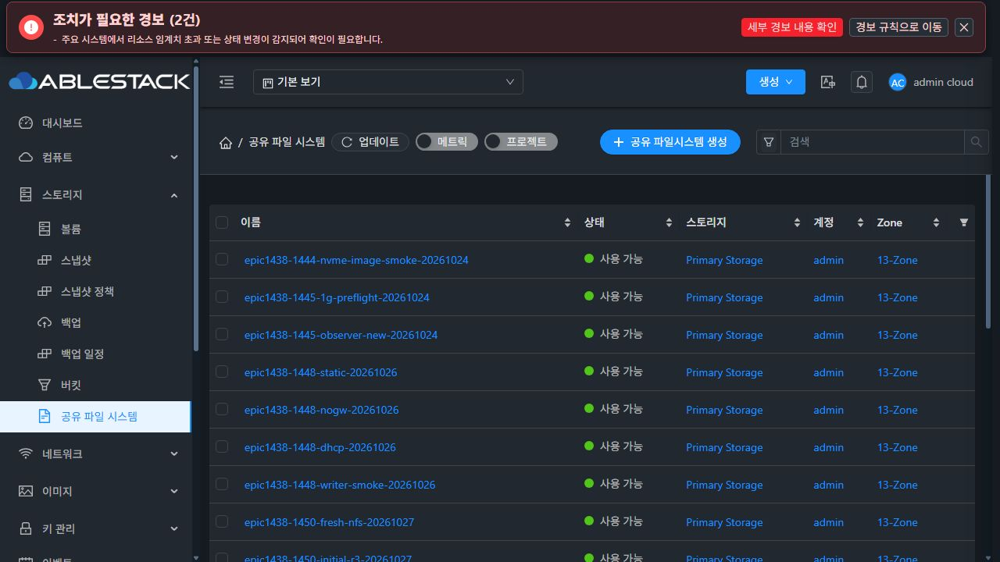
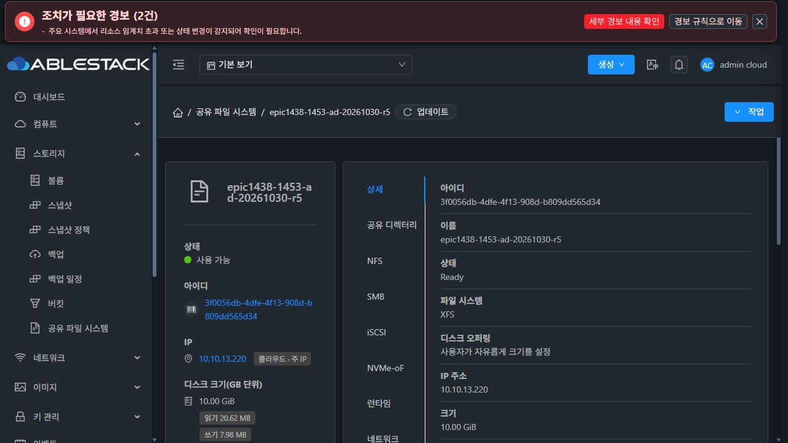
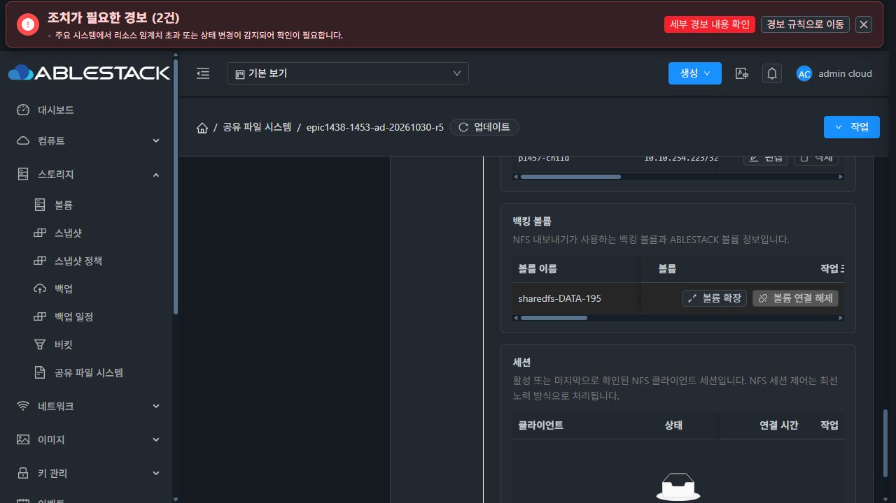

### S — 비교 표준 (실제 컴퓨트 > 가상머신)

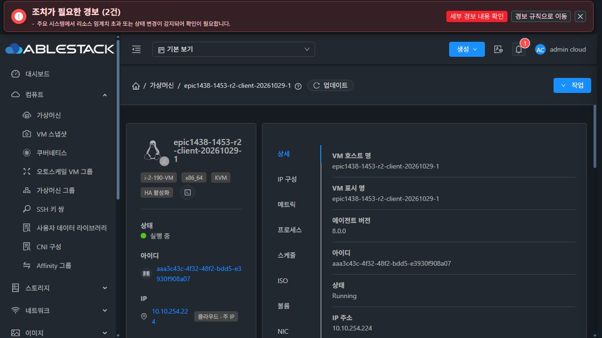
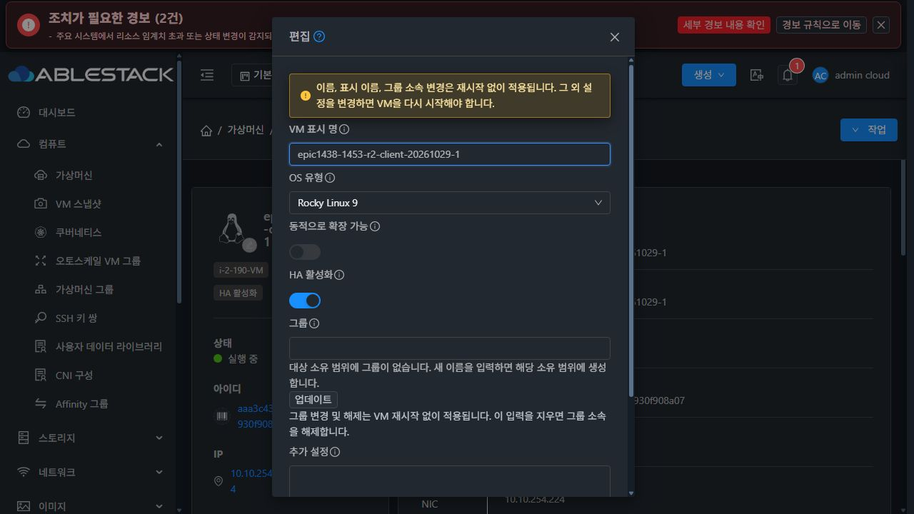

표준 대화상자는 열어 스타일을 확인한 뒤 취소했다. VM 설정은 제출하지 않았다.

### B — 개선 UI 목업 (예시)

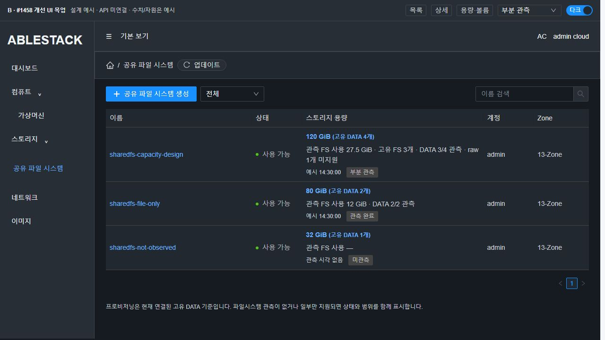
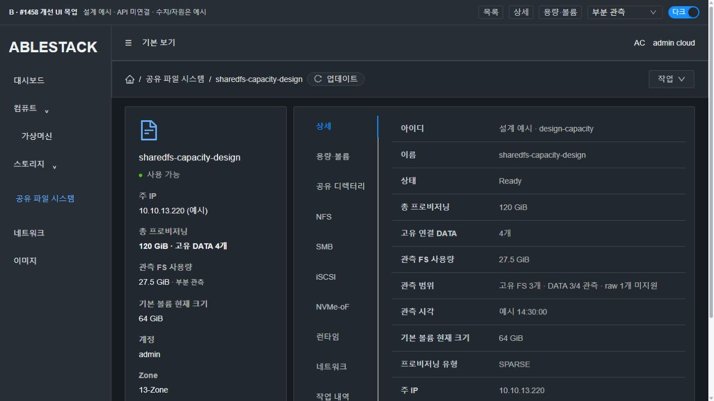
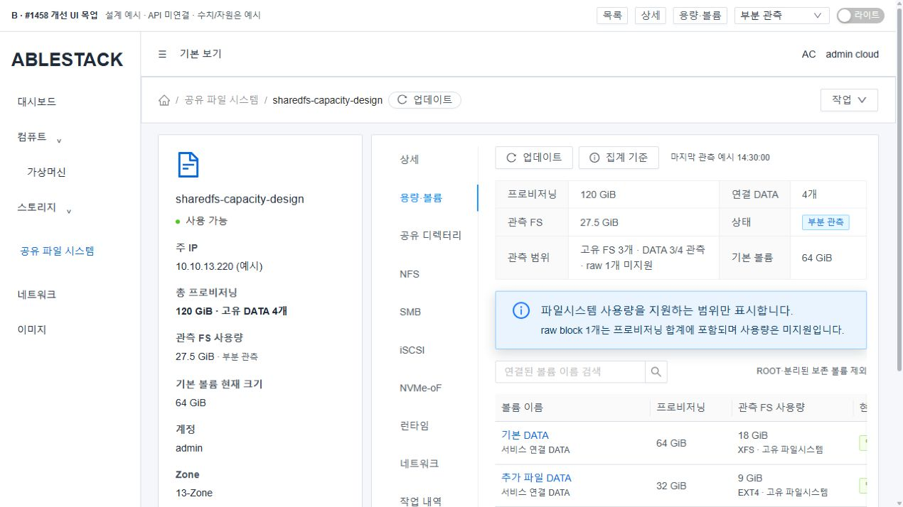
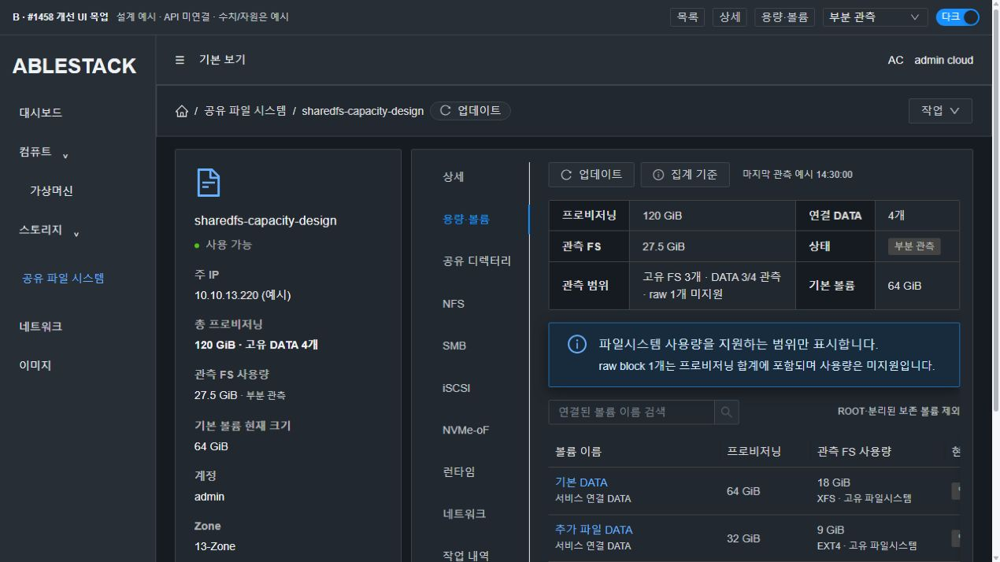
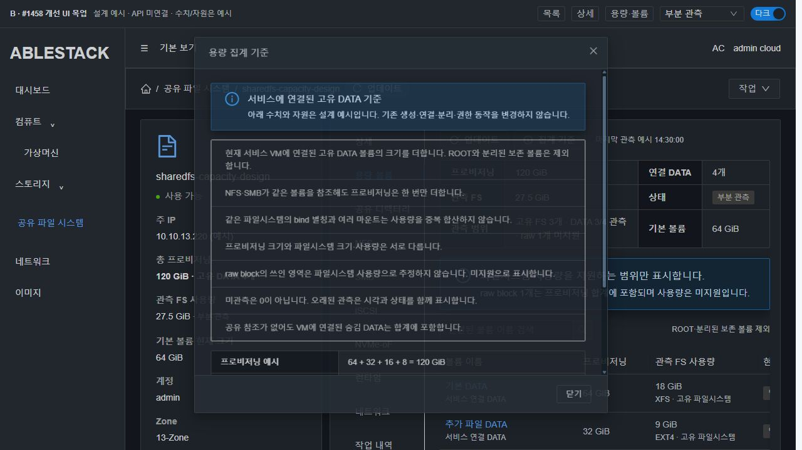
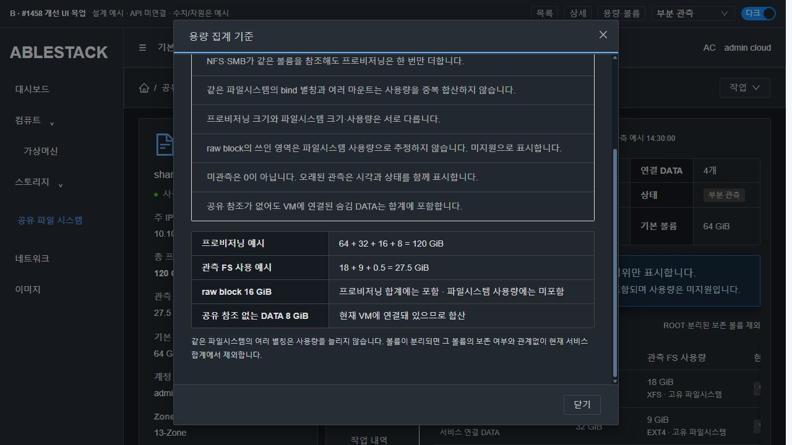
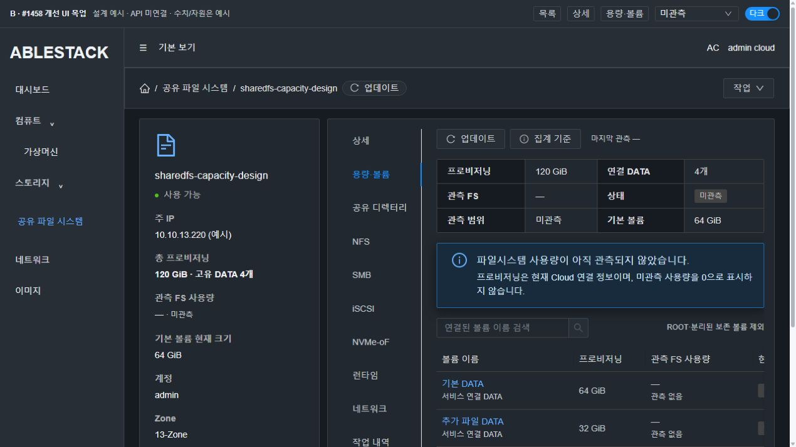
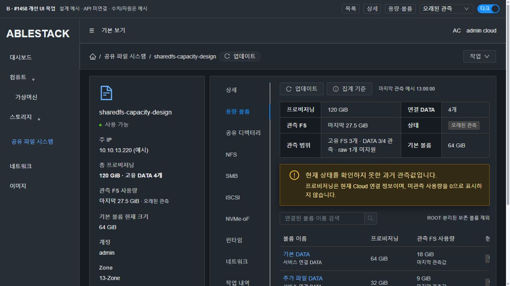
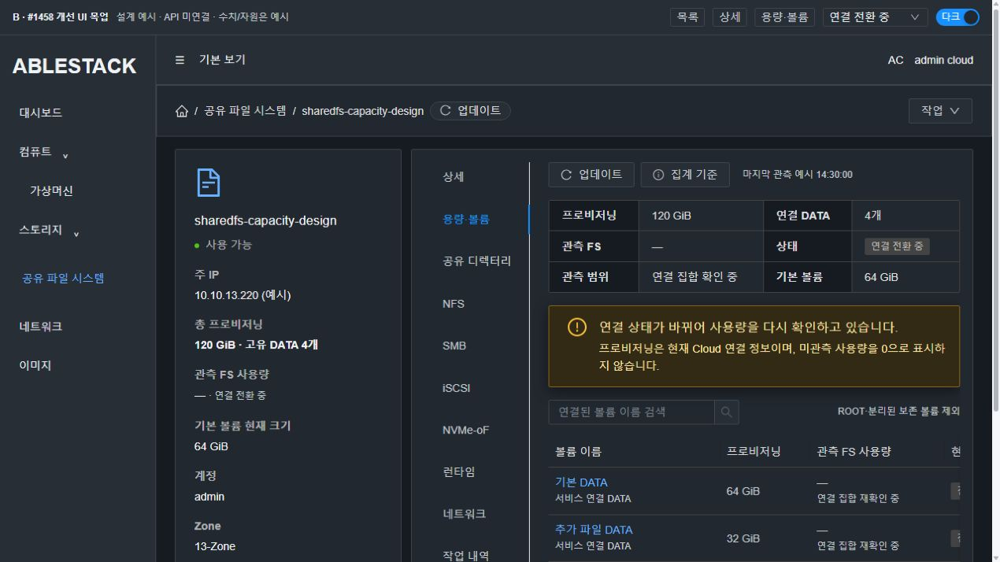

## 7. 실제 SystemVM 주입·격리 시험 결과와 한계

### 실제 파일시스템/별칭 시험 — 8/8

활성 서비스의 **SPARSE XFS**를 읽기 전용 bind로 관찰하고, 해당 DATA 아래 시험 전용 소유 경로에 새 128 MiB SPARSE EXT4, 64 MiB SPARSE raw, 같은 UUID의 별도 128 MiB SPARSE EXT4 clone 파일을 만들었다. mkfs는 새로 만든 일반 시험 파일에만 수행했다. private mount namespace와 검증된 read-only loop 장치를 사용했다.

- 서로 다른 FSROOT의 실제 XFS bind 별칭을 동일 FS로 판단.
- 같은 UUID의 별도 EXT4 device를 서로 다른 FS로 판단.
- 세 고유 FS에서 statvfs 3회만 수행.
- 숨김·미참조 DATA 포함, ROOT·분리 보존 제외.
- 20,000개 중복 참조를 넣어도 동일 합계. 이는 **알고리즘 시험**으로 HTTP/DAO 성능 인수가 아니다.
- raw 미지원/null, stale 과거값, membership 변화 TRANSITION/null을 확인.
- 장치 backfile/마운트 소유 범위를 확인해 시험 장치와 파일을 정리했다.

**실제 Cloud DATA는 기존 XFS 1개뿐**이며, 다른 attachment 목록은 주입 metadata다. private EXT4/raw 장치를 써서 식별 알고리즘을 실증한 것이다. Cloud UI에서 새 DATA를 실제 연결/분리하는 제품 인수를 완료했다고 주장하지 않는다.

### 기존 CLI 호출 계약 — 5/5

실제 활성 CLI를 /run 시험 디렉터리에 복사해 candidate에만 제안 branch를 주입했다. 실제 helper와 실제 lsblk/serial 자료를 사용했다. 원본 CLI hash는 전후 동일했다.

- 일반 inventory {}의 기존 cache 경로 유지.
- 기존 inventory 두 번째 payload 인자로 capacityOnly 분기 도달.
- 구 CLI가 payload를 무시하는 응답을 capability 부재로 구분 가능.
- stale를 보존하고 live fallback 안 함.
- 실제 측정 0을 null로 바꾸지 않음.

`schemaVersion=1`을 유지한 additive marker로 시험했다. 이 복사본은 설치하거나 signed current로 활성화하지 않았다.

### 보존과 UI 목업

- 전후 파일/디렉터리 119개, 데이터·UID/GID/mode·ACL·inode 비교 일치.
- 계정 파일, 실제 SMB 프로필/실행 PID, 파일시스템 신원, boot, IP, MAC 보존.
- 목업에서 검색 후 총계 유지, 대화상자 body 스크롤 중 header/footer 고정, 미관측/stale/transition/전체 관측 표시 **6개 핵심 항목 통과**, 최종 번들 검색도 재확인했다.
- 목업 bundle hash는 41ddd071492db6799e19이며 console error 0. 다크모드 주요 텍스트·링크 contrast 결과는 [검토 기록](evidence/mockup-contrast.json) 참조.
- 제품 DAO·API serializer·권한·실제 UI multi-volume 인수는 **아직 수행하지 않았다**.

재현 소스/결과: [native probe](probes/native-capacity-probe.py), [CLI contract probe](probes/contract-probe.py), [8항목 결과](evidence/native-summary.json), [5항목 결과](evidence/contract-summary.json), [UI 목업 검토](evidence/mockup-ui-checks.json).

## 8. 구현 시 변경 파일과 회귀·인수 계획

| 대상 | 최소 변경 / 필수 회귀 |
|---|---|
| api SharedFSResponse + 새 CapacityResponse DTO | additive 객체/nullable Long/status. 실제 API serializer로 정상·부분·0·null/생략·stale·details 비노출을 확인 |
| api ListSharedFSCmd | includecapacitydetails 기본 false, id 없으면 true 거부. 기존 권한/페이징/count 계약 유지 |
| engine/schema VolumeDao/Impl | VM ID batch DATA 조회. 실제 DAO 저장·재조회로 hidden/unreferenced/removed/Destroy/Attaching/분리/다른 계정/기존 attached null 검증 |
| server SharedFS capacity service/collector/cache + Spring bean | batch call 수, list RPC 0, VM별 bounded 수집, timeout/backoff, attach/resize/VM 교체 경쟁, 재시작 미관측→회복, 삭제 cache 회수 |
| server SharedFSServiceImpl / ApiResponseHelper | 목록·단건 같은 합계. 기존 size·생성·권한 응답 보존 |
| SystemVM monitor + CLI | 실제 mount/clone UUID 식별, 한 FS당 한 statvfs, cache missing/stale/corrupt, 구 runtime marker 부재, 일반 inventory 호환. signed 최초·반복 bootstrap 보호 |
| UI storage.js / SharedFSTab / 전용 cell·capacity tab / InfoCard / AutogenView / i18n | 실제 API 응답으로 컴포넌트 계약. NULL vs 0, total과 초기 크기 구분, partial 안내, customColumns 유지, SharedFS 이외 요청·카드 회귀 |

승인 후 구현·모듈 빌드·13번 변경 모듈 배포를 한다. 새 Cloud 시험 자원은 실제 UI로 준비하고 ROOT/DATA는 SPARSE/FAT만 사용한다. 기존 MAC 정책을 따르며 임의 MAC 변경을 하지 않는다.

제품 인수는 새 서비스의 기본 XFS + 추가 EXT4 + raw DATA + 숨김/미참조 연결 DATA를 사용한다. 같은 DATA에 NFS/SMB 다중 참조 및 bind 별칭을 둔 뒤 목록·InfoCard·상세·capacity tab·실제 API가 고유 합계와 같은지 대조한다. 참조 삭제 후 DATA는 계속 합산되고, 실제 detach 후 보존 DATA는 빠지는지 확인한다. I/O 파일/권한은 전후 클라이언트 콘솔로 확인한다.

QGA 중단/오래된 cache/VM 재시작/관리 서버 재시작/attach 또는 resize 경쟁에서 상태와 관측 시각을 검증한다. raw 또는 미마운트를 0으로 표시하지 않는다. 일반 사용자/도메인 관리자/타 계정 접근과 응답 payload를 확인한다.

100개 서비스·다수 DATA의 DAO fixture에서 **aggregate SQL 1회/설정 chunk 수, 목록 원격 호출 0, 응답 크기 및 전후 p95**를 측정한다. 현재 20,000 참조 prototype 시간을 이 시험으로 대체하지 않는다. 배포 중 signed runtime 적용 실패가 있으면 구 capability/UNSUPPORTED로 명확히 알리고 기존 서비스 보호를 유지한다.

## 9. 이번 작업 종료 상태

- 설계와 실제 SystemVM 격리 실증, A/B/S UI 목업 및 근거 기록을 완료했다.
- 제품 파일 변경·제품 모듈 빌드·13번 제품 배포·새 Cloud 서비스 생성은 하지 않았다.
- #1458은 OPEN이며 네 인수 항목 모두 미완료로 둔다.
- 다음 단계는 사용자 구현 지시 후 본 설계의 최소 변경을 적용하는 것이다.
