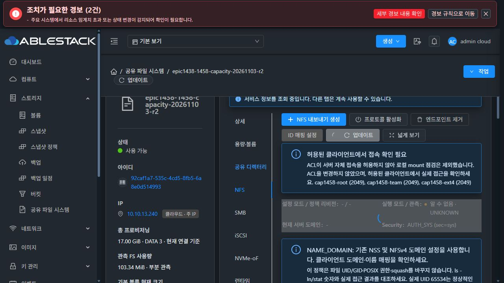
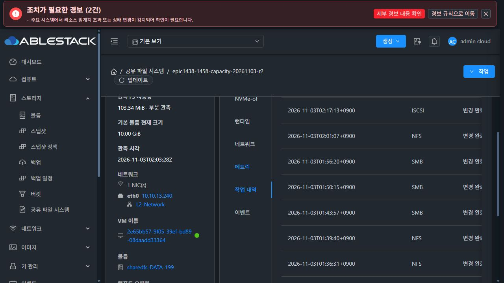
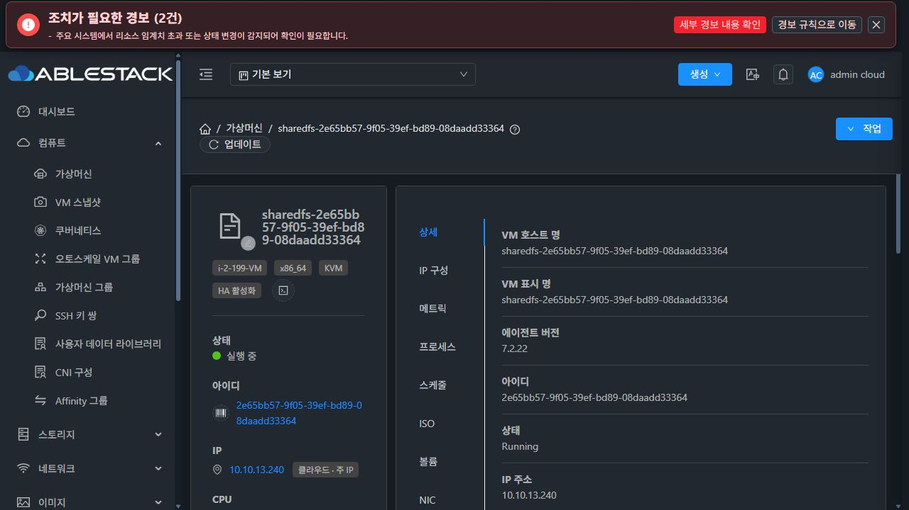
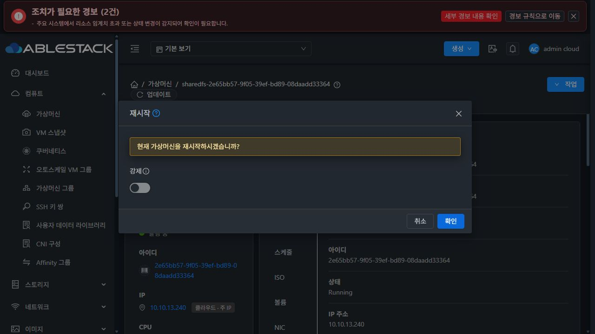
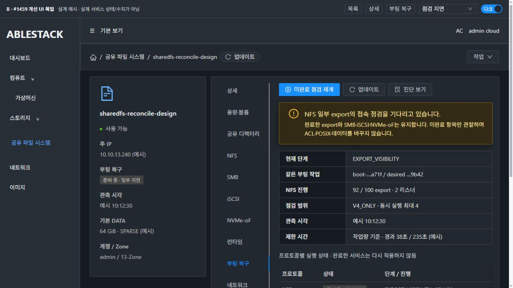
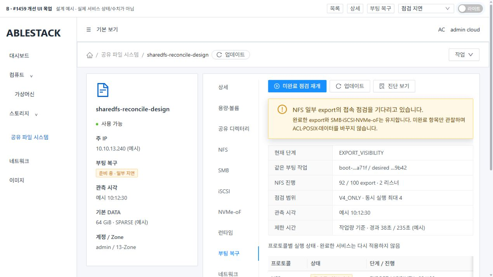
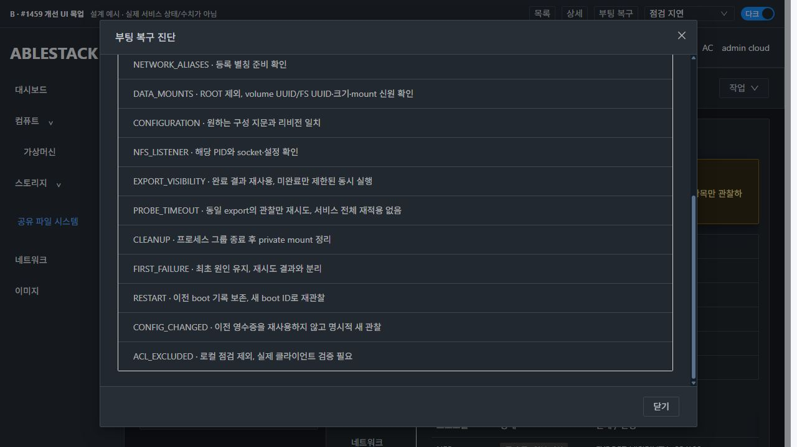
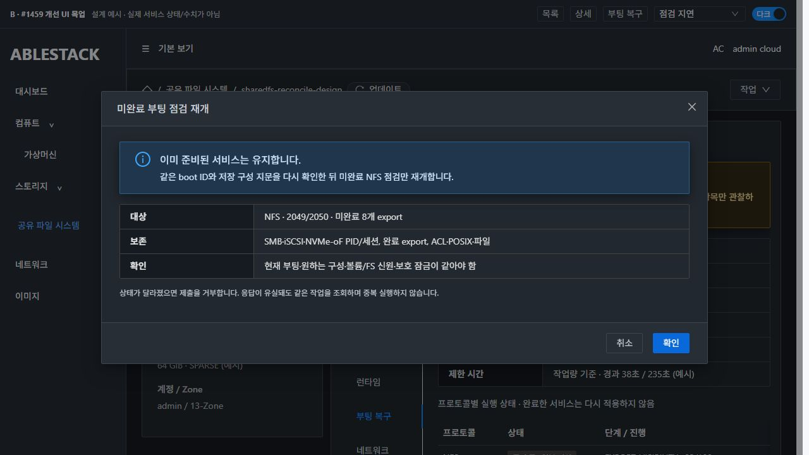
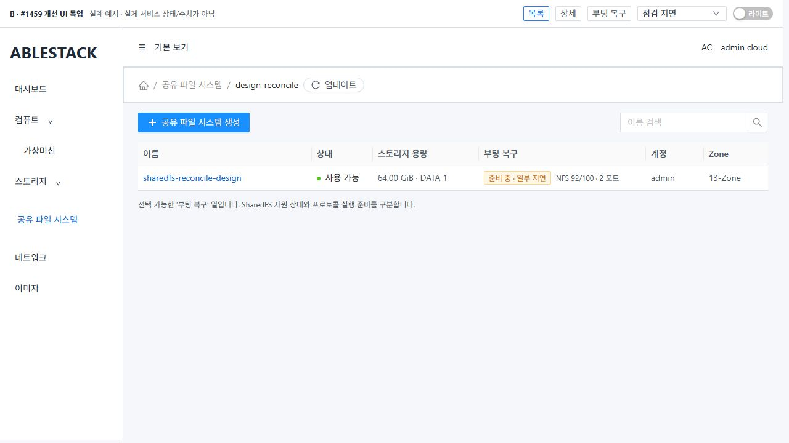

# #1459 다수 NFS Export 부팅 복구 — 코드 수준 설계

작성 2026-11-03 / Epic #1438 / **설계·격리 주입 실증 완료, 제품 구현·모듈 빌드·배포·기능 인수 미착수**.

이 문서는 #1459의 부팅 준비 순서·작업량별 제한·관찰/재개·프로토콜 독립성·진단 표시만 다룬다. #1460의 일반 온라인 변경 실패 정책이나 #1468 전면 UI 정리를 함께 구현하지 않는다. 목업과 주입 시험은 제품 코드가 아니다. 인수4항목은 구현 후 검증할 대상으로 미완료를 유지한다.

## 1. 실제 기준과 무결성

- canonical WSL 소스: /root/work/ablestack-cloud, epic/1438-sharedfs, 착수 HEAD **a9aa7aca04e58ec3f574056265c7c882d798bde9**.
- origin/upstream fetch 후 local ablestack-europa = upstream/ablestack-europa = **413d1459682b6f4dea6c90773510b8342dba1ec2**, 차이0/0. 기존 Epic을 이 local base에 반영한 상태를 확인했다. 새 구현 브랜치를 만들지 않았다.
- 실제 SharedFS **92caf1a7-535c-4cd5-8fb5-6a8e0d514993**, SystemVM **2e65bb57-9f05-39ef-bd89-08daadd33364 / i-2-199-VM / 13.1**, STATIC10.10.13.240.
- 현재 native release **1458.capacity.1**, baseline10. 활성 CLI·boot-reconcile·monitor·configuration_transaction·shared_directory_policy의 SHA-256이 현재 소스와 모두 일치했다.
- 실제 관리 JAR SHA-256 **0bb54b0715b535a87301def3d059509216d25497959e170d172cbdf2d679a8b9**. 이전 #1458 보고서의 전체 JAR 해시를 현재값으로 재사용하지 않았다. #1459 관련 Manager/RuntimeResponse class와 패키지 안 reconcile unit은 현재 로컬 target/source와 각각 일치했다.
- 실제 DATA10GiB SPARSE XFS를 명시해 격리 시험했다. ROOT 및 추가 EXT4/raw도 SPARSE인 현재 UI 증거를 대조했다. 새 Cloud VM/볼륨·THIN·클론·MAC 변경은 없다.
- 현재 저장 NFS export는3개/V4_ONLY/포트2049이며 모두 로컬 주소를 제외하는 /32 ACL이다. 실제 부팅 로그는 **5초(17:35:32→17:35:37 UTC)에 성공**, NFS probe는 올바르게 EXTERNAL_CLIENT_REQUIRED였다. 현재 정상 서비스를 실패 상태라고 주장하지 않는다.

[실제 guest 기준](evidence/deployed-baseline.json) · [관리 class/unit 일치](evidence/management-integrity.json) · [실제 UI API 계약](evidence/actual-ui-api-contract.json).

## 2. 확인된 코드 경로와 문제

### 고정 120초와 순차 작업량이 서로 연결되지 않는다

- systemvm/debian/etc/systemd/system/ablestack-storage-reconcile.service:8-11은 Type=oneshot / TimeoutStartSec=120이다.
- ablestack-storage-boot-reconcile:59-122는 최대12회, 회차마다 mount -a→network→NFS apply→SMB apply→iSCSI apply→NVMe apply를 순서대로 수행한다. network 대기와 NFS export 수를120초 제한과 연결하지 않는다.
- CLI start_ganesha_endpoints:4138-4268은 각 listener를 systemctl restart하고, 전체 listener가 공유하는 time.time()+15 deadline으로 socket을 기다린다. 늦게 검사하는 listener가 사용할 시간이 줄어든다.
- CLI probe_nfs_export_visibility:4278-4478은 export×listener×지원 버전별 mount를 **순차** 실행한다. mount timeout15초, 성공 후 umount timeout10초이다. V4_ONLY는 여러 포트, 현재 지원 DUAL은2049 단일 listener에서 v4+v3를 점검한다.
- 100 export/V4 2listener 또는 DUAL1listener는 mount200회다. 각1초라는 가정만으로도200초이며 mount 상한의 합은3000초다. 이는 **실제 장애 경과 측정이 아닌 호출 수와 제한 계약의 상한 분석**이다. 이번 격리 native 정상 시험은100 export/2listener가6.544초에 완료됐으므로100개면 반드시120초를 초과한다고 단정하지 않는다.

### 일시적인 접속 지연이 전체 재적용으로 확대된다

NFS가 실패해 success=0이 돼도 같은 회차의 다른 프로토콜은 적용한다. 다음 회차에는 성공한 SMB/iSCSI/NVMe도 다시 apply한다. 실제 배포 스크립트 복사본에 NFS 첫 호출 실패만 주입하자 네 프로토콜이 각각2회 호출됐다. 기존 online apply/transaction 전체를 바꿀 이유는 없으며 **boot 경로만** 관찰·재개로 분리한다.

### timeout 진단·정리가 충분하지 않다

TimeoutExpired는 현재 probe의 RuntimeError 처리 범위 밖이다. export 결과 행을 추가하기 전에 빠져나가고 finally는 rmtree만 호출한다. 주입 시험에서 mount timeout→진단행0·umount호출0을 재현했다. 실제 mount/하위 프로세스가 남을 수 있는 경로이며 이번 시험이 운영 mount 누수를 발생시켰다는 뜻은 아니다. mount된 디렉터리에 재귀 삭제를 실행해서는 안 된다.

일반 실패는 실패 export에서 break해 뒤 항목을 관찰하지 않는다. 현재 apply의 실패 분기에서 stop_ganesha_endpoints 전체를 실행한다. #1459에서는 부팅 관찰 지연 때문에 이미 정상인 NFS listener와 타 프로토콜을 다시 시작하지 않도록 별도 경로가 필요하다. 일반 온라인 설정 변경의 기존 검증·원복 정책은 유지한다.

### 현재 UI는 부팅 진행을 볼 수 없다

실제 UI가 호출한 listStorageServiceInventory의 resultjson에는 network/nfsGaneshaRuntime/nfsLocalProbes 등이 있지만 **bootReconcile은 없다**. 작업 내역은 설정 변경 작업 이력이며 부팅 복구 작업이 아니다. Ready 자원 상태나 캐시 ok만으로100 export의 준비가 끝났다고 판단할 수 없다.

## 3. 최소 변경 구조

### 수정할 파일

| 경계 | 예정 변경 |
|---|---|
| ablestack-storage-boot-reconcile | 기존 경로는 유지하고 서명된 BootReconciler worker를 기동하는 짧은 launcher로 바꿈. 같은 boot 전용 lock·중복 admission 유지 |
| **lib/ablestack-storage/boot_reconcile.py 신규** | 단계 계획·프로토콜/항목별 checkpoint·읽기 전용 status·단일 worker admission·bounded probe 실행·안전한 재개 담당 |
| ablestack-storagectl | 기존 apply 진입점 유지. boot worker가 사용하는 NFS 준비/ensure-listener/관찰 경계를 추출하고 boot 전용 옵션으로 제한. inventory에 안전한 bootReconcile 관측 추가. root CLI boot-reconcile status/resume 추가 |
| 기존 reconcile.service / monitor.service | **파일 변경 없음**. 기존 oneshot은 짧은 worker 기동까지만 담당하고 끝나며, 긴 작업은 독립 transient worker가 진행. 기존 bootstrap/network 선행·Before monitor 관계 보존 |
| runtime_updater.py / baseline profile / 서명 manifest 생성·검증기 | 새 helper를 managed files에 정식 포함(현재12→13), baseline10→11. worker의 고정 systemd 실행 인자와 launcher/helper를 서명 payload에 포함 |
| StorageService / Manager / 새 ResumeStorageServiceBootRecoveryCmd | 기존 instance 권한 확인과 dispatcher 재사용. 입력을 고정한 부팅 점검 재개 API 한 개. DDL 없음 |
| SharedFSTab / 신규 SharedFSBootRecoveryTab·Panel·Dialog / AutogenView·storage config / 번역 | 제한된 부팅 상태 요약과 전용 탭. 공통 레이아웃·MoldDialog 재사용. 다른 VM/Volume 목록 경로 유지 |

서버가 설치하는 sharedfs-network 리소스에도 같은 unit이 들어 있다. 이를 별도 교체하면 배포 경로가 늘어나므로 **기존 unit 파일은 보존**하고 launcher에서 긴 작업을 분리한다. packaged unit과 실제 native unit의 동일성·짧은 launcher 종료를 함께 검증한다. 새 host operation 구현이나 QGA wrapper 형식은 만들지 않고 기존 operation 전달 경로를 재사용한다.

공통 ApiResponseHelper·SharedFS DB lifecycle 상태·볼륨 포맷·기존 권한 정책·MAC/네트워크 할당 정책은 변경하지 않는다.

### 단계와 실행 순서

~~~text
NETWORK_PRIMARY → NETWORK_ALIASES → DATA_MOUNTS
→ 프로토콜별 CONFIGURATION → LISTENER/PROCESS → EXPORT_VISIBILITY
→ 프로토콜별 READY / EXTERNAL_CLIENT_REQUIRED / WAITING / BLOCKED
→ 전체 집계와 최초 실패·현재 관측 보존
~~~

1. 기존 --primary-ready→network endpoints reconcile→--ready를 재사용한다. STATIC/DHCP 코드를 재작성하지 않는다. 네트워크가 미준비면 원하는 구성을 보존하고 단계/사유를 남긴다.
2. mount -a 실패를 무시하고 진행하지 않는다. 관리 DATA만 volume_uuid·serial·size·FS UUID·mount source로 관찰해 준비 여부를 판단한다. 기존 resolver와 경로 binding 보호를 재사용한다. ROOT나 미관측 장치를 포맷하지 않는다.
3. 저장된 원하는 구성을 **한 번** 읽어 canonical hash와 instance UUID를 확인한다. 작업 중 변경되면 이전 관측 재사용을 중단하고 CONFIG_CHANGED로 보존한다.
4. 각 프로토콜은 별도 상태/지문/진행률을 갖는다. 짧은 준비/기동을 먼저 처리하고 NFS의 긴 visibility 확인은 bounded 별도 단계로 돌려 다른 프로토콜의 첫 준비를 막지 않는다.
5. NFS는 구성 렌더→listener별 관리 PID/starttime·config hash·socket 확인→필요한 listener만 ensure한다. 현재 정상인 동일 구성 listener에 restart를 호출하지 않는다. TCP 포트가 열렸다는 이유만으로 다른 process를 정상으로 인정하지 않는다.
6. probe가 지연되거나 일시적으로 실패해도 전체 apply로 돌아가지 않는다. 같은 listener·export·버전의 **미완료 관찰**만 재개한다. 잘못된 설정/경로/ACL 거부처럼 재시도로 해결하지 못하는 원인은 BLOCKED로 분리한다.
7. 로컬 주소가 ACL에서 제외된 IP 정책은 기존 EXTERNAL_CLIENT_REQUIRED를 유지한다. 서비스 기동과 실제 외부 접속 확인을 구분하고 허용 ACL을 추가하거나 external 검증을 PASS로 바꾸지 않는다.

### 작업량 기반 제한과 프로세스 정리

- 실제 작업 수 P = 로컬 점검 대상 export×연결된 listener×지원 버전, L = 활성 listener 수. ACL로 로컬 점검이 불가능한 항목은 제외한 사유를 별도로 집계한다.
- 기본 동시 probe 수 **4**, 전체 큐/동시 프로세스를 bounded로 한다. 한 번에100개 프로세스를 만들지 않는다.
- 설계 기본 총 soft budget 예시: **min(900, max(90, 45 + 20×L + 3×ceil(P/4)))초**. V4 100개/2listener는235초, 현재 DUAL100개/1listener는215초다. 1/10/100 실제 관측 결과를 바탕으로 구현 단계에서 수치만 조정할 수 있으며 전제·계산값을 UI/진단에 남긴다.
- monotonic 기준 단계/전체 deadline을 따로 둔다. listener마다 남은 deadline을 계산하며 공유15초를 소진시키는 기존 루프를 제거한다. 매번 같은 큰 고정 timeout을 사용하는 방식으로 대체하지 않는다.
- probe 한 번은 기본3초의 짧은 관찰·한정 재시도와 남은 전체 budget을 사용한다. 초기 reply 유실/일시 ESTALE/초기 준비 지연은 관찰만 재시도한다. 횟수/총 경과는 제한하고, budget 종료는 PAUSED/DEADLINE_EXCEEDED 및 canresume로 보존한다.
- probe를 private mount namespace/process group에서 실행한다. timeout 시 TERM→짧은 grace→KILL→wait, 이후 mount 신원을 확인해 해당 probe mount만 해제한다. 정상 mount와 부팅 DATA mount는 건드리지 않는다.
- mount가 남아 있으면 rmtree 금지. cleanup 오류를 별도 CLEANUP_REQUIRED로 보존하고 다음 재개 전에 잔여 mount/process를 확인한다. 새 epoch를 시작해 잔여를 숨기지 않는다.
- **기존 Type=oneshot/TimeoutStartSec=120 unit은 그대로 둔다.** boot launcher는 서명된 helper의 start만 호출하고, helper가 고정된 systemd-run 인자로 별도 transient worker(Type=exec, RuntimeMaxSec=960, KillMode=control-group)를 기동한 뒤 빠르게 반환한다. 120초가 export 전체 작업의 deadline이 되지 않으며 무한 timeout/무제한 Restart 루프를 만들지 않는다. STARTING→worker 확인을 journal로 구분하고 launcher 성공을 export 완료로 보지 않는다. 강제 종료 시 status는 heartbeat·PID/starttime을 보고 INTERRUPTED로 관찰한다.
- 기존 Before=monitor 관계를 보존해도 launcher가 신속하게 끝나므로 monitor는 worker의 장시간 probe와 독립적으로 실행된다. unit dependency 변경 없이 진행 상황을 관측하며 관측 실패는 서비스 실패와 분리한다.

### 같은 작업의 checkpoint·원인 보존

서버 새 테이블을 만들지 않고 root 소유 journal을 /var/lib/ablestack-storage/boot-reconcile/<instanceUuid>/<bootId>/에 둔다. lock/status/짧은 안전 진단은0600, 디렉터리0700·symlink/O_NOFOLLOW 검증·atomic replace/fsync로 보호한다.

- key: boot ID + instance UUID + desiredHash. export checkpoint는 UUID/port/version/구성 hash/volume·FS·inode·mount 신원과 관리 process PID/starttime/configHash를 포함한다.
- 완료 결과 재사용 전 신원을 재관찰한다. 다른 boot·desired 변경·PID 재기동·FS remount/신원 변경이면 이전 완료를 현재 PASS로 쓰지 않는다.
- 같은 epoch의 status/resume·응답 유실·중복 클릭은 동일 작업을 추적한다. worker flock으로 중복 실행을 거절하고 새 apply를 만들지 않는다.
- firstFailure는 최초 단계·코드·export·port·version·시각만 한 번 저장한다. lastObservation/attempt/cleanup과 별도이며 성공 재개 후에도 유지한다. 비밀·원 desired JSON·원 command 전체는 journal의 공개 진단이나 API로 내보내지 않는다.
- 기존 configuration transaction lock과 runtime-upgrade/boot lock을 공유하는 **같은 순서의 nonblocking lease**로 live 변경과 경합을 막는다. 긴 probe 중 설정 작성이 겹치면 desired/runtime fingerprint로 관측을 무효화한다. 진행 중인 구성 작업을 탈취·강제 commit/rollback하지 않는다.
- 재시작 이력은 boot별 보존하고 상태 조회는 파일 읽기+작업 process 신원만 확인한다. 관리 서버가 다시 떠도 apply하지 않는다. journal 없는 구 runtime은 UNKNOWN/UNSUPPORTED이며 과거 Ready를 새 성공으로 추정하지 않는다.

## 4. API와 UI 계약

조회는 현재 listStorageServiceInventory.resultjson에 additive bootReconcile 객체를 추가한다. **cached inventory를 반환할 때도 현재 안전한 boot 상태를 읽어 보완**한다. 기존 emit_cached_runtime 조기 반환으로 새 상태가 누락되지 않도록 해당 cached/live 두 경로에 회귀를 둔다. 외부 success는 조회 전달 성공이며 boot 상태 성공과 다르다.

설계 예시(실제 배포 응답이 아님):

~~~json
{
  "bootReconcile": {
    "schemaVersion": 1,
    "bootId": "…",
    "desiredHash": "…",
    "state": "WAITING",
    "phase": "EXPORT_VISIBILITY",
    "observedAt": "…",
    "elapsedSeconds": 38,
    "budgetSeconds": 235,
    "canResume": true,
    "protocols": {
      "NFS": {"state": "WAITING", "completed": 92, "total": 100, "pendingProbes": 8},
      "SMB": {"state": "READY"},
      "ISCSI": {"state": "READY"},
      "NVMEOF": {"state": "READY"}
    },
    "firstFailure": {"code": "NFS_PROBE_TIMEOUT", "phase": "EXPORT_VISIBILITY", "port": 2050},
    "cleanup": {"state": "COMPLETE", "remainingMounts": 0, "remainingProcesses": 0}
  }
}
~~~

실제 runtime 응답의 JSON 문자열 resultjson 계약은 그대로 둔다. UI는 파싱 오류/누락·통신 실패를 UNKNOWN으로 표시하고 이전 관측 시각을 보존한다. boot 실패로 잘못 치환하지 않는다. 상세 항목/이력은 크기 제한·생략 개수를 명시하며100 export 인수에서는 모두 확인 가능해야 한다.

재개 API는 **resumeStorageServiceBootRecovery**로 제한한다. instanceid/bootid/expecteddesiredhash와 대상 protocol=NFS를 받는다. 기존 requireInstance 권한·SystemVM 관계·baseline/capability·configuration protection을 확인하고 boot-reconcile resume 명령을 짧게 전달해 worker admission 결과와 같은 작업 식별자를 반환한다. arbitrary command/path/payload, 즉석 desired 설정, 다른 protocol 강제 재시작 인자는 없다. 설정 변경이나 신규 transaction ID를 생성하는 API가 아니다.

canresume는 서버/guest가 검증한 현재 epoch·retryable 상태·정리 완료·보호 상태를 근거로 한다. UI가 숨은 API로 네트워크/리소스를 준비하지 않는다. 실제 전용 탭에서 상태 확인→진단→재개 확인→같은 작업 관찰까지 완료돼야 인수한다.

### UI A / S / B를 구분

- **A 현재 배포 UI**: NFS의 cache/로컬 ACL 안내와 설정 변경 작업 내역. 부팅 복구 단계가 없음을 실제 API와 함께 확인했다.
- **S 표준**: 실제 컴퓨트>가상머신 목록·상세·재시작 대화상자를 캡처했다. 표준 확인을 위한 대화상자는 취소했고 VM 재시작은 실행하지 않았다.
- **B 개선 목업**: 실제 Vue3/AntD와 Breadcrumb·ResourceLayout·MoldDialog·style/index.less를 사용했다. 제품 API 연결0. 상단 ‘목업/예시’를 명시하며 가상의100 export와 원인/수치를 실제 결과처럼 쓰지 않는다.

상세 탭은 정보 전용이고 새 ‘부팅 복구’ **세로 탭**에 목적별 작업을 둔다. 별도 탭 타이틀은 반복하지 않는다. **주요 파란 재개 버튼은 좌측 첫 번째**, 다음 업데이트(icon+업데이트), 진단 보기 순서다. 이 탭에 불필요한 넓게 보기 버튼을 추가하지 않는다. 목록에는 선택 가능한 부팅 복구 상태 열, 상세/InfoCard에는 읽기 전용 요약만 둔다.

Breadcrumb·좌측 정보/우측 탭·테이블·대화상자 영역은 기존 VM 표준을 따른다. 간격은8/16px 공통 기준이며 임의 색상/흰 배경을 넣지 않는다. 다크 텍스트 대표14표본의 실제 계산 대비는7.13 이상이다. 전체 페이지 접근성 인증을 뜻하지 않는다. 대화상자 body scrollTop390에서도 header y33/footer y622가 그대로였고 body만 overflow:auto였다.

목업의 관측 유실/설정 확인 필요에서는 재개 버튼을 비활성으로 확인했다. 프로토콜별 정상 상태와 최초 실패·현재 관측·정리 결과를 분리한다. 일반 구성 작업 내역을 부팅 worker의 확정 기록으로 잘못 사용하지 않는다.

## 5. 실제 SystemVM 주입 시험과 실증 한계

| 시험 | 결과와 범위 |
|---|---|
| 배포 함수 계약 주입 | 1/10/100 × V4 2listener/DUAL1listener의 정확한 mount 수, timeout 진단행0/umount0, NFS1회 실패 뒤 다른 protocol2회 apply 재현 |
| 실제 private Ganesha | SPARSE XFS의 격리 임시 경로·private mount/network namespace에서 V4 1/10/100 export, 두 listener, 실제 mount/seed 읽기 성공 |
| native 소요 | 2/20/200 probes, 동시4: **0.085 / 0.790 / 6.544초**. 관리 기본서비스와 별개인 namespace server 측정 |
| 일부 실패·재관찰 | private 잘못된 pseudo path만 실패시킨 뒤 원래 path 관찰 성공. 두 listener PID 불변 |
| process timeout | 실제 sleep 하위 process를 만든 뒤 그룹 종료·parent wait, 실행 중 descendant0 확인 |
| 짧은 launcher | 실제 systemd transient worker 기동이0.029초에 반환, 반환 후 RUNNING→READY 관찰. 기존 unit 파일 불변 |
| 재개 모델 | workload budget, JSON journal 재조회, 완료 protocol apply count 유지, firstFailure 보존, boot/desired/runtime identity 변경 무효화, 실제 nonblocking flock 중복 거부 |
| 보호·정리 | 활성 CLI/boot·fstab/원래 Ganesha config/desired JSON·원 process PID·eth0 IP/MAC·기존 seed hash 불변. 임시 namespace·mount·process·디렉터리 정리 완료 |

[기존 함수 주입](evidence/contract-summary.json) · [native Ganesha 실증](evidence/native-summary.json) · [설계 상태 모델](evidence/resume-model-summary.json) · [실제 launcher 실증](evidence/launcher-summary.json).

시험 도구의 최초 오류 두 가지(시험 Export_Id 범위 초과, ip netns exec 자식의 mount namespace와 부모 읽기 namespace 차이)는 도구를 교정해 해결했다. 제품 오류로 보고하거나 제품을 수정하지 않았다. 최종 도구는 유효 Export_Id와 같은 private namespace 안의 mount/읽기/해제를 사용한다.

**실제 DUAL native cold boot·새100-export VM cold boot·제품 resume API/UI·관리 서버/SystemVM 전체 재시작 인수는 아직 하지 않았다.** DUAL의 호출 계약만 배포 함수로 실증했다. 실제100개가 이번 새 제품으로 부팅 복구됐다는 완료 판정이 아니다. 구현 전 실증은 제한된 병렬 관찰·PID 보존·정리·checkpoint 경계의 타당성을 확인한 것이다.

## 6. 구현 후 필수 검증 계획

1. 변경 전 배포본과 소스·서명 payload/unit 해시를 다시 확인한다. 새 VM/ROOT/DATA·새 클라이언트를 UI에서 만들고 SPARSE 이상·중복 IP 없음·MAC 정책을 확인한다.
2. 기존 단일 NFS·제한 ACL·online 생성/편집/원복과 STATIC/DHCP를 보존하는 회귀를 먼저 수행한다. boot-only 모드가 일반 transaction 호출에 섞이지 않도록 실제 호출 계약을 검증한다.
3. **1→10→100 export 순차**, V4_ONLY의 두 listener와 현재 지원하는 DUAL2049 한 listener에서 UI cold boot를 검증한다. DUAL에 두 포트를 억지로 허용하지 않는다. 허용 client 실제 접속·쓰기·해시·POSIX·ACL/FS UUID 보존을 확인한다.
4. 초기 응답 지연·유실·일부 export 실패·unknown 통신을 주입한다. 상태→원인→same epoch 재개를 실제 UI에서 실행하고 NFS외 PID/세션/데이터 불변, queue≤4, deadline/잔여 프로세스/mount 정리를 확인한다.
5. 실제 JSON serializer→컴포넌트 회귀, cached/live inventory 두 경로, 같은 boot/다른 boot/desired 변경, 중복 resume, 기존 transaction/upgrade 보호, symlink/잘못된 신원·구 runtime·오래된 cache를 검증한다.
6. 관리 서버·SystemVM 재시작 후 최초 실패/이전 boot 이력·current status가 실제 runtime과 일치하는지 UI에서 확인한다. 조회/재로그인이 새 apply를 만들면 실패다.
7. 서버+UI+정상 서명 runtime/SystemVM 이미지는 **로컬 모듈 빌드**로 배포한다. 새13 managed files/profile11과 bootstrap 첫/반복·기존 unit 보존·서버 재주입 후 launcher/worker 분리를 검증한다. Actions는 반드시 필요한 릴리즈 경우 외 사용하지 않는다.

## 7. 현재 산출물과 다음 단계

이번 변경은 docs/design/sharedfs-1459-boot-reconcile-20261103 내부 설계·목업·격리 시험 코드/증거뿐이다. 제품 src·활성 runtime·DB·템플릿·관리 JAR·UI 모듈은 배포하지 않았다. 로컬 목업 번들 빌드는 제품 UI 빌드와 구분한다. #1459는 OPEN·인수0/4·구현 지시 대기이다. 새 이슈/목업 PR을 만들지 않으며 #1468은 HOLD다.

## A 현재 UI

## S 가상머신 표준

## B 개선 목업

