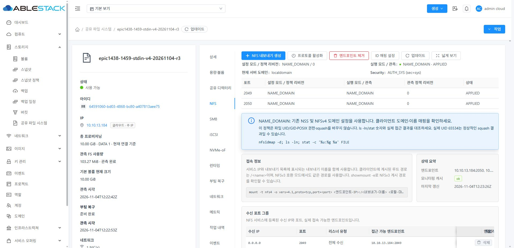
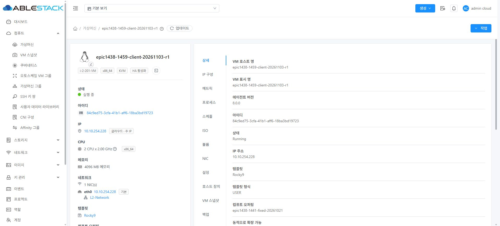
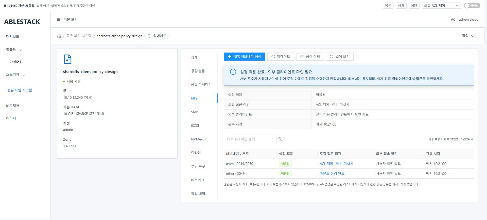
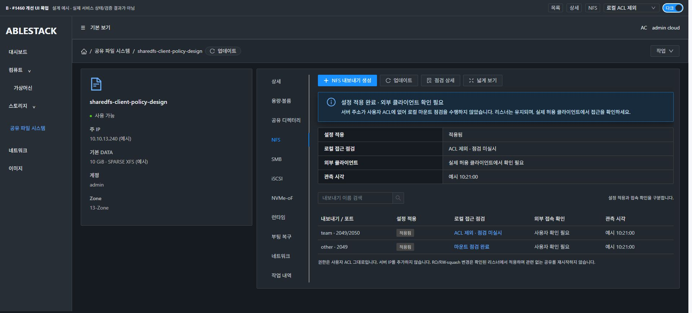
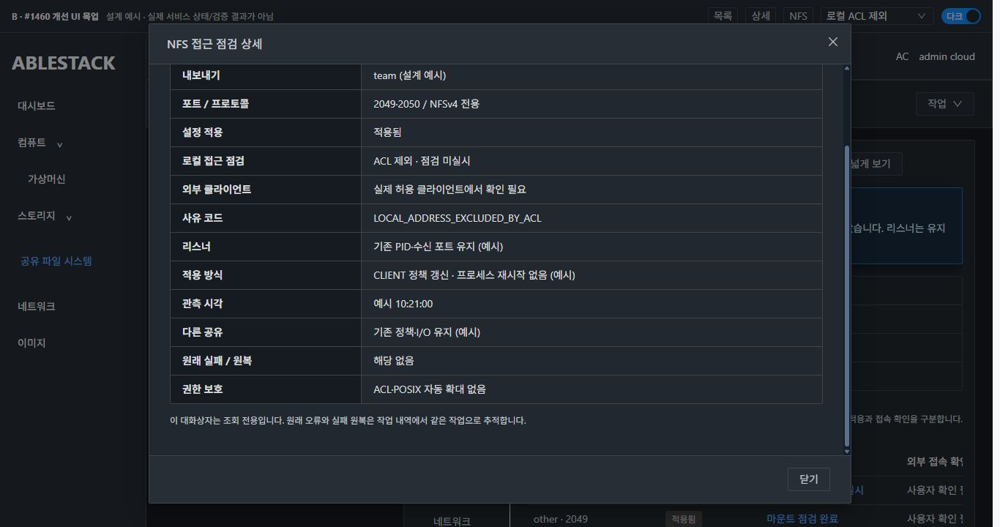
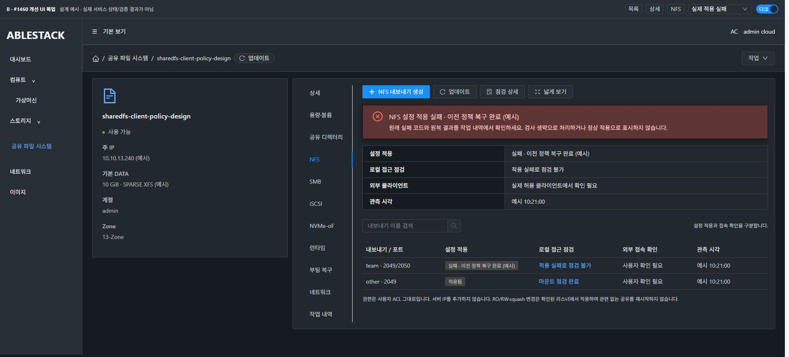
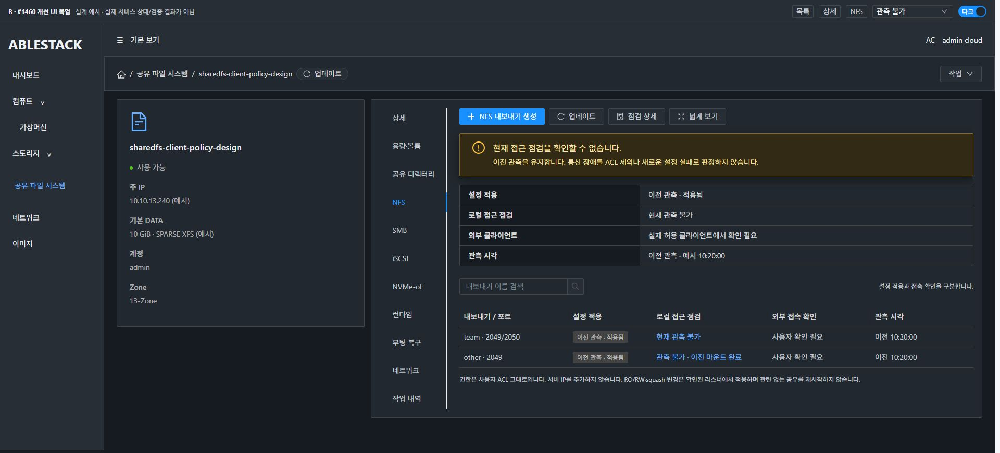
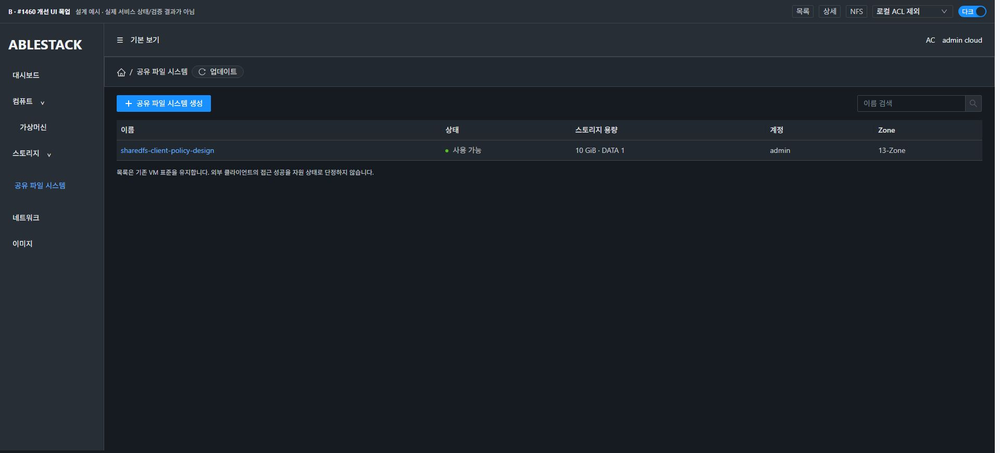
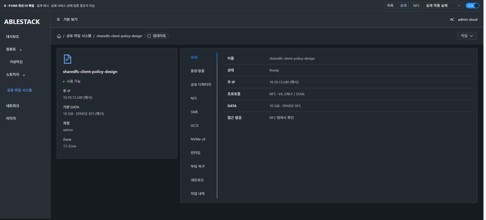

# #1460 코드 수준 설계 — 제한 ACL과 NFS 동적 정책 적용

2026-11-04 · Epic #1438 · 작업 브랜치 epic/1438-sharedfs. **설계·격리 주입 실증·목업만 완료했다. 제품 구현/모듈 배포/제품 UI 인수/이슈 종료는 하지 않았다.**

## 1. 현재 코드·실행 자원 대조

local Europa/upstream은 **413d1459682b6f4dea6c90773510b8342dba1ec2 / 0·0**, 제품 기준은 **b0695d7e44c9975284ced0d72eb19196ca6a09bf**다. 현재 배포된 관리 JAR 571421655be7… / UI index2f7f8d00f811…는 #1459 최종 배포와 같다.

설계 실증 대상은 SharedFS64591060-bd03-4868-bc80-a407813aee75, VM8470a7eb-b5b2-3b45-9922-ba2d3e3aeed0, host13.1, 주 IP10.10.13.184다. **기존 SPARSE10GiB XFS DATA** ef9a2ff3-31fd-44fe-a97a-2e0669455127의 독립 임시 하위 디렉터리만 사용했다. FSUUID08b42571-dbc5-44bd-965b-c5da35d4eb7f를 확인했고 포맷하지 않았다.

활성 signed release는 **1459.directory.1**이며 아래 파일은 저장소와 실행본의 SHA-256이 정확히 같다.

| 파일 | SHA-256 |
|---|---|
| ablestack-storagectl | 6639c2abaf55b18785783298723544afd5a1b432959c6721914ae4b9cb43d03d |
| boot_reconcile.py | 03fd617e478a304c3bfbce565812c65d81afb5b56de0cac6ff5ce3d9f35d852a |
| shared_directory_policy.py | 83dca5104d21dbd94408e3cdebda5de2ad975971a6dbd38eb4bcbe6482d89f76 |

설치된 실제 바이너리는 **NFS-Ganesha4.3-2 / Debian12**다. 원래 운영 Ganesha PID6389/6397과 시작 신원을 보존했다. [실행본](evidence/baseline.json), [관리 서버](evidence/mgmt.json), [소스 무결성](evidence/source-integrity.json).

## 2. 과거 재현과 현재 남은 문제를 구분한다

이슈 본문의 2026-10-21 실패는 실제 UI에서 ACL을 외부 클라이언트 /32로 좁힌 뒤, local host-selection 실패가 전체 stop 경로로 이어진 기록이다. 이를 현재 코드에서 새로 재현한 실패라고 표시하지 않는다.

현재 코드에는 후속 이슈의 다음 처리가 **이미 존재**한다.

- CLI4306~4506 probe_nfs_export_visibility: IP/CIDR ACL 밖의 로컬 주소는 success:null / EXTERNAL_CLIENT_REQUIRED / LOCAL_ADDRESS_EXCLUDED_BY_ACL로 구분하고 mount하지 않는다. probeComplete:false이며 외부 접근 성공을 주장하지 않는다.
- #1455의 nfs-local-probes.json → inventory.nfsLocalProbes → StorageServiceManagerImpl7121~7128 → response.localprobe → NfsLocalProbeNotice 경로가 있다.
- #1459의 boot_reconcile.rendered_probe_plan/probe_plan은 cold boot에서도 같은 ACL 제외를 externalClientRequired로 분리한다.
- #1444 configuration coordinator/guest journal은 DB candidate와 실제 적용·원복·불확실한 응답을 구분한다. 예전 “DB Updating만 잔류” 경로를 다시 만들지 않는다.

**남은 결함은 일반 온라인 변경의 실행 경계다.**

현재 UI ACL 추가/편집/삭제 → runConfiguration → staged NFS before/candidate → configuration operation apply → RuntimeAdapter.apply → CLI apply_nfs_exports → write_ganesha_configs → **start_ganesha_endpoints4181~4184의 systemctl restart**로 이어진다. boot_recovery에서 구성 해시가 같은 경우만 PID를 재사용한다. 일반 ACL/access/squash 변경에는 이 분기가 없어 기존 두 listener도 재시작한다.

또한 일반 probe의 진짜 실패 경로4854~4859에는 인자 없는 stop_ganesha_endpoints가 남아 있다. 예상된 IP/CIDR ACL 제외는 이미 이 경로를 피하지만, 온라인 정책 전용 경로의 실패가 여기에 섞이면 정상 다른 export까지 중지시킬 수 있다. 따라서 단순히 오류를 무시하거나 timeout을 늘리는 수정으로 끝내지 않는다.

현재 NFS 화면은 Ready/상태 요약과 공통 정보 안내를 제공한다. 포트별 “설정 적용 / 로컬 접근 점검 / 외부 접근 확인”을 명확히 나누고 원래 실패와 원복 결과를 연결하는 보완이 필요하다.

## 3. SystemVM에서 먼저 검증한 설계

[실증 코드](probes/systemvm_reload_probe.py)는 제품 src가 아닌 **독립 설계 시험 도구**다. 활성 CLI의 probe 함수를 읽어 별도 프로세스에서 실행하고, 제안한 SIGHUP primitive를 실제 Ganesha4.3에 주입했다. private mount/network namespace 안에 서버192.0.2.1·클라이언트192.0.2.11/.12, 실제 두 listener와 sibling export를 만들었다. 이 시험망은 외부로 라우팅되지 않는다. 사용자 ACL·운영 daemon·코드에는 주입하지 않았다.

| 실제 검사 | 결과 |
|---|---|
| V4 두 포트23049/23050의 CLIENT2 철회 | 같은 PID·process start 유지. C1 읽기 성공, C2의 다음 direct READ는 EACCES |
| DUAL의 v3/v4 CLIENT2 철회 | 이미 연결된 mount에서도 다음 direct READ EACCES. C1·sibling 허용 유지 |
| 재허용 | 기존 mount를 다시 만들지 않고 C2 읽기 회복 |
| RW→RO | 다음 쓰기 거부·파일 미생성 |
| root squash→no root squash | 정책 변경 후 새 파일의 numeric UID0 확인 |
| 문법 오류 config와 이전 유효 config 재적용 | reject를 관측하고 기존 export 유지, 같은 PID로 이전 설정 재적용 |
| 계속 허용된 C1의 열린 FD pwrite+fdatasync | V4 **851회**, DUAL **853회**, 오류0 |
| 실제 설치 CLI의 remote-only ACL probe | 두 모드 모두 EXTERNAL_CLIENT_REQUIRED·success:null·probeComplete:false |
| 운영 보존과 정리 | source/config/desired/PID/원 seed 불변, 시험 DATA 하위 경로·mount/netns/daemon 정리 |

**15개 검사 PASS.** 기존 실제 CLI probe 계약 회귀7개도 로컬에서 PASS했다. 원문은 [native.json](evidence/native.json)이다. 최초 시험 도구에서 ip netns exec의 임시 mount namespace가 종료되는 점을 빠뜨려 mount와 다음 read가 다른 namespace에 있었고 ENOENT가 났다. resident client worker로 도구만 교정했다. 제품 실패/추가 제품 리비전으로 기록하지 않는다.

이 실증은 **동적 적용 primitive의 타당성**을 입증한다. 제품 coordinator→helper→DAO의 통합 확정·부분 실패 원복·실제 Mold 두 클라이언트·재부팅 인수를 완료한 것은 아니다.

설치 버전의 [공식 EXPORT/CLIENT 계약](https://github.com/nfs-ganesha/nfs-ganesha/blob/V4.3/src/doc/man/ganesha-export-config.rst)은 CLIENT 목록·권한을 동적으로 갱신하되 Path/FSAL 등은 제한한다. [SIGHUP 처리](https://github.com/nfs-ganesha/nfs-ganesha/blob/V4.3/src/MainNFSD/nfs_init.c)의 구성 재읽기는 신호 수신과 성공 확정이 별개다. 아래 설계도 이 경계를 지킨다.

## 4. 최소 변경 설계

### 4.1 정책 전용 분류

RuntimeAdapter의 기존 directory_only / nfs_posix_only 분기 옆에 nfs_client_policy_only(payload)를 둔다. **서버 힌트만 믿지 않고 실제 before/candidate를 비교**한다.

~~~python
# 설계 의사 코드. 제품 구현 아님.
if set(before) != {"nfs export apply"} or set(candidate) != set(before):
    return False
require_same_instance_export_ids_paths_volumes_aliases_listeners_mode_identity()
require_no_posix_or_directory_changes()
return only_client_policy_fields_changed(before, candidate)
~~~

- 허용: 기존 export의 ACL IP/CIDR 추가·수정·삭제, RO/RW, root/all squash·anon UID/GID 및 현재 Ganesha renderer가 지원하는 CLIENT 정책 필드. 의미상 변하지 않는 metadata와 state만 정해진 목록으로 정규화한다.
- 불변: export UUID/Export_Id/이름/Path/Pseudo, volume/FS UUID·크기·inode, listener IP/port 집합, enabled, protocolMode, ID mapping, quota, 파일 소유권/mode/POSIX ACL, SMB/iSCSI/NVMe 명령.
- 신규 export·볼륨/경로·listener·프로토콜 변경·POSIX 작업·불확실한 before는 기존 경로/기존 보호를 유지한다. **정책 전용으로 분류된 작업에서 신원을 증명하지 못했을 때는 restart로 몰래 우회하지 않고 거부/관측 필요로 남긴다.**
- wildcard/호스트 이름을 새로 추론하거나 DNS 실패를 ACL 제외로 바꾸지 않는다.
- **마지막 ACL 삭제 주의:** 현재 CLI4782~4788의 ACL0개는 “기본 전체 허용” 계약이다. 이를 deny-all로 바꾸는 새 ACL 모델은 이 이슈에 넣지 않는다. UI에서 마지막 규칙 삭제는 ‘전체 허용 복귀’임을 명시하고 기존 확인 흐름을 유지한다. 철회 인수는 C1 허용을 남긴 C2 철회로 수행하며, 마지막 삭제를 전체 철회 성공으로 기록하지 않는다.

### 4.2 작은 guest helper와 기존 렌더 재사용

새 nfs_client_policy_runtime.py를 정책 전용 실행/관측에만 사용한다. 입력은 유효한 기존 transaction before/candidate와 작업 전용 private 디렉터리다.

- 기존 deterministic Export_Id 계산과 render_ganesha_export를 공통 순수 렌더 함수로 재사용한다. 새 텍스트 치환 renderer를 별도로 만들지 않는다.
- 실제 active config를 before의 렌더 결과와 대조하고, immutable projection이 같은 candidate만 작성한다. CLIENT 외 Path/FSAL/core 차이는 거부한다.
- 변경된 endpoint만 대상으로 삼고 byte-identical config는 신호를 보내지 않는다. 새로운 daemon·unit·DBus 이름을 만들지 않는다.
- 실제 pidfile, /proc/PID/exe, -f config 경로, process start, 해당 PID의 listener 소유권을 확인한다. root 소유·symlink 없는 config/private 경로, bounded before-image와 hash를 확인한다.
- snapshot에는 before file bytes/hash·부재, desired/local-probe 관측 파일, PID/start, config 경로/해시, log inode/offset, operation ID를 저장한다. 기존 0600·fsync journal과 동일 작업 잠금을 쓴다.
- atomic replace 후 pidfd로 **검증한 PID 하나에만 SIGHUP**을 보낸다. killall/systemctl restart/인자 없는 stop을 호출하지 않는다.
- 단순 signal 성공·socket open을 확정 근거로 삼지 않는다. 신호 직전 journal을 저장하고, 같은 PID·log inode/offset 이후의 새 reload 완료와 parse/export 오류 부재를 bounded 관측한다. 알려진 harmless protocol warning만 명시적으로 허용하고 CONFIG 경고/오류는 거부한다. log rotation/응답 유실/신원 불일치는 UNKNOWN/RECOVERY_REQUIRED로 남긴다.
- operation→PID/start→candidate config hash→관측 완료를 연결한 영수증을 저장한다. 모든 변경 endpoint가 검증된 뒤 VERIFIED, 기존 coordinator가 DB와 revision을 commit한다. DB schema·새 외부 API는 필요 없다.

### 4.3 실패 원복·중복·재개

- RuntimeAdapter.snapshot/apply/verify/restore/verify_restored에 **분류된 정책 전용 분기**만 추가한다. 기존 full restore의 accounts/kernel/다른 프로토콜 재적용을 이 분기로 끌어오지 않는다.
- 두 포트 중 두 번째 실패하면 실제 변경/신호 단계가 기록된 endpoint만 before config로 되돌려 **같은 PID에 재읽기**한다. 원 설정 해시·reload 영수증·listener·기존 정책 관측까지 검증한 뒤 ROLLED_BACK/SUCCEEDED로 판정한다.
- 최초 실패는 original-runner-result 및 originalfailure에 보존한다. rollback 결과로 최초 원인을 덮어쓰지 않는다. NFS_CLIENT_RELOAD_REJECTED / NFS_CLIENT_RELOAD_UNCONFIRMED / NFS_CLIENT_RUNTIME_IDENTITY_CHANGED 등의 공개 코드를 구분하고 기존 작업 내역에 전달한다.
- 같은 request/operation ID는 journal을 조회하고 새 signal/apply를 시작하지 않는다. QGA/JVM 단절은 기존 동일 작업 관측·예약 보호를 유지한다. 변경 후 PID가 사라지거나 원복 신원을 증명하지 못하면 RECOVERY_REQUIRED이며 다른 listener를 일괄 중지하지 않는다.
- 새 VM/cold boot에서는 동적 reload가 아니라 기존 #1459 준비/관측 경로를 사용한다. #1459 worker·budget·ROOT/FS/ACL/POSIX 보호를 바꾸지 않는다.

### 4.4 API 관측과 UI 계약

기존 inventory.nfsLocalProbes → NFS response.localprobe.ports를 확장해 재사용한다. 기존 필드·success:null·EXTERNAL_CLIENT_REQUIRED 계약은 유지한다.

예시(설계 값):
~~~json
{"localprobe":{"externalclientrequired":true,"ports":[{
  "port":2049,"status":"EXTERNAL_CLIENT_REQUIRED",
  "reason":"LOCAL_ADDRESS_EXCLUDED_BY_ACL",
  "observedAt":1793780000,
  "configurationState":"APPLIED","applyMethod":"RELOAD",
  "operationid":"<same operation UUID>","bootId":"<current boot ID>",
  "runtimeConfigHash":"<verified config hash>"
}]}}
~~~

추가 값은 게스트의 검증 영수증에서만 만든다. inventory는 현재 boot/PID·구성 해시와 맞지 않는 저장 관측을 새 성공으로 반환하지 않는다. 재부팅 후에는 #1459의 같은 boot/export/port 관측을 재사용하고, 새 관측이 없으면 이전 값/시각과 UNKNOWN을 구분한다. 새 무한 polling이나 UI-only Ready 판정을 추가하지 않는다.

| 실제 상태 | UI |
|---|---|
| 설정/리스너 검증 성공 + 로컬 주소 ACL 제외 | 설정 적용됨 / 로컬 점검 미실시 / 외부 클라이언트 확인 필요 |
| 로컬 mount 성공 | 로컬 점검 완료. 외부 접속까지 검증했다고 쓰지 않음 |
| 진짜 config/권한/process 실패 | 원래 오류와 해당 export/port, 원복 성공/미확정 구분 |
| 통신/관측 유실 | 관측 불가 + 이전 값/시각. ACL 제외나 새 실패로 바꾸지 않음 |

UI가 외부 I/O 성공 여부를 수집하는 새 agent/API는 만들지 않는다. 외부 접근은 구현 후 실제 허용/비허용 클라이언트로 인수한다.

### 4.5 예정 파일 경계

| 파일 | 예정 변경 |
|---|---|
| configuration_transaction.py | 엄격한 정책 전용 분류와 snapshot/apply/verify/restore 분기 |
| nfs_client_policy_runtime.py (신규 소형 helper) | 기존 렌더 재사용·PID/pidfd·reload/원복 journal·관측 필터 |
| ablestack-storagectl | 공통 순수 렌더 재사용, inventory에 신원이 검증된 관측만 전달. 기존 일반/boot 경로 유지 |
| StorageServiceManagerImpl.java / StorageNfsExportResponse | 기존 JsonObject 관측 merge를 재사용. 필요한 범위의 additive 필드만, 새 DTO/스키마 금지 |
| NfsLocalProbeNotice.vue / SharedFSTab.vue / ko_KR·en | 포트별 상태·관측 시각·진단 연결과 마지막 ACL 의미 안내 |
| 기존 OperationPanel / boot recovery | 새 공개 코드·현재 관측 표현만 필요 시 보완. 상태 기계 재작성 금지 |
| runtime-baseline-profile / signed manifest | 구현 후 실제 payload 지문·서명 일치. 설계 단계에서는 변경0 |

코드 이동은 순수 렌더 범위로 한정한다. 기존 변경 경로와 byte-equivalence/fixture 회귀를 먼저 고정한 뒤 구현하며, 무관한 목록·공통 VM·볼륨·UI 전체 정리는 하지 않는다.

## 5. UI 기준과 A/S/B 구분

- **A 현재 화면:** 실제 13번 NFS 탭. 현재 local-allowed 구성의 화면이며 제한 ACL 실패를 새로 재현한 사진이 아니다.
- **S 기준:** 실제 컴퓨트 > 가상머신 상세의 Breadcrumb, InfoCard, ResourceLayout(7/17·12px gutter), 정보 상세와 세로 탭.
- **B 개선 목업:** 실제 Vue3 + Ant Design Vue와 Mold Breadcrumb/ResourceLayout/MoldDialog/style/index.less를 import한다. API 호출 없이 예시 데이터만 쓴다. 새 목업 PR은 만들지 않는다.

변경 영역은 NFS의 관측/진단 부분이다. 기존 생성·ACL 폼 항목을 재배치하지 않는다. 목록/Breadcrumb·왼쪽 정보·세로 탭·정보 전용 상세는 VM 표준을 유지한다. 탭 안에 중복 제목을 넣지 않는다. primary 버튼은 맨 왼쪽 파란색, ‘업데이트’는 Reload 아이콘과 함께 사용하고 **넓게 보기는 좌측 버튼 그룹 마지막**이다.

간격은 버튼8px/섹션16px, theme token을 사용한다. 진단 대화상자는 실제 MoldDialog의 고정 header/footer와 body overflow:auto를 쓴다. 1366×720 검토에서 body534px/scrollHeight662px, body scrollTop0→128 동안 header y33~88·footer y622~687이 그대로였다. viewport는 검토 뒤 원복했다. 다크 대화상자 배경 rgb34,40,47·본문 rgba255,255,255,0.85를 확인했다. 상태는 색만으로 구분하지 않는다.

B의 ‘원복 완료’는 검증된 SUCCEEDED 영수증을 받은 예시다. 실제 실패·불확실한 원복을 정상으로 만드는 동작이 아니다. [재현 가능한 목업 소스/빌드](mockup/README.md).

## 6. 구현 후 인수 계획 — 아직 수행하지 않음

1. 실제 API로 생성된 before/candidate fixture의 분류 쌍: ACL-only만 선택, volume/FSUUID/inode/listener/mode/ID mapping/POSIX/혼합 명령 차이는 배제. 기존 NFS 초기 생성/1·10·100 부팅 회귀를 보존한다.
2. 실제 SystemVM의 제품 helper/CLI→transaction 연결 시험: 두 포트 reload, 동일 정책 no-op, stale PID/config/로그·늦은 응답, 두 번째 포트 실패와 부분 원복, 중복 요청1회, 실제 오류 원인 보존. 신호만 성공한 경우 확정하지 않는 회귀를 넣는다.
3. 실제 coordinator→DAO 저장·재조회·API 직렬화: 정책 작업 COMMITTED와 ROLLED_BACK/RECOVERY_REQUIRED, base/target revision·예약·최초 실패·새 관측 계약. UI 컴포넌트는 이 직렬화 fixture로 시험한다.
4. 로컬 guest/관리/UI 모듈 빌드·정상 서명 runtime 검증 후 13번 변경 모듈만 배포한다. Actions는 명시적 필요 없이는 실행하지 않는다.
5. 실제 Mold UI에서 새 SPARSE 서비스/DATA와 허용/비허용 클라이언트2대를 준비한다. V4 두 포트와 지원 DUAL에서 ACL 추가·C2 철회·재허용·RO/RW·squash를 수행한다. C1의 같은 열린 연결 I/O/PID/listener를 계속 관측하고 C2의 다음 서버 요청이 EACCES/ROFS임을 확인한다. client cache hit·재마운트만으로 철회를 판정하지 않는다.
6. 실제 설정 실패와 원복·통신 유실을 구분하고 다른 export·SMB/iSCSI/NVMe endpoint·파일 hash/UID/GID/mode를 확인한다. 새 boot/관리 JVM 재시작 후 실제 정책과 같은 작업 이력, 오래된 관측 오표시 방지를 확인한다.
7. 라이트/다크와 실제 생성/편집/진단 대화상자를 확인한다. 제품 코드 오류는 원인 분석 후 중단한다. 모두 통과한 뒤에만 이슈 완료 기록→종료한다.

현재 **인수0/5·OPEN**, 제품 src 변경0·배포0·새 THIN/MAC 변경/포맷0이다. #1468 최종 UI 작업은 HOLD로 유지한다.
