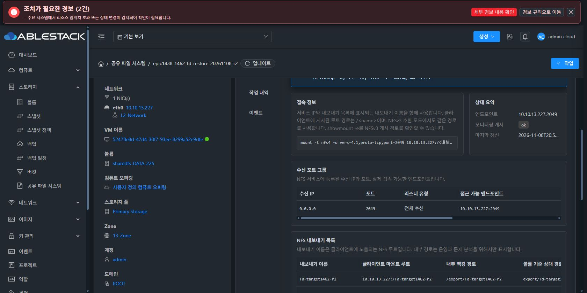
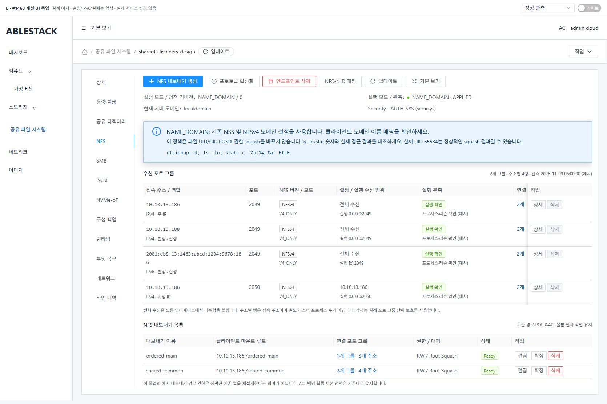
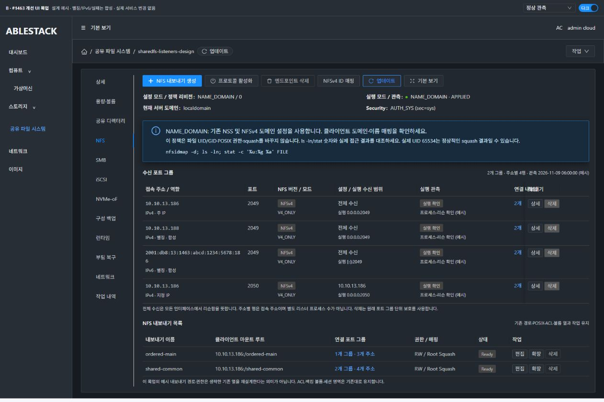
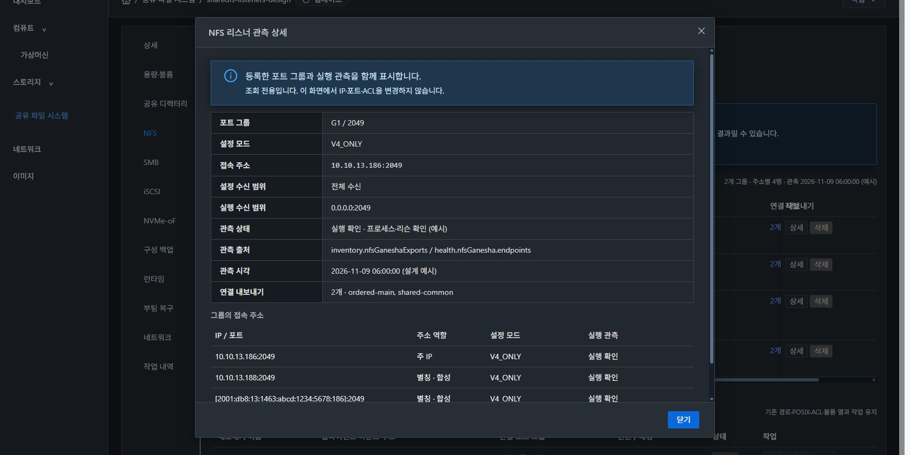

# #1463 NFS 프로토콜·리스너 행 표시 코드 설계 — 2026-11-09

## 판정과 범위

**설계·실제 배포본 대조·격리 SystemVM 주입·라이트/다크 목업 검토 완료. 제품 구현·모듈 빌드·배포·기능 인수는 미착수다.** 목적은 이미 존재하는 NFS 리스너 표의 표시 계약을 보완하는 것이다. NFS 네트워크/버전 지원을 새로 만들거나 리스너 적용·권한·원복을 바꾸지 않는다. #1462 재시험, SMB/iSCSI/NVMe UI 개편, 전체 UI 정리 #1468로 확장하지 않는다.

작업 기준은 Epic epic/1438-sharedfs의 f23c1df191af38a71f1f33d4fa6fd52513183391, local/upstream ablestack-europa413d1459682이며 fetch 후 base0/0을 확인했다. Windows 소스를 별도로 수정하지 않았다.

## A 현재 배포 UI / S VM 표준 / B 개선 목업

이미지는 반드시 다음으로 구분한다.

- **A 현재 배포 화면**: images/A-current-nfs-dark.jpg. 실제 #1462 시험 서비스에서 읽기 전용으로 확인했다.
- **S 표준**: images/S-vm-standard-dark.jpg, S-vm-nic-table-dark.jpg, S-vm-list-dark.jpg, S-vm-dialog-dark.jpg. 실제 컴퓨트 > 가상머신의 breadcrumb·목록·정보 상세·세로탭·행 작업·조회 대화상자다.
- **B 개선 목업**: images/B-* 파일. Vue3 + AntD와 실제 Mold Breadcrumb/ResourceLayout/MoldDialog/StorageNfsIdentityPanel/style/index.less를 import한 설계 전용 UI다. 별칭·IPv6·부분 실패는 합성이며 실제 서비스나 배포 성공으로 표시하지 않는다. 제품 API 요청은 하지 않는다.

## 실제 코드·배포 무결성과 관측

관리 JAR SHA a82e218eed0c4e4a7feb98f298798a317d13e0abd9174686f4f931776768d9ad, 실제 StorageServiceManagerImpl.class SHA9791d61f855737f7bf853b57a56ed2bdaadc03ef49f2c44e338d25966c4dc2cb는 현재 로컬 빌드 class와 일치한다. 실제 UI index356159dcd8080168db29a5c69afb59d7296bb57b8476faf7f9706863bc3fdb43와 참조 app.5dcfbf70.js/SHA45a92b2cd6288c7a8c574e073858b0aeeb0e8d02283021144c85613e8af6ee4d도 로컬 dist와 같다. 참조하지 않는 과거 JS 파일을 현재 실행본으로 해석하지 않았다.

| 실제 서비스 instance | API 등록 | SystemVM 직접 관측 |
|---|---|---|
| 2b6eab19-b339-40fd-b62a-e84d056844db / VM52478e8d… | V4_ONLY/2049/전체수신/주소227/Export2 | Ganesha1606, *:2049, V4_ONLY, 실제 CLI SHA5d61ef69…는 현재 소스와 일치 |
| ff7aa816-cd83-4507-b9d3-feec13f48432 / VM5d82a2a4… | V4_ONLY/2049전체수신 + 2050지정IP186/각Export1 | Ganesha1486/1491, 두 포트 모두 실제 0.0.0.0 구성·전체수신 소켓 |
| 0a647c9e-0bef-4c2d-8002-98ba44bccb36 / VM23ccd807… | V3V4_DUAL/2049/주소187/Export1 | Ganesha1451, *:2049, V3V4_DUAL, rpcbindRequired=true |

현재 VM의 ROOT와 DATA3개 및 기존 두 서비스의 10GiB XFS DATA는 SPARSE다. 새 디스크 생성·DATA 쓰기·재포맷·MAC 변경·서비스 재시작을 하지 않았다. 기존 두 SystemVM은 과거1460 CLI를 유지한 채 관측했으며, 이들의 코드가 최신1462 runtime과 같다고 주장하지 않는다.

### 확인한 표시 문제

1. SharedFSTab.vue:146~171의 기존 표는 protocolListenerColumns/nfsListenerRows를 사용한다. 공통열(:3599)은 모드·주소역할·관측시각을 보여주지 않는다.
2. protocolListenerEntries(:6978)는 NFS/SMB/iSCSI/NVMe 공용이다. NFS의 runtimeState는 API state로 기본화되고(:6993), wildcard와 같은 port의 지정IP를 상태/개수가 같으면 제외한다(:7014). 표시 개선을 위해 이 공통 함수를 고치면 다른 프로토콜·선택/삭제/접속 명령에 영향을 준다.
3. protocolListenerRows(:7022)는 구조화된 effectiveendpoints를 쉼표 문자열로 합친다(:7049). IPv6도 ip:port로 연결해 경계가 모호하다. nfsExportRows(:4077~4078)도 IP/port 문자열과 기본화된 모드를 재사용한다.
4. API의 NFS runtimestate=READY는 실제 소켓 확인 결과가 아니다. createProtocolResponse(:7131)는 DB enabled/state를 사용하며 NFS mode만 :7155에서 추가한다. 반면 inventory.nfsGaneshaExports와 health.nfsGanesha.endpoints는 processRunning/listening/protocolMode·port·listenIp를 이미 제공한다.
5. 실제2050은 등록 listenip=13.186/DEDICATED지만 관측은 전체수신이다. 주소별 접속 가능 목록과 실제 프로세스 바인딩은 다른 정보다. 이 이슈에서 적용 로직을 바꾸지 않고 두 출처를 구분한다.
6. generatedAt/staleAfterSeconds(실제30초), stale/cached, 기존 storageReadErrors·pending·generation이 이미 있다. DB Ready/캐시 성공을 실행 확인으로 바꾸거나 stale를 리스너 실패로 표시하면 안 된다.

관측 원문은 evidence/api-observed.json, deployed-integrity.json, source-integrity.json에 있다.

## 최소 제품 변경 계획 — 아직 구현하지 않음

| 파일 | 계획 |
|---|---|
| ui/src/utils/storageNfsListenerPresentation.js (신규) | 순수 표시 모델: 구조화 주소/등록 그룹/실행 관측/모드/상태/연결 요약. 입력 불변 |
| ui/src/components/storage/StorageNfsListenerTable.vue (신규) | NFS 표·읽기 전용 상세 MoldDialog·주소별 행·고정 작업열·상태/출처 렌더 |
| ui/src/views/storage/SharedFSTab.vue | NFS 표만 새 표시 모델에 연결. Export의 기존 IP/포트 셀에 그룹 개수·상세 tooltip/조회 연결. 나머지 경로/ACL/권한/볼륨 열 유지 |
| ui/public/locales/ko_KR.json, en.json | NFS 전용 상태/출처/주소역할/관측시각 문구 |
| ui/tests/unit/... | 실제 직렬화 fixture를 사용하는 순수 모델/컴포넌트/SharedFSTab 갱신·작업 계약 회귀 |

**API·응답 class·DB·서버·SystemVM 제품 코드는 변경하지 않는다.** 현재 구조화된 필드로 충분함을 실제 관측으로 확인했다. 성능을 위해 API나 QGA 호출을 추가하지 않는다. 구현 중 필드 부족이 새로 실증되면 임의 fallback/범위 확장 전에 근거를 보고한다.

### 순수 모델 계약

buildNfsListenerPresentation({ protocols, inventory, health, exports, readState, now, scope }) -> { groups, rows, exportGroups, summary }

- protocols는 **원래 NFS API 행**을 읽는다. 공통 protocolListenerEntries의 필터를 변경하거나 그 결과에서 사라진 행을 복구하려 하지 않는다. enabled=false도 등록 상태로 표시한다.
- groupKey는 원래 protocol UUID, 없으면 protocol/설정 listenIP/port의 안정적인 tuple이다. 주소 행의 key는 groupKey+family+정규화된 address+port다. 배열 index·시간을 key로 쓰지 않는다. 그룹 수와 주소 행 수를 별도로 표시한다.
- effectiveendpoints[]의 ipaddress/port/role을 우선 사용한다. network.addresses의 주소/family/role은 실제 관측으로 출처를 붙인다. 누락된 데이터는 “설정상 주소·관측 전”이며 접속 확인으로 승격하지 않는다. 주소가 없으면 그룹 자체를 미관측 행으로 남긴다.
- IPv6는 반환된 주소를 읽고 IP와 port를 분리 보관하며 출력은 [IPv6]:port다. 쉼표 endpoint 문자열을 재파싱하지 않는다. 새 IPv6 네트워크 활성화·지원 범위 확대는 하지 않는다. 합성 IPv6는 표시/줄바꿈/식별자 회귀로 구분한다.
- runtime은 inventory.nfsGaneshaExports/health.nfsGanesha.endpoints를 포트·명시 bind 주소로 연결한다. exact match를 먼저 쓰고 같은 port의 단일 wildcard만 공유 관측으로 연결한다. 같은 port에 후보가 복수면 임의 첫 행을 고르지 않고 “관측 연결 모호”다.
- API 행 없이 실행만 존재하는 항목은 “실행만 관측·등록 미확인”의 조회 전용 행으로 남긴다. 삭제 버튼은 제공하지 않는다. 111/rpcbind 보조 프로세스를 NFS Export 리스너 행으로 만들어 수를 부풀리지 않는다.
- 설정 listenIP와 실제 bind는 별도다. 전체수신의 여러 접속 IP 행이 여러 프로세스를 뜻하지 않는다. 지정IP 요청과 실제 전체수신 차이도 숨기지 않는다.
- configuredMode와 observedMode를 분리한다. V4_ONLY만 NFSv4, V3V4_DUAL만 NFSv3+v4로 표시한다. 알 수 없는/없는 값은 UNKNOWN·원문이며 V4_ONLY로 기본화하지 않는다. 실제 모드가 없으면 설정 모드를 현재 실행 버전처럼 표시하지 않는다. 두 모드 불일치는 경고한다.
- 그룹 연결 개수는 API linkedresourcecount를 등록 참조값으로 보존한다. Export tooltip은 최신 exports의 UUID를 중복 제거해 listenerports/config.listenerGroupPorts로 연결한다. 조회 실패·모호한 레거시 값은 개수 미확인/이전값 표시이며 0으로 바꾸지 않는다.

### 관측 상태와 수명

| 상황 | 표시·동작 |
|---|---|
| 최초 조회 중/아직 응답 없음 | “조회 중”/“미관측”, 기본 Ready를 만들지 않음 |
| 같은 scope 갱신 중 | 기존 행을 유지하고 표/업데이트 버튼만 loading. 전체 NFS 탭 재마운트 금지 |
| fresh이며 해당 프로세스+리슨 true | “실행 확인” + 원래관측 시각/출처. 클라이언트 mount 성공의 뜻은 아님 |
| fresh이며 해당 프로세스/리슨 false 또는 명시 error | 그 그룹만 “리스너 실패”; 다른 그룹 정상은 유지 |
| 오래된 응답 | “오래된 관측·마지막 상태…”; 현재 실행 실패/성공으로 단정하지 않음 |
| 조회 실패/timeout | 이전 행+“조회 실패·현재 미확인”, 서버/통신 오류를 리스너 중지로 바꾸지 않음 |
| health/inventory 일부만 실패·서로 다른 boot/관측 충돌 | 유효한 출처만 표시하고 부분 관측/상충 경고. 오래된 긍정으로 새 실패를 덮지 않음 |
| disabled 등록과 실제 실행 동시 관측 | 설정 중지/실행 잔존을 분리 표시. 자동 정지/삭제하지 않음 |

fresh는 응답의 explicit stale와 generatedAt+staleAfterSeconds를 함께 평가한다. 미래/손상 timestamp는 시각 미확인이다. NFS 탭이 열린 동안만 소유한 짧은 표시용 clock(예:5초, 네트워크 호출0)을 갱신하고 탭 이탈/unmount에 정리한다. 새 전역 poller를 만들지 않는다.

기존 fetchStorageServiceData(:5371)의 request owner·AbortController·30초 전체 deadline·scope/generation 보호는 유지한다. inventory가 NVMe 일괄 snapshot(:5529)에 포함된 현재 경계도 참고해 readState에 health/inventory/nvme 실패를 각각 넘긴다. 새로운 표시 component가 임의 fetch/재시도·loading 해제를 하지 않는다. 이전 scope 응답을 현재 행에 반영하지 않는다.

### 쓰기 작업·기존 기능 보호

원래 그룹 raw/id/listenIp/port/protocol을 보존한 deleteRecord만 기존 openDeleteConfirm('protocolListener', record)에 전달한다. 주소별 행/IPv6 display 문자열을 삭제 listenip로 사용하지 않는다. 같은 그룹의 반복 주소 행에서도 삭제는 그룹 전체임을 명시한다. API 참조개수·권한·configurationProtection·impact/preflight·drain·확인/승인·최종 서버 검증을 유지하고, 관측/참조가 미확인이면 버튼을 비활성화한다.

**공통 protocolListenerRows/Entries, nfsRuntimeProtocolMode, nfsExportListenerPorts, 생성/편집/삭제 payload·접속 명령은 변경하지 않는다.** nfsExportRows에는 별도 표시 전용 metadata만 추가한다. 컴포넌트는 표시 데이터나 정규화한 주소/모드를 서버에 제출하지 않는다. 기존 SMB/iSCSI/NVMe 및 NFS 권한·ID 매핑·ACL·볼륨/세션 동작도 유지한다.

## VM 표준·다크·간격 설계

- VM과 같은 breadcrumb의 업데이트·작업, 좌측 정보 카드/우측 세로탭을 유지한다. 상세 탭은 정보만 표시한다. NFS 본문에 “NFS” 중복 타이틀을 추가하지 않는다.
- 주요 버튼은 모두 좌측 그룹이다. 파란 NFS 내보내기 생성이 첫 번째, 아이콘+“업데이트” 통일, “넓게 보기”는 그 그룹 마지막이다. 화면 우측 끝 정렬하지 않는다.
- 기존 NFS ID 매핑 패널은 실제 컴포넌트를 재사용하며 기능/내용을 재설계하지 않는다. ACL·백킹 볼륨·세션 레이아웃을 이 이슈에서 재편하지 않는다.
- 새 표는 주소/역할·port·버전/모드·설정/실행 수신 범위·실행 관측·연결 Export·작업 열이다. 주소는 줄바꿈·선택/복사가 가능하며 전체 주소를 ellipsis로 숨기지 않는다. 긴 표는 내부 가로 스크롤, 작업 열은 우측 고정이며 고정 헤더/셀은 같은 불투명 테마 배경을 사용해 스크롤 아래 글자가 겹치지 않게 한다. 행이 많으면 VM 표와 같은 명시적 전체 개수·페이지 크기의 client pagination으로 모든 행에 접근한다. Export는 연결 그룹/주소 개수와 전체 tooltip/상세 목록을 제공한다.
- 조회 상세는 공통 MoldDialog(size lg): 제목 헤더·닫기 푸터는 고정, 본문만 세로 스크롤한다. 읽기 전용이므로 확인/취소의 가짜 쓰기 동작을 만들지 않는다.
- 실제 테마 var(--ui-text-primary/secondary), --ui-bg-surface/elevated, --ui-border, --ui-link를 쓴다. 색상만으로 상태를 구분하지 않는다. 고정 셀·hover·disabled·긴 코드 문자열까지 같은 토큰을 쓴다. 전역 theme 파일은 바꾸지 않는다.
- 목업 기본1680×841에서 toolbar→다음 컴포넌트 간격16px, 좌측 primary/버튼 순서·긴 IPv6 완전표시/브라우저 전체 가로overflow없음, 모달header33~88/footer743~808·body655/scroll722/overflow auto를 측정했다. 실제 측정 원문은 evidence/mockup-ui-review.json이다.

## 구현 전 실제 SystemVM 주입 시험

evidence/systemvm-observation-probe.py를 각 SystemVM의 /var/tmp/issue1463-design-*에만 주입했다. 실제 설치 CLI의 inventory/health·ss와 설정 해시를 읽었으며, 실패/누락/stale는 **관측 사본**에만 주입했다. 활성 CLI·Ganesha 설정·socket·인터페이스·ACL·DATA를 교체하지 않았다.

각3대×6항목: 실제 프로세스/리슨·모드 일치, stale 사본≠실제장애, 조회실패 사본≠실제장애, 한 포트 실패 사본 분리, 누락관측≠DBReady, 미확인모드≠v4 기본값이 모두 통과했다. 설정 해시 전후 동일, DATA쓰기0·서비스재시작0이다. 이는 **표시 설계에 필요한 관측 계약 실증**이며 후보 제품 기능의 인수/장애 유발 실험이라고 확대하지 않는다.

실제 환경은 IPv4 단일주소와두포트/V4_ONLY·V3V4_DUAL이다. 실제다중별칭·IPv6접속·서비스장애는 이번 설계에서 발생시키지 않았다. 주소 배열/IPv6/긴 목록/부분실패는 목업과 향후 fixture 회귀로 구분한다. 새 자원/디스크를 만들 필요가 없었고 기존 SPARSE를 관측만 했다.

## 구현 승인 후 검증 계획 — 미실행

1. 실제 API 직렬화 fixture(위3서비스)→새 순수 모델→컴포넌트 mount를 연결한다. 단일/다중주소, wildcard+지정IP 동일port 보존, IPv6 bracket, 비정상 mode, 모호한 매칭·실행전용행·disabled, distinct Export 개수·없는연결을 회귀한다.
2. raw 응답 deep-freeze와 before/after hash로 입력/payload 불변을 검증한다. SMB/iSCSI/NVMe 기존 공통 computed 결과와 NFS 생성/편집·삭제 요청 계약도 비교한다.
3. deferred 응답으로 refresh중 기존행유지·부분실패/oldscope응답 차단·deadline/unmount 타이머해제·모달재진입을 검증한다. 실제 삭제 모달은 원래 그룹 listenip/port를 보내고 unknown/연결중은 기존 보호로 막는지 확인한다.
4. UI lint/관련회귀·로컬 UI production build만 수행한다. API/DB/게스트 변경이 없으므로 백엔드/시스템이미지 재빌드나 Actions는 불필요하다.
5. 13번에 변경 UI만 배포하고 운영 config·테마를 보존한다. 실제 단일/두포트·DUAL 서비스 UI를 API/직접 관측과 대조하고 반복 업데이트·다른 탭 왕복·가독성을 확인한다. 리스너설정변경/재포맷·클라이언트대용량I/O/전체복원재시험으로 확대하지 않는다.
6. 실제 별칭이필요한 인수는 기존 UI의지원주소만사용한다. IPv6 실제운영지원이미확인 상태라면 활성화를새로구현하지않고반환IPv6fixture표시검증과제약을기록한다. 제품오류는원인과증거를분석후중단한다.

## 산출물

목업 로컬 빌드만 성공했다. 제품 구현/제품 모듈 빌드/배포/이슈 종료는 하지 않았다. 설계 자료만 Epic 브랜치에 저장하며 **별도 목업 PR은 만들지 않는다**. #1463은 구현 대기 OPEN, #1468은 HOLD다.

목업 표 셀의 실제 측정 색상 대비는 라이트 7.56:1, 다크 9.18:1이다. 전역 접근성 인증이 아니라 해당 셀/배경의 측정이다.
