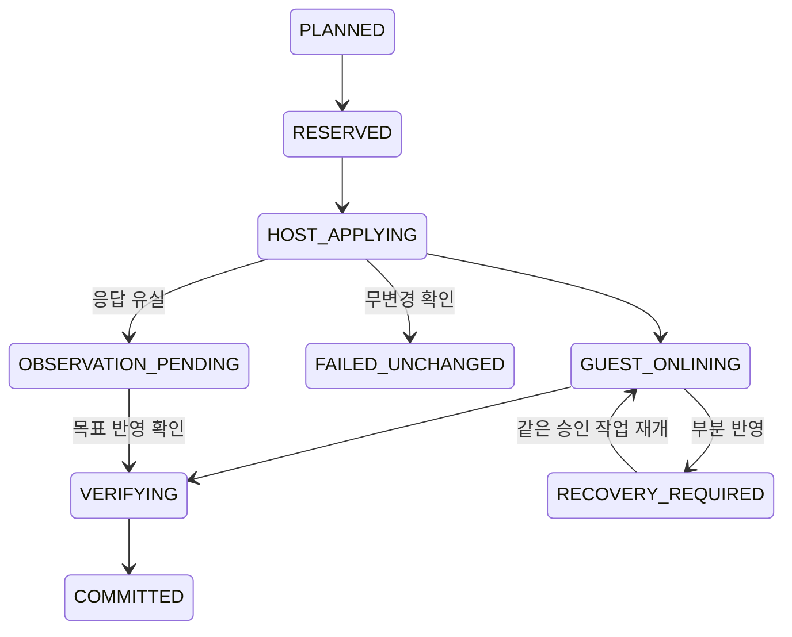
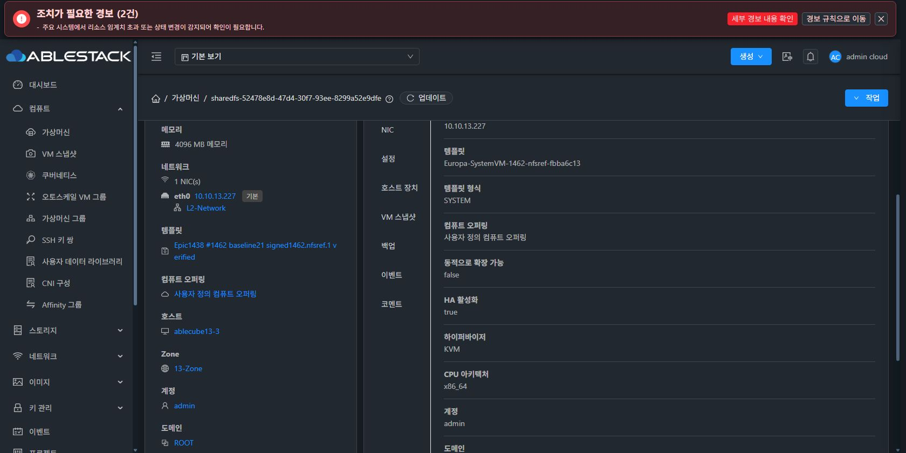
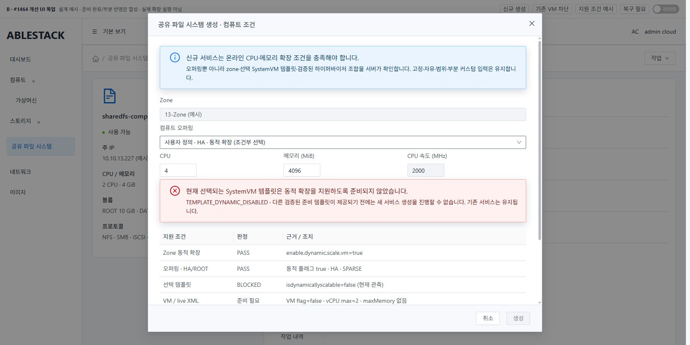
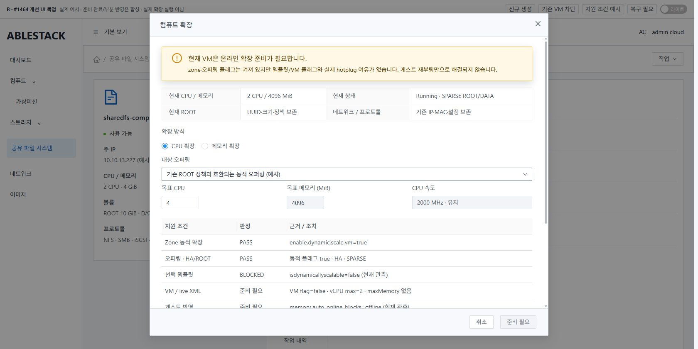
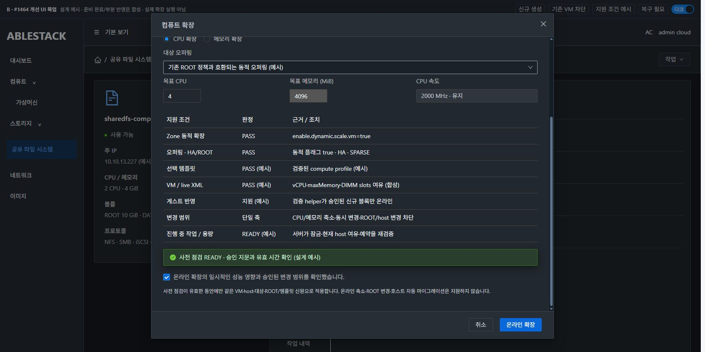
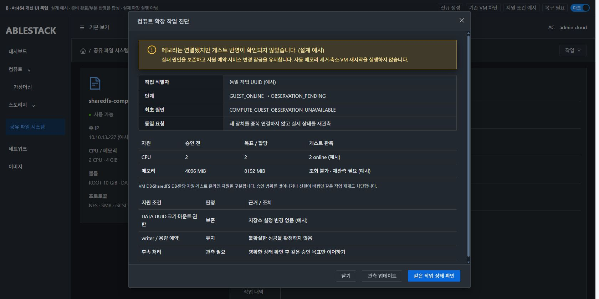

# #1464 온라인 확장 가능한 SharedFS 오퍼링 정책 — 코드 수준 설계

2026-11-09. **설계·배포본 대조·실제 SystemVM 격리 주입·목업 검토 단계다. 제품 구현/제품 빌드/배포/실제 hotplug는 하지 않는다.**

## 결론과 초기 지원 경계

오퍼링의 dynamicscalingenabled만 강제하면 부족하다. 현재13번은 zone=true, 선택오퍼링=true지만 template=false·VM=false이고 live XML의 vCPU상한2/메모리슬롯0이며 게스트 메모리 자동온라인도offline이다. 조건을 검사하지 않고 실행 메뉴만 여는 설계를 채택하지 않는다.

초기 지원은 **검증된 KVM x86_64 조합에서 CPU 또는 메모리 한 축씩 증가**다. 고정·자유·범위·부분커스텀을 유지하며 iscustomized와 온라인확장플래그를 혼동하지 않는다. 온라인축소·CPU속도/cap정책변경·동시CPU+메모리증가·ROOT/스토리지변경·호스트자동이동은차단한다. 양쪽을늘리려면CPU단계와메모리단계를별도작업으로진행한다. 이는 이번 승인 전 설계에 제시하는 안전 제약이다.

기존 서비스는 강제 정지·플래그 수정·템플릿 교체하지 않는다. 신규 생성 정책만 동적 준비 조건을 필수로 하며, 기존비호환VM에는 명확한 전환 안내를 제공한다. #1467 템플릿 교체/자동 복구, #1462 전체복원, 일반VM 확장 정책으로 범위를 넓히지 않는다.

## 실제 배포·소스 근거

기준 Epic f19372ba6ad050f4a132960b6a70f33abece9791 / local/upstream Europa413d1459682, fetch후base0/0. canonical WSL에서 작업했다.

- 현재SharedFS edff302a… / VM52478e8d-47d4-30f7-93ee-8299a52e9dfe / host13.3/i-2-227-VM.2CPU/2000MHz/4096MiB,isdynamicallyscalable=false.
- 오퍼링5da2d6c9…(자유커스텀)는HA/동적확장=true·ROOT SPARSE다. 기존 fixed de15d05b…와free610b811a…는동적플래그=false인데현재생성eligibility.selectable=true다. range0a3cccb9…는동적=true다. **사용자정의 여부와 동적확장 가능 여부는 별개**다.
- 선택된Ready SYSTEM템플릿2924ccf5…는isdynamicallyscalable=false. zone enable.dynamic.scale.vm=true, cluster kvm.memory/cpu.dynamic.scaling.capacity는0(코드상host상한사용)이다.
- live XML vcpu=2/current2,maxMemory없음,DIMM0,NUMA없음. QMP hotpluggableCPU2개는모두이미연결돼있다. host48CPU,libvirt11.10/QEMU10.1이며domcaps의하이퍼바이저vCPU상한240과실제VM상한2를구분했다.
- 게스트kernel6.1.0-54-amd64:CPU/MEMORY_HOTPLUG=y,CPUonline/present/possible0-1,메모리block128MiB,auto_online_blocks=offline,MemTotal4009132kB다. CPUadd-onlineudev규칙은있지만메모리online규칙은확인되지않았다.
- 관리JARa82e218eed0c…/UIindexb1a5d36337cc…은#1463배포본이다. OfferingEligibility/SharedFSServiceImpl/StorageVmLifeCycle와hostScaleWrapper는로컬class해시가배포본과같다.
- UserVmManagerImpl 전체class는로컬target과다르다. 관련 checkIfDynamicScalingCanBeEnabled/upgradeRunningVirtualMachine/upgradeVirtualMachine3메서드는정규화한실제배포바이트코드와동일하다. 전체class를동일버전으로간주하거나임의전체JAR교체를설계하지않는다. 구현시정확한trackedsource로새로빌드하고,배포전무관한메서드/ABI/의존성차이를검사해범위를정렬해야한다. 현재target캐시를그대로배포하지않는다.

원문: evidence/observations.json,creation-catalog-wire.json,deployed-method-comparison.json,systemvm-results.json. 소스에서 확인한 경로:

| 경로 | 현재 계약 |
|---|---|
| api/.../SharedFSOfferingEligibility.java | requirements.dynamicscalingrequired=false, HA/CPU·RAM범위/ROOT보호·커스텀입력계약 존재 |
| plugins/storage/sharedfs/storagevm/.../StorageVmSharedFSLifeCycle.java:192,247,305 | 생성목록/최종검사 공용. createAdvancedVirtualMachine에이미dynamic요청=true를전달하지만템플릿/zone/offering조건과AND됨 |
| server/.../SharedFSServiceImpl.java:610,893,1048,1329 | 신규접수·이어서준비/기존볼륨경로에검사. 기존오퍼링변경은Stopped만허용 |
| StorageVmSharedFSLifeCycle.java:545 | 기존userVmManager.upgradeVirtualMachine 내부경로재사용 |
| UserVmManagerImpl.java:2546~2705 | 온라인축소거부·동적flag·zone·용량·기존엔진. host자동이동과ROOT오퍼링변경도할수있음 |
| UserVmManagerImpl.changeDiskOfferingForRootVolume | 같은customROOT여도size입력이없으면볼륨오퍼링변경분기에들어갈수있음. compute-only표시만믿고ROOT무변경을가정하지않음 |
| KVMGuru:243~327 / LibvirtVMDef.MemDef | 동적VM이면CPU/RAM상한을계산. maxMemory>current일때slots16생성 |
| LibvirtScaleVmCommandWrapper | **메모리attach→CPU→shares/quota**순서.후속실패가앞의메모리증가를되돌리지않고false를반환할수있음 |
| VirtualMachineManagerImpl:5421~5497 | agent성공후VM DB/용량갱신.게스트online확인계약은없음 |
| ui/config/section/storage.js / ChangeSharedFSServiceOffering.vue | Stopped전용/고정오퍼링필터. VM메뉴는sharedfsvm확장을숨김. 이보호를풀어우회하지않음 |

libvirt의vcpu current/max,maxMemory/slots는각각다른자원이며메모리장치는게스트온라인확인과별개다. [공식XML계약](https://libvirt.org/formatdomain.html#cpu-allocation), [메모리할당](https://libvirt.org/formatdomain.html#memory-allocation). 자동역방향hot-unplug의안전성이입증됐다는뜻은아니며이번초기범위에서는하지않는정책을선택했다.

## 최소 변경 구조

### 1. 신규 생성 정책

SharedFSOfferingEligibility의기존constraint/ROOT/HA/아키텍처계약을재사용한다. creation전용requirements.dynamicscalingrequired=true와구조화된reasons를추가한다. 고정·free·range·부분커스텀검증,고정0MHz무제한계약은유지한다.

새 SharedFSComputePolicy를카탈로그와최종생성검사에공통사용한다. 검사순서:
1)Active/권한/HA/CPU·RAM·속도범위·SPARSE이상ROOT,
2)offering.dynamicscalingenabled,
3)zone enable.dynamic.scale.vm,
4)실제선택되는Ready SYSTEM템플릿의동적flag·아키텍처·검증compute프로파일,
5)검증된KVM지원조합·향후hotplug여유정책.

선택가능여부만보내지말고 TEMPLATE_DYNAMIC_DISABLED/ZONE_DYNAMIC_DISABLED/DYNAMIC_OFFERING_REQUIRED/HYPERVISOR_UNVERIFIED/COMPUTE_PROFILE_UNVERIFIED등원인과해결방법을보낸다. zone별환경조회는batch/cache로하고오퍼링행마다원격조회하지않는다. 불명확하면불가로표시한다.

템플릿선택과allocation은같은후보/해시/환경지문을사용한다. 현재TRUE인생성요청flag를단순반복수정하지않는다. 부팅후DATA포맷이시작되기전에VMflag·XML·게스트helper실행/무결성을검사한다. 부적합이면형식화전준비차단상태로남기며같은creationrequest로원인을보여준다.

새CreationContext에policyVersion을고정한다. 새요청은서버가ONLINE_V1로만작성하고클라이언트의legacy요청은받지않는다. 이미접수된구버전컨텍스트/복구/이어하기는기존계약으로끝낼수있게하고온라인지원으로오인시키지않는다. 재요청이새VM·중복포맷을만들지않는#1443~1445계약을회귀한다.

현재13번선택템플릿은false라강제정책을바로배포하면새생성이모두차단된다. **준비된템플릿/검증helper와새시험VM의양성실증을먼저갖춘후강제정책을배포**한다. 템플릿flag를증거없이켜거나일반SystemVM선택정책/일반VM/클러스터설정을자동변경하지않는다. 현재일반SystemVM선택을바꾸는새템플릿교체기능은설계하지않았다.

### 2. SharedFS 전용 온라인 작업 경로

기존 changeSharedFileSystemServiceOffering에추가mode=OFFLINE(default)/ONLINE/PREPARE_ONLINE와custom details(cpuNumber,cpuSpeed,memory),requestid,expectedrevision,planfingerprint를계획한다. 기존OFFLINE호출·일반VM API계약은유지한다. ROOT크기/IOPS·자동이동파라미터를온라인입력으로노출하지않는다.

새 readonly getSharedFileSystemComputeStatus(id,선택target/details,operationid)는static조건·관측상한/현재할당/guestonline·차단원인·서버계획지문/유효시각·작업상태를반환한다. 기존jobid는상위async응답을사용하고중복필드선언하지않는다. UI의판정은서버와같은SharedFSComputePolicy를사용하며브라우저에서별도규칙을복제하지않는다. 사전점검유효기간은제출전검사용이며접수된장시간작업을만료시켜새작업으로재실행하지않는다. 재개는동일한승인목표와opUUID를유지한다.

ONLINE단계:
- 소유권/상태/기존생성·포맷·구성/런타임/삭제작업/자원제한검사,
- 같은host·VMuuid/boot·템플릿/ROOTuuid·크기/할당정책·현재/목표CPU/RAM·XML·guest관측과기존configurationrevision으로fingerprint생성,
- Submit은writer행잠금아래현재관측/지문을재검증·같은requestid+requesthash를영속화,
- 같은host의CPU·메모리여유와dimmslots16/미사용slot·NUMA/host및guest정렬·QGA접근/검증helper확인,
- CPU/MEMORY한축만증가,속도/cap정책과ROOT보존,기존엔진의태그/용량/quota검증재사용,
- host실제효과→guestonline→신원/서비스검증→VM/SharedFS/StorageService오퍼링정보와자원정산일치확인후완료.

sharedfsvm인경우에만공통엔진에명시적인no-migration/no-root-change·부분실패회계hook을넣는다. 일반VM의동작은그대로다. 기존GenericUserVmManager의ROOT변경/자동호스트이동을그대로호출해부수효과를내지않는다. public scaleVirtualMachine의SharedFS우회는차단하고전용SharedFS경로를안내한다. 내부provider호출은서버소유의작업UUID/VM/job과결합해허용한다. 클라이언트details의임의internalflag로우회시키지않는다.

### 3. Guest online과 상태 영수증

새서명된 compute_hotplug.py와CLI compute inspect/start/status/resume/verify를계획한다. 기존보호updater/manifest/관리파일목록/활성release검증으로배포한다. 현재VM의auto_online_blocks를전역으로변경하거나기존offline메모리를모두online하지않는다.

작업전에cpu present/online/topology와memory block목록·128MiB단위·bootid를저장한다. 메모리attach후host가재조회한새DIMM의alias/물리주소범위/크기·이전신원으로**이번작업의신규블록**만검증한다. CPU도새게스트ID와QMP socket/core/thread등의상관관계를검증하며단순ID동일성을가정하지않는다. 기존udev가이미online했으면재관측만한다. 과거offline/범위밖/다른boot/다른크기·교체경로는건드리지않는다.

게스트128MiB블록만으로hostDIMM정렬/증가량까지지원한다고추정하지않는다. 승인된이미지·machine프로파일에서실증한증가단위만허용한다.

게스트온라인은동일opUUID의private journal/start/status로추적하고한번의QGA호출deadline과작업전체deadline을분리한다. 응답유실/프로세스재기동에는현재효과를관측해중복worker·중복online을차단한다.

완료는agent성공한줄이나MemTotal==요청MiB로판정하지않는다. 할당XML/QMP·신규online블록증가량·게스트CPUonline·MemTotal증분(커널관리오버헤드허용범위)·서비스/세션관측을함께검증한다. 검증영수증에는op/VM/boot/host/targethash/before·after·단계가들어간다. 기존storageconfiguration영수증이나백업복원을컴퓨트hotplug의대체결과로사용하지않는다.

### 4. 잠금·재개·실패 회계

StorageServiceInstance.activeLifecycleOperationUuid를행잠금아래예약한다. 기존구성·백업복원·runtime·삭제와동시에실행되지않는다. 삭제전용이름의기존차단코드는기존삭제에유지하고새compute작업에는구분된진단을제공한다. 같은opUUID라도허용된mode/VM/job소유권이맞지않으면통과시키지않는다.

새 cloud.sharedfs_compute_operation 1테이블:
id/uuid/sharedfs_id/instance_id/vm_id/account_id,requestid/requesthash,operation_type(VARCHAR32고정COMPUTE_SCALE_UP/COMPUTE_PREPARE),mode/state/phase,old/target_offering_id,job_id,base_configuration_revision,plan_fingerprint,before_json/plan_json/observed_json/failure_json/reservation_json(MEDIUMTEXT),created/updated/completed.
UNIQUE(sharedfs_id,requestid),uuid고유키,sharedfs/state·vm/state인덱스. 기존프로토콜구성revision은증가시키지않고계산작업generation/지문을별도로사용해게스트구성트랜잭션과충돌하지않게한다.

기존resource-limit/host-capacity예약을작업UUID에묶는SharedFSScaleAccountinghook이필수다. reservation_json에는host/old·target자원/delta/예약토큰/정산상태를보존한다. SharedFS작업의독립적인상한예약과기존엔진의used계수를구분한다. 기존엔진의성공/실패used계수갱신은재사용하되외부상한예약은그finally에서풀지않는다. 같은opUUID의예약을재사용해중복예약/자기예약때문의자기차단을막고,host용량/계정자원재계산·청소기도진행중상한예약을보존한다. 일부반영/응답유실에는승인target상한을유지하고실제host/guest/DB가일치한후에만남은예약을정산한다. 무변경실패만안전하게해제한다. commit/release는CAS로한번만수행하고재시작/TTL만으로풀지않는다. 일반VM경로는변경하지않으며실제DAO+host관측회귀로양쪽회계를검증하기전노출하지않는다.

부분반영시임의CPU/MEM축소·DIMM제거·VM강제재시작은하지않는다. 최초실패(메모리attach/CPU/guestonline/검증/정산)를불변보존하고다음관측·복구진단과구분한다. 동일작업재개는현재실제효과를확인해중복attach/online을피한다. 실제target이승인범위밖이면보호상태를유지하고운영자판단을요청한다. 관리재시작/QGA단절도같은opUUID로추적한다.

### 5. 기존 인스턴스 전환

현재template=false인VM은이기능이flag만켜서변환하지않는다. 지원템플릿이필요하다는안내와기존DATA보존/새서비스경로를제시하며템플릿교체자동화는#1467범위다.

템플릿/게스트가검증된기존VM만정지상태에서PREPARE_ONLINE을사용한다. 같은CPU/RAM·호환오퍼링과VMflag준비를기록하고**정지된준비완료**로끝내writer를해제한다. 그후사용자가기존SharedFS시작UI로완전히새QEMU프로세스를만들고다시XML/guest를검사한다. guestreboot와구분한다. 자신의lifecycle잠금때문에기존powerguard가시작을막는순환을만들지않고기존powerguard도느슨하게풀지않는다.

## 파일 단위 구현 계획 — 미착수

| 위치 | 변경 |
|---|---|
| api SharedFSOfferingEligibility,SharedFSLifeCycle/Service,ChangeSharedFSServiceOfferingCmd·새ComputeStatusCmd/Response | 공통판정/명시mode·customparams·조회와상위job계약 |
| SharedFSServiceImpl,StorageVmSharedFSLifeCycle,SharedFSCreationContext | 신규강제·기존legacy컨텍스트보존·실제선택환경재검증·postbootcompute gate·전용작업연결 |
| 새SharedFSComputePolicy/Coordinator/Accounting·DAO/VO·schema migration | 위계약의잠금/영속작업/보수정산·resume |
| UserVmManagerImpl·VirtualMachineManagerImpl의SharedFS분기 | 전용진입·ROOT/이동차단·부분/불명확실패회계hook.일반VM분기원문회귀 |
| KVM 신규compute관측Command/Answer/Wrapper,ScaleVmAnswer관측필드·ScaleWrapper | liveXML/QMP증거·정확한단계/firstfailure·전후할당관측.일반ScaleAnswer기본계약유지 |
| compute_hotplug.py,CLI·baseline/profile·초기이미지준비 | 서명된새모듈·신규소유CPU/메모리online·검증.프로토콜렌더러는변경하지않음 |
| UI ChangeSharedFSServiceOffering/새SharedFSComputeDialog,storage.js,CreateSharedFS·OfferingInputs/locale | VM표준MoldDialog·서버사유·커스텀값·계획/작업상태.상세는정보만,목록에원격조회추가없음 |

핵심은UI필터만추가하는수정이아니다. 부분실패·실제guest반영을안전하게판정하기위한SharedFS전용훅만추가하고스토리지적용·일반VM·공통템플릿선택정책을재작성하지않는다.

## A / S / B UI

A는현재실제화면이다. 현재RunningSharedFS작업에확장이없고,VM상세는동적으로확장가능=false다.
S는컴퓨트>VM의breadcrumb·목록·상세/세로탭·모달구조다. 해당실제UI를대조했고MoldBreadcrumb/ResourceLayout/MoldDialog·AntD·현재테마를목업에서직접import했다.
B는개선설계목업이다. 준비완료/부분반영은합성이며실행성공으로제시하지않는다.

- SharedFS의작업메뉴에서컴퓨트확장/작업상태로진입한다.일반VM메뉴의sharedfsvm우회보호를풀지않는다.
- 신규생성은기존compute선택영역에필수조건/구체적불가사유를추가한다.동적false오퍼링은명시적으로선택불가다.
- 온라인모달은현재/목표·지원조건·실제차단·정렬/상한·ROOT/SPARSE보존을보이고사전점검후승인된계획만제출한다.복구화면은할당/guest/DB와최초실패를분리한다.
- 상세탭은정보전용이다.헤더의제목·푸터취소/확인은고정,본문만스크롤한다.라이트/다크토큰·16px간격·테이블줄바꿈을사용한다.전체UI#1468은진행하지않는다.

## 실제 SystemVM 설계 실증과 한계

실제게스트에서kernel/sysfs/udev·보호된CLI/설정해시를읽었다. 사전guard16항목과복구상태사본4개,소유블록private prototype7항목을확인했다. /sys가아닌임시mock tree에서승인된신규블록만변경·기존offline/무관블록보존·boot/크기거부·중복쓰기0을실증했다.

**실제hotplug/실제I/O유지·용량정산성공을검증한것은아니다.** 현재VM은준비되지않았으므로무리한명령을보내지않았다. 실제sysfs쓰기0·DATA쓰기0·재시작0·현재CLI/NFS설정해시불변이다. ROOT/DATA는기존SPARSE를관측만했고새디스크/VM·THIN·MAC변경0이다. 배포된binary/flag도변경하지않았다.

제품 변경 착수 전에 추가로 통과해야 할 양성·부분실패 회계 실증 게이트:
1)검증SystemVMprofile/서명helper를준비한**새VM·SPARSE ROOT/DATA**로실제allocation XML/maxCPU/maxMemory/16slots·첫부팅guesthelper를먼저증명,
2)실제UI에서CPU2→4,별도메모리4→8GiB를한축씩확장하고host/guest/DB·예약정산·NFS/SMB및구성된블록프로토콜의기존세션/I/O·데이터/권한을확인,
3)실제host후속실패/guest온라인부분실패/QGA단절·관리재시작에같은작업관측·예약유지/정확한해제·중복device0을주입,
4)기존비동적서비스·구버전이어하기·일반VMscale/ROOT이동·삭제/config/runtimefence·오퍼링4모드/ROOT SPARSE보호를회귀,
5)필요모듈은로컬로만빌드하고13번범위를정렬해배포.양성실증전메뉴를작동가능으로보이거나신규강제정책을먼저배포하지않음.

## 산출물 상태

제품소스는미변경이다. 로컬목업만빌드하며별도목업PR은만들지않는다. 설계·증거만Epic브랜치/이슈에기록하고#1464 OPEN/구현대기로남긴다.

## 비교 이미지

**A 현재 배포 VM — 동적 확장 false**

**B 신규 생성 제한 목업 — 라이트**

**B 현재 VM 차단·전환 안내 목업 — 라이트**

**B 점검/승인 목업 — 다크·합성 지원 조건**

**B 복구 필요 목업 — 합성 부분 반영**

목업 검토10항목은 evidence/mockup-review.json에 있다. 헤더33~88px·푸터743~808px,본문655px/스크롤914px를841px viewport에서확인했다. 실제제품확장인수나실제DIMM연결결과로대체하지않는다.
