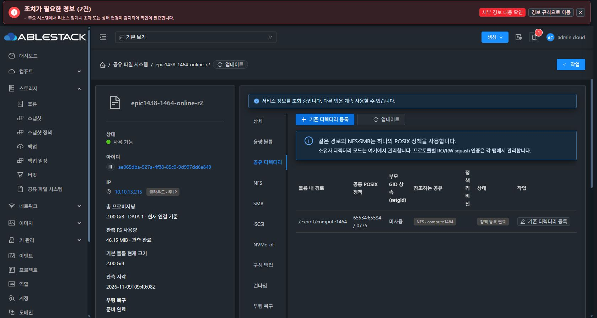
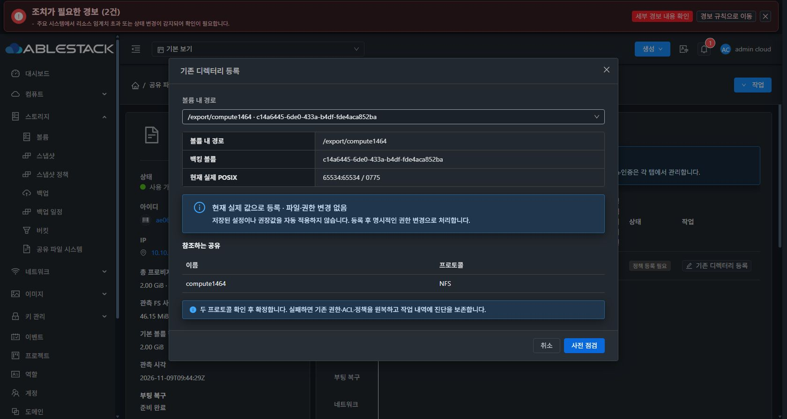
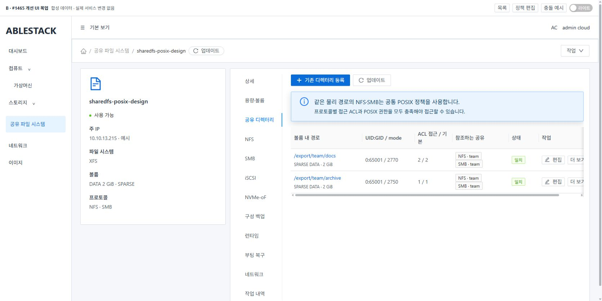
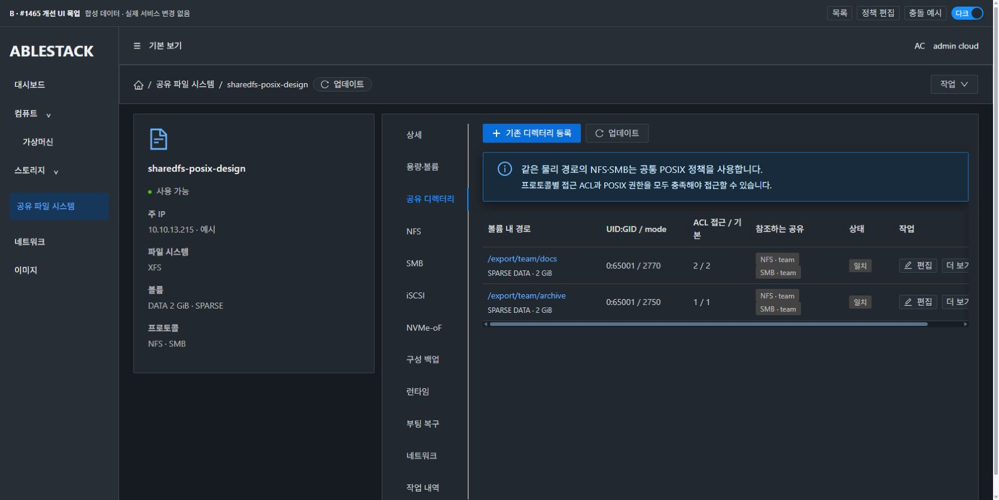
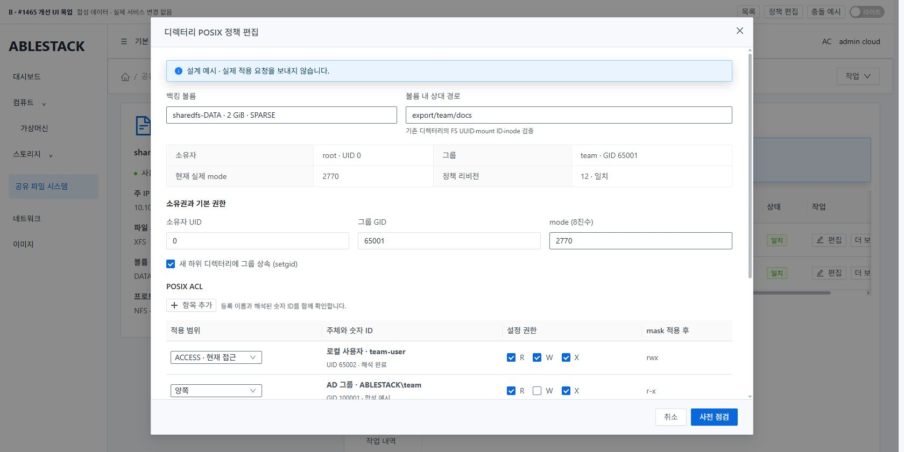
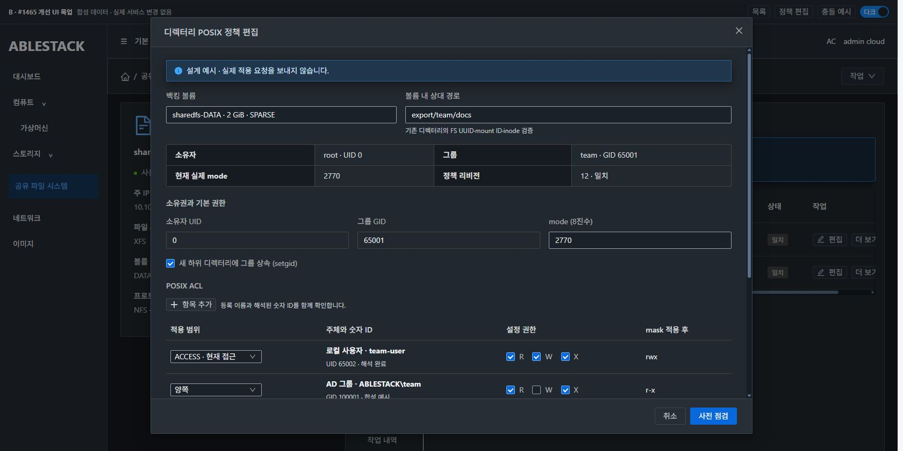
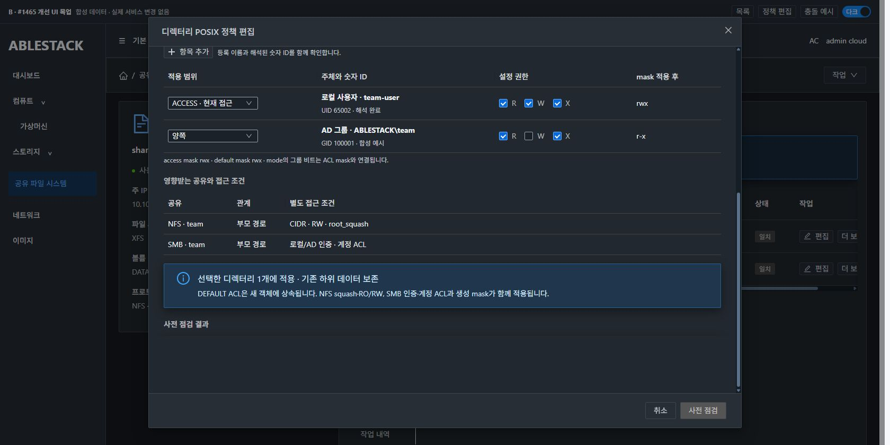
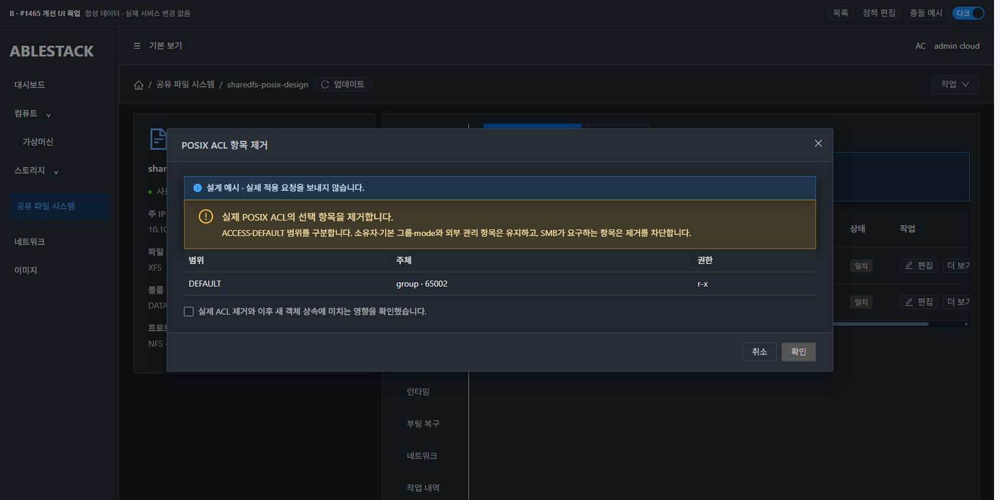

# #1465 하위 디렉터리 POSIX 소유권·ACL 정책 설계

2026-11-09 설계 완료. 제품 구현·배포·인수 시험은 후속 구현 지시 범위다. 이 문서의 SystemVM 시험은 기존 배포 모듈과 격리된 커널 실험을 이용한 설계 검증이다.

## 1. 범위와 현재 배포 기준

- Epic #1438, 작업 브랜치 `epic/1438-sharedfs`, 검토 코드 `ac9d20fe78553f7f604f4ad71da78258cd8a8fba`.
- 로컬 `ablestack-europa`와 `upstream/ablestack-europa`는 `413d1459682b6f4dea6c90773510b8342dba1ec2`, divergence `0 0`. 기존 구현을 재사용하는 설계다.
- 13번 관리 JAR SHA-256 `8ac84663f5c5e035203e23ba99b912decd999fa08f803fb2e3363a670e0b78c0`, UI index `fb8c853ef27e9ea6ea19d76f4c015af4195c193a119cc6fc543b7268981d095d`.
- 실제 시험 SharedFS `ae065dba-927a-4f38-85c0-9d997dd6e849`, SystemVM `9a7bf4cb-6c75-38f3-91d2-0ae671838d06` / `i-2-228-VM`, host `10.10.13.3`.
- 기존 ROOT 8GiB와 DATA 2GiB의 API `provisioningtype=sparse`를 확인했다. DATA `c14a6445-6de0-433a-b4df-fde4aca852ba`, XFS `eb2e98ae-2c46-4935-8e5f-2c90e1401750`, `/dev/sdb`.
- 제품 디렉터리 관리 Java 클래스 3개와 SystemVM helper의 SHA를 로컬 빌드본과 대조해 모두 일치했다. [대조 기록](evidence/code-deployment-comparison.json)

목표는 인스턴스·DATA 볼륨·검증된 canonical 상대 경로별 UID/GID·mode·setgid·access/default ACL의 관리다. NFS export ACL, SMB 계정 ACL, POSIX ACL을 각각 표시하고 접근에는 해당 조건이 모두 적용된다. 이번 변경에 계정 생성·AD 가입 기능 추가, 새 볼륨 포맷, 전체 UI 재구성은 포함하지 않는다.

## 2. 실제 코드에서 확인한 기존 동작과 공백

| 경계 | 현재 구현 | #1465에서 필요한 최소 변경 |
| --- | --- | --- |
| API | `Create/Update/ListStorageDirectoryPoliciesCmd`가 존재한다. create는 기존 실제 경로를 등록하고 update는 UID/GID/mode 및 명시적 재귀 필드를 받는다. | 기존 명령을 확장하고 등록 해제 명령만 추가한다. 기존 호출의 기본값과 응답 필드를 보존한다. |
| 경로 | `StorageDirectoryPolicies.proposal()`은 실제 공유 루트의 관측 목록에서 후보를 찾는다. 공유되지 않은 자식 디렉터리는 직접 고를 수 없다. | list/inspect에 선택 볼륨·단일 상대 경로 관측을 추가한다. 서버가 연결·접근 권한을 확인한 DATA만 허용한다. |
| 저장 | `storage_directory_policy`에 경로·owner·mode·revision·MEDIUMTEXT metadata가 있다. | 기존 metadata에 버전 있는 ACL 정책을 추가한다. 새 테이블과 컬럼은 필요하지 않다. |
| 게스트 | `DirectoryPolicies`가 FD 기반 신원 검사·ACL 관측·비재귀 snapshot·원복·NFS 영향 관측을 수행한다. | 독립 ACL delta의 검증·적용·정확한 재관측을 같은 트랜잭션에 연결한다. |
| SMB 자동 ACL | `apply_acl_batch()`는 SMB 계정 권한에서 계산한 named ACL을 access/default에 함께 기록하고 `ownedacl`로 소유권을 추적한다. | 기존 자동 관리 항목과 새 명시적 항목의 소유권을 구분한다. 같은 항목을 다른 값으로 덮어쓰지 않는다. |
| UI | `StorageDirectoryPolicyPanel.vue`는 실제 owner/mode·setgid·공유 참조와 기존 권한 변경 폼을 제공한다. | 하위 경로 등록, ACL 범위·주체·실효 권한 편집, 등록 해제와 실제 ACL 제거를 추가한다. |

주요 파일은 `server/.../StorageDirectoryPolicies.java`, `StorageServiceConfigurationPreflight.java`, `StorageServiceConfigurationCoordinator.java`, `StorageServiceConfigurationPlan.java`, `api/.../UpdateStorageDirectoryPolicyCmd.java`, `StorageDirectoryPolicyResponse.java`, `engine/schema/.../StorageDirectoryPolicyVO.java`, `systemvm/.../shared_directory_policy.py`, `configuration_transaction.py`, `boot_reconcile.py`, `ui/src/components/storage/StorageDirectoryPolicyPanel.vue`, `ui/src/utils/sharedDirectoryPolicy.js`다.

## 3. API와 데이터 계약

### 기존 API 확장

- `listStorageDirectoryPolicies`에 선택적 `volumeid,path`를 함께 받는다. 기존 목록 호출은 동일하게 동작한다. 추가 관측은 기존 DATA의 단일 경로만 읽으며 임의 트리 순회를 수행하지 않는다. 저장된 자식 정책도 share root 목록에 없다는 이유로 UNAVAILABLE로 처리하지 않고 직접 관측한다.
- `createStorageDirectoryPolicy`는 관측한 UID/GID·mode와 ACL을 초기 정책으로 채택한다. 등록 과정에서 파일이나 권한을 변경하지 않는다. 같은 instance/volume/canonical hash의 기존 unique key와 예약 로직으로 중복 등록을 차단한다.
- `updateStorageDirectoryPolicy`에 선택적 JSON 문자열 `aclchanges`를 추가한다. 기존 owner-only 요청은 기존 경로를 사용한다. ACL 변경이 있으면 재귀 요청을 거부하고 대상 디렉터리 1개만 처리한다. UI에서는 실제 변경된 POSIX 필드만 제출한다.
- `deleteStorageDirectoryPolicy`를 기존 coordinator의 설정 명령으로 추가한다. `instanceid,id,expectedpolicyrevision`과 기존 request/승인 정보를 사용한다. 실제 참조 공유가 있으면 `DIRECTORY_POLICY_IN_USE`로 차단한다. 정상 해제는 DB·게스트 정책 등록만 제거한다.
- 실제 ACL 항목 제거는 `updateStorageDirectoryPolicy`의 ACL delta에서 `REMOVE`로 처리한다. UI의 별도 제거 대화상자가 대상 범위·주체와 결과를 보여주고 최종 확인을 받는다.

예시 요청에서 `aclchanges`의 내용은 다음과 같다.

```json
{
  "version": 1,
  "entries": [
    {
      "action": "UPSERT",
      "scope": "ACCESS",
      "principalType": "UID",
      "principal": "100001",
      "permissions": "r-x"
    }
  ]
}
```

scope는 ACCESS·DEFAULT·BOTH다. BOTH는 사전 점검에서 두 개의 독립 항목으로 정규화한다. principalType은 UID·GID·LOCAL_USER·LOCAL_GROUP·AD_USER·AD_GROUP으로 제한한다. `mask`는 scope별 별도 명시 변경이다. 지정하지 않은 mask·base ACL·외부 관리 항목은 보존한다. mask가 없는데 새 named ACL을 만드는 경우 필요한 초기 mask를 사전 점검 결과에 명시하고 승인 지문에 포함한다. 기존 mask를 암묵적으로 확장하지 않는다.

owneruid/ownergid는 공통 디렉터리 API에서 LONG으로 받고 Linux 유효 ID 범위 0..4294967294를 검사한다. 현재 INTEGER/65535 제한으로 거부되는 idmap ID를 수용한다. 기존의 유효한 숫자는 동일하게 해석한다. NFS의 별도 anonymous ID API는 이 변경에 포함하지 않는다.

### 입력 크기와 주체 해석

- 기존 intent 4096자 및 전체 payload byte 제한을 유지한다. 한 번의 ACL delta는 UTF-8 3072 bytes 이하, 변경할 주체는 최대 16개로 제한한다. 초과 시 UI와 서버가 이유를 표시하고 여러 번의 명시적 작업으로 나누도록 안내한다. 기존의 더 큰 ACL은 읽기와 무손실 보존 대상이다.
- 이름을 shell 문자열에 연결하지 않는다. 게스트의 검증된 NSS/Winbind 경로로 해석하고 숫자 ID·원래 이름·유형을 사전 점검에 반환한다. AD는 가입 상태·trust·해석된 SID/ID를 확인한다.
- 적용 직전에 이름을 재해석한다. 사전 점검과 숫자 ID/SID가 달라지거나 해석이 실패하면 변경 전에 차단한다. UID/GID의 숫자 입력은 NFS AUTH_SYS 등 실제 숫자 신원을 표시하는 용도다. 숫자 ID 시험을 실제 AD 인증 성공으로 판정하지 않는다.

### 저장과 호환

`StorageDirectoryPolicyVO.metadata_json`의 기존 filesystemuuid·inode·lastOperationUuid를 보존하고 `aclPolicyVersion`, `accessAcl`, `defaultAcl`, `managedEntries`, `principalBindings`를 추가한다. 배열은 저장 순서를 보존하고 fingerprint 비교에만 별도 정렬 복사본을 사용한다. access/default 및 mask/base 항목을 구분한다.

게스트 registry에도 같은 버전과 명시적 항목을 저장한다. 기존 ACL 필드가 없는 정책은 owner/mode 정책으로 읽고 등록만으로 ACL을 채우거나 바꾸지 않는다. 기존 `ownedacl` 항목은 SMB 관리 출처로 표시한다. 명시적 편집과 SMB 관리 항목이 충돌하면 적용을 막고 해당 주체와 참조 공유를 보여준다. 명시적 ACL을 이후 SMB 렌더가 재계산해 넓히는 것을 막는다. 다른 경로의 기존 SMB 자동 ACL 처리는 유지한다.

서버는 새 ACL 변경에만 sharedDirectoryPolicyAclVersion=1 capability를 요구한다. 기존 owner/mode capability와 registry version은 유지하고 새 기능을 모르는 게스트에는 적용 전에 업데이트 안내를 제공한다. 새 helper payload는 기존 서명 manifest의 무결성 검증 경로로 배포한다.

현재 MEDIUMTEXT 매핑에 16777215 길이가 명시돼 있고 날짜 매핑도 TIMESTAMP다. 실제 JSON 저장→재조회 회귀에서 새 필드와 배열 순서를 검사한다. 기존 백업의 디렉터리 metadata 복사 경계도 함께 확인한다.

## 4. 경로 신원과 영향 preview

1. 서버가 계정·zone·instance에 연결된 Ready DATA인지 확인한다. ROOT·다른 VM의 볼륨·다른 인스턴스 정책을 거부한다.
2. 경로는 볼륨 루트 기준 canonical 상대 경로로 정규화한다. `..`, 절대 경로 이탈, NUL·symlink를 거부한다.
3. 현재의 UUID·mount·device·inode·FD 검사를 유지한다. 추가로 선택 볼륨 FD와 대상 FD의 `/proc/self/fdinfo` mount ID를 비교해 같은 device의 nested bind mount도 거부한다. 읽지 못한 경우 안전성을 추정하지 않고 UNKNOWN으로 전달한다.
4. 사용자 입력 경로는 다른 mount 경계를 넘지 않는다. NFS/SMB가 소유한 이미 검증된 게시용 bind 별칭은 기존 FSROOT·UUID·device/inode 매핑으로 물리 경로를 얻은 뒤 검사한다.
5. 동일 경로는 동일 정책을 참조한다. 정책보다 위의 공유도 해당 자식을 노출하므로 ancestor·exact·descendant 관계를 모두 preview한다. setgid·default ACL은 새 객체에만 영향을 주며 기존 자식 정책을 덮어쓰지 않는다.
6. 정책 삭제·볼륨 detach·부모 삭제 보호는 기존 경로 참조 검사를 사용하고 새 자식 정책의 참조도 포함한다.

현재 `DirectoryPolicies.opened()`는 `st_dev`로 다른 파일시스템을 거부하지만 같은 device의 bind mount는 열 수 있었다. 이번 private 실험에서 같은 device/inode와 서로 다른 mount ID를 확인했다. 새 하위 정책 경로의 단일 FD 경계 검증으로 보완한다. 이 결과를 기존 게시 경로 재매핑의 실패로 확대하지 않는다.

## 5. 점검·적용·원복·재시작

`directoryIntent()`와 `directoryParameters()`가 공통 ACL 정규화 결과를 사용하도록 확장한다. 실제 API의 파라미터 해석까지 거친 intent 지문과 적용 지문이 같은지 회귀 시험한다.

기존 구성 writer lock·request UUID·revision·승인 fingerprint·만료·drain 검사로 입장한다. owner/mode 변경, ACL 변경, 등록 해제는 기존 `directory policy apply` candidate에 action을 명시하고 같은 snapshot/apply/verify/restore 경로를 사용한다. 새 작업 종류는 32자 이내 고정값을 쓴다.

- snapshot은 대상 FD의 uid/gid/mode, 전체 access/default ACL, inode·device·FS UUID·mount ID와 기존 registry 및 파일 부재 여부를 기록한다.
- 적용 전 첫 관측 및 점검 지문을 재검증한다. 기존 snapshot/progress 저널에 첫 변경 전에 의도를 저장한다.
- owner/mode와 ACL을 같은 트랜잭션에서 적용한다. ACL mask와 mode 그룹 비트의 결합을 검증하고 상충하는 입력을 차단한다. 예를 들어 mode 0750과 access mask rwx를 동시에 요구하는 요청은 거부한다.
- 새 ACL은 검증된 FD에 `setfacl -n`의 명시적 delta로 적용한다. 외부 항목과 SMB 관리 항목의 변경·소실을 검사한다. 적용 후 `getfacl -cpn`과 fstat으로 실제 값과 승인 후보를 비교한다.
- 기존 affected NFS unit 관측·영수증과 SMB 게시 상태 검증을 유지한다. 실제 재시작이 필요한 변경에는 기존 drain·잠금 보호를 적용한다. 권한 변경을 단순 관측 갱신으로 오분류하지 않는다.
- 실패 시 기존 권한·ACL 전체를 동일 inode에 복원한다. default ACL 부재도 원복해야 하므로 기존 `setfacl -k` 후 전체 ACL 복원 및 원래 mode 복구 순서를 유지한다. 최초 오류를 API·작업 기록·UI에 보존한다.
- 게스트 검증 영수증이 성공한 뒤 DAO를 확정한다. 응답 유실이면 같은 operation UUID로 관측하고 중복 등록·중복 적용을 막는다.
- 부팅 시 같은 FS UUID/inode에 대해 저장 정책과 실제 ACL을 검증하고 정상 일치는 유지한다. 외부 drift는 보고하고 권한을 자동 재귀 덮어쓰지 않는다. 중단된 작업은 기존 저널의 재개·원복 경로를 따른다.

등록 해제는 참조 보호를 통과해야 한다. 실제 ACL 제거는 선택된 scope의 명시 관리 항목만 제거하며 데이터·디렉터리와 base/mask를 보존한다. 기존 SMB 관리 항목을 제거하는 요청은 거부한다. 해제와 ACL 제거는 별도 승인 작업이다.

## 6. 실제 SystemVM 사전 주입 시험

배포된 `shared_directory_policy.py`를 import해 실제 SPARSE XFS DATA의 격리 경로에서 시험했다. active registry 대신 `/run`의 private registry를 사용했다. 프로토콜 서비스와 published 공유를 재설정하지 않았다. 새 커널 ACL 동작은 설계용 실험 코드에서 실행했고 제품 모듈은 교체하지 않았다.

| 관측 | 결과 |
| --- | --- |
| access rwx와 default r-x의 독립 저장 | 실제 getfacl에서 분리 확인 |
| chmod 0750과 named ACL rwx | 실제 mask r-x 및 실효 권한 축소 확인, 기존 충돌 보호 확인 |
| 기존 배포 트랜잭션 비재귀 변경·원복 | snapshot 1개, child inode·권한·체크섬 보존 |
| setgid 및 default ACL 상속 | 실제 UID 65534 프로세스가 새 파일/폴더 생성, GID 65001·폴더 setgid·default ACL 확인 |
| 65535 초과 ID | 커널 named UID 100001 설정 성공, 현 `fields()`는 거부함을 확인 |
| 변경 중 ACL 수정 | 같은 inode라도 관측 fingerprint 변경 |
| symlink·상위 이탈·다른 파일시스템 mount | 기존 FD 경로 검사에서 거부 |
| 같은 device의 bind mount | 기존 open 허용, FD mount ID 비교로 별도 경계 식별 가능 |
| 같은 물리 경로 NFS/SMB 관측 | 실제 helper가 합성 참조 2개를 1개 관측으로 집계 |
| private registry 해제 | registry 항목만 제거, 디렉터리·실제 ACL 유지 |
| 기존 서비스 영향 | desired-state 바이트 해시와 기존 published 파일들의 inode·owner·mode·체크섬 일치 |
| 정리 | 생성한 격리 디렉터리·private registry·임시 mount 제거 |

[시험 스크립트](evidence/systemvm-design-probe.py) · [실행 결과](evidence/systemvm-results.json)

시험 스크립트의 초기 ACL 원복 실험에서 default ACL 제거를 빠뜨려 비교가 실패했다. 제품의 기존 원복 순서와 같이 `setfacl -k`를 먼저 수행하도록 시험 코드를 교정한 뒤 원복을 확인했다. 이를 제품 원복 실패로 판정하지 않았다.

이번 설계 시험에는 실제 AD 사용자 접속, 네트워크 NFS/SMB의 새 ACL 인수, VM 재부팅 제품 검증이 포함되지 않는다. 이 항목들은 아래 구현 검증 게이트에 남긴다.

## 7. UI와 목업

A 이미지는 현재 13번 화면이고 B 이미지는 Vue3·AntD·Mold 컴포넌트로 빌드한 합성 목업이다. `컴퓨트 > 가상머신`의 실제 상세·볼륨 탭·생성 대화상자를 열어 배치를 대조했다.

- Breadcrumb 갱신 버튼과 우측 작업 메뉴, 왼쪽 자원 정보와 오른쪽 세로 탭은 기존 `Breadcrumb`·`ResourceLayout`을 사용한다. 상세 탭은 읽기 전용 정보다.
- 공통 정책 기능은 기존 공유 디렉터리 탭을 확장한다. 중복 탭 제목은 추가하지 않는다. 탭 toolbar는 왼쪽 정렬이며 파란 주 버튼을 맨 앞에 둔다. 갱신은 아이콘과 “업데이트”다.
- 목록은 VM의 small table과 같은 행·버튼 간격을 사용한다. 경로·owner/mode·access/default 수·상태·참조 공유를 표시하고 복잡한 ACL 편집은 대화상자로 이동한다. 긴 표는 VM 표준 수평 스크롤을 사용한다.
- 편집 대화상자는 기존 `MoldDialog`와 `MoldDialogActions`를 사용한다. 고정 헤더·푸터, 본문 스크롤, 필드 간 16px, 섹션 간 20px, 버튼 간 8px를 사용한다.
- 주체 이름·해석한 ID, ACCESS·DEFAULT·BOTH, 설정 권한·mask 적용 후 실효 권한, 영향받는 NFS·SMB를 표시한다. 권장값과 실제 관측값은 구분하며 미변경 필드는 제출하지 않는다.
- 등록 해제와 실제 ACL 제거는 별도 메뉴와 대화상자다. 참조 중 해제는 비활성화하고, ACL 제거는 선택 항목과 최종 확인을 보여준다.
- 라이트/다크 토큰으로 배경·글자·보조 문구·입력·table·alert를 대조한다. 주 버튼은 기존 공통 정책 폼과 같은 `#096dd9`/white를 사용한다. 색 외에도 상태 문구와 아이콘을 표시한다.

### A. 현재 배포 UI




### B. 개선 UI 목업








[목업 소스와 실행 방법](mockup/README.md) · [UI 관측 기록](evidence/mockup-review.json)

## 8. 구현 순서와 완료 게이트

1. 공통 ACL parser·input/response/metadata 모델과 실제 DAO 무손실 저장→재조회 회귀를 먼저 구현한다. 기존 owner-only·미변경 비제출·기존 registry 호환을 확인한다.
2. 하위 경로 단일 관측과 FD mount 신원 검증, ACL 후보·mask·NSS 해석 및 preview를 연결한다. 실제 request validator를 거친 점검/적용 지문 동등성을 시험한다.
3. 기존 게스트 snapshot→apply→verify→restore·작업 UUID 복구 경로에 연결한다. 실제 SystemVM에서 XFS·EXT4 SPARSE 이상 DATA로 각 변경·실패 원복을 확인한다.
4. VM 표준 UI를 연결하고 라이트/다크 컴포넌트 회귀·로컬 모듈 빌드를 통과한 뒤 13번에 변경 모듈만 배포한다.
5. 실제 Mold UI에서 기존 하위 경로 등록→권한/ACL 편집→사전 점검→승인→적용→재조회→해제/선택 ACL 제거를 수행한다. 실제 API와 게스트 관측을 대조한다.
6. 두 실제 클라이언트에서 로컬 UID/GID와 실제 AD 사용자/그룹을 사용한다. NFS CIDR 거부·RO/RW·squash와 SMB 인증/계정 ACL이 POSIX 허용으로 우회되지 않는지 확인한다. 새 파일/폴더 상속, 기존 child 데이터·권한 보존, 상위/자식 정책 영향과 외부 drift를 확인한다.
7. 동시 변경·stale 승인·응답 유실·실패 원복·VM/관리 서버 재시작 후 같은 작업 추적과 정책 보존, 참조 중 해제·부모 삭제·DATA detach 차단을 확인한다.
8. 이슈 범위의 모든 인수 기준이 실제 증거로 충족되면 Epic PR에 제품 코드를 반영하고 #1465를 닫는다. 현재 인수 체크박스는 미완료다.

실제 AD·클라이언트·재시작 인수 결과는 이번 설계 실험으로 대체하지 않는다.
