# #1466 코드 수준 설계 — SMB AD 서비스 이름·DNS A·CIFS SPN

## 1. 판정과 변경 범위
**설계와 실제 SystemVM 사전 실증을 완료했다. 제품 구현·DB migration·모듈 배포는 시작하지 않는다.** #1466의 인수 체크 항목은 구현 단계까지 미완료로 둔다. 이 문서는 #1438의 현재 Epic 브랜치에서 #1466만 다룬다.

- 기준 source: `a947772a314ec0ed0f65c9a487b878563b5a84c8` (제품 마지막 변경8801bf942c0), 브랜치 `epic/1438-sharedfs`.
- local Europa / upstream Europa: `413d1459682b6f4dea6c90773510b8342dba1ec2`, divergence0/0을 착수 전에 확인했다.
- 13번 관리 JAR SHA256 `aaf83406ddb48af5d0559cea9b1ca64f5dce4eee7e6aa1151ef2a113843d3335`.
- 실제 member runtime `1465.directory-acl.6`, CLI SHA64703a00fa68bb5d56ae6fd108751524de5471eb502bf8ea14a11103394a1426, transaction module SHA45556d582c77d29d3f38c056b29813ab642a77c939e44fb2b68e6b08d25084dd.
- VM당 현재 AD computer account 하나를 유지한다. **호스트명/netbios name/컴퓨터 계정/SMB 공유·ACL·DATA는 별칭 추가 때문에 바꾸지 않는다.**
- 핵심 변경은 서비스 이름 전용 metadata와 DNS A/CIFS SPN의 정확한 값 단위 작업이다. 일반 SMB 렌더·리스너·Winbind·NFS 경로를 재작성하지 않는다.

초기 지원은 가입 AD DNS 도메인 안의 IPv4 A/FQDN과 해당 VM의 SMB endpoint다. CNAME/PTR/AAAA, WINS·NetBIOS 별명, 다른 realm/trust로의 이름 이동, AD schema/보안 정책 변경, 다른 AD 계정의 항목 강제 인수는 범위 밖이다. DNS는 포트를 인코딩하지 않는다. 일반 Windows UNC 검증은445를 사용하고 custom port는 지원되는 클라이언트의 명시적 포트로 구분한다.

## 2. 현재 코드·실행 자원 확인

| 경계 | 실제 상태와 재사용점 |
|---|---|
| AD member | SharedFS3f0056db-4dfe-4f13-908d-b809dd565d34 / instance c1eca707-a554-4c42-85cd-1e9e9744d804 / VMd9c423e9-ce89-3ba9-9cd8-f48cdb791da2 / 13.220 / host13.2 |
| AD DC | VM eed7f477-e439-4d8a-a932-3642aac0359e / i-2-189-VM / 13.247 / host13.3 / ad1453.ablestack.local |
| Samba/AD | 4.17.12-Debian / ablestack.local / forest·domain2008R2 |
| 컴퓨터 identity | STORC1ECA707A5$ / GUID7189b3df-b6d3-4089-83bf-c1ec9d79bf68 / SID…-1106 / KVNO2 |
| 현재 인증 | API JOINED/OK, guest testjoin·wbinfo trust 성공. 기존 HOST/RestrictedKrbHost SPN4개. additional dns hostnames/netbios aliases는 빈 값 |
| DNS | 기본 storc1eca707a5.ablestack.local의 A 없음. 가입 성공과 FQDN 접근 가능을 같은 상태로 보지 않는다 |
| SMB | managed13.220:445,1445 모두 READY. 같은 AD 서비스와 공유를 사용 |
| 디스크 | ROOT5242880000 bytes·DATA10GiB 모두 SPARSE. 새 VM/디스크·포맷·MAC 변경 없음 |

실제 함수:
- `StorageServiceManagerImpl.joinStorageServiceToAdDomain()`은 AD 예약→`applyAdJoin()`→membership/serviceApply 관측을 처리한다. 재가입은 현재 config를 다시 만들므로 서비스 이름을 여기에 무심코 섞으면 metadata가 유실될 수 있다.
- `configuration_transaction.AdDomainJoin.run()`은 인스턴스 configuration lock, 보호된 client 파일 snapshot, membership→SMB apply/verify와 최초 실패·원복 상태를 이미 제공한다.
- `buildSmbDesiredStatePayload()`는 identityDomain와 리스너/공유/ACL을 만든다. 현 CLI의 AD 렌더는 `kerberos method = secrets and keytab`이며 서비스 이름 목록은 관리하지 않는다.
- `SmbListenerProfiles` 및 #1465의 엄격한 implicit/managed readiness를 그대로 사용해 endpoint의 실행 파일·설정·소유 소켓을 확인한다.
- `StorageServiceConfigurationPlan`의 기존 table snapshot/ID 예약/후보/commit·동일 operation UUID를 재사용한다. 현재 identity-domain DAO는 plan shadow table에 포함되지 않는다. 따라서 config_json에 이름을 덧붙이고 일반 DAO로 먼저 저장하는 방식은 택하지 않는다.

이름 목록/구성/영수증은 새 전용 경계에 두고, 기존 joined→SMB 공유 생성 및 로컬 인증의 의미를 유지한다. 현재 가입/IP 접근 성공은 기존 기능의 정상 근거다. 미구현 DNS 이름 관리를 이유로 이를 실패로 재분류하지 않는다.

## 3. 실제 SystemVM 주입 실증과 설계에 반영한 사실

실험 코드는 /run 또는 QGA 실행 메모리에서만 실행했고 제품 파일은 교체하지 않았다. i1466-*만 사용했다. 임시 operator의 대상 컴퓨터 SPN write-property와 DNS RPC 시험 역할은 시험 후 제거했다. **제품이 AD 사용자를 만들거나 권한을 위임하는 기능은 아니다.**

| 실제 확인 | 결과 / 설계 결정 |
|---|---|
| 기본 FQDN Kerberos | DNS가 없어 -I로 주소만 고정한 baseline에서 Kerberos required와 CIFS AES256 ticket 성공. 인증 엔진 자체는 정상 |
| machine credential의 alias SPN add | AD LDAP19 constraint violation, 기존 값 불변. SELF 권한만으로 가능하다고 가정하지 않음 |
| 위임 SPN 계정 | 대상 컴퓨터 servicePrincipalName WP만 위임한 시험 계정의 add/delete 성공. Domain Admin 구성원은 아님 |
| SPN 값 단위 변경 | libldap2.5 GSSAPI·SSF256, GUID 바인딩으로 LDAP_MOD_ADD/DELETE 성공. 독립 DC writer가 사이에 추가한 다른 SPN과 기존4개 보존. 임시 위임 계정2와 ACE도 정리 |
| DNS RPC | 일반 계정 조회는 가능, 수정은 ACCESS_DENIED. 시험 DNS 관리 역할 후 sealed RPC의 레코드 단위 add/delete 성공 |
| 별칭2개 | i1466-a/b.ablestack.local A가 모두13.220. 주소 override 없이 두 FQDN ×445/1445의 Kerberos 강제 SMB 읽기4회 성공 |
| ticket/데이터 | cifs/i1466-a와cifs/i1466-b ticket, AES256. 모두16bytes와 SHA0f47099d3774628fc3914830cfaac314d37656038e3ed1d657e484bef857ed76 |
| 재시작 필요 여부 | smb.conf·keytab·리스너 profile·desired-state·계정 파일과 PID 불변. netbios alias/호스트명 변경·smbd/Winbind 재시작 불필요 |
| 외부 SPN 충돌 | 다른 AD user GUID의 CIFS SPN을 실제 조회했다. expected computer GUID와 다르므로 인수/정리 금지 |
| foreign RDATA 보존 | 시험 A에203.0.113.66을 함께 두고13.220 한 값만 RPC로 삭제. 다른 값의 flags/serial/TTL까지 보존 |
| 정리 | 임시 A/SPN·operator 제거, computer SID/GUID/KVNO/기존SPN 동일. 임시 위임 ACE 제거 후 원래 security descriptor와 정확히 일치. 선택 원본 시험 파일3개의 inode/uid/gid/mode/ACL/SHA 및 설정/계정/keytab/PID 일치 |

채택하지 않는 경로:
- Samba4.17의 net ads setspn delete와 samba-tool spn delete는 현재 목록을 읽고 속성 전체를 REPLACE한다. 앞의 순차 CLI 시험만으로 동시 변경 보존을 입증할 수 없으므로 제품의 SPN mutation 경로에서는 제외한다. 최종 설계는 실제 SystemVM에서 검증한 LDAP_MOD_ADD/DELETE의 단일 값 연산이다.
- 설치된 명령의 실제 help는 `net ads setspn add <machinename> SPN`이다. 도움말의 spnset 표기·일부 문서의 인자 순서만 믿지 않는다. 실제 설치 버전/명령 계약을 capability로 확인한다.
- `net ads dns unregister`는 호스트의 모든 주소를 정리하는 명령이므로 사용하지 않는다.
- GSS nsupdate 시험은 TSIG 응답 검증 오류를 반환했지만 레코드는 실제 생성됐다. 실패 exit가 “변경 없음”을 뜻하지 않는다. 이 경로는 제품 mutation 경로로 채택하지 않고, 정상 응답을 검증한 DNS RPC add/delete/replace를 사용한다.
- 보장되지 않은 LDAP assertion control이나 추가 DNS-hostname 자동 처리를 전제로 하지 않는다. 실제 DC의 advertised controls/기능 수준을 확인했다. Windows2012 validated additional-name 조건을 2008R2 시험 DC에 강제하지 않는다.
- 시험 입력/cleanup helper의 호출 실수는 실제 상태를 재조회해 교정했다. ignored ACE 삭제를 성공으로 추정하지 않고 최종 descriptor를 확인했다. 제품 수정 리비전은 만들지 않았다.

[실증 결과](evidence/native-summary.json) · [GUID 고정·SPN 값 추가](evidence/ldap-spn-add.json) · [외부 writer 값](evidence/ldap-external-writer.json) · [자기 값 삭제·외부 값 보존](evidence/ldap-spn-exact-delete.json) · [최종 정리](evidence/ldap-probe-cleanup.json) · [실제 두 이름 Kerberos](evidence/kerberos-aliases.json) · [정확한 DNS 삭제](evidence/exact-dns-delete.json) · [컴퓨터/AD 전후](evidence/dc-before.json) · [정리 후](evidence/dc-after.json)

## 4. 영속 모델 — 구현 때 추가할 additive table

현재 DB에는 적용하지 않았다. 새 table을 선택하는 이유는 기존 AD join config 재생성·일반 SMB config/백업과 외부 AD 소유권을 섞지 않고, 기존 plan의 검증 후 확정을 사용하기 위해서다.

제안 table `cloud.storage_smb_service_name`:

| 열 | 형식/규칙 |
|---|---|
| id / uuid | BIGINT PK / VARCHAR(40) NOT NULL UNIQUE |
| instance_id | BIGINT NOT NULL, storage_service_instance 참조. 정상 삭제 전 정리 guard, FK RESTRICT |
| name_kind | VARCHAR(16), BASE 또는 ALIAS |
| binding_type / endpoint_uuid | VARCHAR(16) PRIMARY/EXPLICIT, nullable VARCHAR(40) logical endpoint UUID |
| fqdn / canonical_hash | VARCHAR(253), 소문자·끝의점 정규화 SHA256 CHAR(64), UNIQUE(instance_id,canonical_hash) |
| state / revision | 기존 ResourceState enum VARCHAR(32) / BIGINT |
| desired_json | MEDIUMTEXT, 명시 length16777215, version1·endpoint/NIC/IP/port·확정 DC/zone·expected computer GUID/SID |
| ownership_json | MEDIUMTEXT length16777215, DNS/SPN 각각 CREATED/REUSED, 정확한 RR/SPN·DNS node GUID·computer GUID·operation receipt |
| observed_json | MEDIUMTEXT length16777215, 마지막 확정 관측. 조회 시 새 관측은 DTO/guest cache로 분리 |
| created / updated | DATETIME 및 @Temporal(TIMESTAMP) |

endpoint는 내부 DB id 대신 logical UUID를 사용한다. 기존 복원의 같은 UUID endpoint 재조회/내부 ID 재생성과 결합하지 않는다. 주소/port/NIC·instance와 실행 proof는 별도로 일치해야 한다. 기본 이름은 현재 computer의 dNSHostName을 readonly로 표시하고 관리 등록만 허용한다. 기본 HOST/RestrictedKrbHost SPN과 컴퓨터 계정은 삭제 대상이 아니다.

기존 validateNaturalKeys의 마지막 else는 AccessRule cast이므로 새 이름 VO의 (instance_id, canonical_hash) 분기를 먼저 추가한다. names helper는 overlay가 이미 지원하는 listByInstanceId/findById/findByUuid/persist/update/remove만 사용한다. scoped resume에서도 operation resourceType을 확인해 같은 table을 붙인 뒤 restore한다.

새 VO는 `setState(StorageServiceInstance.ResourceState)` 계약을 갖는다. 기존 Table.persist는 Creating ID 예약을 먼저 짧은 SQL transaction에 저장한다. 이를 숨겨진 “Ready”로 표시하지 않는다. 성공 소유권 영수증은 VERIFIED 후에만 확정한다. persist 반환 엔티티의 ID를 사용한다. JSON 배열 저장 순서와 비교용 canonical copy를 분리한다.

개별 mutation은 이름1개, 가입 시 선택 목록과 인스턴스의 활성 이름은32개 이내로 제안한다. 초기 목록은 별도16384 chars/UTF8 bytes 제한을 명시하고 기존 intent4096·일반 byte 제한은 바꾸지 않는다. 2개 native 실증으로32개 성능을 통과했다고 주장하지 않으며 구현 인수에서 batch/장시간 경계를 별도 검증한다.

## 5. API·코드 경계

새 이름/시그니처는 제안이며 아직 구현하지 않았다.

| 경로 | 추가/수정할 책임 |
|---|---|
| api/.../storage/dataservice/`*StorageSmbServiceNameCmd` | create/update/delete는 BaseStorageServiceConfigurationCmd, list는 instance/id/page 계약, scoped resume는 operation id와 선택적 일회성 AD 인증 |
| api/.../response/`StorageSmbServiceNameResponse` | fqdn/endpoint/owner·DNS/SPN 각각의 관측과 소유권·마지막 시각·접속 검증 구분. jobid는 상위 setJobId만 사용 |
| api/.../StorageService.java | 새 API 메서드. 기존 join은 optional initialServiceNames일 때만 orchestration 확장 |
| engine/schema/... | VO/DAO/DaoImpl와 정확한 Europa migration. real DAO 저장/재조회·unique·Creating 예약 회귀 |
| `StorageSmbServiceNames.java` (새 service) | validation·current AD/endpoint proof·proposal·baseline/candidate·영수증 검증·이름 CRUD |
| `StorageServiceManagerImpl` | API 등록·instance access check·새 DAO view. alias mutation에서 일반 applySmbDesiredState 호출 금지 |
| `StorageServiceConfigurationPlan` | names 명령에서만 선택적 table 추가, resourceUuid·validateNaturalKeys 분기·구 snapshot null/null 호환. 정상 NFS/SMB 작업에 table/예산 추가하지 않음 |
| `StorageServiceConfigurationCoordinator` | resourceType 고정값 SmbAdServiceName(32자 이내), capability gate·새 영수증 VERIFIED 경계·부분 실패/응답 유실·scoped resume |
| guest `smb_service_names.py` (새 helper) | GSSAPI sealed LDAP의 단일 SPN ADD/DELETE, sealed typed DNS RPC, private journal·현재 endpoint/AD identity 검증·관측/원복 |
| `configuration_transaction.py` / storagectl / runtime profile | 정확히 names-only인 command whitelist와 adapter snapshot/apply/verify/restore/verify_restored 경계. 새 managed file/capability smbAdServiceNamesVersion=1·baseline만 additive. 구·신 baseline reader 호환과 signed release manifest/payload 일치를 검증하고 기존 renderer/Winbind/boot DATA 적용 원문은 유지 |
| `SharedFSTab.vue` / `StorageSmbServiceNamesTab.vue` (새 panel) | 독립 세로 탭, 이름 목록/사전 점검/승인/상세/복구. 기존 상세 탭은 정보만 |
| endpoint/delete/leave/deletion/restore guard | 새 이름을 실제로 참조할 때만 조건부 보호. 무관한 기본 기능의 흐름은 그대로 |

새 mutation request의 공통 공개 값은 instance, name id/kind/fqdn, endpoint id 또는 PRIMARY, expectedrevision, requestid, impactack다. AD username/password는 별도 `secrets` 실행용 복사본에만 둔다. names 명령의 publicRequest/hash/DB snapshot에서 두 값 모두 제외하고 dispatcher 로그의 sensitive key로 지정한다. 현재 guest redact는 secret/password key를 제거하므로 전체 secrets map을 durable request.json에 넣지 않는다.

list는 DB/cache 조회만으로 구성하고 SharedFS 일반 목록에 AD RPC를 추가하지 않는다. 명시적인 업데이트가 instance별 bounded readonly 관측을 요청한다. 읽기 결과가 operation 후보/row revision을 뒤에서 바꿔 정상 승인 지문을 무효화하지 않도록 live observation을 구성 저장과 분리한다.

### 검증 규칙
- Cloud instance owner/zone/RBAC와 현재 VM UUID를 먼저 확인한다. DNS server/domain/computer를 API의 자유 URL 입력으로 받지 않는다. 가입 정보와 인증된 DC locator에서 확정한다.
- FQDN은 DNS LDH/길이·가입 zone suffix·CNAME/다른 주소·SPN owner를 검사한다. CIFS뿐 아니라 같은 FQDN의 HOST/RestrictedKrbHost 및 dNSHostName/additional-name owner도 조회해 암묵적 CIFS 매핑의 충돌을 놓치지 않는다. key 문자열을 shell/LDAP filter에 삽입하지 않는다.
- explicit endpoint는 같은 instance의 READY SMB UUID/IP/port여야 한다. 0.0.0.0 자체를 DNS A로 등록하지 않는다. implicit은 기존 엄격한 implicit_legacy proof와 관측 primary NIC 주소를 사용한다.
- 원래 computer SID/GUID가 다르면 이름만 같아도 인수하지 않는다. query 범위/권한/원격 도메인 소유권을 확정할 수 없으면 UNKNOWN/BLOCKED다. 다른 realm/trust로 등록을 우회하지 않는다.
- 기존 동일 DNS/SPN을 재사용한 경우 REUSED로 표시하고 정리 시 남긴다. 다른 주소/AD owner이면 차단한다. 원래 기본 SPN은 항상 보존한다.

### SPN/DNS native adapter의 정확한 계약
- 현재 SystemVM의 libldap-2.5.so.0·GSSAPI SASL 모듈·keyutils를 capability로 확인한다. 인증은 수명 제한된 별도 child/session의 private KEYRING TGT로 수행하고 finally에서 ticket/keyring을 제거한다. DNS RPC는 MEMORY ccache·seal을 사용한다. 비밀번호 파일·FILE ccache·simple bind·NTLM/비암호화 fallback은 금지한다.
- 확정한 DC의 FQDN으로 GSSAPI bind하고 SSF>=128을 확인한다(실증256). SASL의 reverse-DNS 재정규화는 끄되 DC locator·realm·LDAP service ticket 검증은 유지한다. 구현 시 network/operation timeout·referral 차단·응답 크기 상한을 명시한다.
- 관측한 computer GUID/SID를 검증하고 `<GUID=...>` extended DN을 대상으로 값 한 개만 LDAP_MOD_ADD 또는 LDAP_MOD_DELETE한다. 속성 전체 REPLACE와 값 없는 DELETE는 금지한다. GUID-DN 지원도 capability/preflight에 포함하며 실패 시 임의의 이름 DN으로 낮추지 않는다.
- 외부 writer가 별개의 SPN을 중간에 추가한 native 시험에서 자기 값 삭제 후 외부 값이 남았다. 이는 단일 LDAP Modify 값 연산의 실증이다. 같은 값을 외부에서 삭제·재생성하는 경합까지 소유권을 확정했다고 확대하지 않는다.
- DNS는 exact RDATA의 DnssrvUpdateRecord2를 사용하며 node GUID·현재 RR·IP를 전후 인증 조회한다. 다른 RDATA/TTL/flag는 보존한다. 외부의 같은 값·node 삭제/재생성 때문에 소유권을 확정하지 못하면 RECOVERY_REQUIRED로 남기고 강제 정리하지 않는다.
- 각 helper는 실행용 구조체/인자 배열만 사용한다. Python prototype의 ctypes binding은 설계 실증용이며 제품 helper 구현 전에 ABI/메모리 해제·격리 child 종료·라이브러리 부재 회귀를 별도로 추가한다. 기존 CLI/renderer 바이너리를 바꾸지 않는다.

## 6. 적용·원복·응답 유실

일괄 속성 교체가 아니라 기존 writer/operation UUID 안에서 정확한 값 한 개씩 처리한다.

```text
observe → admission/revision/fingerprint → durable Creating 예약
→ journal INTENT(before, target GUID, exact value, operation)
→ SPN add (없던 값만) → authenticated read
→ DNS A add/replace (해당 RDATA만) → authenticated read + DNS resolution
→ 원격 영수증 VERIFIED → SQL ownership/desired 확정 → COMMITTED
```

- create는 SPN을 먼저 준비해 이름 공개 전 인증 기반을 만든다. 일반 smbd/Winbind restart나 DATA chmod/chown/format을 하지 않는다.
- rename은 새 이름 완성 후 원래 소유 이름을 정리한다. endpoint IP 이동은 검증된 같은 컴퓨터의 새 SMB endpoint에만 허용하며 DNS RPC old/new record 인자 한 호출로 교체한다.
- delete는 이번 서비스가 CREATED로 기록한 A/CIFS 값만 제거한다. 기본/외부/REUSED 항목을 지우지 않는다. DNS 캐시·기발급 ticket·기존 SMB session의 즉시 보안 철회는 보장하지 않는다. 접근 철회는 기존 ACL/endpoint 절차다.
- 원복은 이번 operation의 역 delta만 적용한다. 새 DNS/SPN을 제거하고 수정한 자기 RDATA를 되돌리며 다른 RR/value는 남긴다. 원래 부재도 snapshot에 포함한다.
- 오류 exit만 보고 미적용으로 단정하지 않는다. timeout/응답 검증 실패는 소유 GUID·journal·정확한 값의 인증된 재관측으로 판정한다. 불명확하면 RECOVERY_REQUIRED이며 새 create를 반복하지 않는다.
- 실행 중 child가 AD 자격을 메모리로 보유한 동안 보상을 수행한다. worker 종료/재부팅으로 자격이 사라지면 임의 원복 성공을 반환하지 않는다. 같은 UUID의 관측으로 완료를 확정할 수 있으면 SQL만 확정하고, 원격 변경/원복이 필요할 때만 일회성 자격을 다시 받는다.
- 안전한 최초 code/phase/rollback만 API·UI에 노출한다. raw command output·비밀번호를 durable 진단에 넣지 않는다.
- 영수증은 state=VERIFIED/COMMITTED에서만 응답에 붙인다. 최초 apply 응답→coordinator→DAO를 반드시 한 회귀로 연결한다. null/부재 표현도 실제 Gson wire를 통해 검사한다.

새 names-only 분류는 서버가 command set이 정확히 `{smb service names apply}`이고 share/ACL/endpoint/network/DATA 변경이 없음을 검증할 때만 “기존 세션 유지”를 표시한다. 실제 endpoint 중단·삭제·다른 작업의 drain 보호를 이 분류로 우회할 수 없다.

## 7. 가입·수명주기·부팅

1. 기존 join 요청에 이름이 없으면 현재 코드와 반환 의미를 유지한다.
2. 선택 이름이 있으면 **membership→SMB 적용/검증→이름 작업**을 분리한다. AdDomainJoin의 guest lock을 보유한 채 일반 coordinator를 중첩 호출하지 않는다. 앞의 lease 종료 뒤 이름 단계를 이어간다.
3. 이름 단계 실패는 가입/SMB 성공을 “가입 실패”로 덮어쓰지 않는다. UI에서 실패 단계·추가분 원복·같은 이름 작업 복구를 표시한다. 자격은 종료 시 지우며 재가입을 반복하지 않는다.
4. 같은 domain 재가입은 기존 computer GUID/SID와 이름 registry를 먼저 검사하고 재가입 뒤 KVNO/이름을 재관측한다. 같은 GUID이면 필요한 이름 재확인만 한다. 다른 GUID의 계정에 소유권을 자동 이전하지 않는다.
5. endpoint 삭제/IP 이동, primary NIC 이동, AD leave, SharedFS 파기/expunge는 활성 이름 참조가 있으면 **중단/제거 전에** 이름 정리/이동을 안내한다. alias 삭제는 endpoint 삭제를 요구하지 않아 상호 차단 고리를 만들지 않는다.
6. 실제 hook은 `deleteStorageServiceProtocolCandidate()`, `leaveStorageServiceFromAdDomain()`, SharedFS `deletionWritersClear()/acceptDeletion()` 및 관련 preflight다. 0건이면 기존 동작을 그대로 사용한다.
7. 부팅은 기존 SMB/DATA 복구를 유지한다. 관리자 자격 없이 AD를 자동 수정하지 않는다. 마지막 확인값과 현재 관측 시각을 구분하며 AD 단절 때 이름 관측을 UNKNOWN으로 표시해도 로컬 서비스/NFS·다른 프로토콜은 보존한다.
8. 외부 AD 소유권은 기존 구성 ZIP으로 새 컴퓨터에 복제하지 않는다. 같은 서비스 복원에서 이름이 참조하는 endpoint UUID/IP/port가 그대로면 보존하고, 이를 바꾸는 복원만 사전 차단해 이름 정리를 안내한다. 새 VM 복원은 기존 #1462 범위를 유지하며 AD 이름은 새 가입 후 명시적으로 등록한다. 이 이슈에서 외부 AD 이전/전체 백업 형식을 새로 구현하지 않는다.

## 8. UI 설계·A/B 목업

현재 SMB 탭은 리스너·공유·접근계정·인증·볼륨·세션으로 이미 길다. 별칭 작업을 상세 탭이나 기존 SMB 컨텐츠에 모두 붙이지 않고 **SMB 서비스 이름** 세로 탭으로 둔다.

- 실제 VM의 Breadcrumb/목록/ResourceLayout/세로 탭/AntD small table와 MoldDialog/Actions를 기준으로 한다. 새 pane은 문자열 key=smbNames로 두어 비동기 모델 로딩 중 기존 선택 탭을 바꾸지 않는다. storage.js의 기존 SharedFSTab 진입은 유지한다. 전체 SharedFS 목록과 읽기 전용 상세는 변경하지 않는다.
- 중복 탭 제목은 추가하지 않는다. toolbar는 왼쪽, 파란 “서비스 이름 추가”가 맨 앞, 갱신은 아이콘+“업데이트”다.
- DNS·SPN을 독립 상태/소유권으로 표시한다. 가입됨, 이름 구성 일치, 실제 클라이언트 Kerberos 성공은 구분한다.
- 기본 computer/FQDN은 readonly다. BASE 미등록 A와 기존 HOST SPN 관측을 별개로 보여 준다.
- 대화상자는 고정 header/footer·본문 스크롤, 필드/행 gutter16px·버튼8px·구획16~20px를 사용한다. 긴 FQDN/endpoint와 열 제목이 겹치지 않도록 폭과 가로 스크롤을 지정한다.
- 추가/편집의 AD 자격은 일회성이고 저장하지 않는다. 충돌이면 owner/실패 code를 보여 주고 적용 불가, 삭제는 CREATED/REUSED별 실제 정리 범위를 보여 준다.
- 복구는 동일 UUID·원격 관측·자격 필요 여부를 안내하고 새로운 생성 버튼으로 재시도하지 않는다.
- AD 미가입/로컬 인증/구버전 helper에는 이유와 기존 가입·업데이트 경로만 제공한다. 기존 로컬 공유 기능은 그대로다.
- 라이트/다크 공통 token·명시적 상태 문구를 사용한다. 색만으로 성공/차단을 구분하지 않는다.

A는 현재13번의 실제 화면, B는 **Vue3+Ant Design Vue+실제 Mold Breadcrumb/ResourceLayout/MoldDialog/Actions/theme를 사용한 합성 목업**이다. 실제 API나 인증을 요청하지 않는다. S는 현재 컴퓨트>가상머신 표준 비교다.

### A. 현재 화면
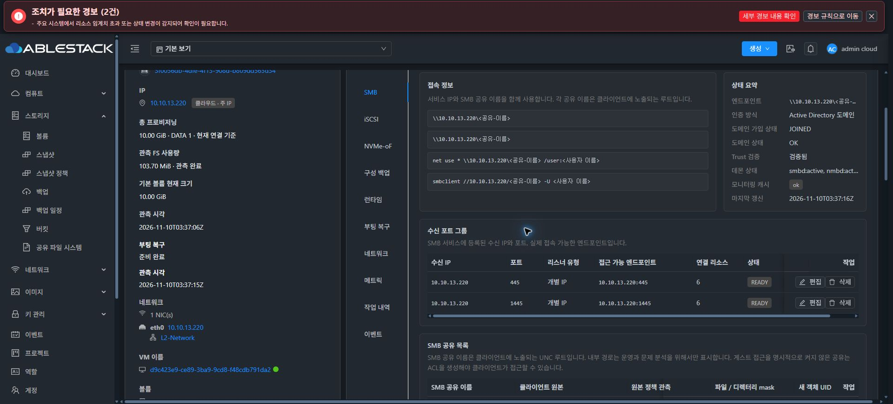
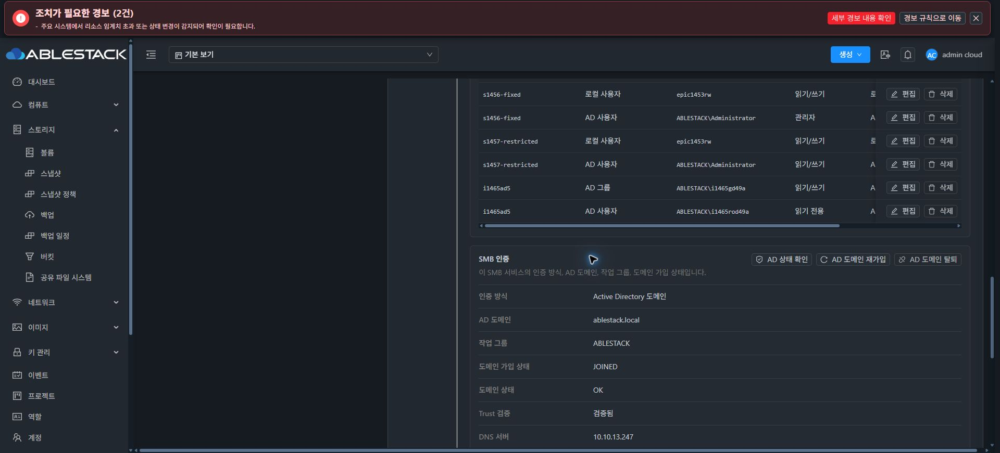

### B. 개선 UI
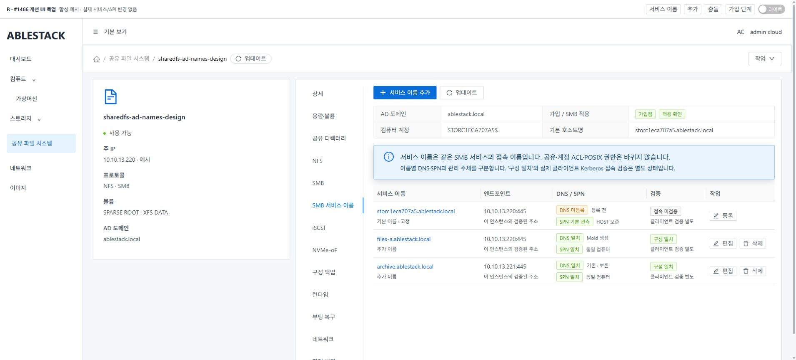
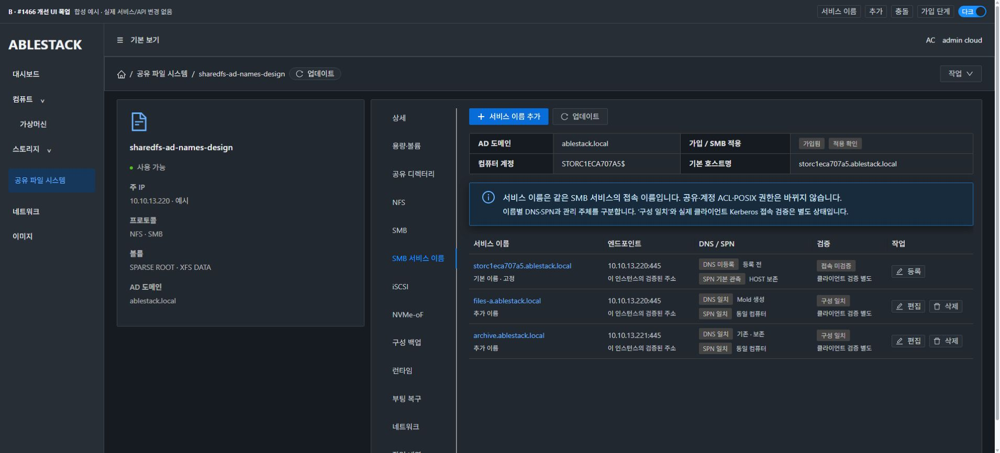
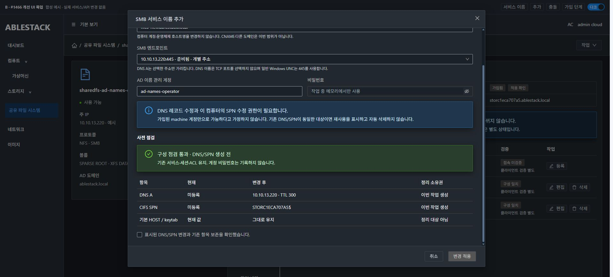
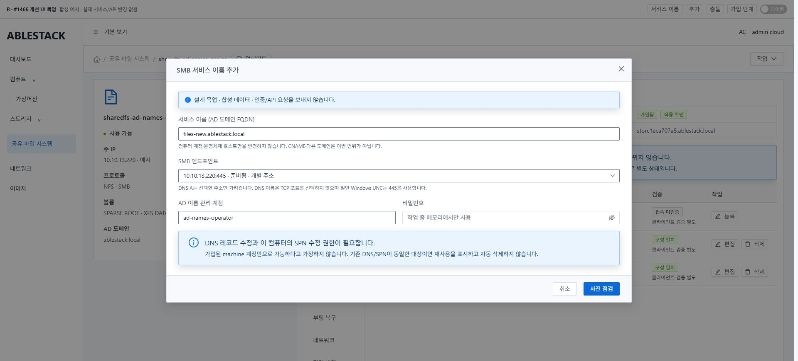
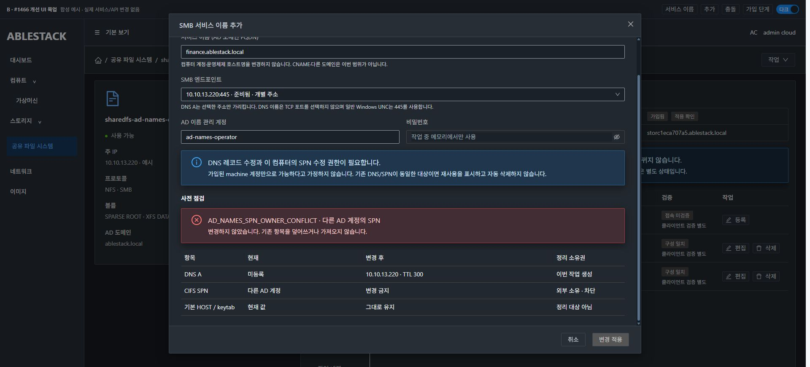
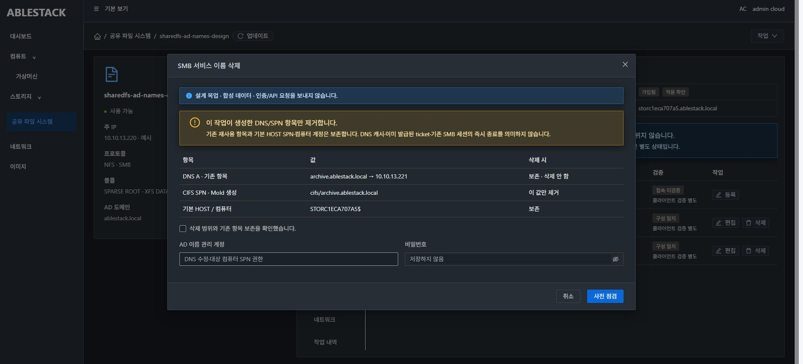
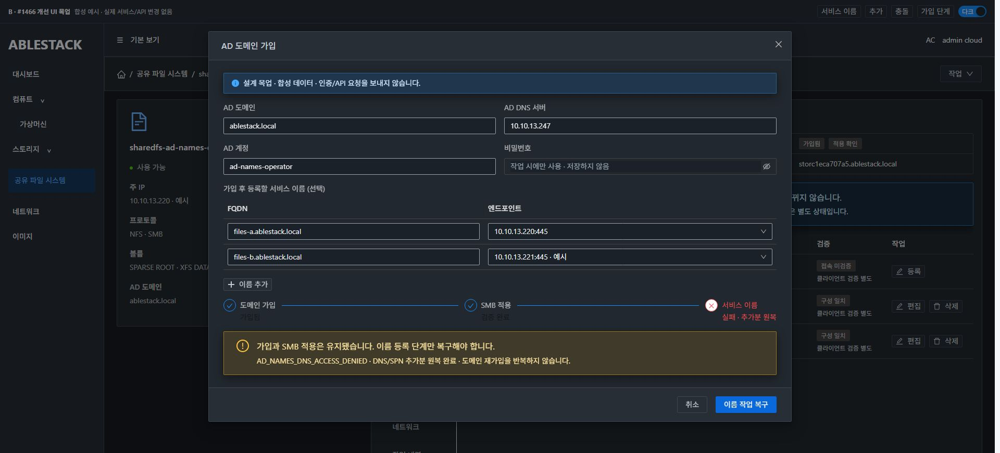
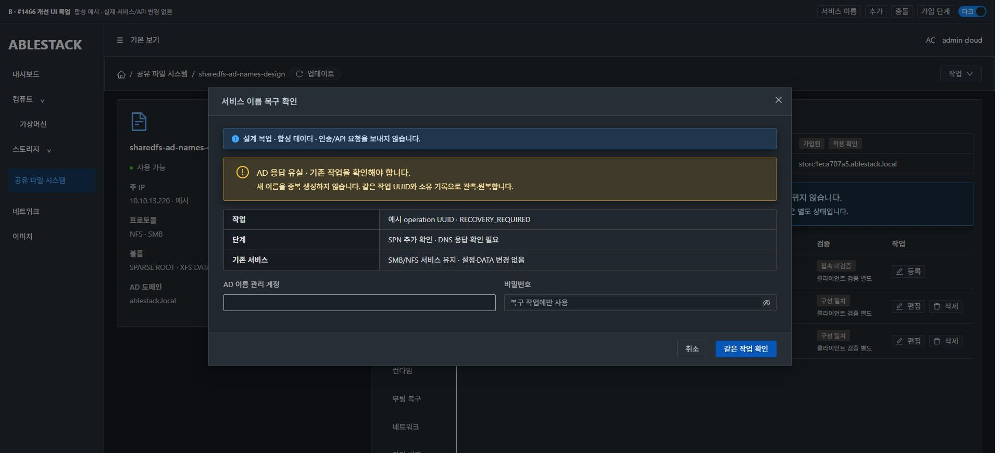

[목업 소스/실행](mockup/README.md). 이미지는 현재 구현과 명확히 구분해 이슈에도 첨부한다.

### S. 현재 가상머신 표준 비교
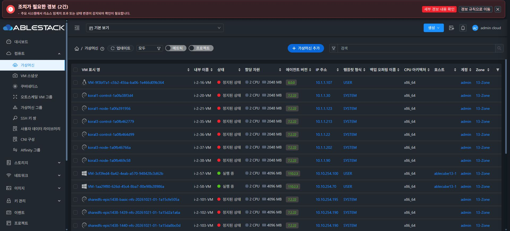
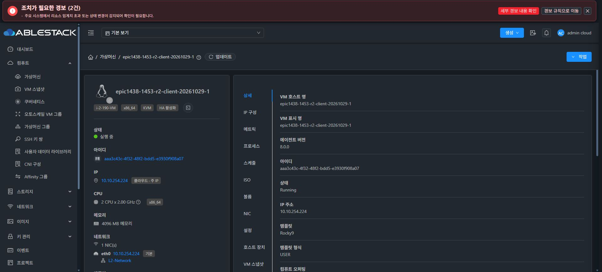
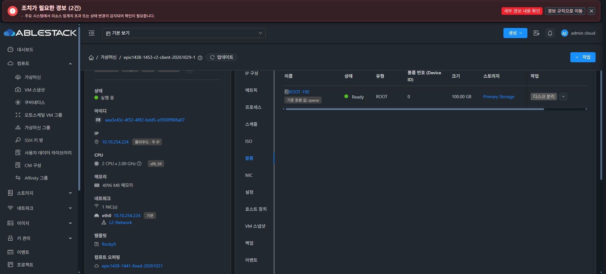
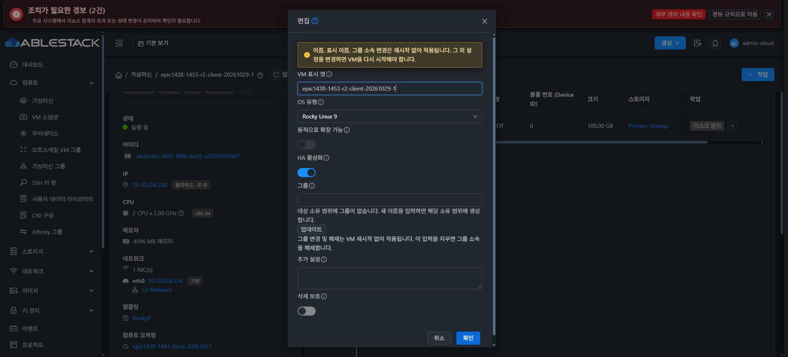

## 9. 구현 순서와 인수 게이트 — 아직 실행하지 않음
1. additive schema/VO/DAO와 실제 저장→재조회(긴 JSON·TIMESTAMP·Creating 예약·unique) 및 coordinator table/resourceType/같은 UUID 회귀.
2. 순수 이름/owner plan과 native helper의 SPN/DNS exact delta·CREATED/REUSED·journal·권한/충돌·응답 유실/보상. 두 단계 사이 실패·worker kill·AD 단절을 실제 SystemVM에서 주입한다.
3. guest 최초 VERIFIED 응답→Gson/실제 API→coordinator→DAO, 최초 하위 code·requirescredentials·resume/rollback·중복 요청을 연결한다.
4. 실제 Mold 구성의 table/모달/가입3단계 컴포넌트 요청 계약과 라이트/다크를 검증한다. 새 명령이 기존 drain/PID/AD lease·디렉터리 보호를 우회하지 않는지 검사한다.
5. API/서버/guest/UI 관련 모듈만 로컬 빌드·13번 배포한다. 새 Windows 클라이언트는 SPARSE 이상과 현재 Mold MAC 정책으로 UI 생성하고, 고유 SID·DNS/time·AD 로그인을 콘솔에서 확인한다.
6. Windows에서 두 FQDN의 SMB 접근·klist의 CIFS ticket·Get-SmbConnection·쓰기/RO/POSIX·원본 hash/권한을 실제 UI 콘솔로 검증한다. IP 접속/NTLM 성공을 Kerberos 대체 근거로 쓰지 않는다.
7. alias 추가/주소편집/rename/delete/재가입/VM·관리 재시작·AD 오류와 다른 프로토콜/로컬 서비스 보존, 소유 항목만 정리, endpoint/leave/delete guard를 확인한다.
8. 전부 통과한 뒤에만 Epic PR 제품 반영·#1466 완료 기록/종료를 한다. 제품 오류는 최초 원인·영향을 분석하고 중단한다.

**이번에 완료한 것은 native 설계 실증과 목업 검토까지다. Windows 신규 클라이언트·새 API/DB·제품 재가입/재시작 수명주기 인수는 아직 하지 않았다.** 수동 실험 성공을 제품 구현/인수 완료로 확대하지 않는다.

## 10. 외부 명세 참고
- [Samba4.17 net](https://www.samba.org/samba/docs/4.17/man-html/net.8.html): SPN/keytab/DNS 명령의 역할. 실제 설치 help·실증을 우선했다.
- [Samba4.17 smb.conf](https://www.samba.org/samba/docs/4.17/man-html/smb.conf.5.html): 현재 secrets and keytab 검증 방식·추가 이름 설정을 구분.
- [MS-ADTS additional DNS hostname](https://learn.microsoft.com/en-us/openspecs/windows_protocols/ms-adts/baa2d292-dc7c-45df-a47a-7aa9cec6c4c4): 기능 수준/validated write 전제를 2008R2에 무조건 적용하지 않음.
- [MS-DNSP record creation/deletion](https://learn.microsoft.com/en-us/openspecs/windows_protocols/ms-dnsp/c87b1caf-904d-4d8a-a7d1-3a6908112cd3), [UpdateRecord2](https://learn.microsoft.com/en-us/openspecs/windows_protocols/ms-dnsp/8f50ae96-d87f-4fdb-8526-5a86cea25837): 정확한 add/delete record 인자를 사용한다.

- [Samba4.17 SPN 구현](https://github.com/samba-team/samba/blob/samba-4.17.12/source3/libads/net_ads_setspn.c): 전체 SPN 목록 재저장 경로를 mutation 후보에서 제외한 근거.
- [OpenLDAP2.5 API 계약](https://github.com/openldap/openldap/blob/OPENLDAP_REL_ENG_2_5_13/include/ldap.h): GSSAPI bind·단일 값 LDAPMod·SSF 조회를 사용하는 native 실증 계약.
