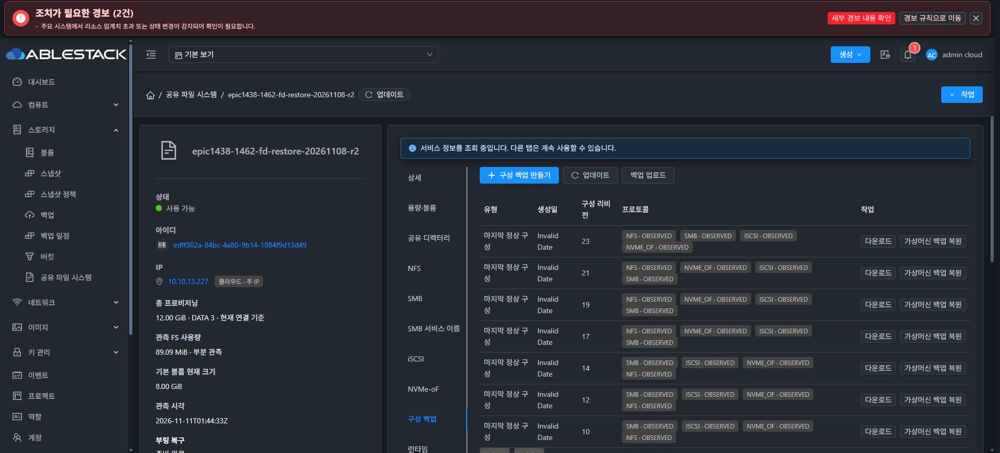
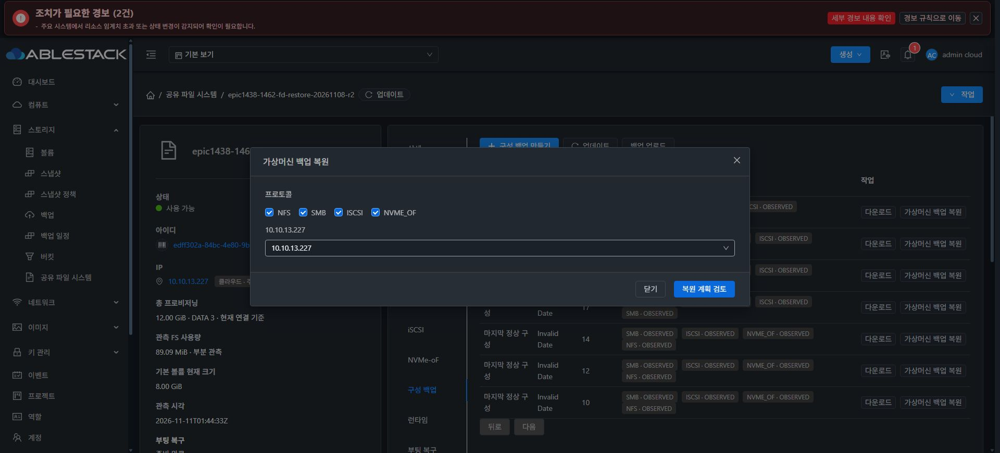
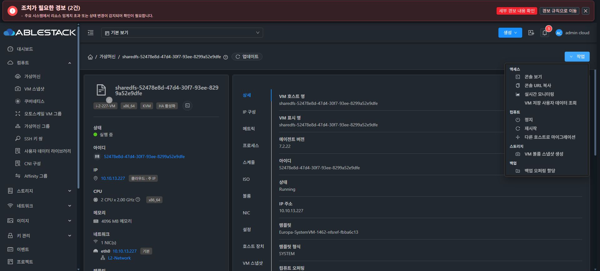
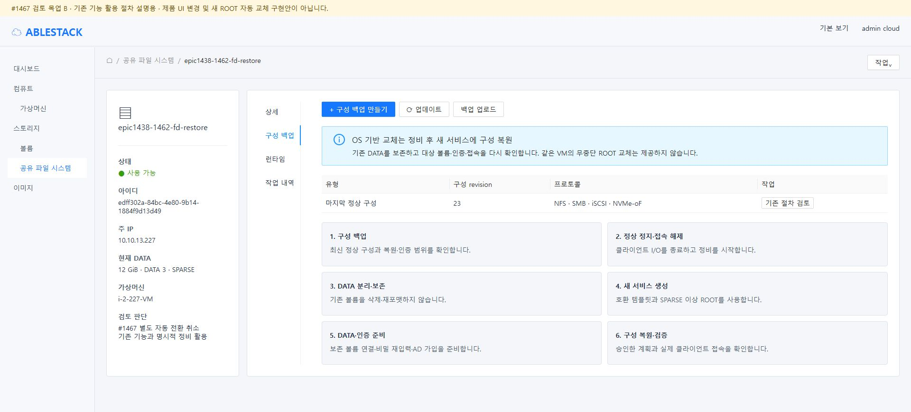
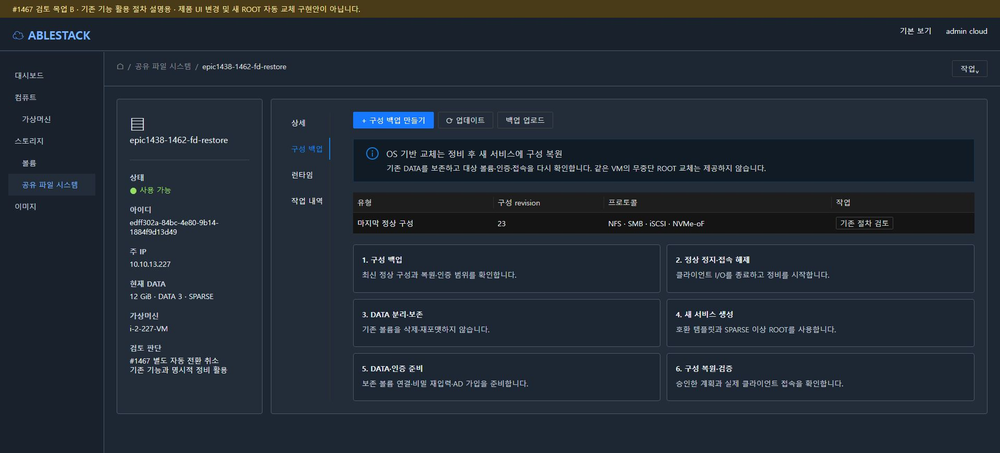
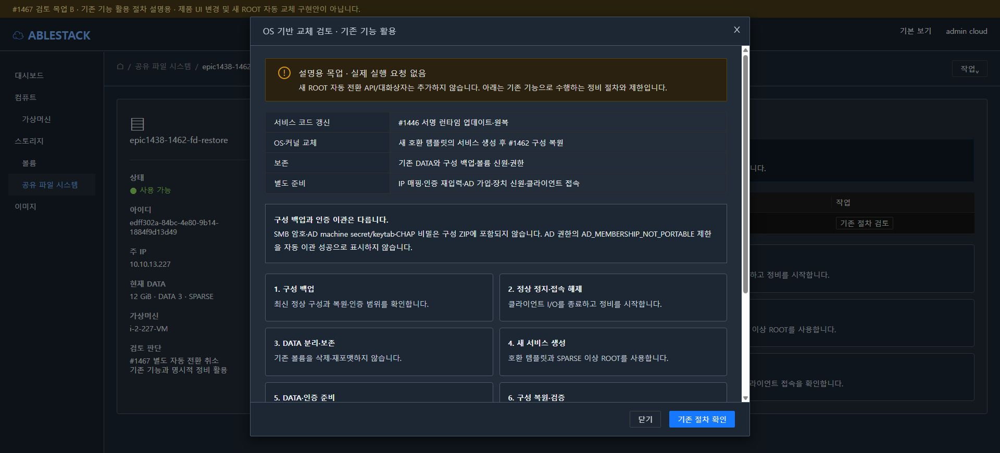
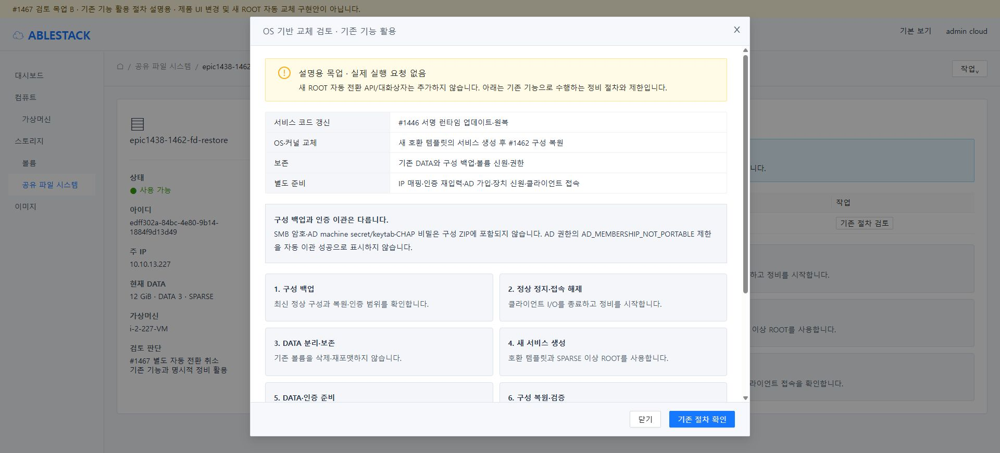

# #1467 기술 검토·설계 판단 — 별도 자동 ROOT 전환 취소

2026-11-11. **결론: #1467은 구현 완료가 아닌 취소(not planned)로 정리한다. 제품 구현·빌드·배포·실제 ROOT 교체를 시작하지 않았다.**

실행 중인 OS를 그대로 유지하면서 다른 템플릿의 ROOT로 바꾸는 기능으로는 제공할 수 없다. VM을 정지하고 ROOT를 교체한 뒤 부팅하는 유지보수 방식은 기술적으로 가능하다. 다만 현재 SharedFS는 해당 범용 API를 명시적으로 막고 있으며, 이번 이슈의 자동 인증 이관·기존 ROOT 보관/원복은 기존 구성 복원과 별개의 신규 마이그레이션 계약이다.

사용자의 “불필요하거나 기술적으로 무리한 기능이면 취소” 지시에 따라, 현재 Epic에서는 일반 모듈 갱신은 #1446, 구성 복구와 보존 DATA 재연결은 #1461/#1462를 사용하고 자동 ROOT 전환 계층은 추가하지 않기로 판단했다. **기술적으로 모든 형태의 교체가 불가능하다거나 #1462가 동일 VM/MAC·인증 신원을 투명하게 이관한다는 판단은 아니다.**

## 1. 판단표

| 구분 | 가능성과 현재 지원 | 이번 판단 |
|---|---|---|
| VM 실행을 유지한 채 OS·커널·ROOT 교체 | 현재 경로 없음. 일반 restore도 내부 정지→ROOT 재생성→시작 | 제공하지 않음 |
| 정지 후 같은 VM의 ROOT를 새 템플릿으로 변경 | 일반 VM의 하위 엔진은 가능. SharedFS UI/API와 일반 볼륨 attach/detach는 보호 차단 | 보호 제거만으로 구현하지 않음 |
| 서비스 코드 갱신 | #1446의 서명·ABI/baseline·무결성·원복 검증이 있는 런타임 경로 | 기존 기능 사용 |
| 같은 서비스의 설정 복원 | #1462의 승인 계획·단일 writer·원복·LKG | 기존 기능 사용 |
| 새 호환 VM/ROOT에서 보존 DATA·설정 복원 | #1461의 DATA 보존과 #1462의 새 대상 복원 경로. 인증 재입력·기능별 제한 존재 | OS 기반 변경의 명시적 정비 대안 |
| 같은 VM/NIC/MAC/IP·인증·WWN·이전 ROOT 자동 원복 | 위 대안이 그대로 보장하지 않음. 별도 호환성/비밀 이관/외부 AD 원복·보관 계약 필요 | 현 Epic에서는 취소. 필수가 되면 이 원요구를 근거로 재검토 |

취소의 근거는 구현 불가능이라는 추측이 아니라 **현재 범위에서 필요한 기존 운영 경로가 있고, 추가로 얻는 투명한 동일 신원 전환을 위해 영향 범위가 크게 늘어난다**는 판단이다. 무중단·동일 MAC·AD 자동 이관을 필수 운영 요건으로 다시 채택한다면 이 결정의 전제가 달라진다.

## 2. 실제 코드와 배포본 대조

- 작업 브랜치: `epic/1438-sharedfs`, 착수 HEAD `d7bf992717a9fb41a1e3093e592a266ed3eda8ac`.
- 로컬 Europa/upstream: `2250b0e7fb87dea26ab8442f52c69dce763c079b`, 차이0/0. origin/upstream fetch 후 확인했고 #1436 변경을 유지했다.
- 13번 관리 JAR SHA256: `aef93d4371defacdc5cb595ce1548d841be1c16864dac0c642ff4988bd143d10`.
- 13번 UI index SHA256: `77aa703a2b85b63a75ccfc3e286a6d9993b3b7540da65f6ef3e7110c6161dc8f`. 서비스 active.
- StorageConfigSnapshot·RestorePlanner·RestoreCandidate·RuntimeUpgradeManagerImpl 네 클래스는 현재 local compiled class와 배포 JAR의 바이트가 동일했다.
- UserVmManagerImpl 전체 class는 바이트가 달랐다. 전체 동일로 간주하지 않고 배포 JAR를 직접 역어셈블했다. 관련 restoreVM 입력 경로의 명령열과 ROOT 엔진·실제 익명 transaction을 대조했다. 상수 풀 번호/공백 및 확인된 익명 클래스 ordinal($8↔$9)을 제외한 명령열이 같았다. 익명 transaction도 같은 방식으로 대조했다. ROOT 엔진에서 이 ordinal 차이 외의 명령 변경은 없었다. **관련 경로의 동등성 확인이며 클래스 전체의 동등성을 주장하지 않는다.**

[배포본·클래스 비교](evidence/code-deployment-comparison.json) · [실제 restore 입력 guard](evidence/restore-api-guard.txt) · [실제 ROOT 엔진](evidence/restore-root-engine.txt) · [명시적 ordinal 차이](evidence/restore-root-bytecode-diff.txt)

### 코드 경계

| 위치 | 확인한 실제 동작 | 설계 판단 |
|---|---|---|
| UserVmManagerImpl.restoreVM(), 9788행 | userVmType=sharedfsvm을 root 작업 전에 거부 | 이 guard를 제거하지 않음 |
| ui/src/config/section/compute.js, 310~320행 | 일반 재설치 작업은 vmtype=sharedfsvm에서 숨김 | 실제 VM 메뉴에서도 재설치 없음 확인 |
| UserVmManagerImpl.restoreVirtualMachine(), 9893행 이후 | Running이면 stop, 새 ROOT 할당/attach, 이전 ROOT detach·destroy, 필요 시 start | 라이브 OS 전환 API가 아님 |
| RestoreVMCmd.expunge | 기본 false. 이전 ROOT의 즉시 영구 제거 여부 옵션 | false를 검증된 보관/선택적 원복 계약으로 오해하지 않음 |
| VolumeApiServiceImpl, 3156·3658행 부근 | 일반 SharedFS attach/detach 차단 | 기존 DATA 전용 서비스 경로·보호 유지 |
| validateRootVolumeDetachAttach(), 3743행 | ROOT 분리는 정지 상태를 요구 | 실행 중 디바이스0 교체 우회 금지 |
| StorageConfigSnapshot, 38~75·170~188·509행 | portable 설정 필드만 투영, 비밀 제외·credentialSlots, AD_MEMBERSHIP_NOT_PORTABLE 표시 | ROOT/AD 비밀 백업으로 확대하지 않음 |
| StorageConfigRestorePlanner.review() | 대상 VM·boot·revision·볼륨/경로 관측과 승인 계획 구성 | ROOT 교체·하이퍼바이저 작업은 하지 않음 |
| StorageConfigRestoreCandidate.stage() | 기존 네 프로토콜 apply와 정책/ACL 검증 재사용 | 설정 복원을 새 ROOT 생명주기로 확장하지 않음 |
| runtime_updater.py MANAGED_FILES, 48행 | 공유 서비스의 18개 관리 파일 및 서명/ABI/baseline 검증 | OS 패키지·커널·부트로더 업그레이드 도구가 아님 |

[CloudStack 일반 restore API](https://cloudstack.apache.org/api/apidocs-4.20/apis/restoreVirtualMachine.html)는 templateid와 이전 ROOT expunge 옵션을 제공한다. 이 일반 API 설명을 이 fork의 SharedFS에 그대로 적용하지 않았다. 실제 guard와 실행 JAR를 우선했다.

## 3. 현재 자원 확인

### 구성 복원 대상 — #1462의 실제 새 VM/ROOT 결과

- SharedFS `edff302a-84bc-4e80-9b14-1884f9d13d49`.
- VM `52478e8d-47d4-30f7-93ee-8299a52e9dfe` / i-2-227-VM / host13.3, Running, vmtype=sharedfsvm.
- 현재 템플릿 `2924ccf5-efa6-4661-b09f-5e319f5585df`.
- ROOT e23dbfc1… **10GiB SPARSE**, DATA3940999e… **8GiB SPARSE XFS**, a59c2c54…와 d647e089… **각2GiB SPARSE**.
- 실제 UI 구성 백업 탭에서 네 프로토콜의 정상 지점 revision23과 기존 복원 검토 대화상자를 확인했다. 검토 대화상자만 열고 닫았으며 복원 계획 검토/적용을 제출하지 않았다.
- 실제 VM 작업 메뉴에 일반 재설치가 없음을 확인했다.
- iSCSI identities.json과 Samba passdb/secrets DB가 **DATA가 아닌 ROOT 장치**에 있고 mode0600인 것을 read-only metadata로 관측했다. 비밀 파일 원문은 내보내지 않았다.

[VM](evidence/live-vm.json) · [볼륨](evidence/live-volumes.json) · [ROOT의 상태 파일 metadata](evidence/multi-protocol-root-state.json) · [#1462 최종 인수](../../validation/sharedfs-1462-config-recovery-20261109/README.md)

이전 #1462의 인수는 당시 새 VM/ROOT에서 네 프로토콜·실제 클라이언트·데이터·재시작을 확인한 기록이다. 이번 설계 검토에서 그 전체 인수를 다시 실행했다고 주장하지 않는다.

### AD 경계 실증 대상

기존 AD SharedFS `3f0056db-4dfe-4f13-908d-b809dd565d34`, instance c1eca707…, VM d9c423e9… / i-2-195-VM / host13.2를 사용했다. DATA e070a0aa…는 기존 **10GiB SPARSE XFS**다. 현재 활성 release `1466.smb-ad-names.2`의 실제 NativeDirectory를 사용했다.

## 4. 실제 SystemVM 주입 시험 — 새 ROOT의 인증 상태 부재

목적은 ROOT 교체/백업 복원 성공을 흉내 내는 것이 아니라 **DATA 보존과 AD machine 인증 보존이 독립임을 실증**하는 것이다.

1. 실제 NativeDirectory에서 현재 AD computer 신원·SPN을 읽었다.
2. 새 private mount namespace를 만들고 propagation=private를 적용했다.
3. /run의 빈0600 파일을 **해당 child namespace의 /etc/krb5.keytab에만** read-only bind했다. 운영 파일을 수정하거나 keytab 비밀을 복사하지 않았다.
4. 같은 활성 모듈의 AD 관측을 호출했다. **SMB_NAME_AD_AUTHENTICATION_FAILED로 차단**됐다.
5. child 종료 뒤 부모 namespace·keytab inode/size/mode·DATA device/inode, AD computer·SPN이 전부 기존 값과 같았다. 실제 DATA bytes write=0.
6. 임시 RAM 파일과 namespace는 종료 시 정리했다.

결과: **설계 경계 시험 PASS**. 새 ROOT에서 machine keytab이 빠지면 DATA와 DB 선언이 있어도 현재 AD 인증 경로는 복구되지 않는다. 이는 실제 새 ROOT 부팅 시험이나 템플릿 교체의 인수가 아니다. OS 이미지/하이퍼바이저 ROOT·네트워크/MAC·기존 DATA·AD 계정 비밀을 변경하지 않았다.

[실행 결과](evidence/root-auth-boundary.json) · [재현용 설계 probe](evidence/probe-root-auth-boundary.py)

NativeDirectory 내부의 정상 kinit은 기존 machine keytab을 사용한다. “비밀 원문 미내보내기”는 프로토타입이 비밀 원문을 출력/저장/전송하지 않았다는 뜻이며, 시스템 인증 모듈이 비밀 파일을 전혀 읽지 않았다는 뜻은 아니다.

## 5. #1462와 중복되는 것과 남는 차이

| 항목 | #1462의 현재 계약 | #1467을 유지하면 새로 필요한 계약 |
|---|---|---|
| 공유/대상·ACL·listener·정책·볼륨 매핑 | 백업/계획 검토/동일·새 서비스 복원 | 같은 검증·reconcile의 재사용 |
| 데이터 | 별도 보존 DATA의 UUID·FS·크기·inode 검증, 비재포맷 | 동일 보호를 ROOT 전환 전후에도 적용 |
| 로컬 SMB/CHAP 비밀 | 내보내지 않음, 다시 입력 | 봉인 전송·버전/형식 호환·이관/원복 |
| AD | AD_MEMBERSHIP_NOT_PORTABLE; 새 VM AD 가입·도메인 재구축은 #1462 인수 범위 밖 | machine secret/keytab·SID/idmap·컴퓨터/DNS/SPN 소유권과 외부 상태까지 확인 |
| 블록 신원 | 새 VM의 대상 WWN이 원본과 같다는 계약 없음 | WWN/namespace 등 클라이언트 신원까지 별도 보존·충돌 검증 |
| VM/NIC/MAC/IP | 새 대상 및 승인 IP 매핑. 같은 VM·MAC을 보장하지 않음 | 동일 VM/NIC 유지와 IP 소유권·ROOT pointer 이력 |
| 원복 | 설정 트랜잭션 원복 | 디스크·VM metadata·게스트/비밀·외부 AD의 다중 계층 원복 |
| 이전 ROOT | 구성 번들에 포함하지 않음 | 보관 기간·자동 정리 제외·수동 선택 원복·명시적 영구 정리 |

새 ROOT에서 AD를 재가입하거나 machine password가 바뀌면, 이전 ROOT만 되붙이는 것으로 외부 AD의 현재 신뢰와 일치한다고 보장할 수 없다. 동일 machine secret을 안전하게 이관하고 불필요한 재가입을 피하는 방안도 가능하지만 그 자체의 호환성·외부 회전 관측·롤백을 설계해야 한다. 이번에는 이 가정을 실제 AD 암호 변경으로 시험하지 않았다.

따라서 **“백업이 있으니 인증도 자동 복구된다”는 주장은 배제**한다. 기존 기능으로 목적을 달성할 때에는 아래 제한을 명시하고 정비/복원을 선택한다.

## 6. 최소 영향도 설계 — 제품 변경 0

- 서비스 모듈: #1446의 서명 런타임 점검→업데이트→검증/원복.
- OS/커널 기반 변경: 지원되는 호환 템플릿을 선택해 **별도 정비**한다. 구성 백업→클라이언트 정상 해제/서비스 정지→#1461 보존 DATA 분리→새 서비스/새 SPARSE 이상 ROOT→보존 DATA 연결→인증 재입력·AD 별도 준비→#1462 계획/승인 복원→실제 클라이언트와 데이터·권한/장치 신원 검증.
- 주소는 기존 IP가 자동 유지된다고 가정하지 않고 실제 새 대상 소유 IP에 매핑한다. MAC은 Mold 정책을 사용한다. 원본이 동작하는 상태에서 동일 IP/AD 컴퓨터 계정을 동시에 사용하지 않는다.
- NFS 복원은 #1462의 **서비스 전체 리슨 확인** 제약을 그대로 유지한다. AD가 포함돼 이식 불가로 표시된 번들은 해당 제약을 무시해 복원하지 않는다. 먼저 지원 여부/인증 절차를 확인하며 필요하면 기존 UI에서 명시적으로 재구성한다.
- 새 VM에서 원본 WWN·VM UUID·MAC·machine secret이 자동 유지된다는 보장은 추가하지 않는다. 클라이언트가 동일 신원을 필수로 요구하면 이 대안으로 진행했다고 성공 처리하지 않는다.
- 범용 restore/attach/detach의 SharedFS 보호를 유지한다. 새 템플릿 전환 API·DAO/DB 컬럼·sealed secret 포맷·guest ROOT 전환 명령·lifecycle 단계를 추가하지 않는다.
- 구현 유지 시 필요했을 대략의 경계는 사전 점검/정지·새 ROOT 준비·보호된 신원 이관·정지 상태 전환·부팅/프로토콜 검증·정식 확정·외부 상태 포함 원복·보관 종료다. 이 경로를 이번 이슈의 구현 계획으로 승인하거나 착수한 것이 아니다.
- #1467은 **취소(not planned)**다. 원래 인수 체크를 성공으로 체크하지 않는다. 새 이슈를 만들지 않으며 원요구와 근거를 보존한다.

## 7. 현재 UI A / 대안 설명 목업 B

A는 **배포된 실제 UI**다. B는 취소 판단과 기존 경로의 제약을 설명하는 **검토용 목업**이며, 제품 UI 변경 요구·신규 API·자동 ROOT 전환 화면의 구현안이 아니다. B의 설명 대화상자/버튼은 서버 요청을 만들지 않는다.

- VM 메뉴에서 확인한 Breadcrumb·좌측 resource 정보·세로 탭·탭 컨텐츠 배치와 AntD table/descriptions/button을 사용했다. 탭 컨텐츠에 별도 중복 제목을 넣지 않고 좌측 도구 그룹의 첫 버튼을 blue primary로 배치했다.
- Vue3.2.37 + Ant Design Vue3.2.20은 현재 repo의 실제 dependency다. **MoldDialog/MoldDialogActions의 실제 SFC와 mold-dialog.less를 재사용**했다. 나머지 프레임은 실제 VM 메뉴의 배치를 재현했다.
- 실제 DOM 측정: header top33/height55, footer top773/height65. body clientHeight685, scrollHeight971, overflow-y:auto. 헤더/푸터 밖으로 본문만 스크롤되는 구조다.
- 다크 표면 #232d39 위 본문 #eef2f7 대비12.40:1, 보조 #c6d0df 대비8.96:1. 16/20/24px 간격과 라이트/다크 표시·콘솔 오류0을 검토했다.
- #1468 전면 UI 정리 구현은 시작하지 않았다. 현재 A의 알려진 날짜/표시 차이는 이번 이슈에서 수정하지 않는다.

| 구분 | 화면 |
|---|---|
| A · 현재 구성 백업 |  |
| A · 실제 복원 검토 |  |
| A · SharedFS VM 작업 메뉴 |  |
| B · 기존 경로 설명, 라이트 |  |
| B · 기존 경로 설명, 다크 |  |
| B · 제약 설명 대화상자 |  |
| B · 라이트 대화상자 |  |

[목업 검토 측정](evidence/mockup-review.json) · [고정 영역 측정](evidence/dialog-layout.json) · [재현 소스](mockup-source/)

## 8. 이번 수행 범위와 다음 단계

수행: 코드/실제 배포 JAR 대조, 실제 VM/ROOT/DATA·기존 백업 UI 확인, 격리 SystemVM 인증 경계 시험, VM 표준 라이트/다크 목업, 설계·취소 판단 기록.

미수행: 제품 구현/모듈 빌드/배포, 템플릿 교체·ROOT 전환·실제 새 VM 복원, 비밀 이관/AD 재가입·암호 변경, 기존 자원 삭제/재포맷·MAC 변경. 신규 디스크 생성0·THIN0·DATA 쓰기0이다.

다음 남은 이슈는 #1468 최종 UI 정리다. 사용자 지시에 따라 **착수 전에 보고하고 추가 지시를 기다린다.**
