# #1468 SharedFS 최종 UI 정리 — 코드 수준 설계

**설계 완료 / 제품 구현·배포 미착수 / #1468 OPEN.** 2026-11-11 사용자 설계 지시와 후속 탭 순서 지시를 반영했다. 이번 문서는 기능 인수 완료 보고서가 아니다. 선행 #1439~#1466의 최종 근거와 #1467 취소 결정을 유지하며, 최종 UI 구현은 별도 지시 후 진행한다.

## 1. 확인 기준과 변경 경계

- 실제 UI: 13번 Mold의 공유 파일 시스템 목록·현재 노출된 15개 상세 탭·생성/편집/ACL/인증/확장/복원/삭제 폼과 런타임 카탈로그를 브라우저로 확인했다. VM 표준 목록·상세·볼륨·NIC·네트워크 대화상자도 대조했다.
- 실제 화면 수집 기준 코드: `df1c87d58fbf1d720461ce20b5ca90b41c9b7135`. 배포 JAR SHA256 `aef93d4371defacdc5cb595ce1548d841be1c16864dac0c642ff4988bd143d10`, UI index SHA256 `77aa703a2b85b63a75ccfc3e286a6d9993b3b7540da65f6ef3e7110c6161dc8f`.
- 저장 전 upstream 변경을 fetch하고 로컬 Europa를 `45944c40dedef7ff6b377db94225cf598c82739d`로 먼저 FF했다. Epic 210개 commit을 로컬 base에 재배치한 결과는 `ffed30c06bbdde7654ca0c167e61c39d9ce4a86e`다. local base/upstream divergence는 0/0이다.
- 재배치 충돌은 ListView의 BackupProgress/SharedFSCapacitySummary 등록과 AutogenView의 deleteBackup/destroySharedFileSystem 그룹 작업 허용 목록 2곳이며 두 기능을 모두 유지했다. 이번 설계 대상 SharedFSTab/CreateSharedFS/StorageConfigBackupTab/ResourceLayout/MoldDialog/테마 토큰의 내용은 수집 기준과 동일하다. upstream의 새 백업 기능은 이 설계의 신규 구현/인수로 세지 않는다.
- 4프로토콜/로컬 인증 기준 서비스: SharedFS `edff302a-84bc-4e80-9b14-1884f9d13d49`, 저장 서비스 instance `2b6eab19-b339-40fd-b62a-e84d056844db`, IP 10.10.13.227. 기존 SPARSE ROOT/DATA의 화면만 조회했다.
- AD/서비스 이름 분기: `3f0056db-4dfe-4f13-908d-b809dd565d34`. 온라인 컴퓨트 확장 지원/미지원 분기는 기존 서비스 `ae065dba-927a-4f38-85c0-9d997dd6e849`와 주 서비스에서 구분해 확인했다.
- 이번에 새 VM·볼륨을 만들거나 포맷·설정 적용·복원·재시작·삭제·클라이언트 I/O를 실행하지 않았다. 대화상자는 열기/취소까지만 수행했다. 새 디스크가 필요한 후속 검증에서는 SPARSE/FAT만 사용한다.
- UI 표시 설계이므로 SystemVM 코드 주입·게스트 변경·DB/API 스키마 변경은 필요하지 않다. 숫자 날짜는 실제 읽기 API 결과로 표시 계약을 실험했다. HTTP POST를 사용하는 LIST 조회도 포함하며 구성 변이는 없다.
- 실제 Mold 테마를 라이트/다크로 검토한 뒤 원래 다크로 복구했다. 임시 viewport override도 reset했다.

## 2. VM 표준을 재사용하는 원칙

SharedFS는 이미 ResourceView → ResourceLayout과 `mixinDevice.resourceTabPosition`을 사용한다. 별도 UI 프레임이나 전역 모달/테마를 다시 만들지 않는다.

| 영역 | 기준 소스/실제 VM 화면 | SharedFS 최소 설계 |
|---|---|---|
| Breadcrumb·목록 상단 | AutogenView, ListView, VM 목록 | 기존 Breadcrumb·현재 자원명·우측 공통 작업 위치 유지. VM 공통 목록 검색/필터/선택/페이지네이션 유지 |
| 상세 프레임 | ResourceView / ResourceLayout / InfoCard | 기존 좌측 정보 카드·우측 탭 영역·gutter 유지. 상세는 읽기 정보만 표시 |
| 상세 정보 | DetailsTab의 label/value 목록 | 동일한 줄 간격/경계/라벨 대비. 작업 폼이나 거대 관리 섹션을 상세에 추가하지 않음 |
| 탭 | InstanceTab + mixinDevice | 데스크톱 세로 탭, 기존 모바일 VM 반응형 정책 유지. 아래 순서만 변경 |
| 탭 내부 | VM 볼륨/NIC 탭 | 좌측 작업 그룹 → 상태/안내 → 섹션·표. 기존 표 검색/페이지네이션/빈 상태 유지 |
| 대화상자 | MoldDialog / MoldDialogActions / mold-dialog.less | 정해진 size·고정 헤더/푸터·본문만 overflow:auto. 각 기능의 필드·순서·검증 유지 |
| 테마 | style/theme/tokens.less, 공통 table/form/dialog 스타일 | semantic token 재사용. VM/볼륨 공통 스타일을 덮어쓰지 않음 |

목록의 공통 상단 툴바를 프로토콜 탭 툴바와 혼동하지 않는다. VM 목록의 기존 Breadcrumb/업데이트/작업 구조를 유지하고, 파란 primary를 좌측 첫 버튼으로 두는 규칙은 각 작업 툴바 내부에 적용한다. 기존 ActionButton/SearchView의 전역 배치를 변경하지 않는다.

## 3. 최종 탭 순서

사용자 요구대로 **상세 다음에 NFS·SMB·iSCSI·NVMe-oF가 연속**하며 이벤트가 맨 마지막이다.

| 순서 | 표시 | 기존 key | 배치 이유 |
|---:|---|---|---|
| 1 | 상세 | details | 읽기 정보 |
| 2 | NFS | nfs | 주요 서비스 |
| 3 | SMB | smb | 주요 서비스 |
| 4 | iSCSI | iscsi | 주요 서비스 |
| 5 | NVMe-oF | nvmeof | 주요 서비스 |
| 6 | 용량·볼륨 | capacity | 자주 쓰는 용량/연결 관리 |
| 7 | 공유 디렉터리 | directory | 공통 POSIX/ACL 관리 |
| 8 | SMB 서비스 이름 | smbNames | SMB 이름/AD 관리 |
| 9 | 구성 백업 | configbackup | 백업·복원 |
| 10 | 작업 내역 | configurationoperations | 바로 앞 복원/구성 작업의 실패 진단·이어하기 |
| 11 | 런타임 | runtime | 유지보수 |
| 12 | 부팅 복구 | bootrecovery | 복구 진단 |
| 13 | 네트워크 | nics | 연결/정책 |
| 14 | 메트릭 | vmstats | 관측 |
| 15 | 이벤트 | events | 표준 최종 이력 |

선택 기능 `volumestats`는 활성화되는 경우 메트릭 옆(이벤트 앞)에 둔다. 현재 13번 feature flag에서는 노출되지 않아 소스로만 확인했다. api 권한·기존 v-if·lazy mount·ref·탭 key를 유지하고 pane 선언 위치만 이동한다. `?tab=configbackup` 등 기존 deep link와 현재 선택을 보존한다.

**코멘트:** VM 표준은 이벤트 다음 코멘트지만 현재 SharedFS 탭과 AnnotationService.EntityType에 SharedFS가 없다. 이번 범위에서 코멘트 API를 만들거나 backing VM의 코멘트를 SharedFS 코멘트인 것처럼 표시하지 않는다. 현재는 이벤트가 마지막이다. 향후 코멘트가 정식 지원되면 이벤트 → 코멘트가 최종 두 탭이며 그 뒤에 관리 탭을 두지 않는다.

## 4. 현재 A와 개선 B의 명확한 차이

### 4.1 네 프로토콜 툴바와 표

현재 iSCSI/NVMe-oF는 탭 제목 아래 `ProtocolHeader`를 중복 표시하고 `protocol-toolbar--right`로 넓게 보기부터 오른쪽 정렬한다. NFS/SMB와 작업 순서가 다르다.

개선:
- 네 탭 모두 **파란 주요 생성 버튼 → 활성화/해당 추가 작업 → ReloadOutlined 업데이트 → 넓게 보기**를 하나의 **좌측 정렬 그룹**에 둔다.
- 넓게 보기는 좌측 버튼 그룹의 맨 마지막이다. `margin-left:auto`나 `justify-content:flex-end`로 화면 끝으로 보내지 않는다. 좁으면 버튼 단위로 wrap한다.
- SMB 엔드포인트 추가는 주요 공유 생성 다음에 둔다. AD/ID매핑/원본 접근/생성 권한/namespace/Host ACL 등 부가 작업은 관련 섹션이나 기존 행 작업에 남긴다. 어떤 기능도 제거하지 않는다.
- 탭과 같은 이름인 protocol header만 SharedFS 사용부에서 제거한다. 다른 화면의 ProtocolHeader를 수정하지 않는다. 엔드포인트/내보내기/대상/서브시스템/namespace/접근 규칙/세션 같은 구획명은 유지한다.
- 긴 경로/IQN/NQN/UUID는 열 최소 폭·nowrap 헤더·ellipsis/tooltip/전체 복사로 표시한다. 행 작업은 오른쪽 고정, 이름은 왼쪽 고정, 가로 스크롤은 표 안에 제한한다.
- 기존 컬럼 정보는 삭제하지 않는다. 기존 정보가 너무 넓으면 표와 읽기 상세의 전체 값으로 확인하며, JSON/config를 다시 저장하거나 배열을 정렬해 화면 문제를 해결하지 않는다.
- 넓게 보기/기본 보기는 현재 공통 ResourceLayout 상태와 복원 동작을 유지한다. 반복 진입으로 데이터 fetch/approval/보호 상태가 초기화되지 않게 한다.

### 4.2 생성·편집 대화상자 — 생성은 현재 본문 유지, 미고정 헤더·푸터만 수정

**2026-11-11 사용자 정정이 이전 생성 목업보다 우선한다. SharedFS 생성 및 서비스별 생성 대화상자의 현재 본문 레이아웃을 그대로 유지한다. 생성 화면에 대한 변경 허용 범위는 현재 고정되지 않은 제목 헤더·확인/취소 푸터의 고정 처리뿐이다. 이미 고정된 영역은 수정하지 않는다.**

생성 화면 보존 기준:
- `CreateSharedFS.vue`의 현재 `.sharedfs-create-layout`은 좌측 요약·우측 설정의 2열(`minmax(240px, 300px) minmax(0, 1fr)`), gap16이다. 이 구조와 기존 반응형 분기를 보존한다.
- 현재 `.sharedfs-create-dialog`의 `width:min(92vw,1120px)`, 기존 높이/본문 표시 폭, 요약 패널·소유자 접기·설정 섹션·필드 순서·컴포넌트 간격·조건부 입력·기본값을 바꾸지 않는다. 표준 LG(960px) 폭을 적용하거나 단일 열 폼으로 재편하는 이전 제안은 철회한다.
- summary/config 영역의 기존 독립 본문 스크롤과 sticky 요약 동작도 유지한다. 스크롤 영역의 경계만 조정해 제목·버튼이 스크롤되지 않게 하며 본문 전체의 스크롤 방식을 새로 통일하지 않는다.
- SharedFS 생성뿐 아니라 NFS·SMB·iSCSI·NVMe-oF 등 기존 생성 폼도 본문 재배치/재그룹/폭 변경 없이 헤더·푸터 고정 여부만 확인한다. 새로운 항목·본문 목업·생성 단계는 추가하지 않는다.

실제 확인: 신규 SharedFS 생성은 이미 제목 헤더가 존재하고, 버튼은 `CreateSharedFS.vue`의 `.action-button`으로 본문 안에 있다. 수집 dark 측정은 header top24/height55, body client824/scroll879, footer 없음이다. 따라서 현재 확인된 생성 결함은 버튼 푸터의 부재이며 제목은 긴 본문 스크롤에서도 고정되는지 먼저 확인한 뒤 필요할 때만 보완한다.

최소 코드 설계:
1. SharedFS 생성의 현재 AutogenView a-modal 경로와 제목 슬롯, width auto·실제 본문 폭을 우선 유지한다. 생성 액션에 `standardDialogSize:'lg'`를 추가하는 계획은 취소한다. 다른 액션이나 전역 `storageUiRoute()`/modal 크기 프리셋은 변경하지 않는다.
2. 생성 액션에만 필요한 경우 `standardDialogFormActions` 같은 opt-in 표식을 둔다(이름은 구현 시 확정). 기존 a-modal을 유지한 채 현재 MoldDialogActions가 사용하는 footer target injection을 해당 폼에만 provide하고, a-modal footer slot에 비어 있는 target을 둘 수 있다. 기존 제목과 전체 폼을 복제하지 않는다.
3. CreateSharedFS의 **기존 취소·확인 버튼 노드만** footer target으로 이동한다. 제목과 푸터의 flex/높이 제한·body min-height/overflow만 생성 전용 class로 보완한다. 현재 고정이 정상인 제목 영역은 그대로 두고 footer만 고정해도 된다. opt-in이 없는 다른 화면은 기존 footer null 경로를 유지한다.
4. 같은 컴포넌트가 독립 MoldDialog로 실행되는 preparationMode의 기존 provider/닫기 footer는 그대로 둔다. footer target을 공유하거나 중복 injection하지 않는다.
5. 버튼이 Spin 밖으로 이동하므로 확인 버튼의 기존 loading/disabled를 유지해 중복 제출을 차단한다. 취소/X/ESC·form finish/ctrl-enter·최초 오류·보호 상태·API 요청/승인/미변경 POSIX 비제출을 바꾸지 않는다. `busy=loading`으로 닫기 동작까지 새로 막지 않는다.
6. provider와 target은 해당 생성 modal 인스턴스/생명주기에만 연결한다. 닫기·재진입 시 다른 폼의 버튼을 가져오거나 footer를 중복 생성하지 않아야 한다.

편집 및 그 외 대화상자는 기존 설계를 유지한다. UpdateSharedFS/ChangeSharedFSServiceOffering의 버튼 footer, SharedFSCompute/Deletion/권한/백업/카탈로그의 기존 MoldDialog와 NIC 복구 local shell 검토는 별도 범위이며, 이번 생성 본문 보존 지시를 편집 폼 재설계 승인으로 해석하지 않는다. 정상인 폼은 재작성하지 않는다.

Teleport된 dialog의 표시는 SharedFS 생성 전용 class 또는 기존 route-scoped class로 한정한다. 제목/푸터를 고정하려고 전역 ant-modal이나 VM/볼륨 스타일을 바꾸지 않는다.

### 4.3 표시 의미: 데이터·작업 판정은 변경하지 않음

| 현재 확인/기존 이슈의 최종 UI 이월 | 개선 표시 계약 | 유지할 보호 |
|---|---|---|
| 백업 created가 숫자 epoch-ms인데 Date.parse(number) → Invalid Date | StorageConfigBackupTab 표시 입력만 ISO로 변환 후 기존 locale/timezone helper 사용. 없는/유효하지 않은 값은 — | API/DB의 원 timestamp·artifact/해시 불변 |
| SharedFS 복원 버튼이 공통 VM 번역 '가상머신 백업 복원' | SharedFS 전용 '구성 복원' locale key | 기존 복원 review/apply·NFS 전체 리슨 제약·인증 재입력·drain 유지 |
| NOT_NEEDED를 모두 '변경 전 차단'으로 표시 | COMMITTED: '별도 원복 없음'. guest VERIFIED/SQL COMMITTING: 기존 '게스트 적용 확인·DB 확정 대기·원복 미실행'. 실제 no-start/PREFLIGHT 거부만 '변경 전 거부'. 나머지 '원복 미실행/확인 필요' | state/phase/원인·canResume·영수증·configurationprotection 변경 없음 |
| 다른 리소스의 최근 종료 작업이 새 폼의 현재 작업처럼 보일 수 있음 | 현재 작업/이전 이력 분리, 이력에는 리소스/시각 표시하고 접기 가능 | instance 전체 활성 잠금은 항상 표시. 패널을 숨겨도 서버 보호/오래된 응답 차단 유지 |
| client-only/listener-only인데 포괄 재시작 설명·생성 mask 용어가 뜸 | 서버가 반환한 실제 impact class/method로만 설명 분기 | API 이름으로 '무중단'을 추정하지 않음. 승인 intent/fingerprint 불변 |
| 같은 IP·다른 포트가 UNC만으로 구분 안 됨 | 실제 게시 이름과 endpoint IP:port를 함께 표시. Windows UNC 제약/지원 접속법 구분 | 리슨 설정·계정/ACL 변경 없음 |
| 정책 상태/관측 캐시/부모·setgid 안내 혼동 | 저장 설정 revision, 관측 시각, 지원 미확인/대기/차단을 명확히 분리 | stale 결과를 현재 구성으로 승격하지 않음. UNKNOWN을 성공으로 바꾸지 않음 |
| SMB_FINALIZING 등 raw 표시 | 기존 raw code를 남기고 locale 설명 병기 | 최초 오류·원복 오류·진단 전체 확인 유지 |

## 5. 파일별 구현 계획

아래는 **변경 예정 지점**이며 이번 문서 commit에는 제품 코드를 수정하지 않는다.

| 파일 | 최소 작업 | 회귀 포인트 |
|---|---|---|
| ui/src/views/storage/SharedFSTab.vue | pane 순서, 4개 툴바, 중복 header, 표 표시/간격, local modal shell | 기존 key/route/ref/v-if/API intent·보호·넓게보기 복원 |
| ui/src/config/section/storage.js | 생성은 현행 modal/폭 유지, 필요 시 footer 전용 opt-in만 추가. update/offering은 기존 설계 | 다른 메뉴/액션 선택 경로 불변 |
| ui/src/views/AutogenView.vue | 생성 전용 footer slot/target provider와 class만 필요한 경우 추가. 기존 modal 크기/본문 경로 유지 | VM/볼륨/백업 modal·그룹 삭제·selfManagedDialog 기존 계약 |
| CreateSharedFS.vue / UpdateSharedFS.vue / ChangeSharedFSServiceOffering.vue | 생성 본문/CSS 그대로, 기존 버튼만 footer target에 연결. 편집은 기존 설계 | 미변경 필드 비제출·검증 실패·중복 제출·취소·preparationMode |
| StorageConfigBackupTab.vue | 날짜 표시 adapter, 구성 복원 label, 표 간격 | 실제 LIST numeric wire·ZIP/restore 계약·보호 상태 |
| StorageConfigurationOperationPanel.vue | 상태 조합별 문구, 현재/최근 이력 표시 scope | SQL 확정 대기/최초 오류/원복 실패·이어하기 보존 |
| SharedFSCapacityTab.vue / SharedFSNetworkStatus.vue / SharedFSBootRecoveryTab.vue | 기존 요약·표·경보 스타일 정리만 | 용량·복구·NIC 보호/permission 불변 |
| StorageDirectoryPolicyPanel.vue / StorageDirectorySetgidDialog.vue / StoragePosixAclFields.vue / FileSharePathFields.vue / SMB 관련 기존 폼 | header/label 폭·gap·정책 리비전 열·테마 | 공통 정책·UID/GID·access/default ACL·상속·경로 신원 불변 |
| StorageServiceRuntimeUpgrade.vue / RuntimeCatalogAction.vue / RuntimeCatalogRecords.vue | 기존 toolbar/table/dialog의 표준 스타일 검토 | 서명/ABI/게시·중지·철회·참조 삭제 보호 및 이력 불변 |
| ui/public/locales/ko_KR.json, en.json | SharedFS 전용 문구 | VM 공통 번역과 raw API enum은 바꾸지 않음 |
| SharedFS 전용 style(구현 시 경로 확정) | route-scoped panel/table/modal 규칙, existing tokens | VM/볼륨·다른 메뉴와 dark/light에 전역 영향 없음 |

기존 SharedFSCompute/Deletion, NicsTab, StatsTab, events-tab이 이미 공통 표준인 부분은 그대로 사용한다. 실제로 수정할 필요가 없는 파일에 단순 정리를 위한 대규모 diff를 만들지 않는다. 1만 줄 SharedFSTab controller·API dispatcher·coordinator를 UI 재배치 목적으로 재설계하지 않는다.

## 6. 다크모드·간격·반응형

- 실제 VM/Mold semantic token: light text #1f2937 / surface #ffffff, dark text #f0f3f6 / surface #22282f, secondary #4b5563 / #c5ccd4, primary #0969da + white. 전역 브랜드/테마 변경 없이 재사용한다. 해당 조합의 계산 대비는 light 기본14.68:1/보조7.56:1, dark 기본13.35:1/보조9.18:1, 파란 버튼 흰 글자5.19:1이다(token-contrast.json). 실제 모든 disabled/hover/focus 상태의 접근성 인수를 대체하지 않는다.
- 배경/경계/라벨/placeholder/link/disabled/error/info도 각각 token으로 분리한다. 비활성 버튼을 흐리게 만들어 글자가 사라지지 않게 하되 활성화하거나 경고를 숨기지 않는다. readonly/disabled 여부는 색만으로 전달하지 않는다.
- 생성 폼의 기존 gap·field 배치는 변경하지 않는다. 다른 정리 대상에서는 버튼 gap8, section gap24, heading→table gap12, form item gap16을 기본으로 VM/Mold 기존 grid/gutter와 맞춘다. 테이블 헤더의 한 글자 세로 줄바꿈을 없애고 긴 값은 내부 가로 스크롤로 처리한다.
- 탭 레이블은 단어 단위 줄바꿈/최소 폭을 사용한다. 현재 예시 desktop156px, 좁은 desktop148px이며 실제 구현 시 VM 프레임과 언어별 길이로 검증한다. 전역 Tab 폭을 바꾸지 않는다.
- 폼은 viewport max-height 안에서 header/footer flex-shrink:0, body min-height:0/overflow:auto. long select popup/validation error가 footer 뒤로 가려지지 않아야 한다.
- **철회된 생성 본문 예시의 과거 참고 측정(개정 생성 설계 인수 근거 아님)**은 **1920×871**: header33~88, body88~773(client685/scroll1247), footer773~838. 본문보다 긴 내용에도 footer가 화면 안에 있다.
- 1366×768 override를 요청했으나 도구 측정 viewport가 1920×871로 유지되어 **작은 화면 통과로 주장하지 않는다**. 이 제한과 실제 측정을 evidence/B-dialog-geometry.json에 기록했다. 1366×768·모바일·영어·포커스 순환/오류 autofocus는 구현 시 필수 인수 항목이다.

## 7. 설계 실증과 확인하지 않은 것

### 실증한 것
- 실제 UI에서 현재 15개 탭을 두 테마로 확인했다. 현재 A107장(다크82/라이트25), VM 기준 S7장, 개선 B36장(각18), 합150장이다. 중복 파일은 최종본 하나로 정리했고 세부 화면·테마별 목록은 gallery.md 및 evidence/audit-index.json을 따른다.
- 생성의 기본/네 프로토콜 분기, NFS/SMB/iSCSI/NVMe 생성·편집·ACL·인증·엔드포인트·namespace, 디렉터리, 확장, 백업 업로드/복원 검토, 지원/미지원 컴퓨트, 삭제의 보존/선택 분기, AD 이름/가입/탈퇴, 카탈로그 화면을 기존 자원으로 열어 확인하고 취소했다. 실제 submit/중지/삭제는 없다.
- B는 **Vue3 + Ant Design Vue + 실제 ResourceLayout/MoldDialog/MoldDialogActions 소스와 AntD 아이콘**으로 렌더했다. 제품 controller/API를 복제하지 않는 표시 전용 목업이다. 표/폼 데이터는 예시이며 실제 포트·권한을 변경하지 않는다.
- 실제 artifact LIST projection의 created=1794168980550은 숫자이며 Date.parse(number)가 NaN이었다. 표시 변환 후 동일한 ms의 2026-11-08T20:16:20.550Z를 보존했다.
- 날짜/상태별 표시/탭 키·순서/원 데이터 불변 실험 **20/20 PASS**. evidence/design-contract-check.cjs와 결과를 제공한다. 이것은 **설계 계약 실험이며 제품 컴포넌트 회귀 시험이 아니다**.
- 재배치 충돌과 관련된 기존 AutogenSharedFSDeletion/SharedFSCapacityAutogen 제품 UI 회귀 2suite·9건은 PASS다(upstream-ui-sync-check.log). 목업 재현 로컬 조립도 PASS다. 이 검사는 Git 동기화 보존 확인이며 #1468 제품 구현 시험이 아니다.
- 목업 console error는 확인한 최종 페이지에서 0이었다. 현재 product service의 기능 회귀 성공/신규 배포 성공을 의미하지 않는다.

### 아직 하지 않은 것
- 제품 구현·UI module build/deploy·제품 컴포넌트 회귀·API 변이·SystemVM/클라이언트 I/O는 미실행이다.
- 모든 대화상자의 모든 상태/권한/영어를 두 테마로 각각 만들지는 않았다. 15개 탭은 두 테마, 폼은 전체 주요 유형의 dark와 대표 light를 확보했다. 지원하지 않는/현재 노출되지 않는 상태는 source review와 후속 계획으로 구분한다.
- nonterminal 이어하기, stopped-only 오퍼링, volume stats flag, 실패/오류/드롭다운 길이 같은 조건부 상태는 기존 코드/기록을 검토했으며 이번에 실행 자원을 조작해 재현하지 않았다.
- catalog 모든 transition action은 공유된 RuntimeCatalogAction 소스로 검토했다. 실환경에서 게시·철회 등을 실행한 것으로 세지 않는다.

## 8. 구현 후 인수 계획

1. 실제 SharedFSTab/AutogenView를 mount해 pane key·기존 deep link·권한별 가시성·4프로토콜 툴바 순서/primary/넓게보기를 검증한다. 목록 검색/페이지네이션·행 작업과 VM 표준 경로도 기존 회귀를 수행한다.
2. 실제 생성/편집 컴포넌트에서 기존 API wire fixture를 써서 사전 점검 → 승인 → 제출 요청의 동등성을 확인한다. 변경하지 않은 POSIX 비제출, 비밀값 비저장/비로그, UUID·revision·intent·해시·배열 순서 보존을 확인한다. 단순 레이아웃 테스트가 기능 회귀를 대체하지 않는다.
3. 현재 생성 2열/폭/본문 섹션·간격/반응형/요약·설정 스크롤이 변경 전과 동일한지 우선 비교한다. 이미 고정된 제목은 유지하고 footer만 변경했는지 확인한다. 생성 전용 footer target·MoldDialog footer teleport·validation 실패·loading 중 확인 중복 차단·취소/X/ESC·닫기 후 재진입·focus restore를 검증한다. preparationMode/삭제 보존·부분 실패 재개/compute 지원 여부의 현재 분기도 보존한다.
4. 실제 numeric timestamp API 입력, COMMITTED/RECOVERY_REQUIRED/UNKNOWN/원복 실패 응답, 오래된/순서가 바뀐 응답으로 표시를 검증한다. configurationprotection·활성 작업은 hidden panel과 무관하게 유지한다.
5. 변경 UI만 로컬 lint/unit/build하고 13번에 배포한다. Actions는 사용하지 않는다. API/Backend/게스트 변경이 없으면 불필요한 Maven/SystemVM 이미지 빌드는 하지 않는다.
6. 실제 UI에서 목록→상세→각 탭→폼→취소, wide/normal, light/dark·한국어/영어·1920/1366/모바일을 확인한다. SharedFS 변경이 VM·볼륨 공통 프레임에 영향을 주지 않는지도 확인한다.
7. 기존 서비스의 표시/API 대조와 필요한 최소 NFS·SMB·iSCSI·NVMe 접속/데이터 확인을 수행한다. #1468을 기존 28개 이슈의 전체 재개발이나 새로운 백업 시나리오로 확대하지 않는다. 새 테스트 DATA는 SPARSE 이상, 기존 데이터/신원/ACL/drain/원복/서명 보호는 유지한다.
8. 제품 오류는 원인·최초 실패를 보존해 보고 후 중단한다. 단순 표시 항목을 server 성공으로 위장하지 않는다. 완료 근거를 #1468/기존 Epic PR #1470에 기록한 후에만 이슈 완료/종료를 판단한다.

## 9. 이미지: 현재 A와 개선 B

각 이미지에 A/B/S와 테마를 명시한다. 목업은 제품 반영본이 아니다. 모든 캡처는 [전체 갤러리](gallery.md)에서 볼 수 있다.

### VM 표준 S
| 라이트 | 다크 |
|---|---|
| 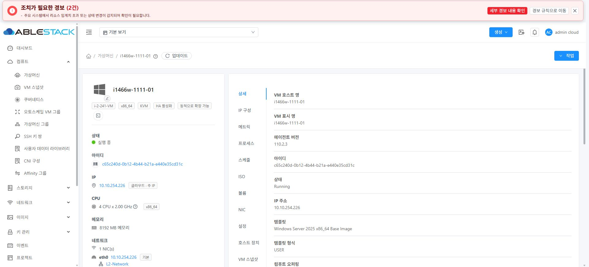 | 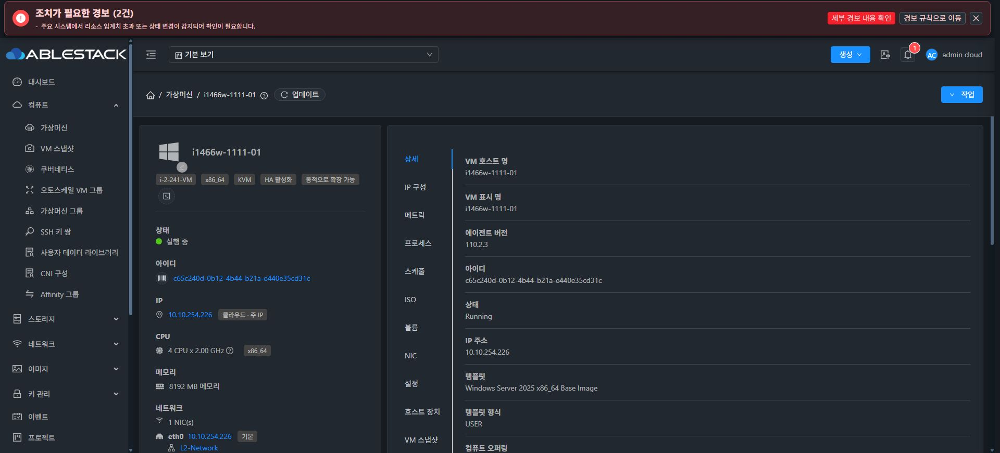 |

### 현재 A: NFS / 개선 B: NFS
| 현재 A · 라이트 | 현재 A · 다크 |
|---|---|
| 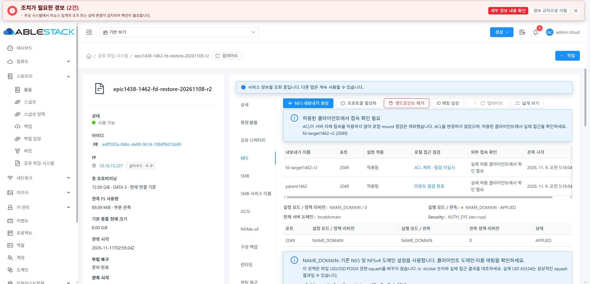 | 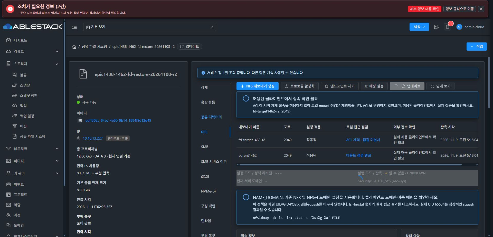 |
| 개선 B · 라이트 | 개선 B · 다크 |
| 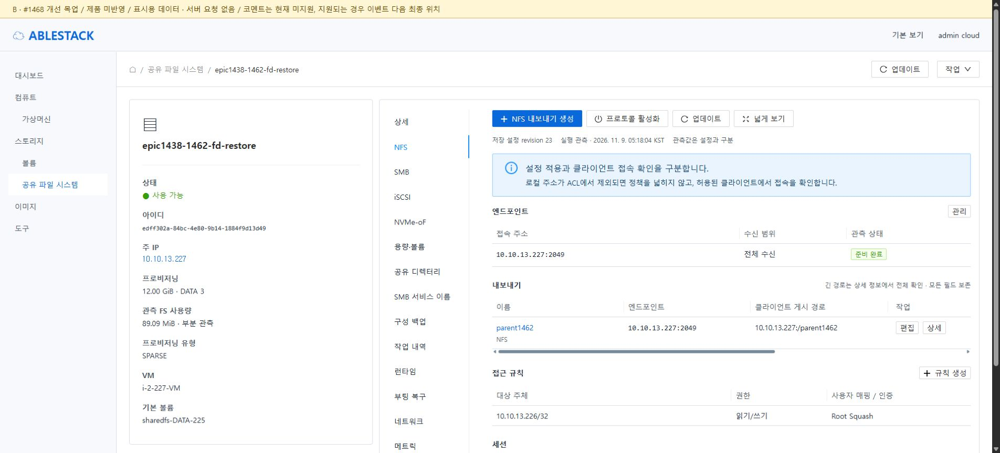 | 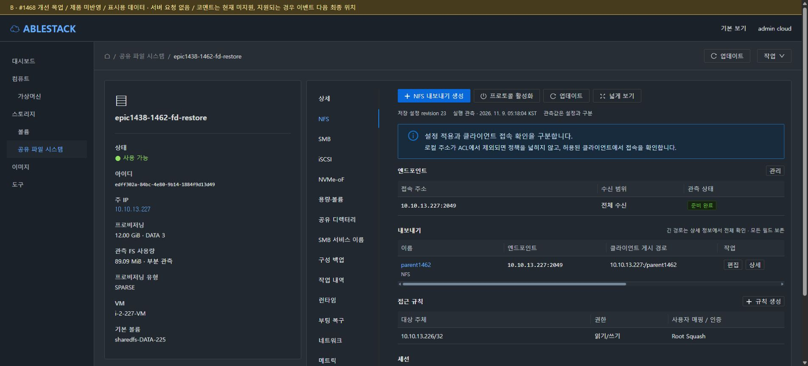 |

### 현재 A: 중복 제목/오른쪽 툴바 / 개선 B: iSCSI
| 현재 A · 라이트 | 현재 A · 다크 |
|---|---|
| 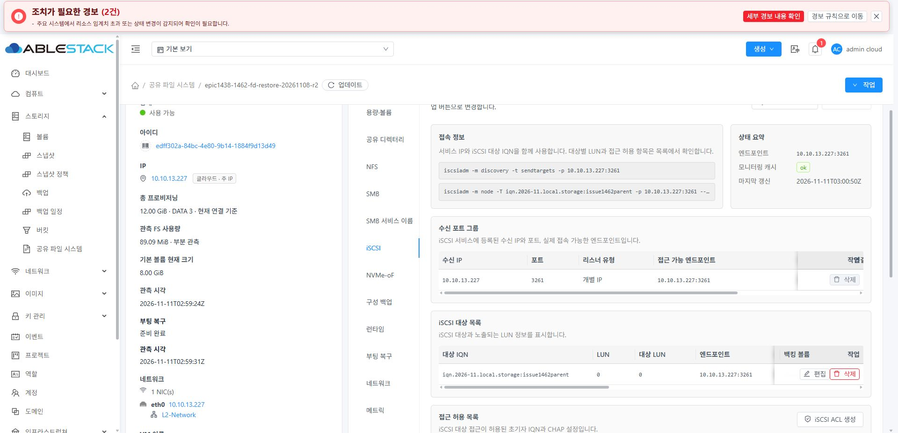 | 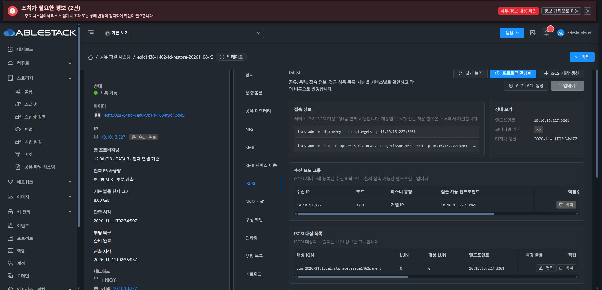 |
| 개선 B · 라이트 | 개선 B · 다크 |
| 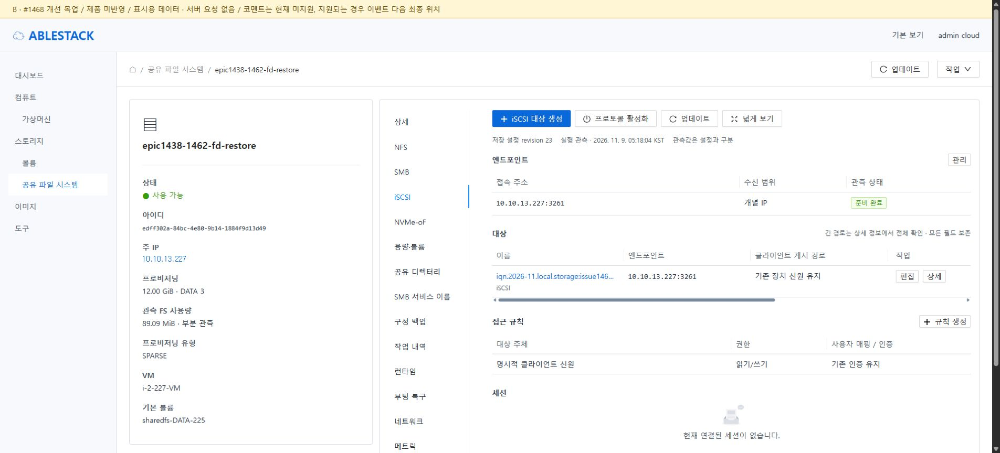 | 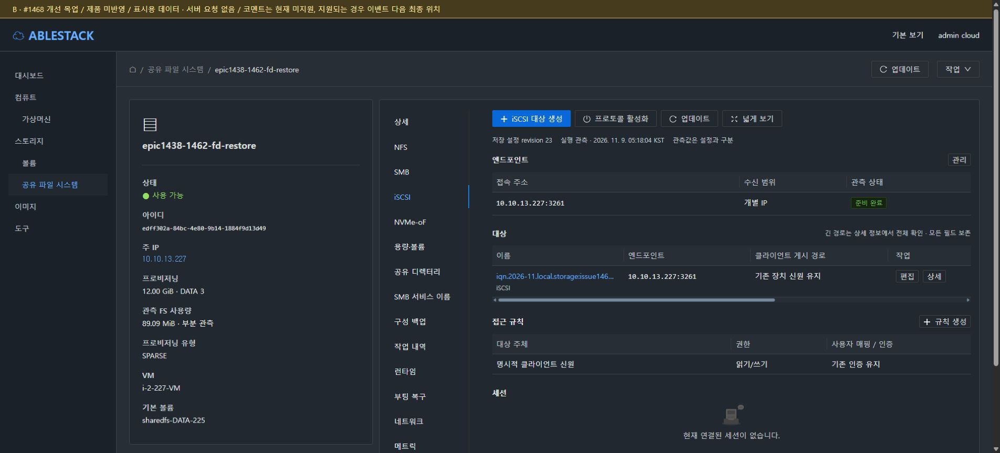 |

### 생성 대화상자: 현재 A 본문 유지 + 미고정 헤더/푸터만 보완
| 현재 A · 라이트 | 현재 A · 다크 |
|---|---|
| 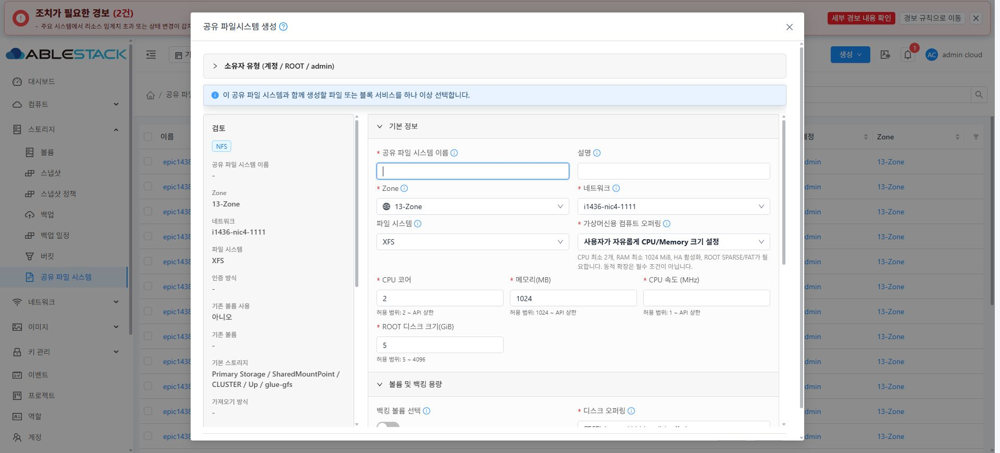 | 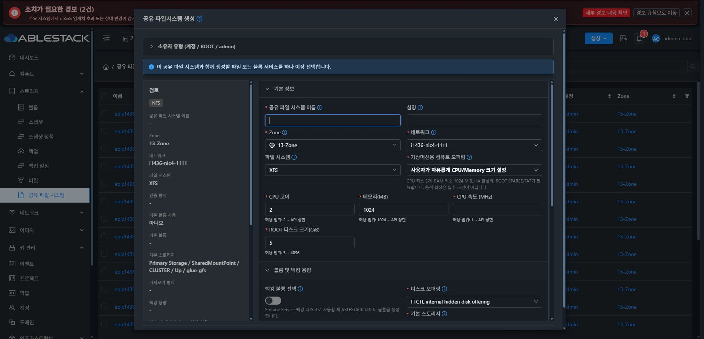 |
**이전 B 생성 본문 재구성 예시는 철회했다. 위 현재 A의 2열 구조·폭·필드 배치가 구현 기준이다. 이미 고정된 헤더는 유지하고 미고정 버튼 푸터만 보완한다. 과거 B 생성 이미지는 기록으로만 보존하며 구현 기준/검증 근거로 사용하지 않는다.**

### 백업/작업 내역: 정확한 표시·실패 안내
| 개선 B · 라이트 | 개선 B · 다크 |
|---|---|
| 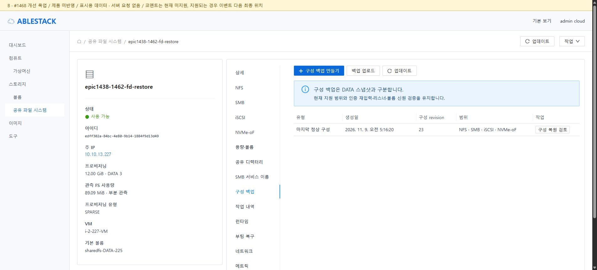 | 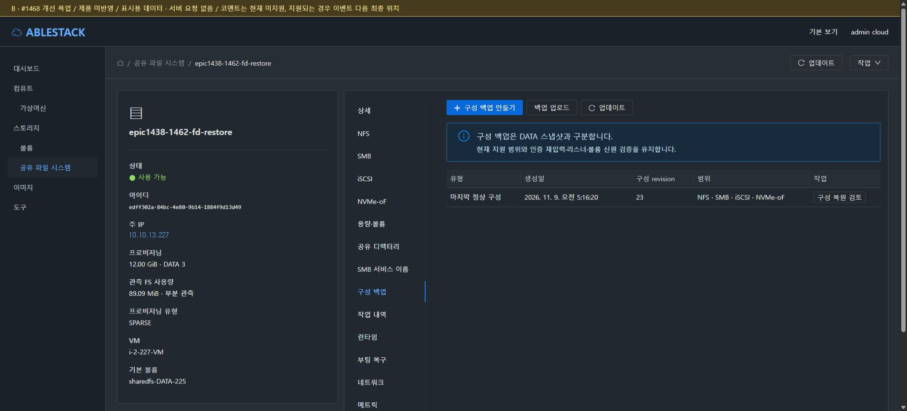 |
| 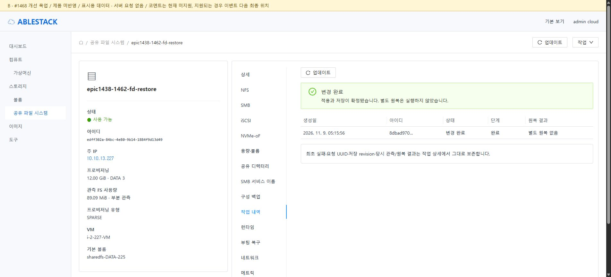 | 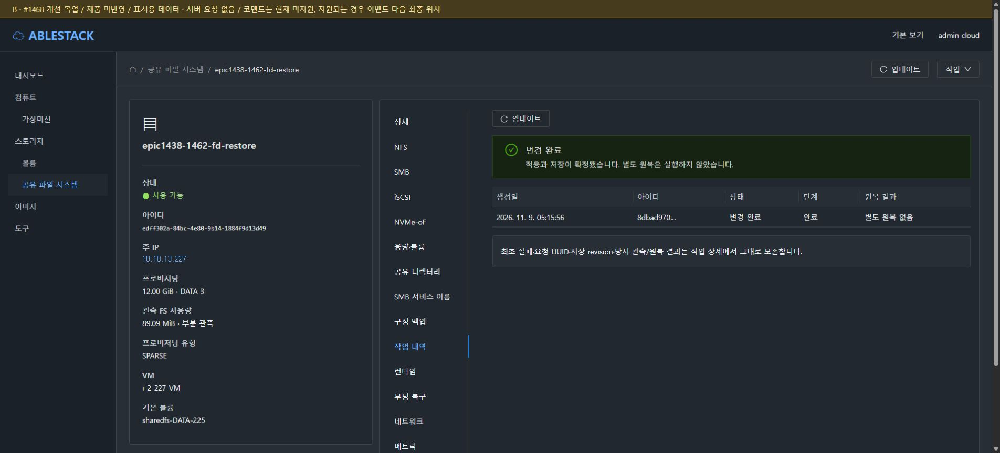 |

### 전체 탭 순서
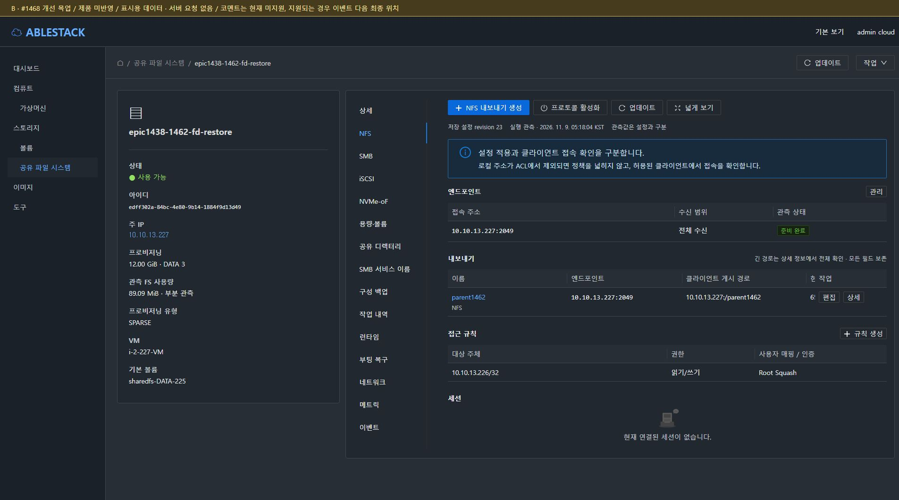

## 10. 재현과 상태

- prototype/prototype.html, data.js, build-prototype.cjs는 문서 전용이다. ui/node_modules가 준비된 WSL 저장소에서 아래를 실행하면 기존 Vue/AntD와 실제 Mold 컴포넌트를 로컬에서 조립한다. vendor/minified bundle은 이 문서에 커밋하지 않는다.
- 생성 목업의 단순화된 본문 예시는 철회했다. 생성 본문·폭·간격·기존 스크롤은 현재 제품 UI 그대로 유지하고 미고정 제목/푸터만 보완한다. 이 보존 규칙은 다른 생성 폼에도 적용한다. 그 외 목업의 예시 필드도 제품 폼을 대체하지 않는다.
- 목업용 별도 PR은 만들지 않는다. 설계·이미지는 기존 Epic 브랜치/PR에 문서로 반영하고 #1468에 연결한다.

```bash
NODE_OPTIONS=--openssl-legacy-provider node docs/design/sharedfs-1468-final-ui-20261111/prototype/build-prototype.cjs
node docs/design/sharedfs-1468-final-ui-20261111/evidence/design-contract-check.cjs
python3 -m http.server 8799 --directory docs/design/sharedfs-1468-final-ui-20261111/prototype/mockup
# http://localhost:8799/index.html?theme=dark&view=nfs
# 생성 본문 목업은 철회했으므로 현재 A 생성 캡처와 실제 CreateSharedFS.vue를 기준으로 삼는다.
```

**현재 종료점: #1468 코드 수준 설계·실제 A 검토·라이트/다크 B 목업 완료. 제품 구현은 시작하지 않으며 다음 지시를 기다린다.**
