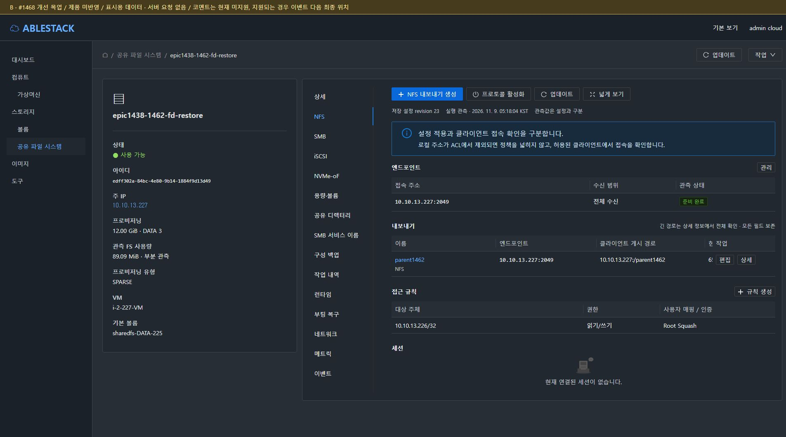

# #1468 화면 근거 목록

**A = 13번의 현재 배포 UI, B = 서버 요청 없는 개선 목업, S = 컴퓨트 > 가상머신 표준.**
캡처는 화면 구조·표시·폼 열기/취소 검토의 근거다. 기능 제출·생성·복원·재시작 회귀 통과를 의미하지 않는다. 모든 조건부 상태를 실환경에서 만들었다는 뜻도 아니다.
이미지와 같은 이름의 DOM 원문은 evidence/에 있다. 순간 로딩/숨은 패널의 DOM이 포함될 수 있으므로 상태는 스크린샷과 함께 해석한다.

## 전체 화면

### VM 표준

| 화면 | 라이트 | 다크 |
|---|---|---|
| S-vm-details | [이미지](images/S-vm-details-light.png) | [이미지](images/S-vm-details-dark.png) |
| S-vm-list | [이미지](images/S-vm-list-light.png) | [이미지](images/S-vm-list-dark.png) |
| S-vm-network-dialog | 해당 테마 별도 캡처 없음 | [이미지](images/S-vm-network-dialog-dark.png) |
| S-vm-nics | 해당 테마 별도 캡처 없음 | [이미지](images/S-vm-nics-dark.png) |
| S-vm-volumes | 해당 테마 별도 캡처 없음 | [이미지](images/S-vm-volumes-dark.png) |

### 현재 배포 UI

| 화면 | 라이트 | 다크 |
|---|---|---|
| A-ad-join-dialog | 해당 테마 별도 캡처 없음 | [이미지](images/A-ad-join-dialog-dark.png) |
| A-ad-leave-dialog | 해당 테마 별도 캡처 없음 | [이미지](images/A-ad-leave-dialog-dark.png) |
| A-ad-rejoin-dialog | 해당 테마 별도 캡처 없음 | [이미지](images/A-ad-rejoin-dialog-dark.png) |
| A-backup-restore-dialog | [이미지](images/A-backup-restore-dialog-light.png) | [이미지](images/A-backup-restore-dialog-dark.png) |
| A-backup-upload-dialog | [이미지](images/A-backup-upload-dialog-light.png) | [이미지](images/A-backup-upload-dialog-dark.png) |
| A-bootrecovery | [이미지](images/A-bootrecovery-light.png) | [이미지](images/A-bootrecovery-dark.png) |
| A-capacity | [이미지](images/A-capacity-light.png) | [이미지](images/A-capacity-dark.png) |
| A-capacity-rules-dialog | 해당 테마 별도 캡처 없음 | [이미지](images/A-capacity-rules-dialog-dark.png) |
| A-catalog-details | 해당 테마 별도 캡처 없음 | [이미지](images/A-catalog-details-dark.png) |
| A-catalog-events | 해당 테마 별도 캡처 없음 | [이미지](images/A-catalog-events-dark.png) |
| A-catalog-register-dialog | 해당 테마 별도 캡처 없음 | [이미지](images/A-catalog-register-dialog-dark.png) |
| A-catalog-usages | 해당 테마 별도 캡처 없음 | [이미지](images/A-catalog-usages-dark.png) |
| A-catalog-validations | 해당 테마 별도 캡처 없음 | [이미지](images/A-catalog-validations-dark.png) |
| A-compute-dialog | 해당 테마 별도 캡처 없음 | [이미지](images/A-compute-dialog-dark.png) |
| A-compute-qualified-dialog | 해당 테마 별도 캡처 없음 | [이미지](images/A-compute-qualified-dialog-dark.png) |
| A-configbackup | [이미지](images/A-configbackup-light.png) | [이미지](images/A-configbackup-dark.png) |
| A-create-NFS | 해당 테마 별도 캡처 없음 | [이미지](images/A-create-NFS-dark.png) |
| A-create-NVMe-oF | 해당 테마 별도 캡처 없음 | [이미지](images/A-create-NVMe-oF-dark.png) |
| A-create-SMB | 해당 테마 별도 캡처 없음 | [이미지](images/A-create-SMB-dark.png) |
| A-create-default | [이미지](images/A-create-default-light.png) | [이미지](images/A-create-default-dark.png) |
| A-create-iSCSI | 해당 테마 별도 캡처 없음 | [이미지](images/A-create-iSCSI-dark.png) |
| A-destroy-dialog | 해당 테마 별도 캡처 없음 | [이미지](images/A-destroy-dialog-dark.png) |
| A-destroy-selected-dialog | 해당 테마 별도 캡처 없음 | [이미지](images/A-destroy-selected-dialog-dark.png) |
| A-details | [이미지](images/A-details-light.png) | [이미지](images/A-details-dark.png) |
| A-directory | [이미지](images/A-directory-light.png) | [이미지](images/A-directory-dark.png) |
| A-directory-edit-dialog | [이미지](images/A-directory-edit-dialog-light.png) | [이미지](images/A-directory-edit-dialog-dark.png) |
| A-events | [이미지](images/A-events-light.png) | [이미지](images/A-events-dark.png) |
| A-file-share-resize-dialog | 해당 테마 별도 캡처 없음 | [이미지](images/A-file-share-resize-dialog-dark.png) |
| A-iscsi | [이미지](images/A-iscsi-light.png) | [이미지](images/A-iscsi-dark.png) |
| A-iscsi-acl-create-dialog | 해당 테마 별도 캡처 없음 | [이미지](images/A-iscsi-acl-create-dialog-dark.png) |
| A-iscsi-acl-edit-dialog | 해당 테마 별도 캡처 없음 | [이미지](images/A-iscsi-acl-edit-dialog-dark.png) |
| A-iscsi-create-dialog | [이미지](images/A-iscsi-create-dialog-light.png) | [이미지](images/A-iscsi-create-dialog-dark.png) |
| A-iscsi-edit-dialog | 해당 테마 별도 캡처 없음 | [이미지](images/A-iscsi-edit-dialog-dark.png) |
| A-iscsi-enable-dialog | 해당 테마 별도 캡처 없음 | [이미지](images/A-iscsi-enable-dialog-dark.png) |
| A-iscsi-wide | 해당 테마 별도 캡처 없음 | [이미지](images/A-iscsi-wide-dark.png) |
| A-metrics | [이미지](images/A-metrics-light.png) | [이미지](images/A-metrics-dark.png) |
| A-network | [이미지](images/A-network-light.png) | [이미지](images/A-network-dark.png) |
| A-nfs | [이미지](images/A-nfs-light.png) | [이미지](images/A-nfs-dark.png) |
| A-nfs-acl-create-dialog | 해당 테마 별도 캡처 없음 | [이미지](images/A-nfs-acl-create-dialog-dark.png) |
| A-nfs-acl-edit-dialog | 해당 테마 별도 캡처 없음 | [이미지](images/A-nfs-acl-edit-dialog-dark.png) |
| A-nfs-create-dialog | [이미지](images/A-nfs-create-dialog-light.png) | [이미지](images/A-nfs-create-dialog-dark.png) |
| A-nfs-delete-dialog | 해당 테마 별도 캡처 없음 | [이미지](images/A-nfs-delete-dialog-dark.png) |
| A-nfs-edit-dialog | 해당 테마 별도 캡처 없음 | [이미지](images/A-nfs-edit-dialog-dark.png) |
| A-nfs-enable-dialog | 해당 테마 별도 캡처 없음 | [이미지](images/A-nfs-enable-dialog-dark.png) |
| A-nfs-endpoint-delete-dialog | 해당 테마 별도 캡처 없음 | [이미지](images/A-nfs-endpoint-delete-dialog-dark.png) |
| A-nfs-identity-dialog | 해당 테마 별도 캡처 없음 | [이미지](images/A-nfs-identity-dialog-dark.png) |
| A-nfs-listener-detail-dialog | 해당 테마 별도 캡처 없음 | [이미지](images/A-nfs-listener-detail-dialog-dark.png) |
| A-nfs-wide | 해당 테마 별도 캡처 없음 | [이미지](images/A-nfs-wide-dark.png) |
| A-nvme-acl-create-dialog | 해당 테마 별도 캡처 없음 | [이미지](images/A-nvme-acl-create-dialog-dark.png) |
| A-nvme-acl-edit-dialog | 해당 테마 별도 캡처 없음 | [이미지](images/A-nvme-acl-edit-dialog-dark.png) |
| A-nvme-namespace-create-dialog | 해당 테마 별도 캡처 없음 | [이미지](images/A-nvme-namespace-create-dialog-dark.png) |
| A-nvme-namespace-edit-dialog | 해당 테마 별도 캡처 없음 | [이미지](images/A-nvme-namespace-edit-dialog-dark.png) |
| A-nvme-prepare-dialog | 해당 테마 별도 캡처 없음 | [이미지](images/A-nvme-prepare-dialog-dark.png) |
| A-nvme-subsystem-create-dialog | [이미지](images/A-nvme-subsystem-create-dialog-light.png) | [이미지](images/A-nvme-subsystem-create-dialog-dark.png) |
| A-nvme-subsystem-edit-dialog | 해당 테마 별도 캡처 없음 | [이미지](images/A-nvme-subsystem-edit-dialog-dark.png) |
| A-nvmeof | [이미지](images/A-nvmeof-light.png) | [이미지](images/A-nvmeof-dark.png) |
| A-nvmeof-wide | 해당 테마 별도 캡처 없음 | [이미지](images/A-nvmeof-wide-dark.png) |
| A-operation-detail-dialog | 해당 테마 별도 캡처 없음 | [이미지](images/A-operation-detail-dialog-dark.png) |
| A-operation-history | [이미지](images/A-operation-history-light.png) | [이미지](images/A-operation-history-dark.png) |
| A-preparation-status-dialog | 해당 테마 별도 캡처 없음 | [이미지](images/A-preparation-status-dialog-dark.png) |
| A-resource-update-dialog | 해당 테마 별도 캡처 없음 | [이미지](images/A-resource-update-dialog-dark.png) |
| A-runtime | [이미지](images/A-runtime-light.png) | [이미지](images/A-runtime-dark.png) |
| A-runtime-catalog-list | 해당 테마 별도 캡처 없음 | [이미지](images/A-runtime-catalog-list-dark.png) |
| A-sharedfs-list | [이미지](images/A-sharedfs-list-light.png) | [이미지](images/A-sharedfs-list-dark.png) |
| A-smb | [이미지](images/A-smb-light.png) | [이미지](images/A-smb-dark.png) |
| A-smb-acl-create-dialog | 해당 테마 별도 캡처 없음 | [이미지](images/A-smb-acl-create-dialog-dark.png) |
| A-smb-acl-edit-dialog | 해당 테마 별도 캡처 없음 | [이미지](images/A-smb-acl-edit-dialog-dark.png) |
| A-smb-ad | 해당 테마 별도 캡처 없음 | [이미지](images/A-smb-ad-dark.png) |
| A-smb-base-name-dialog | 해당 테마 별도 캡처 없음 | [이미지](images/A-smb-base-name-dialog-dark.png) |
| A-smb-client-access-dialog | 해당 테마 별도 캡처 없음 | [이미지](images/A-smb-client-access-dialog-dark.png) |
| A-smb-create-dialog | [이미지](images/A-smb-create-dialog-light.png) | [이미지](images/A-smb-create-dialog-dark.png) |
| A-smb-creation-policy-dialog | 해당 테마 별도 캡처 없음 | [이미지](images/A-smb-creation-policy-dialog-dark.png) |
| A-smb-edit-dialog | 해당 테마 별도 캡처 없음 | [이미지](images/A-smb-edit-dialog-dark.png) |
| A-smb-endpoint-add-dialog | 해당 테마 별도 캡처 없음 | [이미지](images/A-smb-endpoint-add-dialog-dark.png) |
| A-smb-endpoint-edit-dialog | 해당 테마 별도 캡처 없음 | [이미지](images/A-smb-endpoint-edit-dialog-dark.png) |
| A-smb-name-create-dialog | 해당 테마 별도 캡처 없음 | [이미지](images/A-smb-name-create-dialog-dark.png) |
| A-smb-name-delete-dialog | 해당 테마 별도 캡처 없음 | [이미지](images/A-smb-name-delete-dialog-dark.png) |
| A-smb-name-edit-dialog | 해당 테마 별도 캡처 없음 | [이미지](images/A-smb-name-edit-dialog-dark.png) |
| A-smb-names-ad | 해당 테마 별도 캡처 없음 | [이미지](images/A-smb-names-ad-dark.png) |
| A-smb-names-local | [이미지](images/A-smb-names-local-light.png) | [이미지](images/A-smb-names-local-dark.png) |
| A-smb-wide | [이미지](images/A-smb-wide-light.png) | 해당 테마 별도 캡처 없음 |
| A-stop-confirm-dialog | 해당 테마 별도 캡처 없음 | [이미지](images/A-stop-confirm-dialog-dark.png) |
| A-theme-restored | 해당 테마 별도 캡처 없음 | [이미지](images/A-theme-restored-dark.png) |

### 개선 목업

| 화면 | 라이트 | 다크 |
|---|---|---|
| B-capacity | [이미지](images/B-capacity-light.png) | [이미지](images/B-capacity-dark.png) |
| B-configbackup | [이미지](images/B-configbackup-light.png) | [이미지](images/B-configbackup-dark.png) |
| B-create-dialog | [이미지](images/B-create-dialog-light.png) | [이미지](images/B-create-dialog-dark.png) |
| B-details | [이미지](images/B-details-light.png) | [이미지](images/B-details-dark.png) |
| B-directory | [이미지](images/B-directory-light.png) | [이미지](images/B-directory-dark.png) |
| B-directory-dialog | [이미지](images/B-directory-dialog-light.png) | [이미지](images/B-directory-dialog-dark.png) |
| B-iscsi | [이미지](images/B-iscsi-light.png) | [이미지](images/B-iscsi-dark.png) |
| B-iscsi-create-dialog | [이미지](images/B-iscsi-create-dialog-light.png) | [이미지](images/B-iscsi-create-dialog-dark.png) |
| B-list | [이미지](images/B-list-light.png) | [이미지](images/B-list-dark.png) |
| B-nfs | [이미지](images/B-nfs-light.png) | [이미지](images/B-nfs-dark.png) |
| B-nfs-acl-dialog | [이미지](images/B-nfs-acl-dialog-light.png) | [이미지](images/B-nfs-acl-dialog-dark.png) |
| B-nfs-edit-dialog | [이미지](images/B-nfs-edit-dialog-light.png) | [이미지](images/B-nfs-edit-dialog-dark.png) |
| B-nvme-create-dialog | [이미지](images/B-nvme-create-dialog-light.png) | [이미지](images/B-nvme-create-dialog-dark.png) |
| B-nvmeof | [이미지](images/B-nvmeof-light.png) | [이미지](images/B-nvmeof-dark.png) |
| B-operation-history | [이미지](images/B-operation-history-light.png) | [이미지](images/B-operation-history-dark.png) |
| B-restore-dialog | [이미지](images/B-restore-dialog-light.png) | [이미지](images/B-restore-dialog-dark.png) |
| B-smb | [이미지](images/B-smb-light.png) | [이미지](images/B-smb-dark.png) |
| B-smb-edit-dialog | [이미지](images/B-smb-edit-dialog-light.png) | [이미지](images/B-smb-edit-dialog-dark.png) |

## 탭 순서 전체 목업

