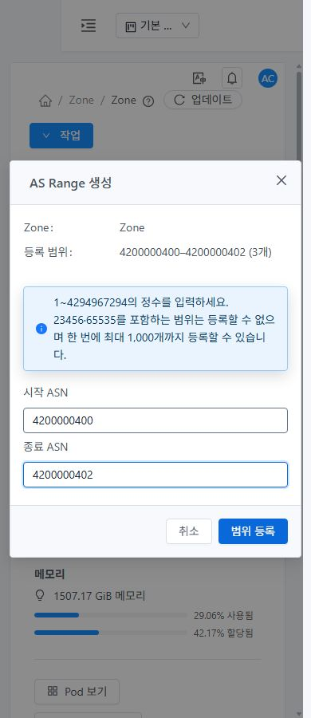
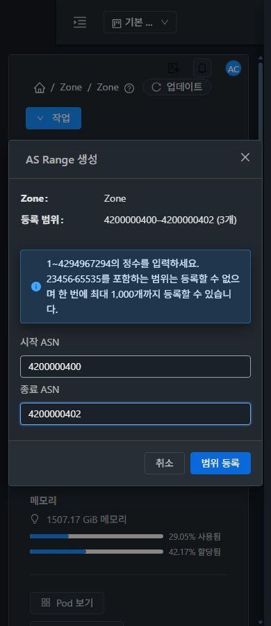
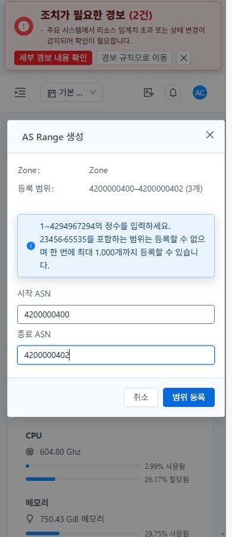
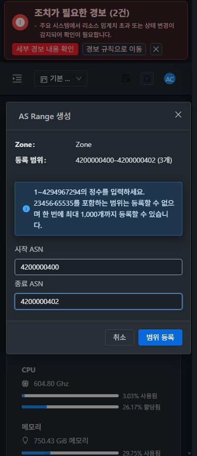
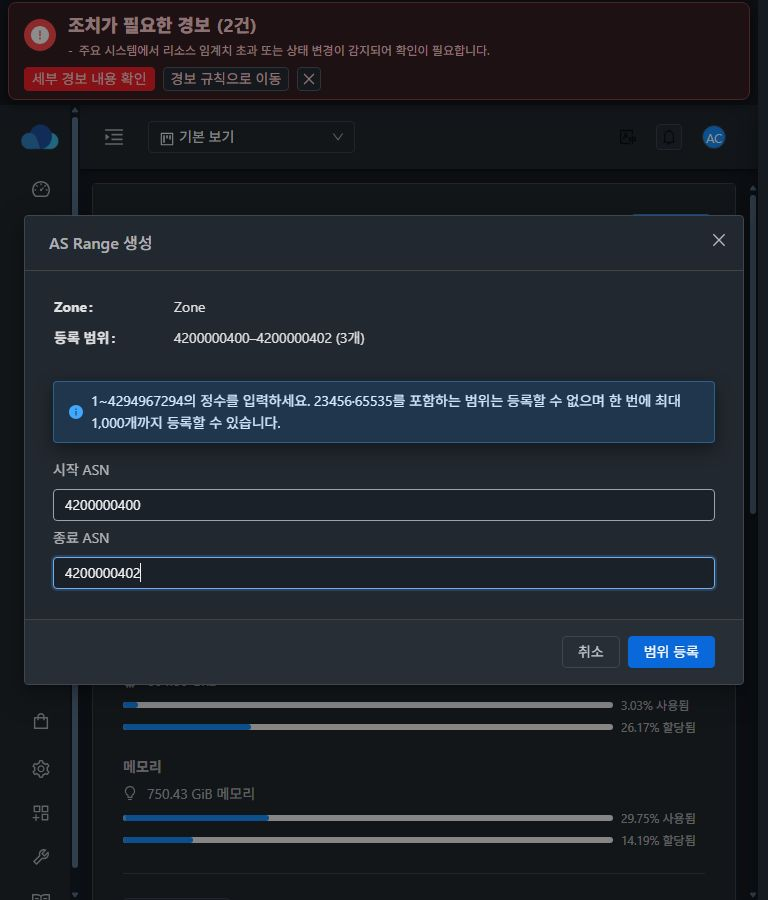
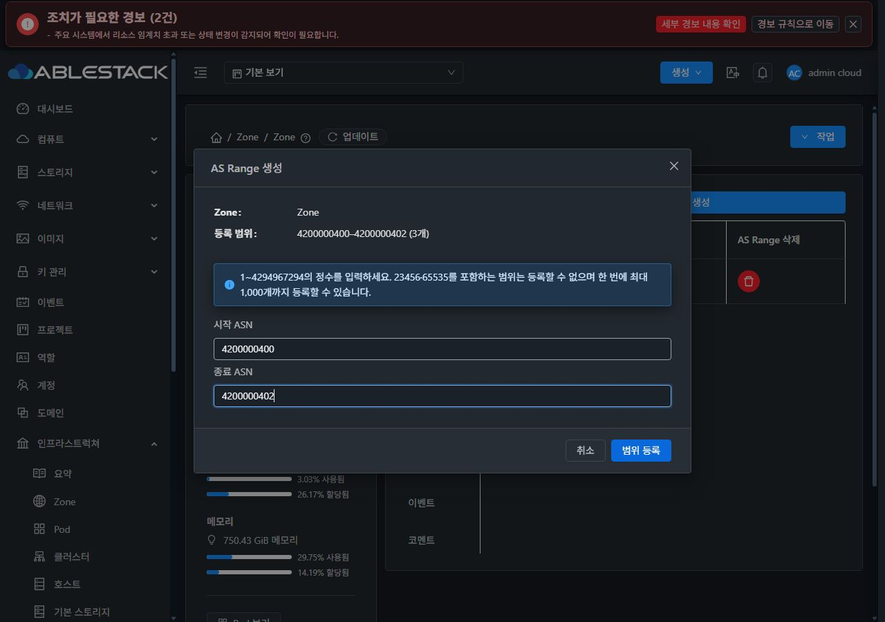

<!--
Licensed to the Apache Software Foundation (ASF) under one
or more contributor license agreements.  See the NOTICE file
distributed with this work for additional information
regarding copyright ownership.  The ASF licenses this file
to you under the Apache License, Version 2.0 (the
"License"); you may not use this file except in compliance
with the License.  You may obtain a copy of the License at

  http://www.apache.org/licenses/LICENSE-2.0

Unless required by applicable law or agreed to in writing,
software distributed under the License is distributed on an
"AS IS" BASIS, WITHOUT WARRANTIES OR CONDITIONS OF ANY
KIND, either express or implied.  See the License for the
specific language governing permissions and limitations
under the License.
-->

# ASN-01 구현 및 검증 보고

[#1709](https://github.com/ablecloud-team/ablestack-cloud/issues/1709), 상위 [Epic #1708](https://github.com/ablecloud-team/ablestack-cloud/issues/1708)의 첫 구현이다. 2026-11-17 KST에 31 GFS2·32 RBD에서 ISP 없이 가능한 등록 UI/API를 검증했다. Epic의 나머지 기능과 PR 병합은 이번 완료 범위가 아니다.

## 변경 결과

- UI와 서버에서 ASCII 10진 정수/양 끝 공백, 1~4294967294, 23456·65535 포함 거부, 시작≤종료와 요청당 1000개 상한을 적용한다. 이는 풀 등록 정책이며 공인 ASN 소유권/광고 가능성을 판단하지 않는다.
- Zone 행 잠금과 트랜잭션 내부 겹침 재검증으로 첫 범위 동시 생성까지 직렬화한다. 범위/번호 persist 실패는 전체 rollback하며, 인자 오류는 431, 내부 오류는 SQL 내용을 숨긴 진단 ID로 구분한다.
- VM EditVM/MoldDialog 기준의 세로 영구 label, 720px md 대화상자, Zone/범위/개수 요약, 고정 취소/등록 footer, busy/중복 제출 가드, 첫 오류 포커스를 적용한다. 기존 Zone breadcrumb/상세/탭 경계를 유지한다. AS Numbers의 별도 목록/검색/진입 통합은 후속 이슈다.
- 동기 생성 응답 이후 범위와 전체 번호를 조회한 뒤 성공한다. 미확정 쓰기는 자동 재전송하지 않고 입력·대상·추적을 유지하며 수동 재확인한다. 이 추적은 같은 브라우저 페이지의 dialog/tab 재열기 동안 유지되며 전체 새로고침/다른 브라우저에 영속 저장하지 않는다.
- 로그인/권한/API 집합/프로젝트/Zone 컨텍스트가 달라지면 오래된 응답을 현재 화면에 반영하지 않는다.

## API 호환성

`createASNRange.startasn/endasn`의 listApis **인자 metadata가 long→string으로 바뀐다**. 기존 숫자 query/form 요청은 계속 받으며 응답 ASN 타입은 long, 서비스 getter는 Long을 유지한다. 전역 LONG parser가 `+1`을 먼저 숫자로 바꾸거나 양 끝 공백을 거부하므로 원문 형식을 검증하기 위해 문자열 인자를 채택했다. 생성 SDK를 재생성하는 클라이언트는 두 인자를 문자열로 전송해야 한다. `listASNumbers.asnumber`의 integer→Long 개선은 #1710에서 별도로 처리한다.

## 검증 결과와 한계

- 변경 모듈 API 7개·서버 8개, UI 55개·lint·production build, 변경 Java 6개 Checkstyle PASS. overlay 배포 파일의 서버 8개 재검증도 PASS.
- 실환경 API 각 54개 검사항목, UI 각 잘못된 입력 15종/생성 요청 0건과 오류 포커스, 정상 등록·전체 재조회·작은 중복 거부·정리, 1280/768/390×라이트/다크 확인.
- 1000개 경계·중간 저장 실패·교차 Zone 독립성은 제어된 fixture다. 실제 클러스터에는 작은 범위만 사용했다. 실제 권한 계정/교차 소유자·실할당/해제·ISP/BGP 세션·경로 광고·패킷 통신은 미검증이다.
- 전체 API 모듈 Checkstyle은 변경하지 않은 파일의 46개 위반으로 실패했다. 전체 Cloud/Actions·전체 UI·RAT 검증을 실행하거나 통과했다고 주장하지 않는다.
- 기존 가상머신용 네트워크/VPC/VNF/Public IP 전체 기능은 재시험하지 않았다. 기존 주요 설정 14개 비교와 ASN 범위/번호 0건 복구는 확인했다.

[상세 실행 결과](RESULTS.ko.md) · [빌드·기존 런타임 보존·배포/복원 증적](BUILD-DEPLOY.ko.md)

## 화면 증적

실제 Chrome 화면이며 별도 모형이 아니다. 31 대표 이미지는 오류 포커스 보완 전과 같은 배치이고, 최종 번들의 포커스 동작은 30개 입력으로 별도 재검증했다. 32 이미지는 최종 번들이다.

다음 권장 구현은 **P2 #1710 / ASN-02: 32비트 ASN 정확 조회의 Long 타입과 조회 경계 계약 통일**이다. 완료 선행은 없으며 #1712의 정확 번호 검색을 해제한다. #1711도 독립 P2이고, 최종 UI 통합 #1713은 #1709/#1711/#1712에 의존한다.
