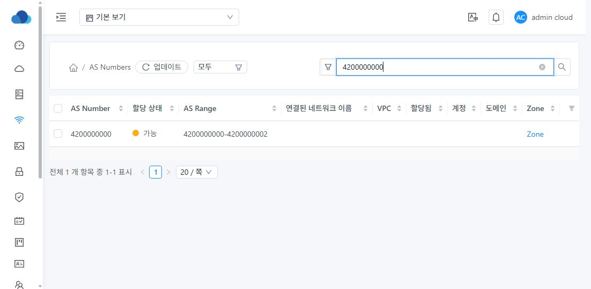
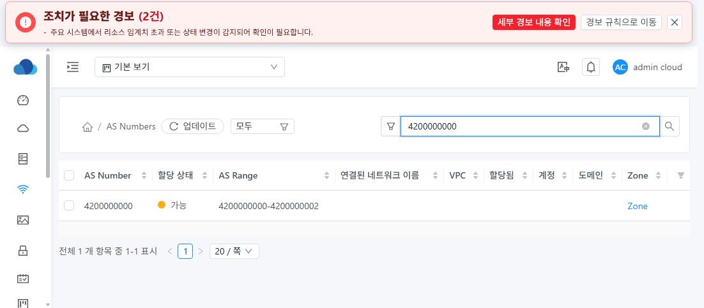

<!--
Licensed to the Apache Software Foundation (ASF) under one
or more contributor license agreements.  See the NOTICE file
distributed with this work for additional information
regarding copyright ownership.  The ASF licenses this file
to you under the Apache License, Version 2.0 (the
"License"); you may not use this file except in compliance
with the License.  You may obtain a copy of the License at

  http://www.apache.org/licenses/LICENSE-2.0

Unless required by applicable law or agreed to in writing,
software distributed under the License is distributed on an
"AS IS" BASIS, WITHOUT WARRANTIES OR CONDITIONS OF ANY
KIND, either express or implied.  See the License for the
specific language governing permissions and limitations
under the License.
 -->

# ASN-02 구현·검증 보고

대상 [#1710](https://github.com/ablecloud-team/ablestack-cloud/issues/1710), 상위 [Epic #1708](https://github.com/ablecloud-team/ablestack-cloud/issues/1708), [Epic draft PR #1716](https://github.com/ablecloud-team/ablestack-cloud/pull/1716). 검증일은 **2026-11-18 KST**다. 시작 소스는 #1709의 `ee32ad9ecfed5e978d1216e72c615b98b395e4db`이며 기존 dhslove Epic branch에서 이어 구현했다.

## 구현 결과

`listASNumbers asnumber=4200000000`이 두 서버에서 431이던 문제를 해결했다. ListASNumbersCmd metadata/getter, BGP 서비스와 DAO 인터페이스/구현을 LONG/Long으로 통일하고 축소 변환 없이 EQ 조건에 전달한다. 응답과 Entity는 기존 long/Long을 유지한다. owning schema는 `engine/schema/src/main/resources/META-INF/db/schema-41910to42000.sql`의 `as_number.as_number BIGINT UNSIGNED`와 `ASNumberVO.long`이다. DB 마이그레이션이나 기존 레코드 수정은 없다.

조회 인자는 ASCII 10진 숫자만, **0~4294967295**를 허용한다. 예약/특수 번호도 조회 인자로 수용하며 풀 등록 정책과 구분한다. 부호·공백·소수·지수·ASDOT·구분 기호·문자·범위 초과는 431이다. optional 인자를 생략하면 기존 일반/keyword 조회를 유지하고, 명시적인 빈 값은 거부한다. leading zero는 10진 값으로 조회한다.

명령은 BaseListCmd의 page/pagesize 검증을 계속 호출하고, 직접 typed 호출의 범위를 다시 검사한다. DAO 진입에서도 범위를 검사한다. 입력 오류를 포괄 catch가 530으로 바꾸지 않도록 인자 예외를 분리했다. 기존 keyword LIKE와 정확 EQ의 AND 결합, Zone/범위/할당/소유자 조건·count와 권한 범위를 유지한다. 기존 32비트 초과 레코드는 keyword/범위 조회로 조사할 수 있다.

## UI와 후속 계약

이번에는 **UI 소스·화면·정적 배포를 변경하지 않았다**. VM 공통 AutogenView/ListView/SearchView의 breadcrumb·목록·업데이트·서버 페이지 처리를 유지했다. 정확 번호 검색 입력의 새 UI는 #1712가 소유한다. 실환경 UI keyword의 64512/4200000000 결과를 정확 API와 대조해 UUID/숫자/총건수가 일치하고 URL/입력/목록이 전체 10진 표기임을 확인했다.

[#1712 전달 계약](ASN-04-CONTRACT.ko.md)에는 Long metadata, UI 정규화/직렬화, 조회 범위와 431/정상 0건·AND 결합을 명시했다. 이번 UI 관찰에서 가용 ASN의 빈 네트워크 칸에 `#/guestnetwork/undefined` 빈 링크가 남아 있었다. 클릭 오류는 유발하지 않았으며 조회 타입 수정과 별개인 기존 표현 개선으로 #1713에 전달한다.

## 검증 결과

- WSL ext4의 변경 Maven 모듈만 빌드했다. API **16개**, schema의 실제 GenericDao/JDBC/H2 테스트 **4개**, 서버 **10개** PASS. 등록 정책/트랜잭션의 기존 회귀도 포함한다. 변경 Java **9개 Checkstyle PASS**.
- 테스트 서버용 overlay의 DAO 4개·서버 10개 재검증도 PASS. 기존 런타임의 다른 메서드와 JAR entry를 보존했다.
- 31 GFS2·32 RBD API **각 45개 검사항목 PASS**. 각 2개 범위/6개 번호만 만들었다. 잘못된 입력 거부·예약/경계 정상 0건·16/32비트 동일 UUID·AND·페이지 총건수를 확인했다.
- 두 UI의 low/high **4개 대조 PASS**, 정리 뒤 업데이트 버튼으로 **양쪽 정상 0건** 확인. 범위·번호는 양쪽 모두 0건으로 복구했다. 기존 주요 자원 설정 14개 비교도 동일하다.
- 전체 Cloud 빌드·수동 Actions·전체 UI 회귀·전체 모듈 Checkstyle은 실행하지 않았다. UI 소스 변경이 없어 UI 재빌드/배포도 하지 않았다. 이전 PR의 전체 lint/RAT 실패를 전체 성공으로 확대하지 않는다. 이전 증적 문서의 MD038 공백 표기 두 곳은 이번에 수정했다.

## 검증 한계

H2 테스트는 실제 GenericDao SQL 생성/JDBC Long 바인딩/응답 hydration/count와 caller 제한을 실행하지만 전체 MySQL 스키마 통합을 대신하지 않는다. 예약 번호가 저장된 경우의 정확 일치·교차 Zone·실할당/다른 소유자·removed/legacy 레코드는 이 제어된 fixture로 검증했다. 실환경은 관리자와 작은 Private Use 범위이며 다른 사용자 계정이나 실할당 망을 만들지 않았다. 실제 MySQL에서는 정상 저장·정확 조회와 주요 AND/페이지 조건을 별도 확인했다.

ISP/BGP 세션·경로 광고·실제 통신, 기존 가상머신용 네트워크/VPC/VNF/Public IP의 전체 기능 체인은 재검증하지 않았다. 관리 JAR의 기존 전체 소스와 현 Epic 소스가 같다고 주장하지 않으며, 배포 범위와 보존/복원 증적은 아래 문서에 구분했다.

[상세 실행 결과](RESULTS.ko.md) · [빌드·배포·복원 증적](BUILD-DEPLOY.ko.md)

다음 권장 대상은 **독립 P2 #1711 / 삭제의 대상·영향 확인과 권한·중복 제출 보호**다. #1710 완료로 P3 #1712의 선행 조건도 충족하며, #1713 최종 통합은 #1711/#1712가 남는다.
