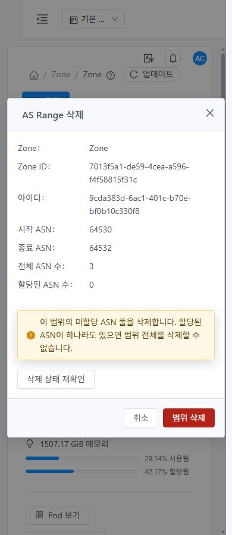
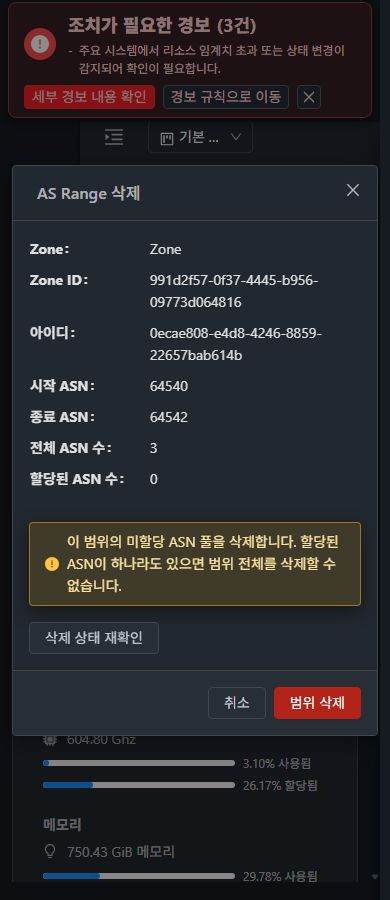

<!--
Licensed to the Apache Software Foundation (ASF) under one
or more contributor license agreements.  See the NOTICE file
distributed with this work for additional information
regarding copyright ownership.  The ASF licenses this file
to you under the Apache License, Version 2.0 (the
"License"); you may not use this file except in compliance
with the License.  You may obtain a copy of the License at

  http://www.apache.org/licenses/LICENSE-2.0

Unless required by applicable law or agreed to in writing,
software distributed under the License is distributed on an
"AS IS" BASIS, WITHOUT WARRANTIES OR CONDITIONS OF ANY
KIND, either express or implied.  See the License for the
specific language governing permissions and limitations
under the License.
 -->

# 실행 결과 / 2026-11-18

## 로컬·제어된 검증

| 구분 | 결과 | 확인 내용 |
| --- | --- | --- |
| API 모듈 | 19 PASS | 삭제 성공·431 분류·내부 오류 진단 ID·Admin 권한 유지, 등록/정확 조회 인접 회귀 |
| schema 모듈 | 5 PASS | 실제 GenericDao/JDBC/H2 조회와 할당 guard의 member 잠금 유지·commit 해제 |
| server 모듈 | 23 PASS | JSON zero count/기존 unescape, 실제 Transaction+JDBC 잠금 경쟁·전체 롤백, 조회/피어 인접 회귀 |
| 배포 overlay | schema 5 + server 23 PASS | 원본 nest member 포함, 선택 외 method/fields 보존 검증 후 실제 overlay class 재실행 |
| 변경 Java | 9개 Checkstyle PASS | 저장소 cloud-style.xml/8.18 |
| UI | 4 suites / 70 PASS | 생성/삭제/정수 유틸/공통 dialog, 네이티브 행 포커스와 실제 Teleport footer 키보드 회귀 |
| UI lint/build | PASS | 변경 소스 lint, sourcemap 없는 production build, buildVersion 유지 |

서버의 7개 삭제 fixture는 가용 범위와 모든 member 제거, 할당 번호가 있는 전체 범위 보존, 범위 제거 실패 후 member 롤백, 할당 저장 실패 후 owner/link 롤백, 이미 할당된 명시 번호의 덮어쓰기 거부, 할당 선점→삭제 거부, 삭제 선점→할당 예외/고아 member 없음이다. 연결 자원 값도 유지했다. 네트워크/VPC 생성 호출부가 false를 무시하므로 할당 불가는 기존 cleanup이 처리하는 CloudRuntimeException으로 전달한다. 호출부 cleanup의 실제 네트워크 체인을 ISP 없이 검증했다고 주장하지 않는다.

UI는 실패/빈 count/대상 변경/이미 소실/권한·로그인 변경/지연 응답·timeout/불명확 receipt/서버 거부/성공 후 조회 실패/탭 재진입 추적을 fixture로 검증했다. API의 named 오류와 공통 errorresponse를 모두 거부 응답으로 처리한다. 장애 주입을 실제 클러스터의 연결 단절·실할당 시험으로 보고하지 않는다.

## 31 GFS2·32 RBD 실제 검증

| 항목 | 31 | 32 |
| --- | --- | --- |
| API 15항목 | PASS | PASS |
| 16/32비트 소규모 범위의 전체 삭제·중복 삭제 431 | PASS | PASS |
| 할당 수 0건의 명시적 JSON count·XML count | PASS | PASS |
| 읽기 전용 Admin 유형 역할: API 목록에서 생성/삭제 제외 | PASS | PASS |
| 해당 계정의 직접 삭제 | 432 거부, member 3개 유지 | 432 거부, member 3개 유지 |
| UI 범위 표시·삭제 버튼 숨김 | PASS | PASS |
| 정확한 Zone/범위 UUID·시작/종료·전체 3개·할당 0개 | PASS | PASS |
| 취소/Escape 및 원래 행 버튼 포커스 | 삭제 POST 0 | 삭제 POST 0 |
| footer Ctrl+Enter 최종 제출 | POST 1 / success=true | POST 1 / success=true |
| 연속 클릭 | 단위 fixture | 실제 POST 1 / success=true |
| 삭제 후 범위·Zone 요약·연결 번호 재조회 | PASS, 선택 탭 유지 | PASS, 선택 탭 유지 |
| 최종 API와 AS Numbers UI | 범위/번호 0 | 범위/번호 0 |
| 테스트 계정·역할 | API 조회상 부재 | API 조회상 부재 |
| 기존 Zone/네트워크/VPC/피어/오퍼링 ID·건수 | 모두 일치 | 모두 일치 |
| 최종 UI 이후 console error | 0 | 0 |

실제 관찰은 `ui-observations.json`과 redacted API/cleanup/inventory manifest로 로컬에 보존했다. 브라우저 reload 후 CDP Network 관찰이 꺼져 있던 첫 증적 시도는 요청 수 증명에서 제외했다. Network.enable 후 preview의 네 GET이 수집되는지 먼저 확인하고 별도 폐기 가능한 범위로 취소/최종 제출을 다시 검증했다. 최종 제출 추적은 각각 대상 UUID의 POST 1회와 성공 receipt, 이후 범위·Zone·ASN GET을 포함한다. 로그인/인증 인자는 보존하지 않았다.

31의 최종 요청 수 증명 대상은 `f20fb8c3-2a26-4713-904a-287c0eefbe71`, 32는 `34d13d3b-1be5-40bd-8779-3d061dbdd21b`였다. 그 이전 UI 제출과 응답 갱신도 정상 완료했으며 모두 정리했다. API에서 시작한 앞선 두 범위와 UI fixture 외 다른 풀은 삭제하지 않았다.

## VM 공통 대화상자 기준

두 클러스터 모두 1280/768/390px × 라이트/다크 **12조합**을 최종 배포본에서 확인했다. dialog 폭은 720/720/366px이고, 가로 넘침이 없으며 footer가 900px 높이 안에 보인다. UUID는 모바일에서 줄바꿈되며 생략하지 않는다. 다크 배경은 `rgb(34,40,47)`, 본문은 기존 VM 공통 밝은 글자색을 따른다. Zone detail breadcrumb·선택 AS Number 탭·목록 조건은 유지했다.

## 배포·범위

- 최종 UI payload SHA-256: `76d8bbcdbf7e2c63513de0ba39a4ee4272f1bad95c6b9d9b7a07c5b5a867fbd3`.
- 양쪽 index SHA-256: `9d8c4708e3373d70d4b57189aa7448eb6cefcf5601c81bf529e0b0f40370061b`.
- 최종 Java payload SHA-256: `1deef4266ac16cf05cb2f9faf54db807b5479d029c8769ad34cbd207738b3fa1`.
- WEB-INF·runtime config·기존 FTCTL marker와 선택 외 JAR entry byte 보존, mold active·HTTP 200, 런타임 class hash 일치.
- 테스트용 테마는 라이트로 복구했고 viewport/탭별 Emulation override를 해제했다.

ISP 세션·경로 광고·실제 ASN 할당·통신과 기존 네트워크/VPC/VNF/Public IP 전체 체인은 제외했다. 실제 운영 데이터의 할당/소유자 경계는 fixture 결과와 구분한다. 전체 Cloud 빌드·수동 Actions·전체 UI/모듈 Checkstyle을 실행하지 않았다. 최종 GitHub CI는 PR 상태 및 후속 보고를 기준으로 하며 이 로컬 PASS를 전체 CI 성공으로 표시하지 않는다.
