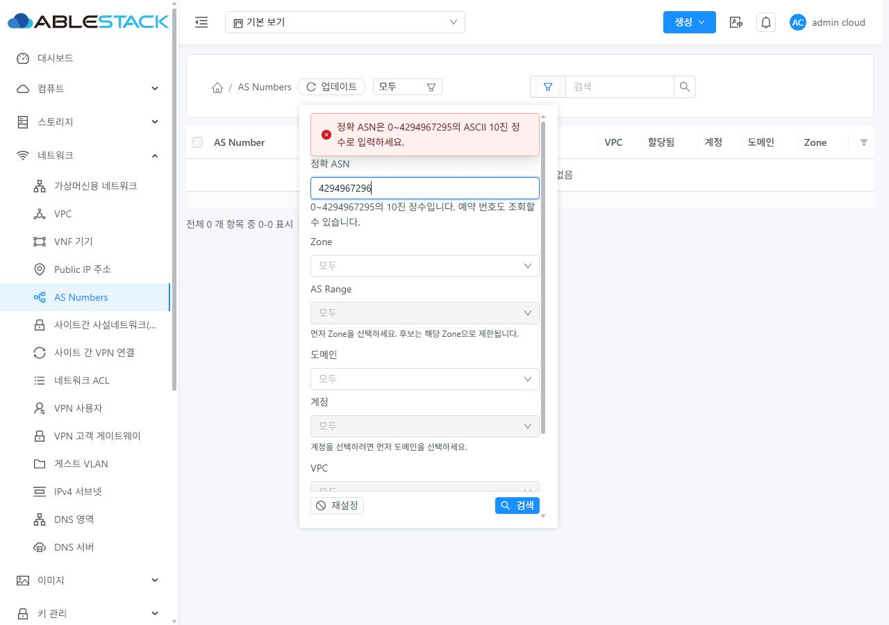
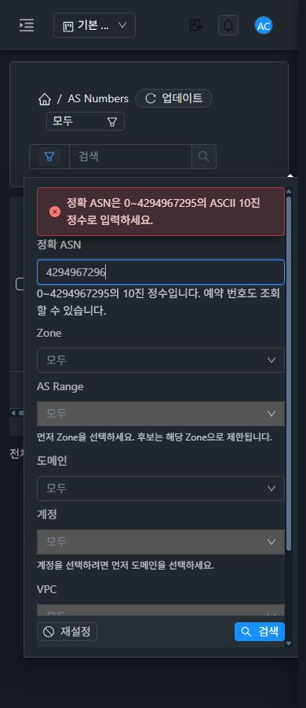

<!--
Licensed to the Apache Software Foundation (ASF) under one
or more contributor license agreements.  See the NOTICE file
distributed with this work for additional information
regarding copyright ownership.  The ASF licenses this file
to you under the Apache License, Version 2.0 (the
"License"); you may not use this file except in compliance
with the License.  You may obtain a copy of the License at

  http://www.apache.org/licenses/LICENSE-2.0

Unless required by applicable law or agreed to in writing,
software distributed under the License is distributed on an
"AS IS" BASIS, WITHOUT WARRANTIES OR CONDITIONS OF ANY
KIND, either express or implied.  See the License for the
specific language governing permissions and limitations
under the License.
-->

# ASN-04 / #1712 구현·검증

Epic #1708 / PR #1716의 네 번째 구현이다. ASN 범위·VPC·정확 ASN 검색을 VM 메뉴의 공통 AutogenView/ListView/SearchView에 연결하고, URL·소유 범위·후보 실패 계약을 보강한다. #1710의 Long 조회 계약을 사용한다.

## 최종 동작

- 고급 검색은 정확 ASN, Zone, ASN 범위, 도메인, 계정, VPC, 네트워크를 세로 폼으로 표시한다. label 연결, 정수 오류, 고정 footer, Ctrl+Enter 적용, Escape/닫힘 후 검색 버튼 포커스를 제공한다.
- 정확 ASN은 공백을 제거한 ASCII 10진 문자열이며 0~4294967295다. 앞자리 0은 정규화하고 예약 번호의 조회를 허용한다. 등록 허용 범위와 구분한다.
- Zone·소유 범위에 맞춰 후보를 조회한다. ASN 범위는 listASNRanges의 전체 응답을 사용하고 가짜 페이징을 만들지 않는다. VPC/네트워크는 서버 페이지·검색·선택 UUID 재조회와 이름/UUID 구분을 제공한다.
- Zone/도메인/계정/VPC 변경 시 종속 조건을 제거한다. 조건과 keyword는 AND이며 VPC tier는 서버에서 VPC ASN으로 변환한다. 다른 VPC 또는 독립 네트워크와 VPC의 모순된 조합을 거부한다.
- 검색 적용·상태 변경·페이지 크기 변경은 1페이지로 돌아간다. 페이지 이동, chip 제거, 직접 URL, 뒤로가기는 같은 조건을 복원한다. 재설정은 상태 필터까지 기본 전체로 복구한다.
- URL/API 인자는 allowlist로 제한한다. 기존 associatednetworkid→networkid 및 q→keyword 호환을 유지한다. API에 프로젝트 인자가 없으므로 기본 보기 외 프로젝트 컨텍스트는 안내 후 차단한다.
- 대상/권한/범위 확인 실패를 정상 0건으로 처리하지 않는다. UUID와 확인 필요 표시를 유지하고 확대 조회를 막는다. 같은 조건의 갱신 실패 시 마지막 정상 행에는 갱신 실패 안내를 표시하고 작업을 차단한다. 늦은 응답은 컨텍스트/version 검사로 버린다.
- 서버는 명시 domainid 단독 조건도 접근 검사 후 DAO로 전달한다. 명시 소유자 조건은 소유자 없는 Free 번호를 제외하고 기본 호출자의 가시 범위는 유지한다. 존재하지 않는 대상·교차 Zone·모순 조합은 431, 접근 불가는 401로 분류한다.

## 증적

[실행 결과](RESULTS.ko.md) · [빌드·배포·복원](BUILD-DEPLOY.ko.md) · [요약 증적](EVIDENCE.json)

변경 모듈 API 6/schema 6/server 16, 배포 overlay schema 6/server 16, UI 6 suites/71개, 변경 lint/Java 5개 Checkstyle, production UI 빌드를 검증했다. 31 GFS2·32 RBD API는 각각 22항목을 통과했다. 실제 화면과 서버 요청을 함께 확인했고 1280/768/390px×라이트/다크의 양쪽 12조합을 검사했다.

실환경에서 삭제 후 갱신 시 chip에 이전 표시명이 남는 문제를 발견해 부모의 조회 오류를 검색 chip에 전달하도록 수정했다. UUID/확인 필요 표시 회귀 테스트를 추가했다. 최종 배포 후 삭제된 범위의 URL 복원·재시도·재설정을 다시 확인했다. 다크 모드의 정확 ASN 도움말도 공통 테마 색상으로 보완했다.

## 범위와 다음 작업

ISP/BGP 세션·경로 광고·실제 할당/통신을 검증했다고 해석하지 않는다. 할당 소유자 분리·VPC/tier 반환·교차 Zone은 제어된 DAO/서비스 fixture다. 실환경 VPC/tier 조회는 기존 자원의 읽기 전용 0건 확인이다. 기존 네트워크/VPC/VNF/Public IP 전체 체인은 반복하지 않았다.

테스트 범위 2개/ASN 26개와 임시 계정·도메인·역할을 각 클러스터에서 제거했다. 기존 망·VPC·피어·오퍼링·Zone의 ID/건수를 보존했다. 전체 Cloud 빌드나 수동 Actions는 실행하지 않았다.

다음은 P3 **#1713 / ASN-05: 관리 진입·할당 해제 조건 안내·VM 표준 UI 최종 통합**이다. #1709/#1711/#1712가 선행이다. 값 없는 참조 링크, 목록 문구/빈 상태, 범위 관리 진입과 해제 eligibility 계약은 #1713 범위로 남긴다.
