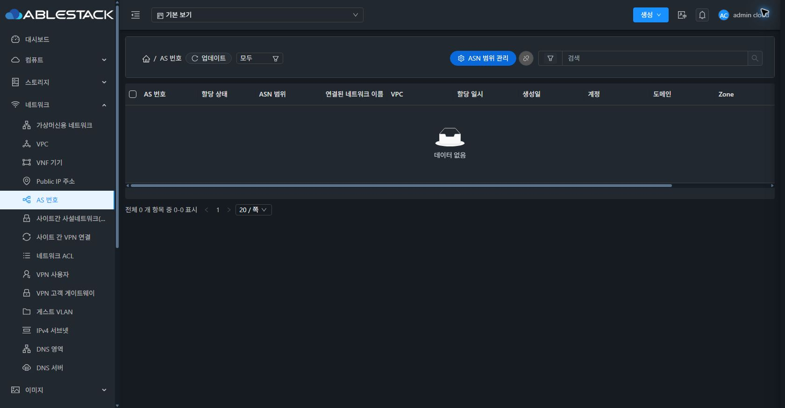
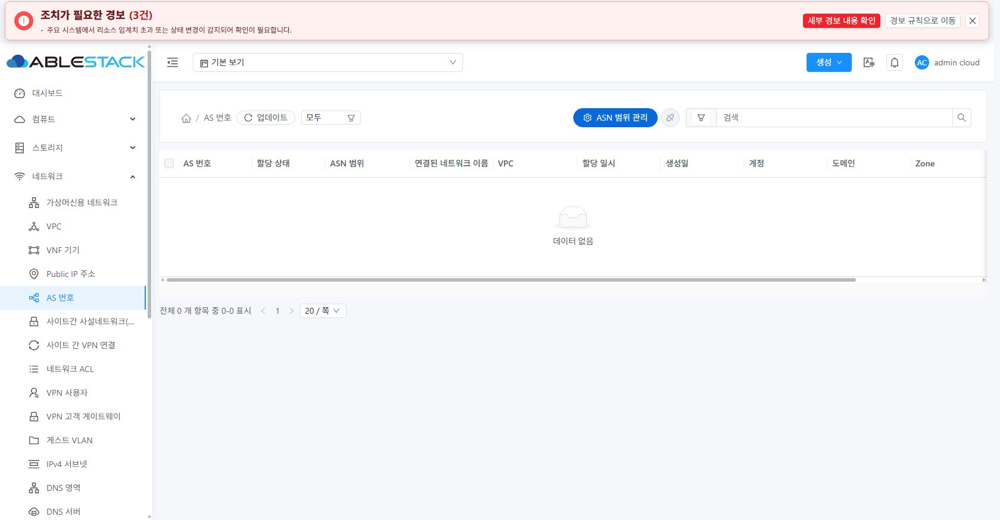

<!--
Licensed to the Apache Software Foundation (ASF) under one or more
contributor license agreements. See the NOTICE file distributed with this
work for additional information regarding copyright ownership. The ASF
licenses this file under the Apache License, Version 2.0 (the "License");
you may not use this file except in compliance with the License. You may
obtain a copy at http://www.apache.org/licenses/LICENSE-2.0 . Unless required
by applicable law or agreed to in writing, software distributed under the
License is distributed on an "AS IS" BASIS, WITHOUT WARRANTIES OR CONDITIONS.
-->

# AS 번호 빈 목록 공통 스타일 검증 — 2026-11-20

## 변경과 기준

최신 Europa `b2e0ff6086ca1813dbddc961d5c35b122aa4a99f`에서 별도 브랜치
`dhslove/asn-empty-state-20261120`를 생성했다. 제품 소스 커밋은
`8bf0e233d1bb42306446b9f405efd4057a11c47f`이며 이후 커밋은 검증 자료만 추가한다.

AS 번호 목록은 정상 조회가 0건이어도 `label.no.data` 문자열을 공통 ListView의
`emptyText`에 전달해 Ant Design의 기본 빈 상태를 덮어썼다. 정상 빈 결과에는
재정의 값을 전달하지 않아 가상머신과 동일한 `ant-empty ant-empty-normal` 아이콘과
현지화 문구 `데이터 없음`을 표시한다. 초기 조회의 로딩 문구와 조회 실패의 오류 구분은 유지한다.
API와 백엔드 변경은 없다. Epic #1708 / PR #1716 이후 별도 UI 보정이다.

## 로컬 확인

WSL ext4 작업 트리 `/home/ablecloud/work/dhslove/cloud-asn-empty-20261120/ui`에서 실행했다.
기존 동일 package-lock의 의존성 캐시를 재사용했다.

- `AutogenAsnSearch.spec.js`, `AsnListTools.spec.js`: 2개 suite / 13개 테스트 통과.
- 변경한 Vue 및 기존 테스트 파일의 `lint --no-fix` 통과.
- Vue CLI production build 통과. 소스맵을 제외한 기존 방식으로 빌드했다.
- `git diff --check` 통과.
- 정상 빈 결과와 지연 새로고침에서 기본 빈 상태를 유지하도록 기존 테스트 기대값을 갱신했다.

## 31·32 클러스터 검증

| 항목 | 31 GFS2 | 32 RBD |
| --- | --- | --- |
| 배포 전 재현 | 텍스트만 표시, 기본 아이콘 없음 | 동일 |
| 기본 조회 0건 | VM과 기본 빈 컴포넌트 HTML 일치 | 동일 |
| UI 검색 결과 0건 | 같은 아이콘·문구 유지 | 동일 |
| 라이트·다크모드 | 통과 | 통과 |
| 4초 지연 업데이트 | 빈 상태·박스 배치 유지, 전체 spinner 없음 | 동일 |
| UI 목록 API | HTTP 200 / 0건 | HTTP 200 / 0건 |
| 읽기 전용 API 확인 | 4/4 통과 | 4/4 통과 |
| 배포 후 `/client/` | HTTP 200 | HTTP 200 |
| `WEB-INF` 및 서버 파일 | 전후 해시 일치 | 동일 |
| 런타임 config / backend JAR / PID | 전후 동일 | 동일 |

읽기 전용 API 네 가지는 `listASNumbers` 기본 조회, keyword 조회, 32비트 exact 조회,
`listASNRanges` 조회다. 배포 전후 모두 0건임을 확인했다.
검증용 리소스 생성·삭제는 0건이며, 검색 조건·라이트모드·네트워크 지연·캐시 설정을 복구했다.
다크모드 문구 색상은 `#c5ccd4`, 빈 행 배경은 `#22282f`로 VM 기준과 같다.

## 배포와 복구 근거

활성 경로 `/usr/share/cloudstack-management/webapp`에 static allowlist만 덮어썼다.
`WEB-INF`, `META-INF`(존재 시), `config.json`은 보존했다. 디렉터리 전체 교체나
`rsync --delete`는 사용하지 않았다. 서비스 재시작과 JAR 배포는 하지 않았다.
FTCTL 번들 표식 `blockingLoadingState`, `fetchSyncProgress`, `extractJobId`도 확인했다.

- UI archive SHA-256: `b5e7e6898babbd77d2d7dbe76ca6ceb5853589ad218d84a00d2aea557da7008a`
- 두 서버의 index SHA-256: `13de00ab5288273c9461159765b8418cb60841f81da62135f07684bbd0f40908`
- 31 백업: `/root/asn-empty-20261120-ui-20261120-091938`
- 32 백업: `/root/asn-empty-20261120-ui-20261120-091958`
- 백업에는 변경 대상 static 파일과 전후 서버·설정·backend 해시가 포함되어 있다.

구조화 결과는 [EVIDENCE.json](EVIDENCE.json)에 기록했다. 원본 빌드·배포 로그는
WSL `/home/ablecloud/work/asn-empty-20261120`와 로컬의 이 검증 폴더에 보관했다.
인증정보가 포함될 수 있는 API 요청 원문·쿠키·세션키는 커밋하지 않았다.

## 확인 범위

이번 검증은 정상 빈 목록의 UI 표시와 기존 새로고침/조회 상태 동작을 대상으로 한다.
전체 Cloud 빌드, Maven 재빌드, 전체 UI 회귀, ISP/BGP 실통신 검증은 실행하지 않았다.
다른 네트워크·VPC·Public IP 기능을 재검증하지 않았다.
32 화면에 표시되는 기존 시스템 경보는 이 AS 번호 표시 검증의 성공 항목에 포함하지 않았다.

## 배포 화면

31 GFS2 다크모드:

32 RBD 라이트모드:

