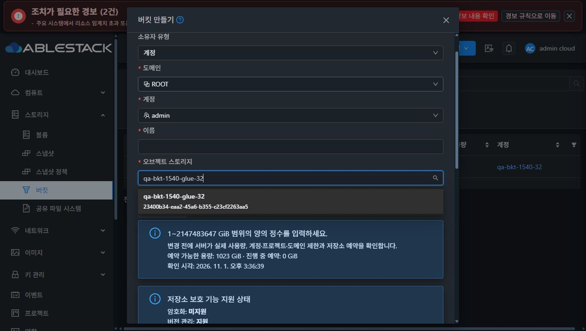

# #1536 생성 저장소 검색·선택·실패 복구 검증

2026-11-01, Epic [#1527](https://github.com/ablecloud-team/ablestack-cloud/issues/1527), PR [#1541](https://github.com/ablecloud-team/ablestack-cloud/pull/1541). 같은 `dhslove/epic-1527-buckets` 브랜치에서 구현하고 31 GFS2/32 RBD의 실제 Mold UI와 32번 Glue로 검증했다. #1536 완료 기준을 충족했다. Epic은 **10/13 완료·OPEN**, PR은 미병합이며 다음 작업은 **#1537 사용량 동기화·최신성·실패 상태**다.

## 문제와 변경

생성 폼에서 표시 이름을 입력해도 UUID만 검색해 결과가 사라졌고, 재조회는 첫 저장소로 선택을 바꿨다. 미등록·검색 결과 없음·조회 실패의 안내도 구별되지 않았다.

이름과 UUID를 NFKC·대소문자·연속/양끝 공백으로 정규화해 검색하고, UUID만 식별자로 사용한다. 옵션에는 이름과 UUID를 함께 표시한다. 최초 성공 조회만 기본 선택을 적용하고 재조회·이름 변경은 유효한 UUID를 보존한다. 사라진 UUID는 해제하고 명시적인 재선택을 요구한다. 성공적인 빈 목록, 로컬 검색 결과 없음, API 오류를 분리하고 목록 대기/오류/유효하지 않은 선택은 확인 버튼과 Ctrl+Enter 제출 모두 막는다.

전체 페이지·count·ID 중복/응답 불완전을 검증하고 기존 API의 전역 등록 저장소 범위를 유지한다. 등록 API 권한이 있는 관리자만 인프라 등록 화면으로 연결한다. 소유자·권한·프로젝트·세션 문맥 수명과 capability/할당량 재계산은 기존 계약을 따른다. 새 API/서버/DB 변경은 없다. [상세 설계](../../design/bucket-1527/1536-store-picker.ko.md) · [최초 설계와 완료 기준](../../design/bucket-1527/BKT-08.ko.md).

## 실제 UI → API → Glue

Root admin·Domain admin·일반 사용자·프로젝트 사용자로 로그인했다. API는 보조 검증과 전용 fixture/장애 준비에 사용했다. 생성은 모두 실제 UI를 통해 실행했고 각 UUID/소유자는 Cloud DB와 RGW bucket owner를 대조했다. [생성 결과](created-31-root-name.json)와 각 `created-{31,32}-*.json`에 10개 결과가 있다.

| 검증 | 31 GFS2 | 32 RBD |
|---|---|---|
| 한글 이름, 영문 대문자/공백, 전각 문자, UUID, no-match, 검색 지우기 | 통과 | 통과 |
| 동일 이름의 A/B를 UUID로 구별, 방향키/Enter 선택 | 통과 | 통과 |
| B 이름 변경 후 재조회: 동일 UUID/새 이름 유지 | 통과 | 통과 |
| 선택 C 삭제 후 재조회: 해제·경고·제출 차단, 반복 재조회도 자동 대체 없음 | 통과 | 통과 |
| Root 다른 계정·도메인 지정, 이름 검색 A 선택 → 생성 | 통과 | 통과 |
| 전달 전 create 실패 → 같은 owner/B/draft로 명시적 재시도 | 통과 | 통과 |
| Domain admin 본인/하위 도메인만 선택, child 계정/B 생성 | 통과 | 통과 |
| 일반 사용자 본인 고정, 이름 검색 B 생성 | 통과 | 통과 |
| 현재 프로젝트 고정, UUID 검색 B 생성 | 통과 | 통과 |
| 본인 버킷 브라우저 빈 목록 정상 조회 | 통과 | 통과 |

양쪽 각각 5개, 합계 **10개**를 실제 생성했다. 각 버킷은 1 GiB/Private/보호 옵션 false이며 Cloud 소유자=RGW 소유자, 해당 계정 S3 ListVersions HTTP200을 확인했다. 다른 계정은 account/domainid 쌍, 본인은 생략, 프로젝트는 projectid 단독을 유지했다. [권한 사전 확인](api-permission-preflight.json) · [실제 권한 회귀](owner-regression.json).

일반 사용자/Domain admin의 저장소 등록 거부 4건, 혼합 인자/외부 도메인 생성 거부 4건에서 버킷 할당이 없었다. 타 계정 버킷 목록은 두 역할에 노출되지 않고, 명시적 키 조회·수정·삭제 12건은 거부됐다. 각 클러스터에서 본인 목록2/프로젝트 목록1, 본인 S3 HTTP200/타 계정 HTTP403을 확인했다. 조회 저장소는 기존 전역 등록 목록이며 계정별 private catalog를 새로 도입하지 않았다.

## 실패와 복구

- 실제 목록 갱신 요청에 전달 전 HTTP503을 주입했다. 이전 owner/name/quota/UUID를 유지하고 선택/생성을 차단했다. 명시적 재시도는 같은 B UUID와 draft를 복구했다. [31 오류 화면](final-refresh-error-31.jpg) · [32 오류 화면](final-refresh-error-32.jpg).
- createBucket HTTP503은 서버 전달 전에 주입했다. 실패 후 동일 draft로 재시도해 실제 서버 생성이 한 번 성공했고 Cloud/Glue를 대조했다. 전송 여부가 불명확한 단절·이미 queued job의 실패를 자동 재시도로 검증했다고 주장하지 않는다. [31 실패](final-write-failure-31.jpg) · [32 실패](final-write-failure-32.jpg).
- 선택 C를 실제 API로 삭제한 뒤 UI 새로고침에서 선택 해제/경고/확인 차단을 검증했다. Ctrl+Enter로 create POST가 발생하지 않았고 다시 조회해도 다른 저장소로 바꾸지 않았다. [31 해제](final-deleted-choice-31.jpg) · [32 해제](final-deleted-choice-32.jpg).
- 기존 목록 응답을 대기시킨 동안 제출을 막고 폼 취소→재진입했다. 신규 목록을 먼저 적용한 후 이전 응답을 풀어도 신규 선택이 덮이지 않았다. `final-store-pending-*`, `final-late-store-discarded-*`에 상태를 남겼다. 문맥 전환·권한 변경·불완전/중복/누락 페이지의 거부는 집중 단위 회귀로도 검증했다.

## 빈 목록·등록 권한

10개 QA 버킷과 최초6개 QA 저장소를 정리한 다음 검증했다. **31번은 실제 등록 저장소0개**에서 미등록 안내/제출 차단과 관리자 등록 연결을 확인했다. 연결을 클릭해 `/objectstore`의 저장소 등록 액션을 확인했다. 31번에 추가 D 저장소를 등록해 재조회해도 자동 선택되지 않았고, 이름 검색으로 명시적으로 선택해야 했다. D도 정리했다. [등록 후 선택](final-register-after-empty-31.jpg) · [등록 메뉴 이동](final-registration-link-31.json).

**32번은 확인용 원본 저장소를 보존하므로 빈 목록 응답을 주입**했다. `simulatedEmptyResponse:true`를 기록했고 실제 전체 미등록으로 주장하지 않는다. 양쪽 Root light/dark에서 빈 안내·등록 연결을 확인했다. 일반 사용자·프로젝트 사용자·Domain admin에는 등록 링크가 없었다. [31 실제 미등록](final-empty-admin-dark-31.jpg) · [32 주입 미등록](final-empty-admin-dark-32.jpg) · [일반 사용자](final-empty-user-32.jpg) · [프로젝트](final-empty-project-32.jpg) · [도메인 관리자](final-empty-domain-admin-32.jpg).

## VM 메뉴 표준·테마·반응형

공통 FormItem/label/icon, 32px 높이·14px 글자·4px 선택기 기준을 기존 VM 메뉴와 대조했다. 선택된 이름은 한 줄 표준 조작 높이를 유지하고 긴 옵션 이름/UUID와 설명은 줄바꿈한다. 모달 내부 스크롤과 하단 취소/확인 접근을 검증했다. [VM 기준](vm-standard-current.json) · [최종 번들 조작 실측](final-vm-standard-comparison.json).

두 클러스터 × light/dark ×360/768/1280 CSS px에서 열린 선택기와 no-match를 각각 캡처하고 360px 하단 액션을 추가해 **필수28개 화면**을 확인했다. 실제 생성/오류/빈 목록/권한/최종 브라우저까지 최종 소스의 **59개 안정 화면**에서 수평 넘침/텍스트 대비 실패0이었다. 최소 텍스트 대비는 light **4.6686:1**, dark **4.5818:1**이었다. [측정 요약](final-ui-styles-summary.json).

드롭다운 portal, 입력값/placeholder, 직접 렌더링된 텍스트와 실제 합성 배경을 측정했다. 실제 disabled 조작은 제외하지만 FORM의 `disabled="false"`는 활성으로 취급해 폼 본문을 누락하지 않았다. 이는 색상/배치 검증이며 전체 WCAG 인증을 의미하지 않는다. Native JPEG를 재인코딩하지 않고 시그니처·디코드 크기·SHA256을 저장했다. CSS viewport와 이미지 픽셀 크기는 JSON에서 별도 기록한다(예:1280px viewport의 스크롤바 제외 JPEG 폭1270px).

[360px 밝은 화면](final-picker-light-360-32.jpg) · [360px 다크모드](final-picker-dark-360-32.jpg) · [360px 하단 조작](final-footer-dark-360-32.jpg).

## 테스트·동일 배포 근거

- 버킷 관련 회귀 **11 suites/172 tests PASS**, picker/ownership 집중 회귀 **2 suites/39 tests PASS**(새 선택기20건 포함). [누적 집중 회귀](ui-tests-final.log) · [선택기/소유자 회귀](ui-head-tests.log).
- 최종 ESLint/KO·EN literal 번역키 확인/WSL ext4 UI production build 성공. [lint](ui-lint-final.log) · [번역키](translation-keys.json) · [build](ui-build-final.log). 기존 Vue 아이콘 중복 등록/injection 테스트 경고는 테스트 실패가 아니다.
- 최종 UI 구현 소스 `831bc4eb585b2358a4749bf5026f87fda20e44f1`, 활성 번들 `app.799ef603.js`. 최종 HEAD의 전체 production source hash를 build manifest와 비교했다. 중간 번들/원시 `label.update`가 있던 화면은 최종 자격에 포함하지 않았다.
- 두 서버의 활성 `/usr/share/cloudstack-management/webapp`에서 **정적642개** 해시가 같고 index SHA256은 `9e3b1cc409e67f1c4b204d06f51bd7d52fa6d0c978d9892a859b3af4553e89dc`다. WEB-INF/설정/실행 라이브러리9개와 Mold PID를 보존하고 배포 전후 `/client/` HTTP200을 확인했다. 기존 FTCTL async marker와 이번 picker marker도 활성 번들에서 확인했다. [31 배포](deployment-31.json) · [32 배포](deployment-32.json) · [소스 정합성](final-source-alignment.json).
- 서버 JAR는 #1535 검증본 그대로이며 SHA256은 `44cf9ac136c45053bea6ab64591ff65950987d55af1f2b93437fdd3e41528f9d`, backend marker source는 `2b47787346e57b927610b3a894c0e6fc2f02b757`다. UI source와 서버 marker를 혼동하지 않는다. Java/Maven/전체 Cloud/Actions/qemu 빌드는 실행하지 않았다. 이 결과를 전체 Cloud CI 성공으로 확대하지 않는다.

## 자원 정리·보존·최종 상태

전용 QA 버킷10·저장소7·계정12·프로젝트6·도메인6과 RGW QA 사용자를 정리했다. 계정/프로젝트 삭제 전에 resource count0과 기존 IAM/상세 hash 보존을 확인했다. 수동 카운터 보정 없이 활성 QA/자격 증명/예약/진행 중 원장/장애 trigger0이다. 양쪽 Mold active/HTTP200, 호스트 각각3대 Up, Glue HEALTH_OK/RGW3/3을 확인했다. Windows와 WSL의 기존 dirty FT worktree를 보존했다. [정리](cleanup-final.json) · [최종 상태](final-health.json) · [Windows 보존](protected-windows-comparison.json) · [WSL 보존](protected-wsl-comparison.json).

확인용 **`qa-bkt-1540-32-files`**를 유지했다. 원본11개 객체의 이름/크기/raw S3 SHA256, 계정 상세, 기존 bucket credential/RGW 세 사용자 키 hash, 요청/실제 보호 설정을 전후 비교해 일치를 확인했다. 최상위 브라우저8행이 정상 표시되며 파일/폴더 구조를 그대로 열어 확인할 수 있다. 기존 RGW `dashboard` 사용자도 보존했다. [파일 보존](retained.json) · [키 보존](retained-credentials-after.json) · [보호 설정 보존](review-protection-after.json) · [최종 브라우저](review-browser-final.jpg).

[확인용 버킷 열기](http://10.10.32.10:8080/client/#/buckets/3e952d59-a311-4a2b-86fe-d66ed38f050c?tab=browser).

18개 실제 관측 키 값과 알려진 로그인 비밀번호를 공개 source/evidence에서 검사해 일치0을 확인했다. 로그인·키 조회 응답·세션·개인 fixture 파일은 공개하지 않았다. 관리 로그/저널 검사에서도 관측 키 일치0이었다. [로그 검사](credential-log-scan.json).

다음 **[#1537](https://github.com/ablecloud-team/ablestack-cloud/issues/1537)**은 목록 업데이트와 사용량 수집을 분리하고 마지막 성공 시각·Fresh/Stale/Error/Unknown·실패 중 기존값 유지·명시적 재시도를 구현하는 작업이다. 외부 S3 변경 후 브라우저/요약/DB/Object Store 집계 일치를 검증해야 한다. #1538 객체 HEAD, #1539 저장소 용량·연결 상태는 OPEN 후속으로 남긴다.
