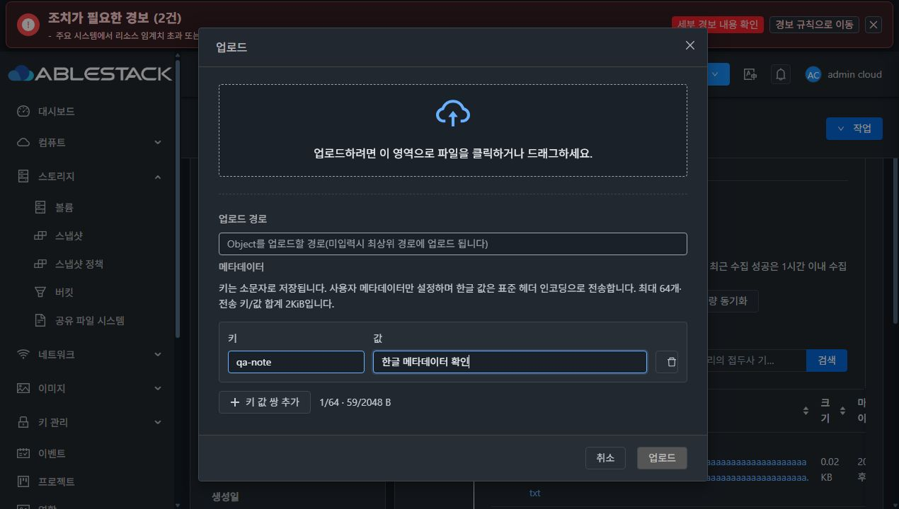
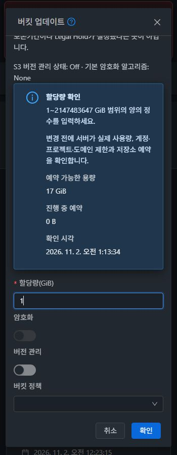

# #1539 Object Store 용량·연결 및 버킷 대화상자 검증

검증: 2026-11-01~02 Asia/Seoul. [작업 #1539](https://github.com/ablecloud-team/ablestack-cloud/issues/1539), [Epic #1527](https://github.com/ablecloud-team/ablestack-cloud/issues/1527), [PR #1541](https://github.com/ablecloud-team/ablestack-cloud/pull/1541). 같은 `dhslove/epic-1527-buckets` 브랜치에서 구현했다. 31 GFS2/32 RBD Mold를 검증했으며 실제 버킷 저장은 양쪽 모두 32번 Glue RGW를 사용했다.

## 결과와 구현

#1539의 용량 단위·수정 초기값·연결 상태 및 추가 요청한 업로드 다크모드/메타데이터, 보호설정·버킷 업데이트 정보 리본을 개선하고 실제 UI/API/DB/S3로 확인했다. 13개 하위 이슈의 구현·검증이 완료됐으며 Epic과 PR은 통합 검토·병합을 위해 OPEN으로 유지한다. 다음 작업은 PR #1541 최종 통합 검토·병합과 Epic #1527 종료다.

- 총량/할당/예약은 기존 바이트, `storageused`는 기존 KiB를 보존한다. 신규 `*bytes` 십진 문자열과 known 플래그를 제공해 BigInt로 계산한다. 20GiB는 21474836480 B이고 수정 창은 20으로 초기화된다. 사용량 1KiB는 기존 응답 1/신규 응답 1024다.
- 이름만 변경하면 name만 제출하고 용량·URL·키를 보존한다. 0은 운영자 추적 상한 해제, null은 미확인이다. Glue 물리 용량·버킷 무제한과 혼동하지 않도록 설명한다. 정수 GiB로 나누어지지 않는 기존 Long.MAX_VALUE는 경고·원본 바이트를 표시하고 이름 수정 시 정확히 보존한다.
- 루트 관리자 전용 `checkObjectStoragePool` POST/no-store와 전용 상세/수정 폼을 추가했다. Connected/AuthFailed/AccessDenied/Unreachable/Unknown, 점검 시각·설정 revision·마지막 성공을 구분한다. 후보 URL/키는 읽기 인증 후 원자적으로 저장하고 실패하면 이전 설정과 입력 초안을 유지한다.
- Glue 점검은 서명된 읽기 Admin Ops만 사용한다. 연결/읽기 5초, 전체 deadline 10초, 최대 동시 작업 4, 대기열/재시도/redirect 없음, 1MiB 응답 제한이다. 원문 제공자 오류나 키를 응답·로그에 남기지 않는다.
- 관리 버킷의 Fresh/Stale/Unknown/Error/NoBuckets와 수집 범위·시각을 표시한다. BucketVO가 이미 계산한 Stale를 DAO가 다시 계산해 Unknown으로 바꾸던 문제도 실제 Stale 실험으로 발견해 고쳤고 실제 BucketVO 회귀 테스트를 추가했다.
- 업로드 입력은 접근성 라벨이 연결된 키/값/삭제, 64행·인코딩 후 2KiB 제한, 중복/예약/제어 문자/잘못된 Unicode 검사를 제공한다. 모든 사용자 키를 `x-amz-meta-`에 넣어 시스템 MIME을 보존한다. 한글·공백·이모지 값은 UTF-8 경계에서 75자 이내 RFC2047 단어로 분리하며 상세에서는 복원한 값과 원문 헤더를 구분한다.
- 파일별 상태를 보존하고 부분 실패 후 실패 파일만 재전송한다. 완료 안내는 성공/실패 수를 표시한다. 보호설정·버킷 업데이트 리본은 짧은 제목/설명 문단/항목명·값/제약 목록으로 정렬하고 모바일에서 세로 배치한다.
- tab/browserPath만 바뀌는 경우 자원 scope를 유지해 브라우저 URL 정규화·탭/폴더 이동 뒤 작업 메뉴가 사라지지 않도록 했다. 다른 UUID·필터·계정·프로젝트·역할·세션 변화는 계속 무효화한다.

[최종 설계](../../design/bucket-1527/1539-capacity-connection.ko.md).

## 31·32 실제 기능 검증

| 항목 | 수행 방법 및 확인 결과 | 근거 |
|---|---|---|
| 용량 왕복·경계 | 20→30→20GiB, 이름만 수정, 0, null, Long.MAX_VALUE 보존. -1/1.5/8589934592GiB 및 3GiB 할당 중 2GiB 상한은 API 거부/원본 보존, UI 확인 비활성 | [31 API](evidence/api-validation-31.json), [32 API](evidence/api-validation-32.json), [UI31](evidence/ui/infra-boundaries31.json), [UI32](evidence/ui/infra-boundaries32.json) |
| 수정 초기값·변경 필드 | 양쪽 UI 20GiB 초기값, 이름만 수정 요청에는 command/id/name만 포함. unroundable legacy와 0/null 각각 별도 표시 | [제출 필드](evidence/ui/infra-name-only-network31.json), [legacy31](evidence/legacy-name-only-preserved-31.json), [legacy32](evidence/legacy-name-only-preserved-32.json) |
| 연결·권한·재시도 | 실제 Glue 정상 서명 읽기, 실제 잘못된 후보 키 거부. QA 프록시로401/403/503/잘못된 JSON/지연 주입 후 실제 UI 상태·마지막 성공·재시도 확인. 실제 지연 종료 약5초 | API31/32의 checks 및 UI 기록. [POST/GET31](evidence/http-contract-31.json), [32](evidence/http-contract-32.json) |
| 후보 검증·원자 복구 | 31 UI 잘못된 후보 URL 실패 후 DB/기존 키 해시 보존 및 재시도. 32 DB 갱신 전 실패와 store 변경·이전 details 삭제 후 revision INSERT 실패를 별도 주입해 전체 트랜잭션 rollback, 초안 유지·재시도 성공 | [31](evidence/ui-candidate-failure31-db.json), [32 후반 쓰기 rollback](evidence/ui-postwrite-fault32-verified.json), [주입 정의](evidence/qa-postwrite-fault-definition.json) |
| 사용량 상태·단위 | 양쪽 QA telemetry만 Unknown/Stale/Error로 바꿔 API와 최종 UI를 대조한 뒤 원본 복원·실제 syncBucketUsage 수행. legacy1/bytes1024 및 Fresh 회복 | [31 단위](evidence/capacity-units-final-31.json), [32 단위](evidence/capacity-units-final-32.json), [Stale31](evidence/usage-stale-31.json), [Stale32](evidence/usage-stale-32.json), usage-real-recovery-31/32.json |
| 소속 버킷·삭제·키 동선 | 양쪽 저장소의 소속3버킷, 버킷 존재 시 삭제 비활성, 기존 키 변경 창 연결 및 입력 공백 확인. 기존 운영 키 변경은 하지 않음 | [소속31](evidence/ui/final-store-buckets-31.json), [삭제32](evidence/ui/final-store-delete-blocked-32.json), [키 동선32](evidence/ui/final-store-key-path-32.json) |
| 일반 소유자 권한 | 전용 일반 계정으로 자기 버킷 접근 가능, 인프라 링크·연결 점검 없음, 직접 인프라 경로도 대시보드로 전환. API도 권한 거부 | [31](evidence/ui/owner-infra-denied31.json), [32](evidence/ui/owner-infra-denied32.json) |
| 업로드·메타데이터 | 양쪽 UI에서 한글/공백 파일명2개 업로드, 두 번째 PUT만503 주입. 첫 파일200 1회, 실패 파일503→재시도200. 빈 값·한글과 content-type 사용자 metadata 확인, 실제 MIME은 text/plain 유지 | [31 HEAD/PUT](evidence/upload-metadata-validation-31.json), [32](evidence/upload-metadata-validation-32.json) |
| 긴 메타데이터·복원 | 최종 UI에서 한글·선후행 공백·이모지 포함 값 업로드. 실제 HEAD/GET200, 8 encoded words/최대72자, 원문 Unicode와 body 해시 일치. UI 상세 복원도 대조 | [31](evidence/long-metadata-validation-31.json), [32](evidence/long-metadata-validation-32.json), [32 상세](evidence/ui/final-long-metadata-head-32.json) |
| 브라우저 scope | 최종 앱에서 최초 목록·QA 폴더 생성/진입/빈 목록/최상위 복귀 시 작업 메뉴 유지, 업로드 동선 유지 | [31](evidence/ui/final-folder-scope31.json), [32](evidence/ui/final-folder-scope32.json) |

장애 응답/timeout/DB trigger/legacy·미수집·오래된 telemetry는 **전용 QA 자원에만 주입**했다. 실제 Glue 전체 장애나 운영 키 변경을 실행한 결과로 주장하지 않는다. 늦은 응답·설정 revision·역할/프로젝트 전환·미지원 제공자 등 결정적 경계는 집중 단위 테스트로 검증했다. 이번에 전체 소유권/회전/삭제/보호 매트릭스를 재실행한 것은 아니며 누적 이전 이슈 보고서와 집중 회귀 범위를 구분한다.

## VM 스타일·다크모드·반응형

실제 VM 볼륨 탭의 생성 및 연결/기존 볼륨 연결/업데이트 버튼은 32px 높이·14px 글자·4px 모서리이며 이 기준과 같은 테마 토큰을 사용한다. VM 목록의 메인 추가 버튼 모양과 헤더의 24px 아이콘 버튼은 해당 화면의 별도 규칙이며 모든 VM 버튼이 같다고 가정하지 않았다. [실제 VM 탭 기준](evidence/ui/final-vm-tab-standard.json).

31/32 × light/dark × 360/768/1280 × 보호설정/버킷 업데이트/업로드/인프라 상세/인프라 수정 **60개 화면**을 최종 앱/CSS 지문과 함께 실측했다. 모바일 업데이트 창은 하단으로 스크롤한4개 프레임을 더 확인했다. 일반 텍스트 합성 배경 대비 최소 **4.97:1**, 기준 미달0, 실제 페이지/리본/메타데이터 행 가로 넘침0, 닫기 버튼 도달 실패0이다. 업데이트 하단의 할당량 안내·입력·취소·확인 버튼에도 접근했다. 비활성 버튼은 일반 본문 대비 판정에서 제외했다.

[64프레임 실측 요약](evidence/ui/final-ui-styles-summary.json), [버킷36뷰](evidence/ui/final-bucket-matrix-summary.json), [인프라24뷰](evidence/ui/final-infra-matrix-summary.json), 각 final-matrix JSON과 원본 JPEG를 보존했다.

네이티브 JPEG83개의 시그니처·디코딩 치수·해시를 확인했다. 도구 JPEG 너비는 기록된 JS viewport보다 **항상10px 작고 높이는 같다**. 원본을 리사이즈하지 않았으며 360/768/1280 DOM 실측을350/758/1270 JPEG 픽셀 크기와 동일시하지 않는다. 일부 Ant grid root scrollWidth가 여백 때문에 커지는 진단값도 보존하고 실제 document 폭·컨트롤 경계·행 폭으로 판정했다. [이미지 원본 검증](evidence/ui/final-image-integrity.json). 정리 후 확인용 버킷 화면2개도 별도 보존했다.

## 빌드·검증과 동일 배포

Java 집중 회귀 **고유118개**(Ceph40/Server75/Schema3), UI **15 suites/244개**, 변경 Java Checkstyle·변경 UI 소스/테스트 ESLint·UI production build를 통과했다. 재실행된 테스트 수를 중복 합산하지 않았다. [빌드·테스트 요약](evidence/test-summary.json). 단위 성공을 전체 Cloud CI로 확대하지 않는다.

Maven은 WSL ext4 체크아웃의 변경 모듈 api/engine-api/engine-schema/ceph/server만 빌드했다. UI도 같은 ext4에서 빌드했다. 전체 Cloud·GitHub Actions·qemu 빌드는 시작하지 않았다. 기존 Browserslist/번들 크기/Vue 테스트 등록 경고는 남아 있으며 테스트 실패가 아니다.

| 배포 항목 | 31·32 공통 최종값 |
|---|---|
| Java 소스 | `2527faaa36480ad3595f346c87d8bc6a9371a5a5` |
| UI 소스 | `337d542bf386424ff2cfeaf7f61914f0dad40cc4` (현재 ui/src 및 locale manifest 일치) |
| 주 JAR SHA256 | `878054400f56c243449021f5bbe32be45522a2cbe2aaa7a3371652b0fe4bb525` |
| index SHA256 | `979191861ccf51a6abcf445108697a282a7a1dfe3830922a335330c3b4e2c33e` |
| 앱/CSS | `app.6b1f8411.js` / `app.28bcf807.css` |
| 정적 파일 | allowlist648개 해시 확인 |
| 실행 라이브러리 | 9개 모두 양쪽 일치 |
| API 버전 | `4.23.0.0-Mold.Europa-202609222315` |

변경 모듈의 class overlay38개를 검증된 기존 JAR에 반영했고 원본 ZIP local entries204619개를 바이트 단위로 보존했다. 이 방식은 전체 JAR를 새 소스 전체 빌드로 바꾼 것이 아니다. [JAR manifest](evidence/jar-manifest.json). 활성 `/usr/share/cloudstack-management/webapp`의 정적 자원만 갱신하고 WEB-INF·설정·기존 라이브러리를 보존했다. FTCTL 마커도 최종 활성 번들에서 확인했다. [31 UI](evidence/deployment-31.json), [32 UI](evidence/deployment-32.json), [31 backend](evidence/backend-deployment-31.json), [32 backend](evidence/backend-deployment-32.json).

초기 readiness에서 31의 원래 저장소 부재와 응답 envelope 불일치를 확인해 검증된 이전 JAR로 자동 복구한 뒤 전용 QA readiness와 표준 response 이름을 수정했다. 이후 실제 API/DB 대조로 KiB 호환성과 Stale 이중 계산도 보완했다. 최종 배포는 rollback 없이 정상이다. [보완 이력](evidence/deployment-readiness-corrections.json). 이번 schema 변경은 없으며 #1537 nullable usage5열을 유지한다. RPM 설치 메타데이터와 Agent/Glue 패키지는 변경하지 않았다.

## 정리·보존·보안

31/32 각각 QA 버킷3개·저장소2개·일반 계정1개를 정상 Cloud API로 정리했다. QA S3 객체/버전/marker만 확인 후 비웠으며 원본 확인용 버킷은 제외했다. Cloud 카운터를 수동 보정하지 않았다. 활성 QA 자원·자격 증명 행·예약·진행 중 할당량/키회전·장애 trigger0, 프록시 중지와 임시 scoped 방화벽 규칙 제거를 확인했다. [정리](evidence/cleanup-final.json).

32번 **`qa-bkt-1540-32-files`** (`3e952d59-a311-4a2b-86fe-d66ed38f050c`)와 원래 계정/저장소를 유지한다. **원래12개 raw S3 객체의 이름·크기·원본 바이트 SHA256, 기존 계정 상세, 버킷 credential revision과 기존 RGW3사용자의 전체 키 집합, 실제 보호 설정 모두 보존**했다. 이번 작업은 확인용 버킷에 파일을 추가하지 않았다. UI 루트 목록은 폴더3개를 포함9행이며 raw 객체12개와 서로 다른 기준이다. [객체 보존](evidence/retained.json), [키 해시 보존](evidence/retained-credentials-after.json), [보호 설정](evidence/review-protection-after.json), [최종 브라우저](evidence/ui/review-browser-final.json).

확인 경로: [32번 버킷 브라우저](http://10.10.32.10:8080/client/#/buckets/3e952d59-a311-4a2b-86fe-d66ed38f050c?tab=browser). 새 앱으로 로그인·목록 표시와 업로드 대화상자 열기/취소를 확인하고 브라우저 탭을 유지했다.

최종 양쪽 Mold active, `/client/`200, WEB-INF 존재, 컴퓨트 호스트 각3대 Up. Glue HEALTH_OK/RGW3개 running, 기존 사용자3개와 원래 확인용 버킷1개만 남았다. [최종 상태](evidence/final-health.json).

이번 관찰 키12개 값으로 양쪽 관리 로그와 Mold journal을 검색한 결과 일치0이다. 키 값은 게시하지 않으며 요약과 해시만 남겼다. [로그 점검](evidence/credential-log-scan.json). 보호 대상 WSL FT 작업트리는 HEAD/상태/추적 diff/미추적 파일 해시가 같고 Windows 기존 작업트리는 HEAD/브랜치/상태/추적 binary diff가 같다. Windows 미추적 내용 해시 baseline은 없으므로 그 검증까지 주장하지 않는다. [WSL 보존](evidence/protected-wsl-comparison.json), [Windows 보존](evidence/protected-windows-comparison.json), [소스 키 검색](evidence/source-secret-scan.json), [공개 증거 키 검색](evidence/evidence-secret-scan.json).

## 검증 한계

다른 Object Store 제공자, HTTPS/TLS/KMS 성공, Glue 물리 증설, 대용량·장시간 부하·실제 전체 Glue 장애, 전체 Cloud CI는 이번 통과 범위가 아니다. HTTP Glue 암호화 Unsupported는 기존 계약이다. 논리 사용량은 KiB 반올림된 관리 버킷 수집 통계이며 원본 객체 바이트 합이나 Glue의 전체 물리 사용량과 같지 않을 수 있다. 연결 결과는 화면 수명 안의 명시적 점검 결과이며 새로고침하면 Unknown부터 시작한다. Epic 병합·종료는 후속 작업이다.
