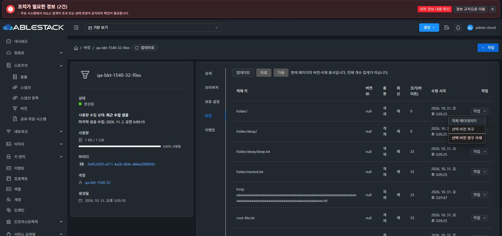
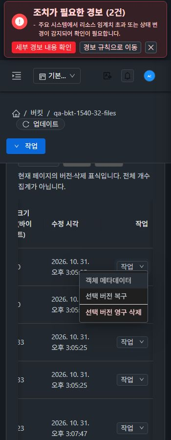

# 버킷 버전 탭 행 작업 메뉴 개선 검증

2026-11-02 Asia/Seoul. Epic #1527 / PR #1541의 같은 `dhslove/epic-1527-buckets` 브랜치에서 추가 요청을 구현했다. 31 GFS2·32 RBD Mold와 32번 Glue를 사용했다. 기존 하위 이슈 상태는 유지하고 PR·Epic에 추가 검증을 기록한다.

## 문제·해결

작업 열의 `a-space wrap` 안에 텍스트 버튼3개를 넣고 열 폭을 지정하지 않아 버튼이 세로로 쌓였다. 같은1280px 화면에서 QA 행 높이는137~143px였고 원래 확인용 버킷의 일반 행도137px였다.

행마다 24px 높이의 **작업 드롭다운1개**를 표시하고 작업 열은112px로 고정했다. 메타데이터·복구·영구 삭제를 메뉴로 묶고 삭제는 구분선/위험 항목으로 분리했다. VM 행 메뉴의 공통 팝업 팔레트를 사용하고 키·버전ID를 접근성 이름에 포함한다. 기존 최신 버전 복구 제한, 삭제 표식 metadata 제한, 관리 권한·진행 중 작업의 비활성 조건과 기존 확인창을 유지한다.

기본 라이브러리의 Escape 닫기 부재를 실제 UI에서 확인해 제어 상태와 키보드 동작을 보완했다. 메뉴가 표시된 뒤 현재 행의 활성 항목으로 포커스를 보내고 방향키/Home/End·Enter/Space, Escape 닫기·원래 버튼 복귀, Tab 이동을 지원한다. 목록 갱신·탭 이탈·범위 변경·unmount에서는 메뉴와 지연된 포커스를 정리한다. DOM 포커스는 키·버전ID가 일치하는 현재 메뉴에만 보낸다.

변경 소스는 `BucketVersions.vue`와 기존 `BucketDeletion.spec.js`다. API·DB schema·관리 JAR·호스트/Glue 패키지는 변경하지 않았다.

## 검증

31/32 × light/dark × 360/768/1280px의 **12개 조합**을 최종 앱 지문으로 검증했다. 모든 행의 작업 버튼1개, 작업 열112px, 문서 전체 가로 넘침0, 팝업의 viewport 내 배치·활성 메뉴 항목 hit test·Escape 후 포커스 복귀를 확인했다. 작은 화면의 표 내부 가로 스크롤은 유지한다. 활성 작업 버튼/메뉴 텍스트 대비 최소 **5.19:1**, 4.5:1 미달0이다. [12프레임 요약](evidence/ui/final-matrix-summary.json).

확인용 버킷을 같은1280×720 DOM viewport에서 비교한 결과 일반 행137→77px,12행 높이 합계1650→990px로 **40% 감소**했다. 긴 파일명은 생략하지 않아서 일부 행은 줄바꿈 높이를 유지한다. [배치 비교](evidence/layout-summary.json), [수정 전](evidence/ui/before-review-dark-1280.json), [수정 후](evidence/ui/final-review-dark-1280-720.json).

양쪽 실제 키보드 검증에서 Enter 열기, 비활성 항목 건너뛰기, 방향키/Home/End, Escape 닫기·버튼 복귀, Space로 과거 버전 복구 확인창 열기, Tab으로 다음 행 버튼 이동을 확인했다. [31](evidence/ui/final-keyboard-31.json), [32](evidence/ui/final-keyboard-32.json), [Tab](evidence/ui/final-keyboard-tab.json). 최신 객체 복구와 삭제 표식 metadata는 기존처럼 비활성이다.

도구의 viewport-preview JPEG는 고정16:9 캔버스의 미리보기라 DOM viewport와 픽셀 치수가 다르다. 이를 실제360×900 이미지라고 주장하지 않고 픽셀 검증 근거에서 제외했다. 별도 fullPage 원본3장은 실제350×900/1590×900/1910×900으로 디코딩·서명·해시를 확인했다. 이 원본은 viewport보다 너비10px 작고 높이는 같다. 모든 이미지는 도구가 반환한 원본이며 리사이즈하지 않았다. [원본 이미지 검증](evidence/ui/final-image-integrity.json).

- 실제 UI에서 양쪽의 과거 버전 metadata 조회로 정확한 버전ID·13바이트·qa-note를 확인했다. 복구·영구 삭제·삭제 표식 제거는 선택한 키/버전ID의 기존 확인창이 열리고 취소되는 것을 확인했다. 이번 배치 검증에서 확인 버튼을 눌러 버전을 변경하지 않았으며 QA4개 버전/표식의 ID·종류·최신 여부·크기·시각이 그대로인지 API로 대조했다.
- 실제 Glue의 최신 객체·이전 객체·삭제 표식을 사용했다. DOM을 가짜 버전 행으로 바꾸거나 목록 API를 모의하지 않았다. 기존 확인용 버킷은 읽기 및 대화상자 취소만 수행했다.
- 기존 버전·삭제·metadata 회귀 및 추가 키보드 회귀2개를 합해 **2 suites/39 tests PASS**, 변경 Vue·테스트 ESLint PASS. 전체 Cloud CI가 아닌 집중 UI 검증이며 Maven·Actions·qemu 빌드는 시작하지 않았다. UI production build는 WSL ext4에서 수행했다. 기존 Browserslist/번들 크기/테스트 아이콘 중복 등록 경고는 남아 있다.

## 동일 배포

UI 소스 `1b26db1a6f7b3fee298e8da3e5db3b9451d41901`에서 빌드한 `app.c7285cbb.js`, CSS `app.28bcf807.css`, index SHA256 `ccff3b6b41466c0a2a1cbfcbb69921db24935f1919a1769b21dc942996ef6416`를 동일 반영했다. 양쪽 정적 자원 **648개**와 실행 라이브러리9개 해시가 일치한다. 백엔드 JAR SHA256은 기존 `878054400f56c243449021f5bbe32be45522a2cbe2aaa7a3371652b0fe4bb525`를 유지한다. [UI 지문](evidence/final-ui-fingerprint.json), [31 배포](evidence/deployment-31.json), [32 배포](evidence/deployment-32.json), [최종 상태](evidence/final-health.json).

활성 `/usr/share/cloudstack-management/webapp`에 allowlist의 정적 파일만 갱신했다. 각 배포 전후 WEB-INF·설정·백엔드9개 라이브러리 해시·Mold PID가 동일하고 HTTP200과 서비스 active를 확인했다. FTCTL 기존 마커도 유지했다. 이전 청크를 임의로 삭제하지 않았다.

## 정리·보존

각 클러스터의 QA 버킷1개·저장소1개·소유 계정1개와 QA RGW 사용자만 정리했다. UI 확인/취소 검증 후에도 원래4개 버전/표식은 ID·종류·최신 여부·크기·시각이 그대로였고, 정리 단계에서 이 QA 버전들만 비운 뒤 정상 Cloud 삭제를 수행했다. 활성 QA 자원·자격 증명 행·예약·진행 중 quota/회전0, 수동 카운터 보정 없음. 원래 버킷1개·원래 RGW 사용자3개만 남았다. [UI 비변경 대조](evidence/ui-version-nonmutation.json), [정리](evidence/cleanup.json).

양쪽 Mold active/HTTP200/WEB-INF 존재, 호스트 각3대Up, Glue HEALTH_OK/RGW3개 running. 실제 관찰 키16개로 양쪽 관리 로그와 Mold journal 검색 일치0이다. [로그 검색](evidence/credential-log-scan.json). WSL 보호 작업트리의 HEAD/상태/추적 diff/미추적 파일 해시도 이전 기준과 같다. [작업트리 보존](evidence/protected-wsl-comparison.json).

확인용 **qa-bkt-1540-32-files**와 원래 계정·저장소를 유지했다. 원래12개 객체의 이름·크기·raw S3 바이트 SHA256, 원래3개 RGW 사용자의 키 집합·버킷 자격 증명 revision, 실제 보호 설정·계정 상세를 보존했다. 이번 작업은 확인용 버킷에 파일을 추가하지 않았다.

원래 Windows/WSL의 FT 작업트리는 수정하지 않았다. 작업용 WSL ext4 체크아웃만 사용했다. 비밀 값이 들어 있는 fixture/credential 파일은 게시하지 않았으며 공개 증거와 소스는 실제 관찰 키·제공 암호로 검색했다.

## 검증 범위와 다음 작업

이 변경은 버전 목록의 작업 배치와 키보드 조작에 한정한다. 전체 버전 삭제·복구의 장애/부하 매트릭스를 다시 수행한 것은 아니다. 기존 기능 계약의 집중 회귀와 새 메뉴에서 기존 동작으로 연결되는 실제 UI 경로를 구분해 기록한다. Epic과 PR은 OPEN·미병합을 유지한다. 다음 작업은 PR #1541 최종 통합 검토·병합 후 Epic #1527 종료다.

[집중 검사39개](evidence/checks.json) · [원본 객체 보존](evidence/retained.json) · [키 집합 보존](evidence/retained-credentials-after.json) · [보호 설정 보존](evidence/review-protection-after.json).
