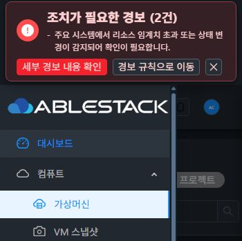

# #1546 VM 목록 테마 대비 검증

검증일: 2026-11-02. UI 구현 `36f28a1a712aaaf3e357ed296b071bfb28543017`, 기준 Europa `50d666d1113ddbc50f0b632eb69e0d72d82faba4`.

## 변경과 원인

VM 목록의 Ant primary와 검색 placeholder 레거시 색상이 일반 글자 대비 4.5:1에 미달했다. AutogenView의 `!dataView && route.meta.name === 'vm'`에만 `vm-list-page`를 부여하고 별도 scoped CSS에서 기존 semantic 토큰을 사용한다. ActionButton/SearchView 공통 구현·토큰 값·API·권한·busy gating·검색 조건은 변경하지 않았다.

주 작업은 `--ui-action-primary-bg/text`, hover/active는 `--ui-action-primary-hover`, 검색 안내는 `--ui-text-muted`, 포커스는 `--ui-focus`를 사용한다. danger·disabled·loading veil은 각각 기존 상태와 의미를 보존하는 별도 selector로 구분한다.

| 대상 | 수정 전 | 수정 후 |
|---|---:|---:|
| 가상머신 추가 일반 글자 | 3.24:1 | 5.19:1 |
| 추가 hover | — | 6.96:1 |
| 검색 안내 라이트 | 1.84:1 | 4.97:1 |
| 검색 안내 다크 | 4.18:1 | 5.88:1 |

## 실제 UI 인수

- 31(GFS2)·32(RBD), 라이트/다크, 360/768/1280px의 12조건 모두 새 app 번들·scope·html/body 테마·실제 색상·4.5:1·버튼 높이32px/14px/400/round·가로 overflow 없음 확인. native JPEG와 DOM 측정 JSON을 동일 이름으로 제공한다.
- 모바일에서 양방향 테마 선택이 동일 URL/viewport에서 즉시 반영된다. 생성 화면 왕복과 hash 화면 이동에서 테마를 유지한다. VM→볼륨은 CDP loader ID가 같은 문서인 상태에서 확인했다.
- 실제 키보드 Tab/Shift+Tab으로 추가 버튼 포커스와 2px outline을 확인했다. hover는 CDP CSS pseudo state로 확인하고 해제했다.
- 두 클러스터 모두 생성 화면 진입 후 제출 없이 목록으로 복귀했다. 빈 필수 값의 생성 버튼 disabled 상태와 VM 전용 CSS 미적용을 확인했다.
- 없는 키워드 검색→0개→검색 해제→목록/갱신 복구를 확인했다. 32번 2개 행 선택/해제를 수행했고 주 작업이 앞, 고급 검색/검색 아이콘이 뒤에 유지된다. 기존 선택 작업은 context menu 방식이며 이번 수정은 그 동작을 바꾸지 않는다.
- 조회 XHR 1개를 일시 정지해 검색 loading과 주 작업/placeholder 대비를 확인하고 요청을 재개했다. 주 작업은 현재 VM 목록에서 loading/disabled로 전환되는 동작이 없으므로 해당 방어적 CSS는 소스 검토 범위다. 생성 버튼 disabled는 실제 UI로 확인했다. danger 작업 실행과 운영 VM 상태 변이는 수행하지 않았다.
- 두 클러스터에서 목록 요청 차단 시 무한 loading 없이 기존 전역 Network Error 처리로 로그인 화면에 이동했고, 차단 해제·재로그인 후 목록과 각 테마가 복구됐다. 자동 제자리 재시도 기능을 구현했다는 의미는 아니다.
- 대표 회귀:31 버킷 만들기5.19/검색4.97,32 볼륨의 기존 primary/placeholder 색상이 수정 전과 동일하고 VM scope가 없다. 전체 메뉴 대비 개선을 의미하지 않는다.

## 한계와 다음 작업

대비 4.5:1 인수 대상은 VM 목록의 주 작업 일반 글자와 검색 placeholder다. 비활성/진행 중 컨트롤은 일반 텍스트 대비 인수와 구분한다. 실제 refresh loading의 기존 veil 아래 글자는4.10:1로 측정됐다. 기존 전역 Network Error→로그인 유도와 레거시 보조 검색 아이콘 색상은 유지되며 개선 후보로 남긴다.

다음 권장 작업은 **볼륨 목록 주 작업·검색 안내 토큰 적용**이다. 이번 대표 회귀에서 기존 primary3.24:1·다크 placeholder4.18:1을 재확인했다. 공통 적용은 메뉴별 영향 검증 후 opt-in으로 진행한다. #1214/#1213의 공통 대화상자 전환은 별도 범위다.

## 검증·배포·보존

- 집중 unit4 suites/46 tests PASS:ActionButton,ThemeLifecycle,GuiTheme,AutogenBucketBrowser. 변경 파일 lint PASS. WSL ext4에서 UI production build PASS. 전체 Cloud/Maven/qemu/GitHub Actions 빌드는 실행하지 않았다. 기존 Browserslist 및 테스트 개발 모드 경고는 별도다.
- 동일 정적647개를 활성 `/usr/share/cloudstack-management/webapp`에만 배포했다. WEB-INF/config/9개 library/PID/기존 FT marker를 보존하고 /client HTTP200·Mold active·두 클러스터 라이브러리/UI 해시 일치·Glue HEALTH_OK/RGW3을 확인했다.
- app `app.1e065b21.js`, CSS `app.b67475e3.css`, index SHA256 `54c2c5635c47b6e440ecf8f4dcc42dbdebd4fb556bed18bf09e03990ce3d863b`.
- 확인용 `qa-bkt-1540-32-files`는13개 객체·버전/marker13·원문 bytes·키 revision/account details/보호 설정이 시작 시점과 동일하다. snapshot SHA256 `8962694351f0109f1aba38639debd2e0d4f9596caa049031b8f7324008023371`.
- 기존 FT 작업트리는 작업 전 snapshot으로 보호하고 병합/동기화 뒤에 다시 대조한다. 브라우저 임시 viewport/요청 차단/pseudo state는 복원했다. 운영 VM·버킷 데이터의 생성/삭제/변경은 없다.

측정 전체는 [ui-summary.json](evidence/ui-summary.json), 활성 배포는 [health-summary.json](evidence/health-summary.json), 보존은 [retained-comparison.json](evidence/retained-comparison.json)에 기록했다. JPG는 native JPEG이며 image-dimensions.json에 실제 크기를 기록했다. 인증정보와 운영 VM 목록 화면은 공개 증거에서 제외했다.
