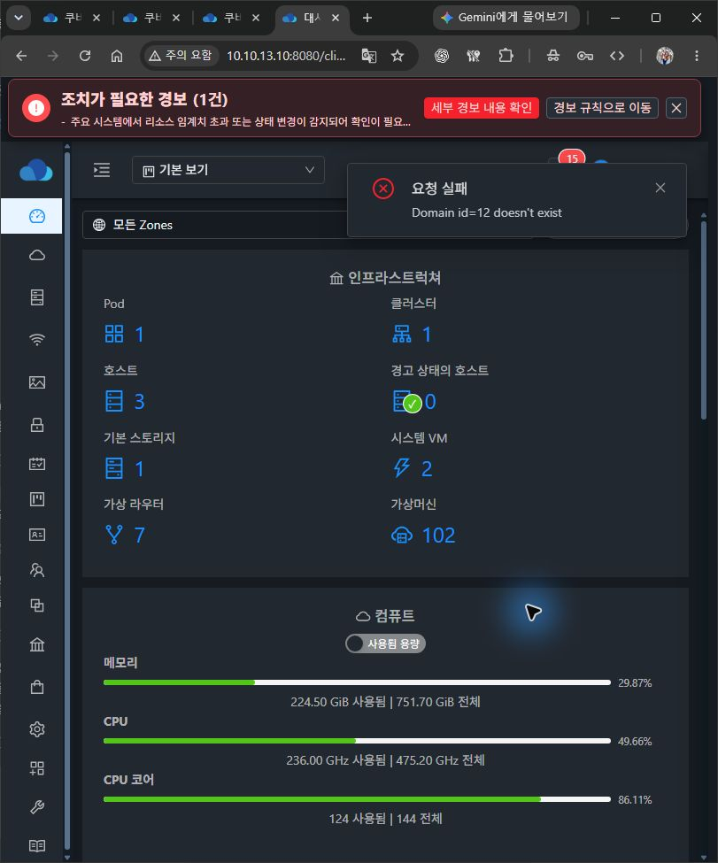
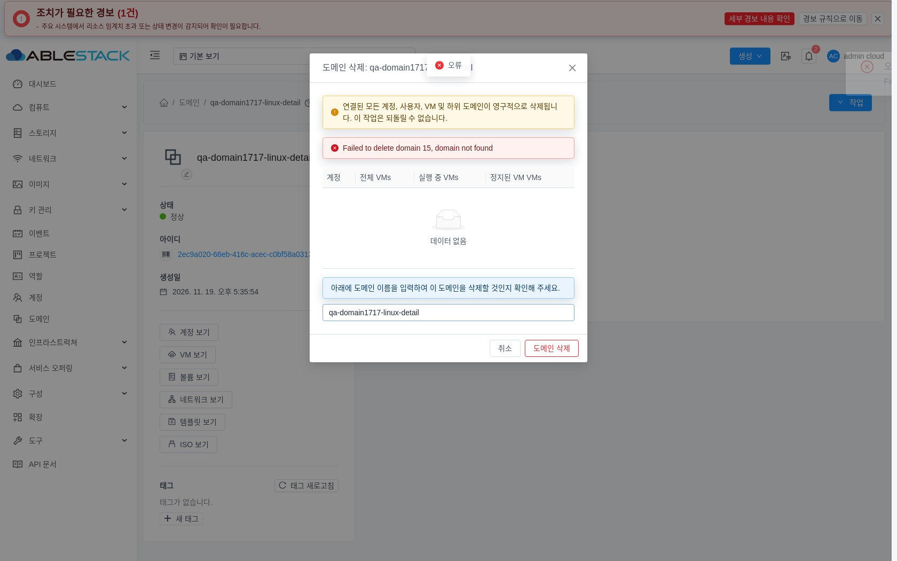
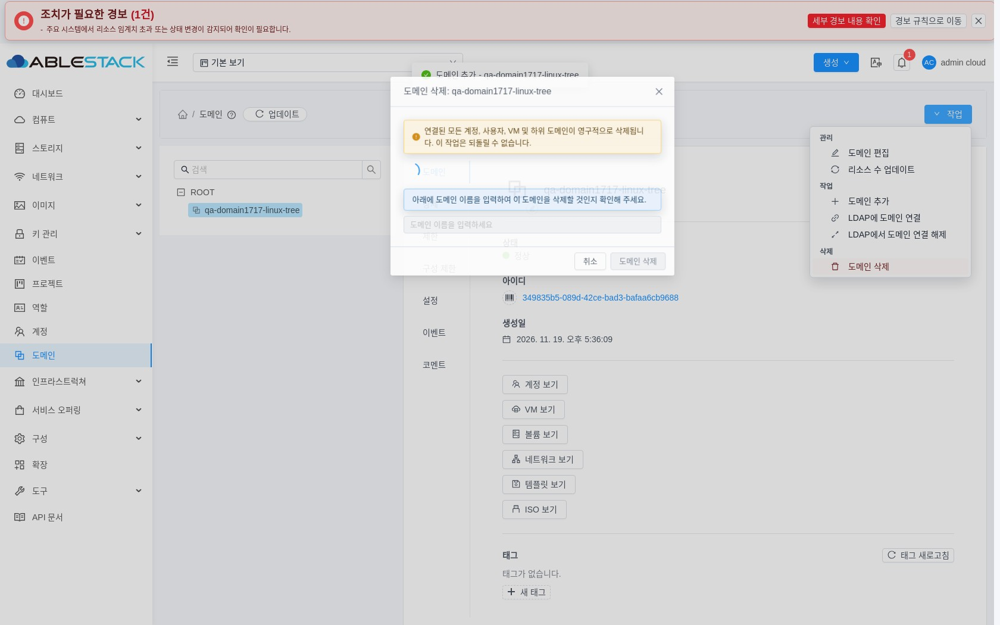
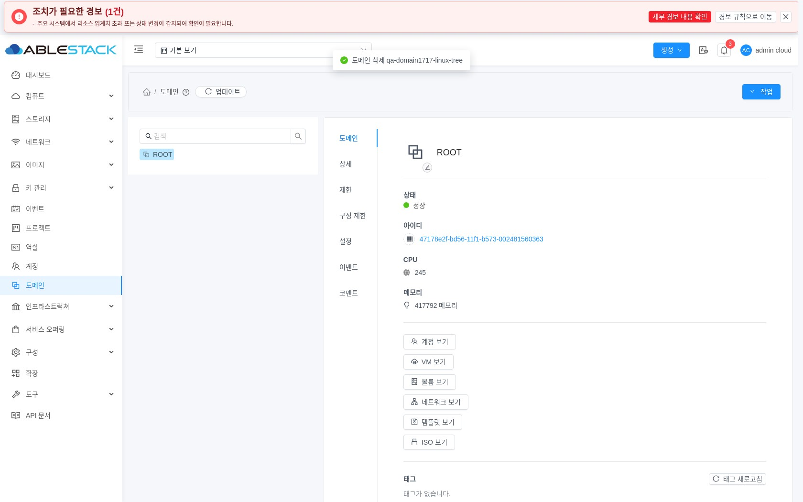
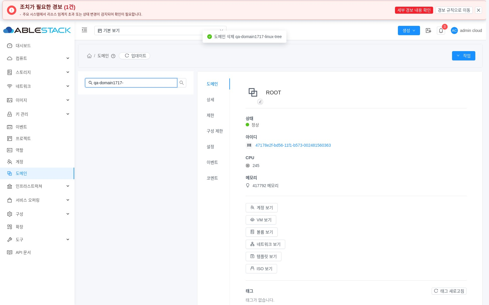

<!--
Licensed to the Apache Software Foundation (ASF) under one
or more contributor license agreements.  See the NOTICE file
distributed with this work for additional information
regarding copyright ownership.  The ASF licenses this file
to you under the Apache License, Version 2.0 (the
"License"); you may not use this file except in compliance
with the License.  You may obtain a copy of the License at

  http://www.apache.org/licenses/LICENSE-2.0

Unless required by applicable law or agreed to in writing,
software distributed under the License is distributed on an
"AS IS" BASIS, WITHOUT WARRANTIES OR CONDITIONS OF ANY
KIND, either express or implied.  See the License for the
specific language governing permissions and limitations
under the License.
-->

# 도메인 삭제 후 오래된 조회 오류 보정 — #1717

13번 실제 UI에서 재현·배포·수정 후 검증과 시험 자원 정리를 완료했습니다. 별도 브랜치 `dhslove/issue-1717-domain-delete-lifecycle`, 기준 `61d39d7cd2dd6b1caaa6634eef16e8757f1cc05a`, 제품 커밋 `42c472907d9714f2fbb07a69e81262e5851bef10`입니다.

## 재현과 원인

빈 시험 도메인을 UI로 생성하고 직접 상세에서 삭제했습니다. DOMAIN.DELETE 완료 감사 뒤 대시보드로 이동하면서 `Domain id=12 doesn't exist` 알림이 남았습니다. 같은 삭제 UUID의 `listDomains` 요청 두 건이 삭제 후431로 실패했습니다. [수신 기록](before-delete-requests.json)은 명령·대상·상태만 보존합니다.

삭제 성공 콜백이 router.replace 완료 전에 상세를 다시 조회했고, 이전 선택 상태·닫힌 영향 대화상자·트리의 늦은 응답을 무효화하지 않았습니다. 화면 이동을 기다려 ROOT를 한 번 조회하고, 이전 조회를 취소/무효화하며 선택 상태와 이벤트 리스너를 정리했습니다.

## 구현

- `DomainView.vue`: 이동 완료 후 ROOT 재조회, 이전 선택 초기화, 상세 조회 수명 검사와 중복 삭제 제출 차단. 실제 서버 실패는 현재 대화상자에 유지합니다.
- `DomainDeleteConfirm.vue`: 영향 확인 완료 뒤 삭제 허용, 조회 실패/재시도, 닫힘·대상 변경 시 취소와 늦은 응답 폐기. 삭제 진행 중에는 닫기/재제출을 차단합니다.
- `TreeView.vue`: 도메인 상세 조회를 컴포넌트 수명에 맞추고 지연된 조회와 종료된 아이콘 리스너를 정리합니다.

## 실제13번 UI 결과

재현은 Windows Chrome의 실제 화면입니다. Windows 제어가 `GetCursorPos 0x80070005`로 실패해 수정 후 회귀는 WSL의 기존 Linux Chromium130.0.6723.31에서 같은13번 Mold 웹 UI로 실행했습니다. 모든 생성·삭제·검색은 렌더링된 UI 컨트롤을 사용했습니다. 로그인 값·세션·요청 본문은 기록하지 않았습니다.

| UI 검증 | 최종 결과 |
| --- | --- |
| 배포본 로딩 | 실제 app.39167b5e.js 로딩 확인 |
| 직접 상세 삭제 | ROOT 복귀, ROOT 재조회1건, 삭제된 ID 재조회0건, 잘못된 오류 없음 |
| 다른 탭의 오래된 삭제 양식 | 실제 서버 작업 실패를 대화상자에 유지, 임의 화면 이동 없음 |
| 영향 조회 중 취소 | 실제 UI 계정 조회를 보류한 로딩 상태에서 취소, 요청 중단1건·늦은 오류 알림 없음 |
| 취소 후 재열기 | 영향 재조회와 이름 확인 뒤 삭제 가능 |
| 트리에서 삭제 | ROOT 복귀, 삭제된 ID 재조회0건, 잘못된 오류 없음 |
| 시험 자원 정리 | 재현1개·회귀 반복4개, 총5개 시험 도메인 UI 삭제·접두어 검색0건·원래 ROOT 보존 |

최종 실행의 실제 API 관측은105건, 브라우저 page error는0입니다. 의도한 서버 삭제 실패는 작업 결과로 따로 확인했습니다. [UI 결과](ui-gates.json), [요청 메타데이터](ui-requests.json), [자원 원장](resource-ledger.json)에 기록했습니다. 회귀 반복을 별도 기능 수나 테스트 수로 합산하지 않습니다.

## 빌드·제한 배포와 보존

검증된 운영 입력1120개를 대조해 제품3개 소스만 교체했습니다. 기존 운영/VNF 입력 차이는 유지했습니다. Vue CLI 생산 빌드828.9초/PASS입니다. [빌드 입력 요약](build-input-summary.json), [빌드 결과](ui-build-result.json).

13번에는 정적5개만 반영했습니다. 기존7221개 파일과 보호 설정(config.json·WEB-INF/web.xml·color.less)을 보존했고 최종7226개 파일의 전체 기대 해시가 일치합니다. index SHA-256은 `eaf3bca66efcd4d3f2b2bed0870189bd83e71b26a53ce89b9839596041a0d5ae`입니다.

관리 서비스 PID2860414와 JAR SHA-256 `55f802d2b22c9d4d471644c6157781cc2604e27d4ba0d7b055e4a934bb1d6171`이 같습니다. Backend/DB/Host Agent 변경·재시작은 없습니다. rollback 백업은 `/var/tmp/domain1717-backup-q9ui5bor`입니다. [배포 결과](deployment-result.json), [최종 정적 확인](static-final-verification.json).

시험 계정·VM은 생성하지 않았습니다. 시험 도메인5개는 모두 UI에서 삭제했고 원래 ROOT UUID `47178e2f-bd56-11f1-b573-002481560363`를 보존했습니다. 사진은 [해시 원장](image-manifest.json)의 원본 바이트입니다.

## 검사와 CI 분리

최종 제품 커밋의 지연 이동·상세/영향/트리 수명·실제 실패·중복 제출 집중16 tests가 정상 종료했습니다. ESLint4개 경로와 적용 훅25개 PASS/skip입니다. [단위 검사](unit-result.json), [소스 범위 훅](source-hooks.json).

전체 저장소 CI와 기능 검증은 구분합니다. #926·#1044는 별도 OPEN으로 유지하며 전체 CI green을 주장하지 않습니다. PR의 전체 CI 상태는 PR에서 별도로 추적합니다.
