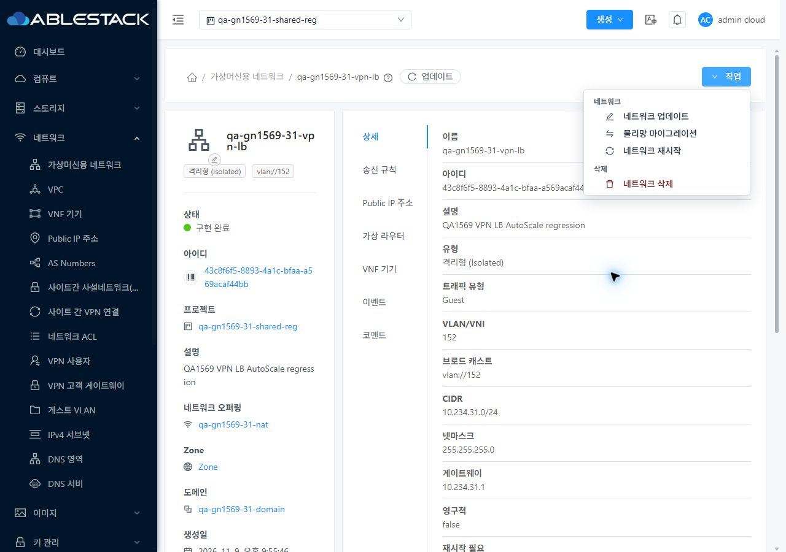
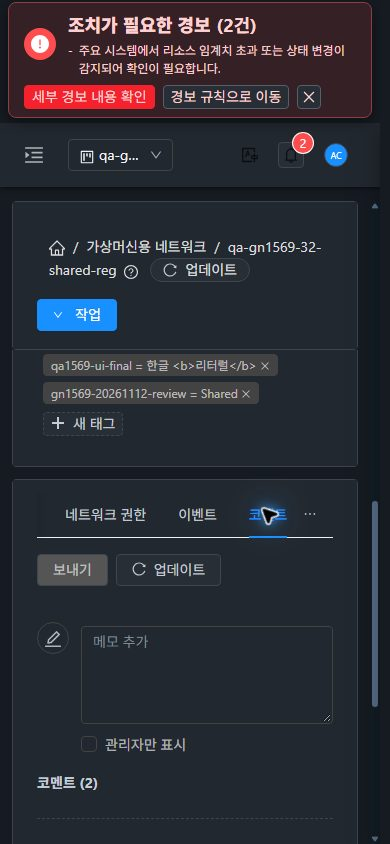

<!--
Licensed to the Apache Software Foundation (ASF) under one
or more contributor license agreements.  See the NOTICE file
distributed with this work for additional information
regarding copyright ownership.  The ASF licenses this file
to you under the Apache License, Version 2.0 (the
"License"); you may not use this file except in compliance
with the License.  You may obtain a copy of the License at

  http://www.apache.org/licenses/LICENSE-2.0

Unless required by applicable law or agreed to in writing,
software distributed under the License is distributed on an
"AS IS" BASIS, WITHOUT WARRANTIES OR CONDITIONS OF ANY
KIND, either express or implied.  See the License for the
specific language governing permissions and limitations
under the License.
 -->

# 네트워크 Epic #1554 병합·종료 근거

2026-11-12. 사용자 지시에 따라 준비된 기능 검증을 종료 범위로 확정하고 미구성 조건과 독립 P3 UI를 분리했다. 최종 PR 병합 커밋·이슈 종료 시각·원격/Windows/WSL ref 일치는 [PR #1577](https://github.com/ablecloud-team/ablestack-cloud/pull/1577)의 최종 보고를 기준으로 한다. 이 문서는 병합 대상으로 제출한 결과물이다.

- [통합·검증 및 종료 범위](merge-validation.ko.md)
- [자원 정리·실제 통신 결과](cleanup.ko.md)
- [남겨둔 확인용 최신 회귀 자원](retained-resources.ko.md)

독립 후속 [#1636](https://github.com/ablecloud-team/ablestack-cloud/issues/1636)은 미구성 조건의 준비 후 검증을 관리하며 제품 오류가 아니다. [#1634](https://github.com/ablecloud-team/ablestack-cloud/issues/1634)·[#1635](https://github.com/ablecloud-team/ablestack-cloud/issues/1635)는 중요 결함이 아닌 P3 UI 후속이다. [#1586](https://github.com/ablecloud-team/ablestack-cloud/issues/1586)은 별도 자원 정리 결함이다. 모두 네트워크 Epic 필수 하위·종료 차단 관계에서 분리했다.

이번 작업에서 새 화면 기능을 추가하지 않았다. UI 병합 충돌은 PSK 마스킹, 네트워크 표준 toolbar·breadcrumb·공통 content scroll, 프로젝트 범위 및 SharedFS 표시를 함께 보존했다. 기존 배포본의 VM 기준 대조·역할·프로젝트 왕복·반응형·즉시 테마·다크모드 근거는 [191개 캡처](../guest-network-1569-role-conditional-20261112/capture-matrix.ko.md)와 [직전 통합 회귀](../guest-network-1569-role-conditional-20261112/README.ko.md)에 있다. 새 병합 결과를 브라우저에서 재검증·재배포했다는 의미는 아니다.

