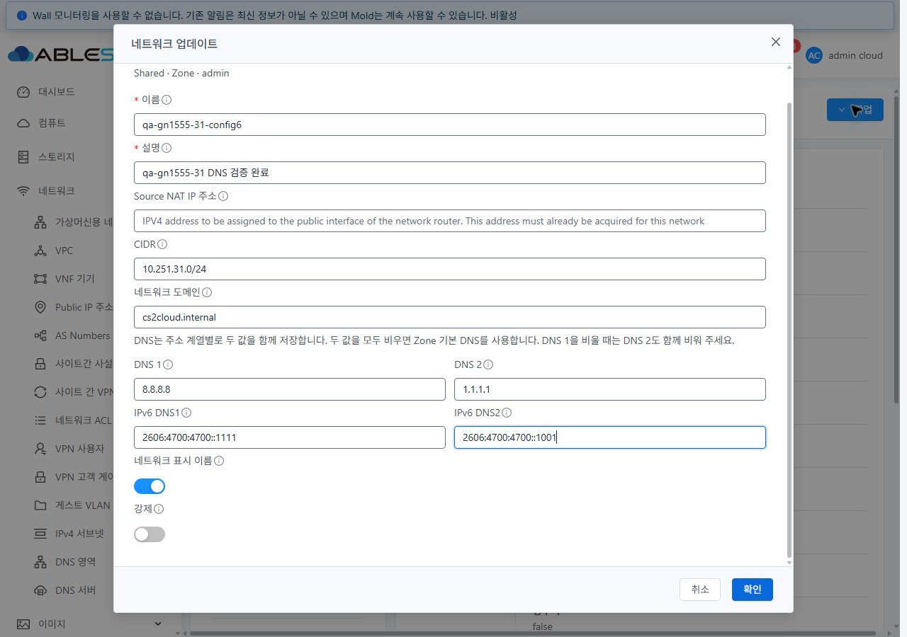
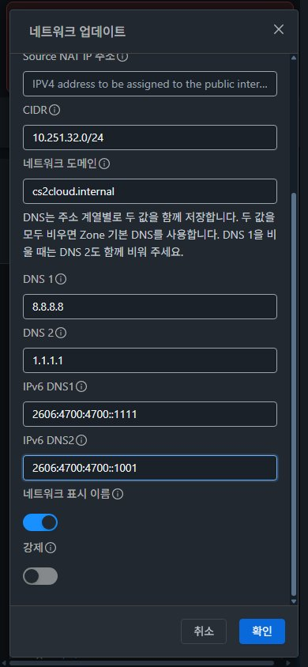

<!--
Licensed to the Apache Software Foundation (ASF) under one
or more contributor license agreements.  See the NOTICE file
distributed with this work for additional information
regarding copyright ownership.  The ASF licenses this file
to you under the Apache License, Version 2.0 (the
"License"); you may not use this file except in compliance
with the License.  You may obtain a copy of the License at

  http://www.apache.org/licenses/LICENSE-2.0

Unless required by applicable law or agreed to in writing,
software distributed under the License is distributed on an
"AS IS" BASIS, WITHOUT WARRANTIES OR CONDITIONS OF ANY
KIND, either express or implied.  See the License for the
specific language governing permissions and limitations
under the License.
 -->

# 가상머신용 네트워크 DNS 수정 검증 — #1555

2026-11-03 · [Epic #1554](https://github.com/ablecloud-team/ablestack-cloud/issues/1554) · [이슈 #1555](https://github.com/ablecloud-team/ablestack-cloud/issues/1555) · [Epic Draft PR #1577](https://github.com/ablecloud-team/ablestack-cloud/pull/1577)

DNS2만 수정하면 DNS1이 요청에서 빠져 실패하던 문제를 수정하고 31(GFS2)·32(Glue RBD)에 반영했다. 주소 계열별 DNS 쌍, 빈 값 초기화, 지원 조건, 최종 결과 대조 및 실패 복구를 실제 UI로 검증했다. Epic은 계속 진행하며 다음 구현 대상은 **#1559**다.

배포 소스: `af4fdf26fce257fa6e2e7b5f33e205c2d7ce68f6` · 브랜치: `dhslove/epic-1554-guest-networks`

## 변경 동작과 설계

- IPv4 `dns1/dns2`, IPv6 `ip6dns1/ip6dns2`를 별도 변경 단위로 취급한다. 한 값만 바꾸면 편집 시작 시점의 짝 값을 함께 전송한다. 건드리지 않은 주소 계열은 생략한다.
- 일반 필드 정리 전에 원본 폼을 읽어 `undefined`와 명시적 빈 문자열을 구분한다. DNS2만 비우면 DNS1을 유지하고 DNS2를 제거한다. 두 값을 비우면 Zone 기본값으로 돌아간다.
- Dns 서비스가 있는 Isolated·Shared에서 지원하는 주소 계열만 표시·전송한다. 일반 L2·VPC tier에는 DNS 수정 입력이 없고, IPv4 전용 Isolated에는 IPv6 DNS 입력이 없다.
- job 접수 후 성공 상태와 최종 네트워크 DNS 값을 대조한다. 초기화는 새로 읽은 Zone DNS 쌍과 비교한다. IPv6의 축약·확장 표기는 같은 주소로 비교한다.
- 서버 거부·작업 실패·조회 실패 시 입력과 오류를 유지한다. 결과 조회 실패는 작업 ID를 보존하고 확인 버튼을 막는다. 재시도는 같은 작업을 조회하며 저장 POST를 추가하지 않는다.

서버 API·라우터 DNS 엔진의 동작 계약은 유지했다. 소스 변경은 UI 컴포넌트, DNS 유틸리티, 한·영 문구 및 집중 테스트 5개 파일이다.

## 변경한 UI와 가상머신 표준 반영

| UI 영역 | 반영 내용과 확인 결과 |
|---|---|
| 네트워크 업데이트 대화상자 DNS 영역 | 주소 계열별 쌍 저장·Zone 기본값 복귀 안내를 추가했다. `--ui-text-secondary`를 사용해 라이트·다크 전환을 즉시 반영한다. |
| IPv4·IPv6 DNS 입력 | 가상머신 메뉴와 같은 세로 라벨·32px 입력·12px 열 간격을 사용한다. 데스크톱은 계열별 2열, 모바일은 1열이다. |
| 대화상자·오류 표시 | 공통 `MoldDialog lg`의 960px 폭, 초기 포커스, 본문 스크롤·고정 푸터를 재사용한다. 오류 발생 시 오류 영역이 보이도록 스크롤하며 입력을 보존한다. |
| 오퍼링 선택 영역 | 기존 #1556의 드롭다운 우측 재조회 아이콘·툴팁·접근성 이름을 유지해 최종 화면을 확인했다. |
| 목록·상세·탭·breadcrumb·관련 VM | 다크 상태에서 목록 → 상세 → 가상 라우터 → 관련 VM → NIC → 네트워크로 이동했다. 라이트 복귀 후 최신 DNS·설명 입력값도 확인했다. |

31·32 × 1280×900 / 768×1024 / 390×844 × light/dark **12조건**에서 대화상자 본문 가로 넘침 0, 푸터 화면 내 유지, JPEG 실제 크기 일치를 확인했다. 도움말 최소 명암비는 **7.56:1**, 입력 문자열은 **14.56:1**이었다. 테마 전환은 페이지 재로딩 없이 확인했다. 좌표·색상·이미지 해시는 [시각 검증](evidence/visual-checks.json), [원본 측정](evidence/visual-matrix.json), [이미지 무결성](evidence/image-integrity.json)에 있다.

## 실제 UI·API 검증

기존 UI는 두 클러스터에서 DNS2만 전송하여 `Second IPv4 DNS can be specified only with the first IPv4 DNS` 작업 실패를 재현했다. 수정 UI는 DNS1을 함께 전송하여 성공했다.

| 시나리오 | 결과와 증적 |
|---|---|
| Isolated DNS2 추가·수정, DNS1 단독 수정 | 31·32 실제 UI 요청·job 성공·최종 DNS·모달 종료 확인. IPv6 인자 없음. |
| 두 주소 계열의 DNS2 추가·수정, DNS1 단독 수정, 동시 변경 | Shared IPv4 및 IPv4+IPv6 망에서 계열별 요청 쌍과 최종 조회 일치. |
| DNS2만 삭제 | 31·32에서 DNS1 유지, 두 계열 DNS2 제거 확인. |
| DNS1만 삭제하면서 DNS2 유지 | IPv4/IPv6 서버 규칙에 따른 job 실패 3건, 입력·구체적 오류 유지. IPv4 실패 뒤 같은 폼에서 수정·재시도 성공. |
| DNS 쌍 초기화 | 31·32에서 빈 문자열을 보존해 전송. 최종 IPv4 DNS1은 Zone의 8.8.8.8, DNS2 및 IPv6 DNS는 현재 Zone 기본값대로 비어 있음. |
| 무변경 저장·설명 수정 | 양쪽 무변경 저장은 DNS 인자 0개. 설명만 수정한 요청도 DNS 인자 0개이며 DNS 보존. |
| HTTP 요청 거부 | 32에서 서버 전송 전 합성 500 응답 1건. 입력 유지 후 같은 폼의 실제 재시도 성공. |
| 최종 조회 실패·재조회 | 31·32 실제 저장 성공 후 최종 GET에만 합성 500을 주입. 확인 버튼 비활성화·입력/작업 ID 유지. 재시도 후 종료, 각 흐름의 POST 1건·고유 job 1개. |
| L2·VPC tier | 양쪽 폼의 DNS 입력 0개. L2 설명 저장에도 DNS 인자 없음. 기존 운영 VPC tier는 조회·취소만 수행. |
| 화면 이동·최종 정리 | 다크 테마의 네트워크↔VM NIC 경로, 라이트 복귀, 최종 UI 검색 `qa-gn1555-` 0건 확인. |

[저장 사례 30건](evidence/ui-save-cases.json)은 정상 job 27건과 예상 거부 3건이다. 여기에 [31 최종 조회 실패](evidence/31-final-read-failure.json)·[32 최종 조회 실패](evidence/32-final-read-failure.json)와 [31 재조회](evidence/31-final-read-retry.json)·[32 재조회](evidence/32-final-read-retry.json)를 별도로 기록했다. 합성 오류와 실제 서버 결과는 구분했다.

조회 오류 주입 중 32의 늦은 부모 화면 GET 한 건이 일시 정지돼 이전 값이 보였던 진단 사례가 있었다. 해당 요청을 정상 진행시킨 뒤 최신 값으로 재진입했고, 이후 초기화·무변경 저장·최종 UI를 검증했다. 오류 주입 해제 시 남은 요청도 처리하도록 검증 도구를 보완했다.

## 실제 서비스 확인과 검증 한계

- **Isolated:** 양쪽 기존 전용 VM의 NIC UUID·IPv4·MAC을 유지했다. DNS 변경 전·후 `getent ahostsv4 example.com`과 게이트웨이 ping이 성공했다. 라우터 DNS/DHCP 설정도 변경값과 최종 Zone 복귀값을 확인했다. [31 결과](evidence/31-runtime-network.json), [32 결과](evidence/32-runtime-network.json).
- **Shared:** 양쪽 VM의 초기 DHCP DNS와 라우터 통신, 변경 후 라우터의 IPv4·IPv6 DNS/DHCP 설정 및 최종 API/UI 값을 확인했다. 전용 VLAN에는 외부 게이트웨이·호스트 간 trunk가 구성되지 않아 외부 DNS 조회는 실패했다. DNS 변경 중 라우터 재구성에 따라 테스트 VM을 같은 호스트로 옮긴 경우도 기록했다.
- Shared VM 재부팅 후 SSH 호스트 키가 바뀌었다. 31번에서 신뢰된 호스트 경로를 통해 QGA로 공개 키를 확인하려 했으나 `guest-file-open`이 차단됐다. 양쪽 최종 게스트 SSH/DNS 재확인은 미검증으로 남겼고 검증되지 않은 키로 접속하지 않았다.
- 32 최초 VLAN 4032는 `brens1f0np0-4032`가 Linux 인터페이스 이름 길이를 넘어서 라우터 배치가 실패했다. 전용 망을 VLAN 632로 재생성해 UI 검증을 이어갔으며 호스트 네트워크 설정은 변경하지 않았다.
- IPv6 외부 패킷·Routed·no-SourceNat·외부 제공자·전체 권한/탭 조합은 이번 DNS 편집 수정의 전체 통신 PASS로 확대하지 않는다. [#1572](https://github.com/ablecloud-team/ablestack-cloud/issues/1572)·[#1574](https://github.com/ablecloud-team/ablestack-cloud/issues/1574)·[#1576](https://github.com/ablecloud-team/ablestack-cloud/issues/1576)의 통합 검증 범위로 유지한다.

## 빌드·배포·정리

- WSL ext4, Node 20.20.2에서 변경 파일 lint, DNS 31개 + 오퍼링 회귀 21개 = **2 suites / 52 tests**, 로컬 UI production build 통과. Cloud Java 변경·전체 Cloud 빌드·GitHub Actions 수동 빌드 실행 없음.
- 두 클러스터 정적 파일 **648개 / 29,548,909 bytes**의 전체 해시 일치. 최종 index SHA256: `cbd6850be93741dc68548e6f00f65bb906d44d89a5bbe079e76d40132d5c6269`.
- WEB-INF·META-INF·운영 config·모니터링 이미지·관리 PID 보존, `/client/` HTTP 200. DNS 변경 표시와 기존 FTCTL의 `blockingLoadingState`·`fetchSyncProgress`·`extractJobId` 표시 확인. [31 배포](evidence/31-deployment.json), [32 배포](evidence/32-deployment.json), [31 최종 런타임](evidence/31-runtime-ui-final.json), [32 최종 런타임](evidence/32-runtime-ui-final.json).
- 전용 접두사의 네트워크·VM·라우터·NIC·볼륨 활성 DB 잔여물 **각 0**. GFS2 18개·RBD 18개 루트 볼륨과 관련 도메인의 부재 확인. 기존 네트워크/오퍼링/VM/라우터/Public IP/IP 범위/Zone DNS/SSH 키 목록 및 핵심 설정 일치. [31 정리](evidence/31-cleanup-db-storage.json), [32 정리](evidence/32-cleanup-db-storage.json), [31 보존](evidence/31-cleanup-result.json), [32 보존](evidence/32-cleanup-result.json).
- 최초 배치 실패 라우터 `r-314-VM`이 RBD 커널 매핑 2곳과 Destroy 볼륨 1개를 남겼다. VM 제거·활성 NIC 0·도메인 부재·마운트/사용 프로세스 없음 확인 후 해당 매핑만 해제했고, Cloud `deleteVolume` API 성공 및 최종 잔여물 0을 확인했다. [정리 근거](evidence/32-orphan-rbd-cleanup.json). 실패 배치 후 정리 회귀는 [#1568](https://github.com/ablecloud-team/ablestack-cloud/issues/1568)에 인계한다.
- 임시 개인 키·라우터 known-hosts·원격 tmpfs 스테이징 삭제. 배포 백업은 WSL ext4에 보존. 기존 FTCTL 작업트리의 HEAD·staged/unstaged diff 해시 일치. [작업트리 보존](evidence/protected-worktree.json).

자동 PR 검사에서는 소스 커밋 기준 merge-conflict 검사는 성공했으나, 저장소 전체 pre-commit과 License Check는 실패했다. License Check는 기존과 같은 미승인 **3,494건**이며 pre-commit에는 기존 PNG·라이선스 삽입·줄 끝·철자·Python·Markdown 등의 오류가 있다. 로컬 집중 검증 및 실환경 결과와 전체 저장소 자동 검사 상태를 구분한다.

## 캡처와 후속 순서

총 **25개 캡처**를 [screenshots](screenshots)에 보관했다. [31 기존 실패](screenshots/31-before-error.jpg), [32 기존 실패](screenshots/32-before-error.jpg), [모바일 작업 오류](screenshots/31-mobile-job-error.jpg), [최종 조회 오류](screenshots/31-final-read-error.jpg), [HTTP 거부](screenshots/32-http-error.jpg), [VM NIC 연계](screenshots/32-navigation-vm-nic-dark.jpg), [정리 후 0건](screenshots/32-cleanup-ui-empty.jpg)을 함께 확인할 수 있다.

Epic 완료 범위는 **#1555·#1556, 2/22**다. 다음 구현은 **#1559 — 네트워크 일괄 재시작의 대상 제어와 Live Patch 인자 전달 복원**이며, 이후 #1558 → #1561 → #1562 순서를 따른다. Epic 브랜치와 Draft PR #1577에 후속 구현을 누적한다.
