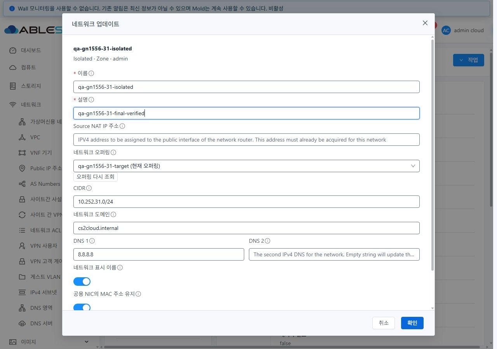
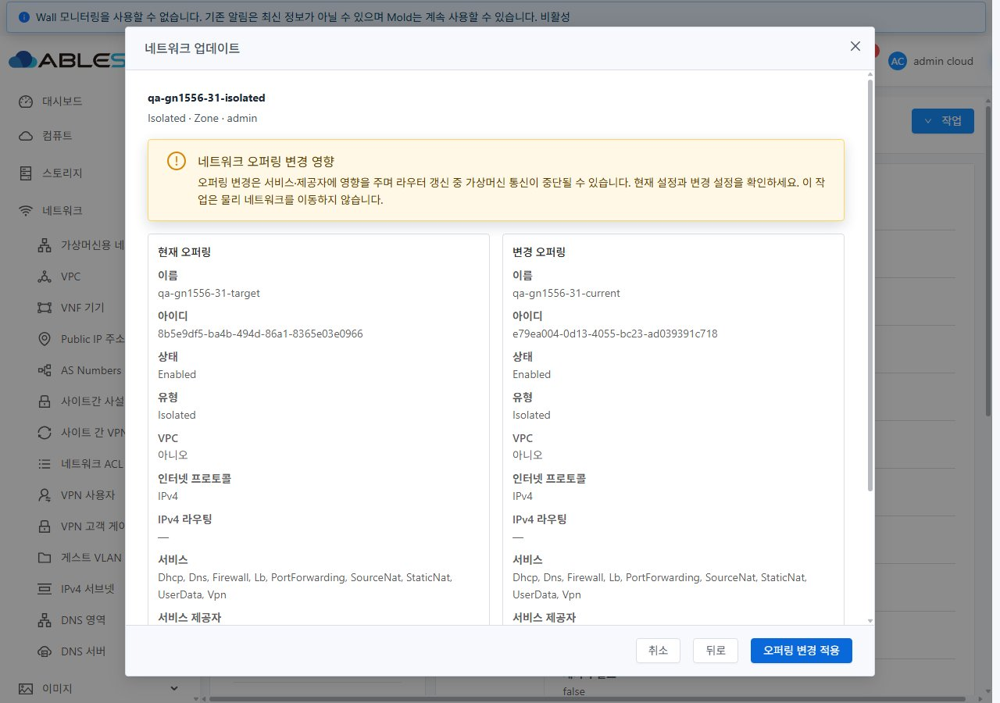
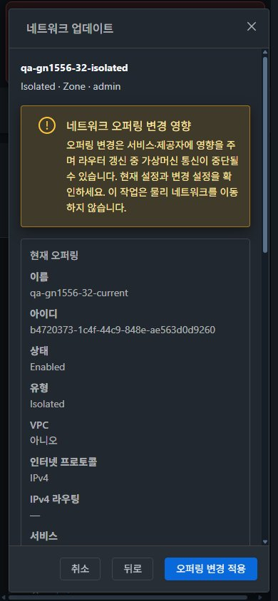
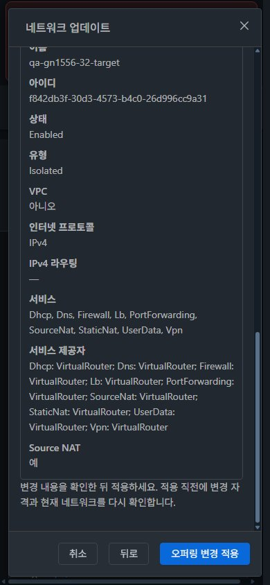

<!--
Licensed to the Apache Software Foundation (ASF) under one
or more contributor license agreements.  See the NOTICE file
distributed with this work for additional information
regarding copyright ownership.  The ASF licenses this file
to you under the Apache License, Version 2.0 (the
"License"); you may not use this file except in compliance
with the License.  You may obtain a copy of the License at

  http://www.apache.org/licenses/LICENSE-2.0

Unless required by applicable law or agreed to in writing,
software distributed under the License is distributed on an
"AS IS" BASIS, WITHOUT WARRANTIES OR CONDITIONS OF ANY
KIND, either express or implied.  See the License for the
specific language governing permissions and limitations
under the License.
 -->

# #1556 오퍼링 변경 후보·영향 안내 구현 및 31·32 UI 검증

> 후속 UI 보완: 오퍼링 재조회를 드롭다운 우측 아이콘으로 변경해 31·32에 반영했다. [최신 배치·캡처·검증 결과](../guest-network-1556-icon-20261103/README.ko.md). 아래 캡처는 최초 완료 시점의 기록이다.

검증일: 2026-11-03 · Epic [#1554](https://github.com/ablecloud-team/ablestack-cloud/issues/1554) · Epic PR [#1577](https://github.com/ablecloud-team/ablestack-cloud/pull/1577)

## 결과와 구현 범위

`네트워크 > 가상머신용 네트워크 > 상세 > 작업 > 네트워크 업데이트`를 개선했다. 서버의 네트워크별 변경 후보를 사용하고 현재 오퍼링을 별도로 유지한다. 사용자는 변경 내용을 확인한 뒤 적용하며, 접수된 작업의 성공과 최종 네트워크 값을 확인한 후 대화상자가 닫힌다. 31(GFS2)·32(Glue/Ceph RBD)에 동일한 최종 정적 UI를 반영하고 실제 UI 오퍼링 전환을 확인했다.

- 기준 커밋: `413d1459682b6f4dea6c90773510b8342dba1ec2` (`ablestack-europa`).
- 최종 실행 소스: `a15158f5a044672a8b99e248842ed5bf662f4c5a`.
- Epic 브랜치: `dhslove/epic-1554-guest-networks`. PR은 나머지 Epic 작업을 누적하는 Draft로 유지한다.
- 이번 완료는 #1556의 수정 경로다. #1555 DNS 쌍, #1557 no-SourceNat IP 범위 탭, #1562 제공자 구성, #1570~#1576의 유형별 전체 기능·조합은 각 이슈에서 계속 추적한다.

## 변경 UI와 가상머신 표준 반영

| 화면 | 실제 변경 | 표준 반영·확인 |
|---|---|---|
| 네트워크 업데이트 편집 대화상자 | 공통 `MoldDialog size=lg` 사용, 대상 이름/유형/Zone/소유자 표시, 현재 오퍼링·변경 후보 분리, 재조회/오류 안내 | 가상머신 메뉴의 공통 대화상자·라벨·초기 이름 필드 포커스·고정 푸터·본문 스크롤 재사용 |
| 오퍼링 변경 확인 대화상자 | 현재/대상 UUID·이름·상태·유형·VPC·IP 프로토콜·라우팅·서비스·제공자·SourceNat 비교, 영향 경고, 뒤로/적용 | 데스크톱 2열, 767px 이하 1열. 긴 UUID/제공자 줄바꿈. 가상머신 테마의 의미 기반 배경·글자·테두리 색상 사용 |
| 실패·후보 소멸·처리 중 | 입력 유지, 사라진 선택의 이름/UUID를 `변경 불가`로 표시, 중복 요청 차단, 작업 결과 재조회 | 전체 화면을 지우지 않고 대화상자 안에서 오류·상태·재시도 표시 |
| 목록·상세·탭·breadcrumb | 이번 이슈에서 별도 레이아웃 개편은 하지 않음 | 기존 공통 화면을 유지한 채 목록→상세→이벤트/상세 탭→수정→breadcrumb 복귀, 관련 VM→NIC 이동을 실제 조작해 확인 |
| 모바일·다크 테마 | 비교 레이아웃과 새 대화상자의 테마 대응 | 버튼이 화면 안에 유지되고 본문만 스크롤. 테마 변경은 새로고침 없이 반영, 종료 시 라이트 모드·화면 크기·캐시·장애 주입 설정 복구 |

편집 화면(31, 라이트):

확인 화면(31, 라이트):

모바일 다크 모드(32, 390×844), 본문 스크롤 전·후에도 푸터가 고정된다:

추가 캡처:

| 확인 항목 | 캡처 |
|---|---|
| 모바일 목록 / 상세·breadcrumb | [31 목록](screenshots/31-final-network-list-mobile-light.jpg), [31 상세](screenshots/31-final-network-detail-mobile-light.jpg), [32 다크 상세](screenshots/32-final-network-detail-mobile-dark.jpg) |
| 다크 편집 / 데스크톱 비교 / 라이트 모바일 비교 | [32 편집](screenshots/32-final-update-edit-desktop-dark.jpg), [32 비교](screenshots/32-final-review-desktop-dark.jpg), [31 모바일](screenshots/31-final-review-mobile-light.jpg) |
| 관련 가상머신 NIC 탭 | [31 VM NIC](screenshots/31-final-vm-nic.jpg), [32 VM NIC](screenshots/32-final-vm-nic.jpg) |
| 조회 실패 / 실제 동시 비활성화 | [32 조회 실패](screenshots/32-candidate-failure.jpg), [31 적용 차단](screenshots/31-concurrent-disable-blocked.jpg), [32 적용 차단](screenshots/32-concurrent-disable-blocked.jpg) |
| 늦은 응답 뒤 L2 화면 / 실제 후보 0 | [31 L2](screenshots/31-l2-late-response-safe.jpg), [32 L2](screenshots/32-l2-late-response-safe.jpg), [31 no-SourceNat](screenshots/31-nosnat-real-zero-candidates.jpg) |
| 정리 후 UI 검색 0건 | [31](screenshots/31-final-cleanup-ui.jpg), [32](screenshots/32-final-cleanup-ui.jpg) |

모든 게시 이미지는 JPEG 서명·실제 픽셀 크기와 기록한 viewport를 대조했다. [이미지 무결성 목록](evidence/image-integrity.json)에 크기와 SHA256을 기록했다. 초기의 잘못된 브라우저 미리보기 크기는 게시 증적에서 제외했다.

## API·UI·비동기 결과

| 검증 | 31 | 32 | 증거·판정 |
|---|---|---|---|
| 변경 후보 요청 | `networkid`, `zoneid`, Enabled, Isolated, `forvpc=false`, page/pagesize | 동일 | [최종 요청](evidence/final-candidate-requests.json). 현재값은 state 필터 없이 ID로 별도 조회 |
| API 후보 / 현재값 포함 UI | 6 / 7 | 5 / 6 | 전용 A/B 오퍼링 생성 상태 기준. 기존 광역 쿼리에 끼어 있던 no-SourceNat `DefaultIsolatedNetworkOffering` 제외 |
| Disabled 현재값 유지·설명 저장 | 성공 | 성공 | [31](evidence/31-independent-ui-job.json), [32](evidence/32-independent-ui-job.json). 독립 저장 POST에 `networkofferingid` 없음 |
| 후보 조회 500·재시도 | 입력 유지·변경 차단·복구 | 동일 | 브라우저의 해당 후보 XHR 응답만 합성. 서버 장애를 유발한 시험과 구분 |
| 후보 0·선택 후보 소멸 | UUID/이름 유지, 비교 숨김, 적용 차단, 현재값 유지 저장 | 동일 | 합성 0개 시험. 31 no-SourceNat은 실제 서버 후보 0개도 확인 |
| 확인 후 대상 오퍼링 동시 Disabled | 새 updateNetwork POST 0건 | 0건 | 전용 오퍼링을 실제 API로 비활성화한 대조. 이후 다시 활성화 |
| 비활성 대상의 직접 API 전환 | 서버 거부·기존 설정 유지 | 동일 | [31 거부](evidence/31-disabled-transition-rejection.json), [32 거부](evidence/32-disabled-transition-rejection.json), [보존 비교 31](evidence/31-rejection-preservation.json), [32](evidence/32-rejection-preservation.json) |
| 늦은 후보 응답 | 취소→breadcrumb→L2 수정 뒤 이전 Isolated 응답 해제, 오염 없음 | 동일 | 실제 XHR 응답을 지연. 소유자/프로젝트·A-B-A 및 자기 작업 완료 갱신 경합은 단위 회귀로 추가 확인 |
| 최종 배포 후 실제 UI 전환 | B→A, jobstatus=1 | A→B, jobstatus=1 | [31 요청/작업](evidence/31-final-offering-ui-job.json), [32](evidence/32-final-offering-ui-job.json). job 완료 후 재조회·모달 종료 확인 |
| VM·NIC 유지 | Running, 같은 NIC/IP/MAC | 동일 | [전후 비교](evidence/runtime-preservation.json), VM NIC 탭 캡처 |
| 실제 통신 | 라우터→VM 2/2 응답, 손실 0% | 동일 | [31 호스트](evidence/31-host-verified.json), [32 호스트](evidence/32-host-verified.json). 인터넷·DNS·모든 서비스 패킷 검증을 뜻하지 않음 |

31은 앞선 배포본에서도 A→B 전환을 한 번 실행했다([증거](evidence/31-offering-ui-job.json)). 최종 소스에서는 자신의 성공 후 전역 새로고침이 먼저 도착하더라도 정확한 대상 오퍼링·동일 네트워크/소유 범위인 경우 작업 추적과 최종 검증을 유지한다. 다른 네트워크·소유자·예상하지 않은 오퍼링으로 바뀌면 이전 작업이 새 화면을 닫지 않는다.

## Isolated·L2·Shared 적용표와 미검증 조합

| 유형/조합 | 생성 후보·현재값·변경 후보 분리 결과 | 실행 수준 |
|---|---|---|
| Isolated SourceNat | 생성 UI 31:8개 / 32:6개와 API UUID·표시명을 대조. 32의 NSX 전용 1개는 기존 생성 폼의 비-NSX Zone 필터로 제외. 수정은 위의 networkid 후보 계약 사용 | 양쪽 생성 후보 조회·현재값·실제 수정·VM NIC·ICMP |
| Isolated no-SourceNat | 31 전용 망 생성, 현재 UUID 유지·변경 후보 0 확인. 32는 `VpcVirtualRouter ... Firewall ... physical network id=200` 구성 오류로 생성 차단 | 31 읽기/생성, 32 환경 차단. [32 오류](evidence/32-create-nosnat.json), #1562 계속 추적 |
| VPC tier | 기존 망의 상세·조건부 탭·수정 폼을 읽기 전용 확인. `forvpc=true`와 각 networkid로 조회 | 양쪽 조회. 운영 VPC 전환 쓰기는 실행하지 않음 |
| L2 | 생성 후보 2개(UUID/이름 대조), 현재값 조회, 사후 오퍼링 변경 선택 UI 없음 | 양쪽 읽기. 서버 upgrade 계약이 Isolated로 제한됨 |
| Shared | 생성 후보 2개(UUID/이름 대조), 현재값 조회, 사후 오퍼링 변경 선택 UI 없음 | 양쪽 읽기. networkid 목록 API 결과 자체를 사후 변경 지원으로 해석하지 않음 |
| IPv6/DualStack·Routed·외부 제공자 | 현재 인벤토리에 DualStack/IP6 망·Routed 실행 구성이 없음. 프로토콜/라우팅/제공자 표시·후보 조건은 소스 검토 | 실환경 전환 미실행. #1574/#1576 및 유형별 #1570~#1572에서 지원 환경과 전체 탭/서비스 조합 검증 |

[생성 UI/API UUID 대조](evidence/creation-ui-api-mapping.json), [31 유형별 API](evidence/31-type-matrix-api.json), [32 유형별 API](evidence/32-type-matrix-api.json).

기존 상세·탭의 서비스 분기는 수정 전후 같은 오퍼링 서비스에서는 유지됐다. no-SourceNat 게스트 IP 범위 탭 누락(#1557), L2의 무관 L3 필드(#1571), 모든 조건부 탭·권한·제공자 조합(#1574~#1576)은 이번 후보 수정의 완료를 근거로 해결됐다고 판정하지 않는다.

## 스타일·반응형·빌드 검증

- 31·32 × 1280×900 / 768×1024 / 390×844 × light/dark = 12조건: 모달·푸터가 viewport 안에 있고 본문 수평 넘침 없음. [31 결과](evidence/31-responsive-results.json), [32 결과](evidence/32-responsive-results.json).
- 비교의 23개 텍스트 표본(보조 글자·현재/대상 값·경고·주요 버튼)의 최소 대비는 5.19:1. 알파 색상은 모달 배경과 합성했다. 이는 화면 전체 접근성 인증이 아닌 해당 표본 측정이다. [측정](evidence/readability-results.json).
- 위 12조건은 `b4ddb2b590f2fcd16017e7ffa298b1cd735962c5`에서 확인했다. 최종 `a15158f...`는 스타일 변경 없이 완료 갱신 경합만 보완했으며, 재배포 후 31 라이트/32 다크의 데스크톱·모바일, 본문 스크롤/푸터, 실제 전환·관련 VM 경로를 다시 확인했다.
- 테마 전환은 새로고침 없이 반영됐다(조작/상태 관찰 약 0.4~0.5초). 목록→상세·탭·breadcrumb 이동에서 이전 대화상자/선택이 되살아나지 않았다. 시간은 이 시험의 관찰값이며 성능 보장값은 아니다.
- WSL ext4에서 변경 Vue/유틸/테스트 lint 통과, 집중 회귀 **21/21 통과**. [lint](evidence/lint-summary.txt), [테스트](evidence/jest-focused-summary.txt).
- Node **20.20.2**, `NODE_OPTIONS="--openssl-legacy-provider --max-old-space-size=6144" npm run build` 로컬 UI 프로덕션 빌드 성공. [빌드](evidence/build-final-summary.txt). Browserslist 데이터 경고·기존 번들 크기 경고가 있었다. 기본 전체 소스 coverage 수집은 집중 테스트 결과 후 중단하고 `--coverage=false`로 21개 테스트의 정상 종료를 재확인했다.
- Java 변경·Maven 빌드·전체 Cloud 빌드·GitHub Actions 수동 실행은 없었다. 등록 CI 성공으로 이 결과를 대체하지 않는다.

## 배포·정리·보존

- 활성 경로 `/usr/share/cloudstack-management/webapp`에 정적 파일만 갱신. 양쪽 **648개 / 29,544,882바이트**, manifest 대비 해시 불일치 **0**.
- 최종 index SHA256: `140b04e15046637c959d1c631da59fcac581a60dc0c836cdeec78bd9f9bb941d`.
- `WEB-INF`/`META-INF` 파일 해시, config.json, cloud-image-templates.json, 대형 monitoring 이미지의 inode/크기/mtime, mold PID 보존. `/client/` HTTP **200**. JAR 교체나 관리 서비스 재시작 없음.
- [31 배포 영수증](evidence/31-deployment.json), [32 배포 영수증](evidence/32-deployment.json), [정적 manifest](evidence/manifest.json). 최초 배포 전과 최종 배포 전 백업은 WSL ext4 검증 작업 폴더에 보존했다.
- 전용 네트워크 **7개**, 사용자 VM **2개**, 복제 오퍼링 **4개** 및 자동 생성 라우터 정리. API 기준 기존 네트워크/오퍼링/VM/라우터/Public IP/VLAN range의 ID·주요 상태/설정에 변화 없음.

| 인벤토리 | 31 전/후 | 32 전/후 |
|---|---|---|
| 네트워크 | 22 / 22 | 9 / 9 |
| 오퍼링 | 24 / 24 | 15 / 15 |
| 사용자 VM | 121 / 121 | 55 / 55 |
| 라우터 | 12 / 12 | 3 / 3 |
| Public IP | 22 / 22 | 8 / 8 |
| VLAN 범위 | 2 / 2 | 2 / 2 |

[31 보존 비교](evidence/31-cleanup-result.json), [32 보존 비교](evidence/32-cleanup-result.json). 로컬 관리 DB에서 전용 네트워크·오퍼링·VM·사용자 볼륨·라우터·라우터 볼륨·게스트 NIC 활성 잔여물 **0**. GFS2 마운트를 확인한 상태에서 테스트 루트 파일 없음, Glue RBD `rbd info`는 해당 이미지 ENOENT, libvirt 도메인 없음. [31 DB/스토리지](evidence/31-cleanup-db-storage.json), [32](evidence/32-cleanup-db-storage.json).

기존 FTCTL 작업 폴더의 HEAD, 전체 staged/unstaged diff SHA256 및 수정 중이던 3개 파일 해시가 시작 전과 동일했다. 테스트 SSH·배포는 WSL에서 수행했고, 32.1의 로컬 known_hosts 불일치는 검증된 관리 서버 경유로 처리하여 로컬 신뢰 정보를 덮어쓰지 않았다. 오브젝트 스토리지는 사용하지 않았다.

## PR 자동 검사 상태

PR 자동 License Check는 증적 추가 전 소스 커밋(a15158f)에서도 미승인 라이선스 3,494건으로 실패했다([기존 실행](https://github.com/ablecloud-team/ablestack-cloud/actions/runs/41577045915)). 최초 증적 커밋에서는 새 보고서/요약문서 4개가 추가되어 3,498건이었다. 이 4개 문서에 저장소 표준 라이선스 헤더를 추가하고 증적의 줄 끝 형식을 정리했다. 전체 저장소의 기존 라이선스 오류는 이번 네트워크 UI 범위에서 수정하지 않는다. 자동 Lint의 최종 상태는 PR Checks와 구분해 확인하며, 로컬 집중 lint/21개 테스트/프로덕션 빌드와 실제 배포 검증 결과는 위에 별도로 기록했다.

## 다음 진행

다음 구현 대상은 **[#1555 DNS 2 단독 수정 실패 및 DNS 쌍 전송 계약 복원](https://github.com/ablecloud-team/ablestack-cloud/issues/1555)**이다. 이번 작업의 실패 입력 유지·비동기 추적을 재사용하되 IPv4/IPv6 DNS 쌍 구성·초기화·생략 의미를 별도로 구현한다. Epic의 나머지 21개 하위 이슈는 열린 상태로 유지한다.
