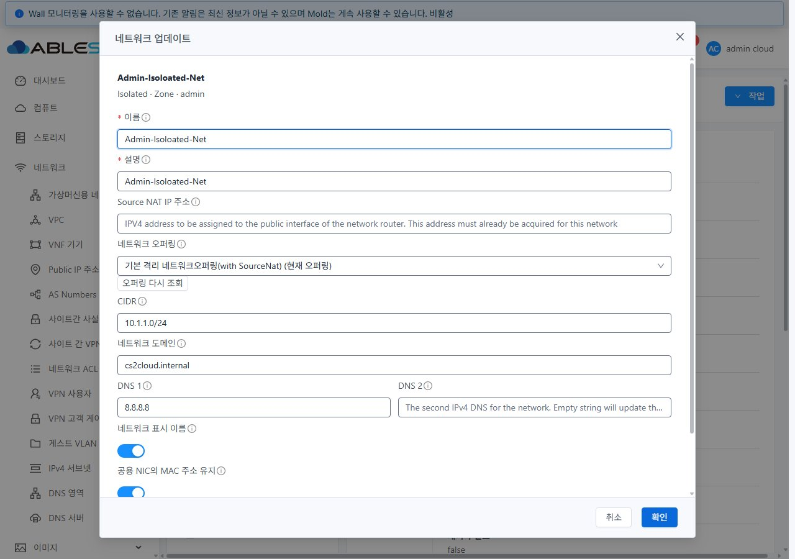
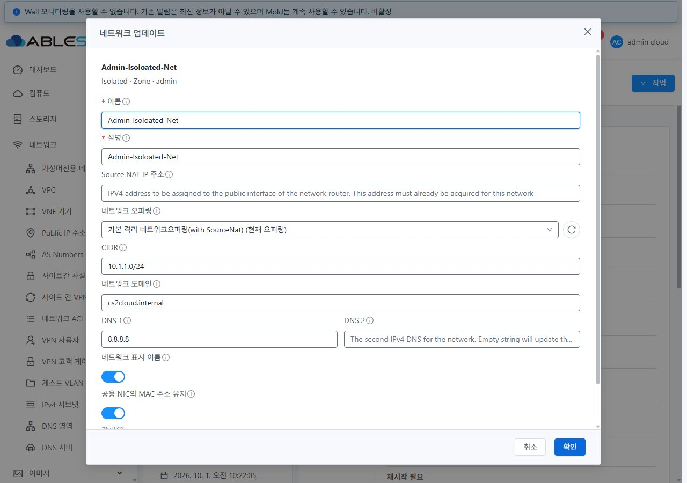
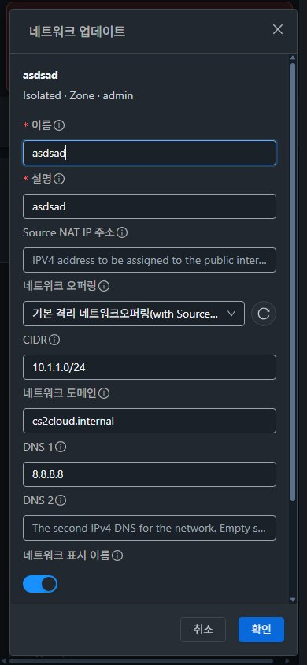

<!--
Licensed to the Apache Software Foundation (ASF) under one
or more contributor license agreements.  See the NOTICE file
distributed with this work for additional information
regarding copyright ownership.  The ASF licenses this file
to you under the Apache License, Version 2.0 (the
"License"); you may not use this file except in compliance
with the License.  You may obtain a copy of the License at

  http://www.apache.org/licenses/LICENSE-2.0

Unless required by applicable law or agreed to in writing,
software distributed under the License is distributed on an
"AS IS" BASIS, WITHOUT WARRANTIES OR CONDITIONS OF ANY
KIND, either express or implied.  See the License for the
specific language governing permissions and limitations
under the License.
 -->

# #1556 후속 UI 보완: 오퍼링 재조회 아이콘 우측 정렬

2026-11-03 · Epic #1554 · [Epic Draft PR #1577](https://github.com/ablecloud-team/ablestack-cloud/pull/1577)

## 변경 내용

`네트워크 > 가상머신용 네트워크 > 상세 > 작업 > 네트워크 업데이트`의 오퍼링 선택창 아래 텍스트 버튼을 없애고 **드롭다운 우측의 원형 업데이트 아이콘**으로 배치했다. 버튼의 툴팁과 접근성 이름은 `오퍼링 다시 조회`다. 선택창과 아이콘은 같은 줄에 있고 8px 간격을 유지한다.

- 가상머신 메뉴에서 사용하는 Ant Design `reload-outlined` 아이콘·기본 32px 컨트롤 높이·테마 색상을 재사용한다.
- 선택창은 남은 폭을 차지하고 긴 값은 기존 선택창 방식으로 표시한다. 모바일에서도 아이콘이 아래 줄로 내려가지 않는다.
- 조회 중에는 선택창·아이콘을 비활성화하고 로딩 아이콘을 표시한다. 기존 조회·실패 재시도·후보/현재값 보존 동작은 유지한다.
- 소스 커밋: `a504a61d4d81f7a93357e6fe9e29de8cf52f25aa`. 같은 Epic 브랜치 `dhslove/epic-1554-guest-networks`와 PR에 추가했다. #1556은 Closed, Epic은 진행 중이며 다음 구현 대상 #1555는 변동 없다.

## 실제 배포 UI 캡처

변경 전(31):

변경 후(31, 데스크톱 라이트):

변경 후(32, 모바일 다크):

[31 모바일 라이트](screenshots/31-after-light-390.jpg) · [32 데스크톱 라이트](screenshots/32-after-light-1280.jpg) · [31 조회 중](screenshots/31-refresh-pending.jpg) · [32 조회 중](screenshots/32-refresh-pending.jpg)

## 검증 결과

- 31·32 × 1280×900 / 768×1024 / 390×844 × light/dark **12조건 통과**. 드롭다운/버튼 높이 32px, 같은 y 좌표, 우측 간격 8px, 가로 넘침 없음, 버튼에 표시 문구 없음과 접근성 이름을 확인했다. [좌표/상태 결과](evidence/geometry-results.json).
- 양쪽에서 아이콘을 실제 클릭했다. 후보/현재 오퍼링 GET 2건이 각각 HTTP 200으로 완료되고 선택값과 입력값이 유지됐다. 실제 응답을 잠시 지연해 조회 중 중복 클릭 차단도 확인했다. 응답 내용은 조작하지 않았다. [31](evidence/31-refresh-proof.json), [32](evidence/32-refresh-proof.json).
- 기존 망은 읽기 전용으로 확인했고 `updateNetwork` POST는 0건이다. 네트워크 이름·설명·오퍼링·서비스·주소 설정 전후가 일치했다. [31](evidence/31-network-preservation.json), [32](evidence/32-network-preservation.json). 테스트 개체 생성·구성 변경은 없었다.
- 변경 lint 및 기존 오퍼링 회귀 **21/21 통과**, WSL ext4 로컬 UI 프로덕션 빌드 성공. [lint](evidence/icon-lint-summary.txt), [회귀](evidence/icon-jest-summary.txt), [빌드](evidence/icon-build-summary.txt). 전체 Cloud 빌드·Actions 수동 실행은 하지 않았다.
- 양쪽 활성 webapp 정적 파일의 manifest 해시 불일치 0, WEB-INF/운영 설정/관리 PID 보존, `/client/` HTTP 200. [31 배포](evidence/31-deployment.json), [32 배포](evidence/32-deployment.json).
- 모든 게시 JPEG의 실제 픽셀 크기를 viewport 기록과 비교했다. [이미지 SHA256](evidence/image-integrity.json). 테마·화면 크기·캐시/응답 지연 설정은 검증 후 복구했다. 기존 FTCTL 작업 폴더의 HEAD 및 전체 staged/unstaged diff 해시는 동일했다.

이번 검증은 재조회 아이콘의 배치·동작에 대한 후속 확인이다. 최초 기능 검증의 범위·미구성 조합·기존 전역 License Check 오류와 자동 CI의 상태는 [이전 보고서](../guest-network-1556-20261103/README.ko.md) 및 PR Checks와 구분한다.
