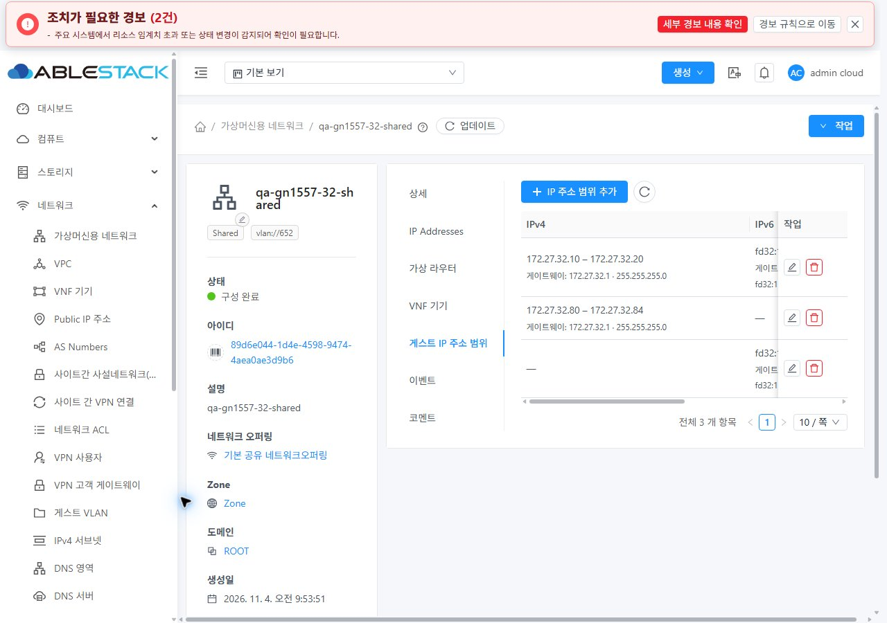
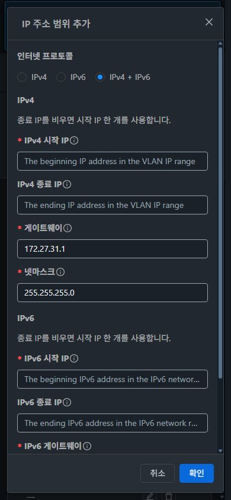

<!--
Licensed to the Apache Software Foundation (ASF) under one
or more contributor license agreements. See the NOTICE file
distributed with this work for additional information
regarding copyright ownership. The ASF licenses this file
to you under the Apache License, Version 2.0 (the
"License"); you may not use this file except in compliance
with the License. You may obtain a copy of the License at

  http://www.apache.org/licenses/LICENSE-2.0

Unless required by applicable law or agreed to in writing,
software distributed under the License is distributed on an
"AS IS" BASIS, WITHOUT WARRANTIES OR CONDITIONS OF ANY
KIND, either express or implied. See the License for the
specific language governing permissions and limitations
under the License.
-->

# #1557 게스트 IP 범위 탭 복원·CRUD 검증

2026-11-04 KST · [Epic #1554](https://github.com/ablecloud-team/ablestack-cloud/issues/1554) · [구현 #1557](https://github.com/ablecloud-team/ablestack-cloud/issues/1557) · [Epic Draft PR #1577](https://github.com/ablecloud-team/ablestack-cloud/pull/1577).

31 GFS2·32 Glue(Ceph) RBD에 반영하고 실제 UI로 검증했다. no-SourceNat Isolated의 숨겨진 범위 탭과 서버 생성 거부를 수정했으며, Shared IPv4·IPv6 전용·이중 주소의 범위 CRUD를 확인했다. **화면 96조건·원본 JPEG 100개**, 서버 집중 121건·UI 162건 통과다. 기존 #1562 시험 자원은 정리했고 최종 **네트워크 4개·VM 4대·오퍼링 2개·범위 11개를 사용자 검토용으로 유지**한다.

**32 Shared의 다른 서브넷은 구형 DB 컬럼 길이로 HTTP 530 거부된다. 이를 PASS로 세지 않으며 #1572에 인계한다.** 전체 역할·프로젝트, IPv6 게스트 전달/RA·패킷과 호스트 간 VLAN까지 완료했다는 뜻은 아니다.

## 변경한 UI와 가상머신 표준

| 화면 | 변경 및 표준 반영 |
|---|---|
| 네트워크 상세의 게스트 IP 주소 범위 탭 | Shared/no-SourceNat Isolated, specifyipranges, 서비스 정보, 목록 API 권한으로 표시한다. NAT Isolated·L2·VPC/routing 및 불명확한 서비스 정보는 제외한다. VM 공통 ResourceView/탭/URL·테마를 사용한다. |
| 탭 본문·목록 | **텍스트가 있는 주 버튼 → 우측 새로고침 아이콘 → 실패 안내 → 목록** 순서다. IPv4/IPv6 주소·게이트웨이·CIDR을 의미별로 표시하고 행 편집/삭제·페이지를 제공한다. 최초 실패와 빈 목록을 구별하며 갱신 실패 시 기존 행을 유지하고 쓰기를 잠근다. |
| 추가·수정 대화상자 | VM 공통 **MoldDialog lg 960px, 본문 스크롤·고정 푸터·포커스 가드·32px 공통 버튼**을 적용한다. 주소 계열 선택, IPv4/IPv6 구역과 세로 입력·12px 간격을 사용한다. 종료 주소 생략은 단일 주소다. API 지원에 따라 IPv6를 제공하고 현재 목록의 개별 서브넷을 기본값으로 사용한다. |
| 삭제 대화상자 | VM 공통 sm 480px 확인 창에 대상 망·범위와 경고를 표시한다. 사용 중 거부와 실패 이유를 창 안에 유지하며 삭제/결과 조회 중 중복 실행을 막는다. |
| 반응형·다크모드 | 1280×900·768×1024·390×844에서 표 내부 가로 스크롤과 세로 폼을 사용한다. 공통 테마 색상, 라벨 굵기·본문 줄바꿈·고정 푸터를 반영한다. 실제 페이지 스타일 설정으로 즉시 전환했다. |

실제 **컴퓨트 > 가상머신 목록·상세·볼륨/NIC 탭·기존 네트워크 연결 대화상자·breadcrumb·모바일/다크 테마**를 대조했다. 목록→상세→범위, 오퍼링 연결→복귀, VM 목록→NIC→네트워크, 탭 뒤로/앞으로 및 모바일 더보기 메뉴도 실행했다. VM 공통 화면의 스타일 자체를 변경한 작업은 아니다.

## 원인·서버/API 보완

- 배열의 잘못된 `.count === 0` 판정으로 no-SourceNat 탭이 숨겨졌다. 유형·서비스·지원·권한을 명시하는 공통 판정으로 교체했다.
- 서버 `createVlanIpRange`도 Shared만 허용했다. 독립 Isolated·명시적 범위·no-SourceNat·non-VPC/non-routed 조합에만 허용하고 기존 게이트웨이·서브넷을 유지한다. 새 VLAN·Isolated 다중 서브넷/라우팅 기능을 추가하지 않았다.
- IPv6 전용 범위에 IPv4 게이트웨이가 잘못 붙고 편집·겹침 검사·VM 배포의 시작 IPv4 조회가 null 오류를 냈다. 실제 IPv4 범위로 주소 계열을 판정하고 IPv6 전용 행은 IPv4 경로에서 제외한다. 신규 IPv6 행에는 불필요한 IPv4 필드를 저장하지 않는다.
- 한 범위를 삭제하면 같은 서브넷의 다른 범위가 남아 있어도 부모 CIDR/게이트웨이를 지웠다. 추가·수정·삭제 후 **남아 있는 Shared 범위로 양쪽 주소 계열의 정보를 맞추고, Isolated의 고정 L3 서브넷은 마지막 풀 삭제 후에도 보존**한다. 기존 누락 정보는 기존 범위가 단일 서브넷으로 명확한 경우에만 복구한다. 중간 검증에서 누락된 전용망 정보는 공식 범위 수정 API로 복구했다. 직접 DB 수정은 하지 않았다.
- 각 쓰기 전 망의 유형·owner/project·Zone·서비스와 최신 범위를 다시 읽는다. 자원/권한/프로젝트 변경·이전 응답·변경된 범위·중복 제출을 차단한다. 읽기와 생성/수정/삭제 API 권한을 각각 확인한다. 프로젝트는 명시적으로 바인딩하며 전역 선택 프로젝트가 다른 망에 주입되지 않게 한다.
- 저장 성공 뒤 서버 재조회로 ID·주소를 대조한다. 조회만 실패하면 입력·저장 상태를 유지하고 **결과 조회만 재시도**한다. 서버 거부는 입력을 유지한다. 대화상자 종료 시 부모의 busy 상태도 즉시 해제한다.

## 실제 실행 결과와 경계

| 검증 | 결과 |
|---|---|
| 최종 UI의 IPv4 CRUD | 31/32 × no-SourceNat Isolated/Shared 각 추가·수정·삭제 HTTP 200, 최종 재조회 일치. 삭제 후 재추가와 작업 버튼 복구도 확인했다. |
| 최종 UI의 Shared IPv6 전용·이중 주소 CRUD | 31/32 각 2계열 × 3작업 모두 HTTP 200. 신규 IPv6 전용 응답에 IPv4 시작 주소·게이트웨이·넷마스크가 없음을 확인했다. 기존 IPv4 값이 붙은 IPv6 행의 편집도 검증했다. |
| 다른 서브넷 | 31 Shared 실제 추가·수정·삭제 성공. 32 Shared는 HTTP 530·입력 유지·추가 범위 롤백을 확인했다. 32의 `networks.cidr/gateway`는 varchar(18/15), 31은 varchar(255/255)이며 IPv6 컬럼도 50 대 1024로 다르다. 기존 `schema-42040to42100.sql:593–596`과 32 실제 스키마의 불일치는 **#1572 후속**이다. 임의 ALTER는 하지 않았다. |
| 겹침·Isolated 서브넷 경계 | 양쪽 Isolated/Shared 겹침은 HTTP 431 거부·입력 유지. Isolated의 다른 서브넷도 HTTP 431로 거부했다. |
| 사용 주소 축소/삭제 | 새 `.30–.34` 범위의 `.31`을 임시 VM 4대가 실제 DHCP로 사용했다. 양쪽 두 유형 모두 축소 HTTP 431·삭제 거부, 입력·행·기존 VM 주소 유지. VM 제거 후 DB Free와 UI `할당 됨 → 가능`, 같은 범위 삭제 성공을 확인했다. |
| 실패·재시도 | 양쪽 합성 XHR 500에서 기존 목록 보존·쓰기 잠금·실제 재조회 복구. 실제 저장 후 최종 조회만 합성 실패시킨 경우 각 POST **1회**로 복구. 저장 직전 서비스 정보만 합성 누락시킨 경우 POST **0회**·입력 유지. 주입은 해제했다. |
| 목록 페이지 | 공식 API로 만든 단일 주소 fixture 10개씩을 이용해 10+2/10+1 행을 UI에서 대조했다. 2페이지 마지막 행을 삭제한 뒤 1페이지로 복귀했다. 이 페이지 fixture는 모두 정리했다. |
| 표시·직접 URL | 양쪽 기존 NAT Isolated/L2에 범위 탭이 없고 직접 URL은 상세로 정규화됐다. 서비스 누락·쓰기 API별 권한·프로젝트·VPC/routing·응답 역전은 실제 Root Admin UI 시험과 단위 시험의 경계를 구분한다. 전 역할 실환경 검증은 #1575다. |
| 화면·테마 | 2클러스터 × 2유형 × 2테마 × 3크기 × 목록/추가/수정/삭제 = **96조건 통과**, 문서/대화상자 본문 가로 넘침 0, 푸터 화면 내 유지. 고정 푸터와 다크모드 문구를 원본 캡처로 확인했다. |

검증용 VM의 API NIC, 실제 게스트 IPv4·DHCP lease, SSH와 라우터 ICMP 및 GFS2/Glue RBD 루트 경로를 범위 변경 전후에 대조했다. 최종 **4대 모두 주소 `.18`·NIC UUID·실행 상태가 유지되고 SSH·ICMP가 통과**했다. 시험 라우터만 해당 VM 호스트로 옮기고 필요한 시험 VM 재부팅 후 확인했다. 이 통신 결과는 **같은 호스트의 내부 경로**다. 외부 trunk와 운영 VM 배치는 변경하지 않았다.

Shared API NIC에는 IPv6 값이 있지만 게스트 주소 실측에서는 global IPv6가 확인되지 않았다. 범위 CRUD의 성공을 RA/DHCPv6·게스트 IPv6 패킷 성공으로 세지 않는다. 이 전달 경로와 32 다중 서브넷 스키마 정합성, 전체 Shared 조합은 **#1572**, 역할/project 전체는 **#1575**, 호스트 간/VPC·PVLAN·외부 제공자 통합은 해당 유형 이슈와 **#1569**에 남긴다.

[96조건 행렬 요약](evidence/ui-validation-summary.json) · [100개 JPEG 크기·해시](evidence/images-index.json) · [최종 검토 자원](evidence/retained-resources.json) · [정리 요약](evidence/cleanup-summary.json) · [빌드·시험](evidence/build-and-tests.json).

## 소스·빌드·실행 배포

최종 실행 소스는 `e66dbb4b8bf63eeb3f9334d29a0847ab9b258eb7`, 브랜치는 `dhslove/epic-1554-guest-networks`다. 동일 Epic Draft PR #1577에 누적하며 병합하지 않는다.

- WSL ext4 `/home/ablecloud/work/dhslove/cloud-epic-1554`에서 **server 변경 모듈만** 로컬 빌드했다. `mvn -pl server -Dtest=ConfigurationManagerTest,GuestNetworkIpRangesTest,NetworkModelTest -Dcheckstyle.skip=true -Drat.skip=true package`: **78+15+28=121/121**, package 성공.
- 전체 모듈 Checkstyle은 변경 전에도 있던 **62건**으로 실패한다. 변경 Java 파일의 오류는 0이다. 이를 숨기지 않고 skip 조건으로 집중 시험/package 결과와 구분했다.
- 최종 UI **5 suites 162/162**, 전체 UI lint와 로컬 production build 통과. `NODE_OPTIONS="--openssl-legacy-provider --max-old-space-size=6144" npm run build`를 사용했다.
- 전체 Cloud 빌드·수동 Actions·qemu 빌드는 시작하지 않았다. 소스 e66의 자동 License는 기존 미승인 **3,494건**, 전체 저장소 Lint는 기존 `docs/design/vm-group-ui-20261013` PNG 헤더의 oxipng 실패다. 이번 캡처 100개는 원본 JPEG 확장자·시그니처·해상도·해시를 검사했다. 자동 검사를 통과했다고 보고하지 않는다.

양쪽 active webapp에 정적 **648개**만 반영하고 모두 해시가 일치했다. `WEB-INF/META-INF`·운영 config·기존 이미지·관리 PID를 보존했다. index SHA256은 `186bfefb5d738ff26b7bfc62adb5421989f80e1a37360a9a1c281ada302d0f43`이다.

실행 fat JAR의 ConfigurationManagerImpl 계열 28개와 NetworkModelImpl 계열 2개를 모듈 산출물과 대조했다. 최종 fat JAR SHA256은 양쪽 `58d8aaf66db1c5c68dca70bfdac064dfce55a9928ef764e3279ab2a56f674561`. 기존 #1562 제공자 초기화 클래스와 UI FTCTL 마커를 보존했고 HTTP 200·서비스 active·최종 배포 이후 linkage 오류 0이다. 중간 단일 클래스 교체의 생성자 불일치는 동일 빌드의 내부 클래스 묶음 배포로 바로잡고 실제 CRUD/VM 배포를 다시 실행했다.

[31 최종 실행 검증](evidence/31-final-runtime.json) · [32 최종 실행 검증](evidence/32-final-runtime.json) · [648개 정적 manifest](evidence/manifest.json) · [30개 클래스 해시](evidence/classes.json).

영속 원본 Java 백업은 WSL `/home/ablecloud/work/guest-network-1557-validation/backups/before-gn1557-cloudstack.jar`이며 SHA256 `df0f900602bc90d5e11a7dd327ea16d5f917d8507001b85ed7464708dd5e5f10`다. UI 직전 백업은 같은 루트 `backups/20261104-110105/{31,32}/static-backup.tar.gz`다. tmpfs 배포 사본은 재부팅 때 사라질 수 있으므로 영속 백업을 기준으로 한다. 되돌릴 때는 정적 파일만 복구하고 WEB-INF를 보존하며, Java 원본의 해시·서비스/API를 재확인한다.

## 정리·보존·검토 화면

이전 #1562 **망 6개·VM 4대·오퍼링 4개**를 공식 API로 정리하고 양쪽 호스트 3대씩의 도메인·GFS2/Glue 이미지·매핑 부재를 확인했다. 이번 임시 VM 4대와 페이지 fixture, 실패한 Shared VM/미사용 라우터도 정리했다. 삭제된 이전 부모망 아래 Reserved Placeholder NIC는 기존 #1568 추적 대상이며 직접 DB를 수정하지 않았다.

기존 9종 인벤토리의 누락/추가/변경 0, 제공자·물리망·VPC·ACL 설정 동일을 확인했다. admin의 새 VM/볼륨은 각각 +2이며 최종 network resource_count=3은 DB 집계 기대값 3과 일치한다. 보호한 주 작업트리 HEAD와 dirty FT diff 해시도 동일하다.

| 검토 대상 | 31 GFS2 | 32 Glue RBD |
|---|---|---|
| Isolated no-SourceNat | [qa-gn1557-31-nosnat](http://10.10.31.10:8080/client/#/guestnetwork/670c6673-068d-4436-b57c-b09acce6b65f?tab=guest.ip.range) · VLAN 641 · 172.26.31.0/24 | [qa-gn1557-32-nosnat](http://10.10.32.10:8080/client/#/guestnetwork/1b6001c7-f30f-4b5b-8843-8b8e68b2720e?tab=guest.ip.range) · VLAN 642 · 172.26.32.0/24 |
| Shared | [qa-gn1557-31-shared](http://10.10.31.10:8080/client/#/guestnetwork/903d1def-9929-4755-82ec-69296b6847fd?tab=guest.ip.range) · VLAN 651 · 172.27.31.0/24 · fd31:1557::/64 | [qa-gn1557-32-shared](http://10.10.32.10:8080/client/#/guestnetwork/89d6e044-1d4e-4598-9474-4aea0ae3d9b6?tab=guest.ip.range) · VLAN 652 · 172.27.32.0/24 · fd32:1557::/64 |

각 망의 `*-review` VM은 IPv4 `.18`을 사용한다. 초기 범위 `.10–.20`, 추가 검토 범위 `.80–.84`와 Shared의 IPv6 `::80–::84`를 유지한다. 31 Shared의 기존 호환성 검증 행 `::30–::35`도 유지한다. **새 검토 자원은 별도 삭제 지시를 받을 때까지 유지한다.** 브라우저 시험 응답 주입·캐시/viewport 설정은 복원했고 31/32 검토 탭을 열어 두었다.

이슈 #1557의 구현 범위 완료 후 Epic은 **7/23 완료·Open 16개**, 다음 구현은 **#1580 KVM VLAN 브리지 이름 길이 초과 개선**이다. #1572의 32 스키마/IPv6 전달 경계는 Open으로 유지한다. Epic 종료·PR 병합·다음 이슈 자동 착수는 하지 않는다.
