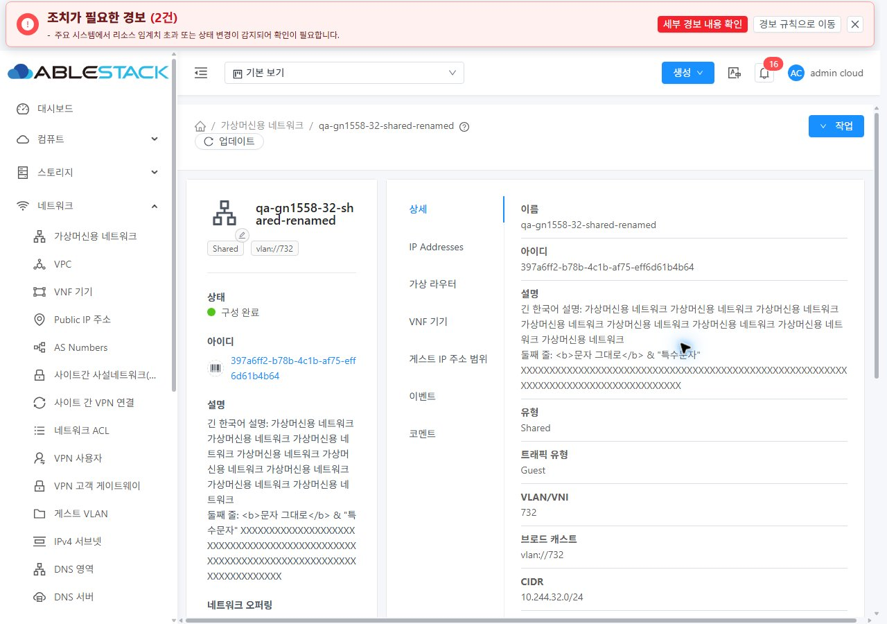
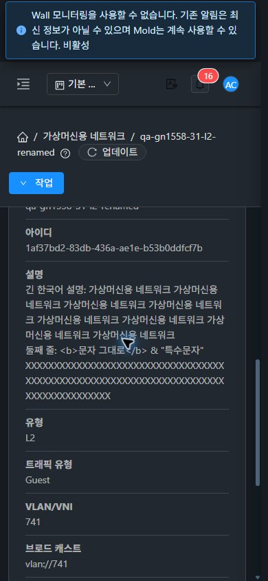

<!--
 Licensed to the Apache Software Foundation (ASF) under one
 or more contributor license agreements. See the NOTICE file
 distributed with this work for additional information
 regarding copyright ownership. The ASF licenses this file
 to you under the Apache License, Version 2.0 (the
 "License"); you may not use this file except in compliance
 with the License. You may obtain a copy of the License at

   http://www.apache.org/licenses/LICENSE-2.0

 Unless required by applicable law or agreed to in writing,
 software distributed under the License is distributed on an
 "AS IS" BASIS, WITHOUT WARRANTIES OR CONDITIONS OF ANY
 KIND, either express or implied. See the License for the
 specific language governing permissions and limitations
 under the License.
-->

# #1558 네트워크 설명 표시·편집 정합성 복원 및 31·32 UI 검증

2026-11-03 · [이슈 #1558](https://github.com/ablecloud-team/ablestack-cloud/issues/1558) · [Epic #1554](https://github.com/ablecloud-team/ablestack-cloud/issues/1554) · [Draft PR #1577](https://github.com/ablecloud-team/ablestack-cloud/pull/1577)

**API의 `displaytext`와 DB의 `display_text`에 저장된 설명을 요약·상세에 표시하고 생성·수정의 여러 줄 입력과 저장 결과 확인을 보완했다.** 31(GFS2)·32(Glue/Ceph RBD)의 Isolated/L2/Shared에서 실제 UI로 검증했다. Epic은 완료 **4/22**, 다음 구현은 **#1561 → #1562**다. 같은 Epic 브랜치·Draft PR을 유지하며 병합하지 않는다.

## 소스와 검증 단계

| 단계 | 커밋 | 실행 수준 |
|---|---|---|
| 수정 전 기준 | `04a4fa5ae0ee43ee8abd34f47a0a1c10212c2760` | 31/32 세 유형의 설명 행 누락 재현. 빈 설명을 지원하는 서버와 달리 UI가 이름 수정도 막는 현상 확인 |
| 기능 구현·초기 배포 | `dc0abb3837b8de215b41c7734cf7d2017553d8f1` | 실제 생성/수정·API/DB 대조·실패/재조회·36개 설명 화면 및 12개 수정 대화상자 조건 검증 |
| 최종 배포 | `ff5dbd2425f3a47610b294130c1c5cce28ed4f79` | 기능 코드는 동일. 요약 설명 라벨의 VM 표준 굵기 700·아래 간격 5px 추가. 최종 설명 화면 36조건·라벨 일치·L2 수정·직접 진입/이동 재검증 |

브랜치: `dhslove/epic-1554-guest-networks`. Java·API 응답·DB 스키마는 변경하지 않았다. 빌드는 WSL ext4의 UI만 로컬에서 실행했고 전체 Cloud·Maven·GitHub Actions 수동 빌드는 시작하지 않았다.

## 변경 UI와 VM 표준 반영

| 변경 UI | 개선 내용·표준 | 검증 |
|---|---|---|
| 상세 탭의 설명 행 | 잘못된 `description` 대신 `displaytext`. 필드가 없거나 빈 값이어도 설명 행과 `—` 유지 | 세 유형·두 클러스터, 새로고침/직접 진입 |
| 상세 요약 카드 | 이름과 구분된 설명 추가. VM 공통 라벨의 14px·굵기 700·아래 간격 5px와 색상/줄 높이 일치 | 인접 공통 라벨의 computed style 대조 |
| 요약·상세 설명 본문 | 같은 컴포넌트 사용. 줄바꿈 보존·긴 단어 줄바꿈·테마 색상 상속·HTML 모양 문자열의 일반 텍스트 표시 | 213자 한국어/특수문자/85자 연속 문자열, HTML 자식 노드 0 |
| Isolated/L2/Shared 생성 폼 | 설명을 2~5행 자동 크기 textarea로 변경. 기존 유형별 필수 조건과 이름 의미 유지 | 수정 후 세 유형을 양쪽에서 UI 생성, 여러 줄 POST/API/DB/표시 대조 |
| 네트워크 업데이트 대화상자 | 설명 textarea·빈 값 초기화 허용. VM 표준 MoldDialog lg, 세로 라벨, 공통 스크롤/고정 푸터, 반응형 1열·테마 사용 | 12조건 및 최종 L2 데스크톱/모바일 확인 |
| 저장 결과·오류 | job 성공 후 이름/설명을 서버 재조회 값과 비교. 불일치는 입력·작업 ID를 유지하며 같은 job 재조회 | 요청 거부 3유형·조회 불일치 3유형·최종 GET 오류 |

목록 기본 컬럼과 다른 자원의 공통 CSS는 늘리거나 바꾸지 않았다. 목록/상세/탭/breadcrumb는 기존 VM 공통 구조·색상·간격을 사용하며 실제 이동을 확인했다. VM 자체는 참조 화면을 읽기만 했다. 화면·테마 변경은 재시작/페이지 재로드 없이 적용되며 검증 후 light·기본 viewport·캐시 설정으로 복원했다.

## 유형별 실제 UI 검증

| 검증 항목 | Isolated | L2 | Shared |
|---|---|---|---|
| 31/32 생성 설명과 수정 설명의 API/DB/요약/상세 일치 | 통과 | 통과 | 통과 |
| 여러 줄 생성·긴 한국어·특수문자·HTML 모양 문자열 | 통과 | 통과 | 통과 |
| 설명만 수정·이름 유지 | 통과 | 통과 | 통과 |
| 이름만 수정·설명 인자 생략/기존 값 유지 | 통과 | 통과 | 통과 |
| 빈 문자열 초기화·요약/상세 `—` | 통과 | 통과 | 통과 |
| 31 합성 요청 거부 후 입력/기존 표시 보존·재시도 | 통과 | 통과 | 통과 |
| 32 실제 저장 후 최종 조회 불일치·동일 job 재조회 | 통과 | 통과 | 통과 |
| 1280/768/390 × light/dark × 31/32 설명 화면 | 12조건 | 12조건 | 12조건 |
| 직접 진입·새로고침·목록/탭/관련 링크·breadcrumb | 통과 | 통과 | 통과 |

수정 전 재현용 6개와 수정 후 여러 줄 생성용 6개를 합해 **네트워크 12개를 UI로 생성**했다. 사용자 VM·라우터·오퍼링·계정은 생성하지 않았다. 빈 설명 서버 지원은 L2 전용망에서 별도 API 수정 2건으로 확인했다. 생성 설명의 필수 조건은 유지한다.

브라우저 수정 요청은 **총 35건 = 정상 job 32건 + 합성 요청 거부 3건**이다. [중복 제거한 요청·작업 원장](evidence/update-request-ledger.json), [생성/API/DB](evidence/31-created-api-db-6.json), [32 생성/API/DB](evidence/32-created-api-db-6.json)를 제공한다. 이름만 수정할 때 `displaytext`가 생략되는 것과 설명 초기화 시 빈 문자열이 전송되는 것을 실제 요청으로 확인했다.

### 실패 시험의 구분

- **31 Request 거부:** 브라우저 Request 단계에서 synthetic HTTP 500을 반환했다. 첫 요청은 서버에 전달되지 않았다. 입력과 기존 요약/상세를 유지한 뒤 사용자가 확인을 다시 눌러 정상 저장했다. 유형당 브라우저 POST 2건 중 실제 서버 저장은 1건이다.
- **32 조회 불일치:** 실제 저장/job 성공 후 마지막 `listNetworks` 응답의 설명만 다른 값으로 바꿨다. 새 검증 메시지·입력·job ID를 유지하며 같은 job 재조회로 복구했다. 유형당 POST 1건이다.
- **31 Shared 최종 GET 오류:** 실제 저장 후 마지막 GET만 synthetic HTTP 500으로 바꿨다. 오류 상세와 job ID를 유지하고 같은 job으로 복구했으며 POST는 1건이다.
- 저장이 실제 성공한 뒤 배경 상세가 갱신되는 경우에는 별도의 정상 `listNetworks` 응답이 새 값을 반환했음을 기록했다. 실패 요청의 낙관적 확정과 혼동하지 않는다. [32 Isolated 조회 근거](evidence/32-mismatch-failure-isolated.json)

검증 도구의 대기 시간 초과는 저장 실패로 계산하지 않았다. 진행 중인 작업과 현재 서버 값을 먼저 대조하고 새 요청을 중복 전송하지 않은 채 이어서 검증했다.

## 반응형·테마·배포·정리

- 최종 요약/상세 **36조건·조건당 2개 설명 영역**: 가로 넘침 0, 줄바꿈 보존, HTML 자식 노드 0, 명암비 최소 **6.97:1**. [측정값](evidence/description-style-matrix.json)
- 수정 대화상자 **12조건**: textarea 값 보존·본문 가로 넘침 0·푸터 화면 내 유지·읽기 시험 중 update POST 0. [측정값](evidence/dialog-style-matrix.json)
- 31/32의 즉시 테마 전환·화면 이동·직접 진입·새로고침과 VM 표준 상세/NIC/breadcrumb를 확인했다.
- 로컬 변경 lint, **4 suites·95/95 tests**, Node 20.20.2 UI production build 통과. 최종 CSS 보완도 lint/build 통과. [로컬 검증](evidence/local-validation.json)
- 최종 정적 **650개 파일** 해시 전수 일치. index SHA256 `90870ab232a1cec24cbc46bf4d4cb74f438097c478d02be63927982894f4fcfd`. WEB-INF/META-INF·운영 config·기존 큰 이미지·관리 PID 보존, `/client/` HTTP 200. 새 설명/오류 마커와 기존 FTCTL 마커 유지. [31](evidence/31-runtime-ui-final.json) · [32](evidence/32-runtime-ui-final.json)
- 삭제 정리에서 31은 최초 6/6, 32는 최초 5/6 성공했다. 32 Isolated 1개는 DB 교착으로 jobstatus=2/errorcode=530이었다. NIC/VM 의존성 0을 확인하고 해당 망만 단일 UI 재시도해 성공했다. 강제 삭제·DB 수정 없이 정리했으며 서버 교착/오류 상세/실패만 재시도는 #1568 후속으로 기록한다. [실패·관리 로그](evidence/32-delete-failure-management-log.json) · [재시도](evidence/32-ui-cleanup-failed-only-retry.json)
- 전용망 12개 UI 정리 후 활성 DB network/NIC/router/volume 모두 **0**. 관련 VM/라우터 생성 이력 0이며 기존 9종 인벤토리의 선택 속성과 UUID 집합이 일치한다. [31](evidence/31-cleanup-db.json) · [32](evidence/32-cleanup-db.json)
- 전용 원격 tmpfs 배포 스테이지는 제거하고 WSL ext4 백업을 보존했다. dirty FTCTL 작업트리의 HEAD·staged/unstaged diff 해시는 그대로다.

자동 전체 저장소 License Check는 기존과 같은 미승인 3,494건으로 실패했다. 전체 저장소 Lint/최신 Checks와 로컬 집중 검증·실환경 결과를 구분하며 전체 Cloud CI 성공으로 보고하지 않는다.

## 범위와 후속

실환경은 Root Admin과 기본 Isolated/L2/Domain Shared 오퍼링이다. VPC·PVLAN·ConfigDrive·외부 제공자·프로젝트/역할 전체 조합, 다른 상세 필드·모든 조건부 탭의 기능 완료를 뜻하지 않는다. 해당 조합은 #1570/#1571/#1572/#1575/#1576 및 통합 회귀 #1569에서 검증한다. 다음 구현 #1561은 중복 조건부 탭·고정 탭 URL 계약을 담당한다.

## 캡처 35개

실제 JPEG 크기·SHA256은 [캡처 색인](evidence/screenshot-index.json)에 있다. 기능/실패/수정 대화상자 사진은 기능 구현 단계, 최종 요약·상세 사진은 라벨 표준 보완까지 반영한 최종 배포 기준이다.

| 구분 | 캡처 |
|---|---|
| 수정 전 누락·빈 설명 수정 차단 | [31 상세](screenshots/31-before-isolated.jpg) · [32 빈 설명](screenshots/32-before-l2.jpg) · [이름 수정 차단](screenshots/32-before-empty-name-edit-ui.jpg) |
| 생성 여러 줄 | [Isolated](screenshots/31-create-isolated-multiline.jpg) · [L2](screenshots/31-create-l2-multiline.jpg) · [Shared](screenshots/31-create-shared-multiline.jpg) |
| 31 최종 light 상세 | [Isolated](screenshots/31-description-isolated-light-1280.jpg) · [L2](screenshots/31-description-l2-light-1280.jpg) · [Shared](screenshots/31-description-shared-light-1280.jpg) |
| 32 최종 light 상세 | [Isolated](screenshots/32-description-isolated-light-1280.jpg) · [L2](screenshots/32-description-l2-light-1280.jpg) · [Shared](screenshots/32-description-shared-light-1280.jpg) |
| 31 최종 모바일 dark | [Isolated](screenshots/31-description-isolated-dark-390.jpg) · [L2](screenshots/31-description-l2-dark-390.jpg) · [Shared](screenshots/31-description-shared-dark-390.jpg) |
| 32 최종 모바일 dark | [Isolated](screenshots/32-description-isolated-dark-390.jpg) · [L2](screenshots/32-description-l2-dark-390.jpg) · [Shared](screenshots/32-description-shared-dark-390.jpg) |
| 편집·오류·복구 | [편집](screenshots/31-edit-isolated-light-1280.jpg) · [모바일 편집](screenshots/31-edit-isolated-dark-390.jpg) · [요청 거부](screenshots/31-request-failure-l2-error-ui.jpg) · [조회 불일치](screenshots/32-mismatch-failure-isolated-error-ui.jpg) · [GET 오류](screenshots/31-read-failure-shared-error-ui.jpg) · [최종 저장](screenshots/31-final-save-success.jpg) |
| 정리 | [31 0건](screenshots/31-cleanup-zero.jpg) · [32 0건](screenshots/32-cleanup-zero.jpg) |

