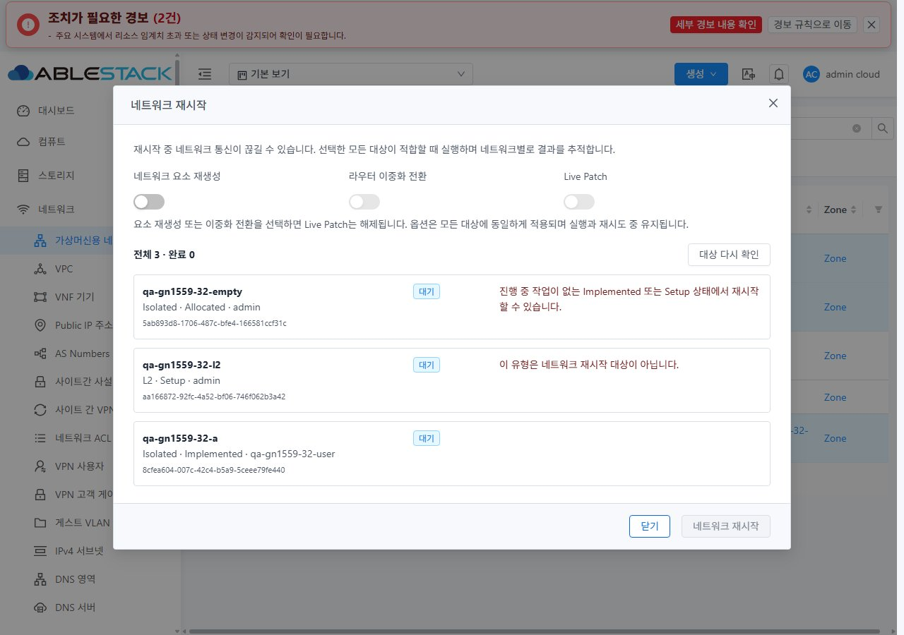
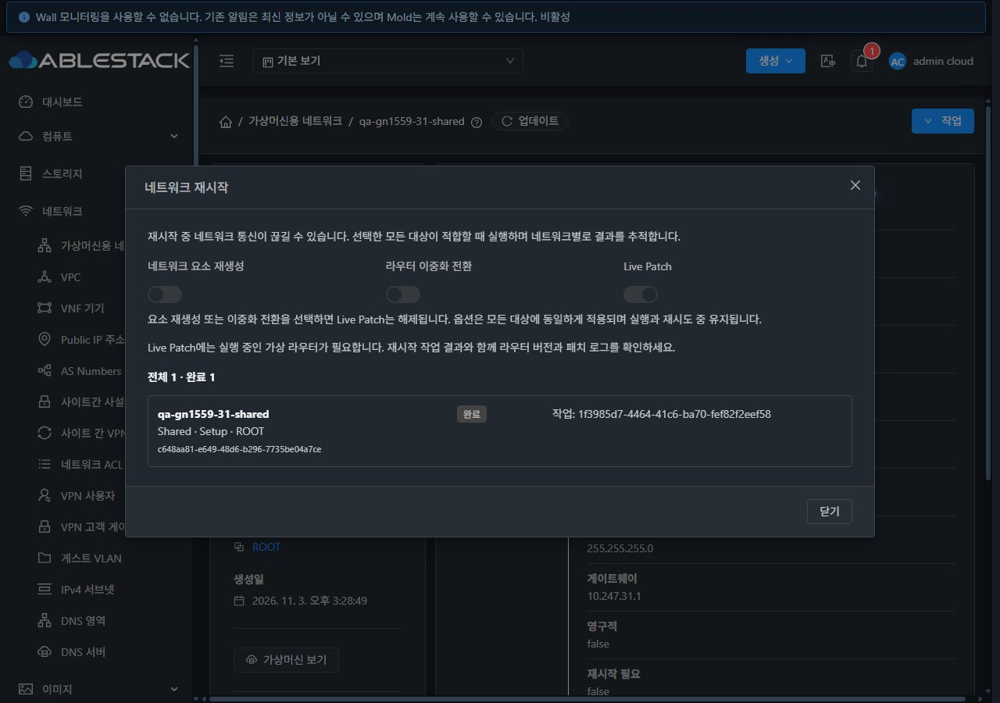
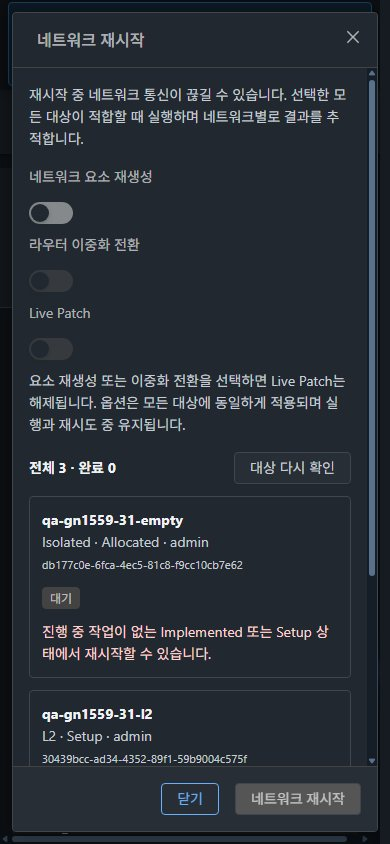

<!--
 Licensed to the Apache Software Foundation (ASF) under one
 or more contributor license agreements. See the NOTICE file
 distributed with this work for additional information
 regarding copyright ownership. The ASF licenses this file
 to you under the Apache License, Version 2.0 (the
 "License"); you may not use this file except in compliance
 with the License. You may obtain a copy of the License at

   http://www.apache.org/licenses/LICENSE-2.0

 Unless required by applicable law or agreed to in writing,
 software distributed under the License is distributed on an
 "AS IS" BASIS, WITHOUT WARRANTIES OR CONDITIONS OF ANY
 KIND, either express or implied. See the License for the
 specific language governing permissions and limitations
 under the License.
-->

# #1559 네트워크 재시작 개선 및 31·32 UI 검증

2026-11-03 · [이슈 #1559](https://github.com/ablecloud-team/ablestack-cloud/issues/1559) · [Epic #1554](https://github.com/ablecloud-team/ablestack-cloud/issues/1554) · [Draft PR #1577](https://github.com/ablecloud-team/ablestack-cloud/pull/1577)

**단일·일괄 재시작의 대상 검증과 네 인자 전달, 항목별 작업 결과·실패 항목 재시도를 구현하고 31(GFS2)·32(Glue/Ceph RBD)에 반영했다.** Isolated와 Shared의 실제 재시작·Live Patch를 확인했다. 테스트 활성 잔여물은 0이며 기존 운영 인벤토리를 보존했다. Epic은 완료 3/22, 다음 구현은 **#1558 → #1561 → #1562**다. PR은 Draft·미병합으로 유지한다.

## 구현 및 배포 기준

| 단계 | 소스 | 검증 수준 |
|---|---|---|
| 수정 전 | `a895ea52029921f4cfa50a5f0e2485e941c076f5` | L2 혼합 선택 실행 가능 표시, 실제 Live Patch 선택 후 일괄 요청의 인자 누락 재현 |
| 기능 구현 | `1fd8908255d692bf0053ae1bcb54bd4979dbd289` | 양쪽 클러스터의 유형·상태·권한·단일/일괄·실패/재시도·실제 패치 검증 |
| 최종 배포 | `70d1e136822deddfd50ed44886612359a1f9b127` | Shared 도메인 표시와 조회 오류 상세 보완. 요청·정책·스타일은 동일. 12조건 캡처, Shared 실제 패치·최종 조회 실패/재조회·화면 이동·일괄 삭제 재검증 |

Epic 브랜치 `dhslove/epic-1554-guest-networks`에서 누적한다. Java·라우터 패치 엔진은 변경하지 않았다. 전체 Cloud 빌드나 GitHub Actions 수동 빌드는 시작하지 않았다.

## 변경 UI와 가상머신 표준 반영

| 변경 UI | 반영한 표준·동작 | 검증 근거 |
|---|---|---|
| 목록 우클릭의 재시작 | 선택 대상을 고정해 전용 대화상자로 연결. L2 단독은 재시작 제외, 혼합 선택은 대상별 사유 표시 후 전체 실행 차단 | 혼합 유형·Allocated·일반 사용자 권한 차이, [L2](evidence/l2-action-check.json) |
| 상세 작업 메뉴의 재시작 | 같은 대상·권한·상태 판정과 옵션 계약 사용 | 단일 Isolated/Shared, VPC 읽기 전용 옵션 제한 |
| 재시작 대화상자 | VM에서 사용하는 `MoldDialog` lg(960px), 세로 라벨, 12px 열 간격, 공통 본문 스크롤·고정 푸터·포커스 가드 | 1280/768/390px × light/dark × 31/32 |
| 항목별 결과·오류·재시도 | 이름/유형/상태/계정·도메인, 상태 배지, API 오류와 작업 ID. 실패 항목만 재시도, 결과 불명은 같은 작업 재조회 | 합성 요청 거부·종료 실패·최종 조회 실패를 실제 UI 경로에서 검증 |
| 모바일·테마 | 옵션과 결과 카드 1열, 긴 UUID/오류 줄바꿈, 의미 기반 배경·경계·보조 글자·오류 색상 토큰 | 본문 가로 넘침 0, 푸터 화면 내 유지, 도움말·오류 명암비 최소 **7.56:1** |
| 목록·상세·탭·breadcrumb 연계 | 공통 목록/VM/탭/breadcrumb의 기존 스타일과 경로를 사용 | 네트워크 → 가상 라우터 → 관련 VM 목록 → VM 상세 → NIC → 네트워크 → breadcrumb 목록 |

공통 ListView·ActionButton·다른 자원의 우클릭은 수정하지 않았다. VM 화면 자체와 네트워크의 다른 탭도 수정 대상은 아니다. 위 경로를 밝은·어두운 테마에서 실제로 이동해 확인했다. 테마는 새로고침 없이 전환되며, 검증 후 light·기본 viewport·브라우저 캐시 설정으로 복원했다.

## API 계약과 실행 검증

| 시나리오 | 31 | 32 | 근거·판정 |
|---|---|---|---|
| 수정 전 실제 Live Patch 선택 | 재현 | 해당 없음 | 요청은 id만 포함, 패치 로그 생성/서명 시각 변화 없음. 단순 일반 재시작 job 성공과 구분 |
| L2 단독·L2/Allocated/Isolated 혼합 | 통과 | 통과 | L2 상세 재시작 없음. 혼합 대화상자는 이름·유형/상태 사유를 표시하고 실행 차단 |
| Isolated 단일/일괄 Live Patch | 단일 통과 | 2개 일괄 통과 | 각 UUID에 cleanup=false, makeredundant=false, livepatch=true. job 성공 후 최종 조회 |
| 일반 사용자 권한 차이 | 통과 | 통과 | 소유 Isolated·Domain Shared만 조회. 혼합 선택은 Shared 권한 사유로 차단, 소유망 단일 재시작 완료 |
| 실행 직전 상태 변경 | 합성 응답 시험 통과 | 단위 회귀 | fresh GET을 Implementing으로 반환하면 전체 POST 0. 서버 실제 상태 변경과 혼동하지 않음 |
| 요소 재생성 | 실제 통과 | 실제 통과 | cleanup=true가 Live Patch 선택 해제·비활성화. 전송값 true/false/false, 전용 B 라우터 교체 확인 |
| Shared 정상 재시작·Live Patch | 실제 통과 | 실제 통과 | false/false/false 및 false/false/true. 새 라우터 Running·패치 로그·호스트 패키지 서명 대조 |
| VPC Tier | 읽기 검토 | 읽기 검토 | 요소 재생성·이중화 비활성 및 공유 라우터 영향 안내. 기존 운영 VPC에는 실행하지 않음 |
| 부분 요청 실패·실패만 재시도 | 통과 | 종료 실패 시험 | 성공 B를 유지하고 실패 A만 실제 재시도. B 작업 ID 유지 |
| 작업 종료 실패 | 단위 회귀 | 합성 jobstatus=2 시험 통과 | 서버 전송 전 가짜 접수/종료 응답. UI 오류·작업 ID 유지 후 해당 항목만 실제 재시도 |
| 최종 조회 실패·같은 작업 재조회 | 단위 회귀 | 실제 재시작+합성 GET 실패 통과 | 최종 번들에서 API 오류 상세 표시. 동일 job 재조회로 성공, restart POST 1회 |
| 기존 일괄 삭제 | 실제 5/5 | 실제 5/5 | 기존 공통 확인·진행·항목별 성공 경로 보존. 서로 다른 유형의 전용망 모두 삭제 |

`id/cleanup/makeredundant/livepatch`는 지원 API 파라미터에 한해 명시적으로 전송한다. false와 미지원 필드 생략은 별도 단위 시험으로 확인했다. 실행 전 전체 재검증, 항목 실행 직전 재검증을 수행한다. 모호한 접수/타임아웃은 자동 재전송하지 않으며, 확정 실패만 재시도 대상으로 삼는다. 실행 중 화면·프로젝트·사용자 변경 시 후속 쓰기/늦은 UI 반영을 중단한다.

부분 요청 거부는 **브라우저 Request 단계에서 synthetic 500을 반환하여 서버에는 해당 요청이 전달되지 않은 시험**이다. 종료 실패 역시 가짜 작업 접수/실패 응답이다. 최종 조회 실패는 **실제 정상 재시작 후 GET 응답만 synthetic 500**으로 바꿨다. 정상 동작·실제 패치와 합성 복구 시험을 구분한다.

## Live Patch 실적용과 VM 보존

[실적용 비교 요약](evidence/runtime-proof.json)에 수정 전/후 라우터 UUID·서명 수정 시각·로그 생성·호스트 패키지 SHA512를 연결했다.

- 31의 A 및 32의 A/B: 라우터 UUID 유지, `/var/log/livepatchsystemvm.log` 생성, `/var/cache/cloud/cloud-scripts-signature` 수정 시각 증가, 설치된 `cloud-scripts.tgz` SHA512 일치.
- Shared: 양쪽 전용 라우터의 패치 로그와 서명 일치 확인. 최종 31 번들에서도 추가 패치 성공.
- 요소 재생성 B: 라우터 UUID가 바뀌는 것이 예상 결과다. 재생성 직후 패치 로그가 없는 상태를 Live Patch 실패로 해석하지 않는다.
- VM 4개 모두 원래 UUID·NIC·IP·MAC 유지, Running, 라우터에서 VM으로 ICMP 성공. 최종 호스트 domuuid·domblklist/API로 대조했다.

API job 성공만으로 패치 성공을 판정하지 않았다. Shared 전용 VLAN의 외부 gateway/trunk와 Shared VM 종단 통신은 이번 재시작 시험 범위에서 구성하지 않았다.

## 검증·배포·정리

- WSL ext4 로컬 변경 lint, **3 suites·85/85 tests**, Node 20.20.2 UI production build 종료 0. DNS·오퍼링 기존 회귀 포함. [로컬 검증](evidence/local-validation.json)
- 최종 양쪽 정적 **650개 / 29,579,583 bytes** 해시 전수 일치. index SHA256 `a3293b424c06569cc1cc3565fb2496524e8ccf6108554bb3473e2960502f20b3`.
- WEB-INF·META-INF·운영 config·기존 큰 이미지·관리 PID 보존, `/client/` HTTP 200. 기존 FTCTL `blockingLoadingState/fetchSyncProgress/extractJobId`와 새 재시작 마커 확인. [31](evidence/31-runtime-ui-final.json) · [32](evidence/32-runtime-ui-final.json)
- 테스트 계정 2·망 10·사용자 VM 4·라우터 8개(교체 전 포함) 정리. 활성 DB network/VM/router/NIC/volume/account 모두 0. GFS2/RBD 루트 볼륨 **총 12개 부재**, 클러스터당 3호스트에서 관련 도메인 각 6개 부재. [31](evidence/31-cleanup-db-storage.json) · [32](evidence/32-cleanup-db-storage.json)
- 기존 9종 인벤토리의 선택 속성·UUID 집합 완전 일치. [31](evidence/31-cleanup-preservation.json) · [32](evidence/32-cleanup-preservation.json)
- 최초/최종 원격 tmpfs 배포 스테이지와 전용 라우터 known-hosts 제거. WSL ext4 배포 백업은 보존. 기존 dirty FTCTL 작업트리의 HEAD·staged/unstaged diff 해시 동일.
- 자동 PR 검사: 소스 커밋의 License Check는 기존과 같은 미승인 **3,494건**으로 실패했다. 전체 저장소 Lint 결과는 GitHub 최신 Checks를 따른다. 이는 로컬 집중 검증이나 실환경 성공과 별개이며 전체 Cloud CI 통과로 보고하지 않는다.

## 적용 한계와 후속 범위

실환경 권한 시험은 Root Admin/User다. DomainAdmin 도메인 계층·프로젝트 소유/선택·API 미지원·busy router·화면 전환 중 작업 등은 집중 단위 시험으로 확인했으며 전체 역할 조합의 실환경 PASS로 확대하지 않는다. 이중화 전환은 양쪽 `allowMakingRouterRedundant=false` 환경에서 버튼 비활성·makeredundant=false 전달을 검증했다. true 전환과 redundant 제공자 실제 토폴로지 시험은 수행하지 않았다.

Isolated NAT/no-SourceNat/Routed/외부 제공자·모든 이중화 조합의 실환경 전수 검증은 #1570/#1574/#1576, Shared 전체 범위·IP/DHCP/종단 통신은 #1572, DomainAdmin/프로젝트 전체 권한 조합은 #1575, 최종 통합 회귀는 #1569에 남긴다. 32 no-SourceNat 제공자 문제는 #1562를 따른다. 적용 제한을 통과로 바꾸지 않는다.

## 캡처 31개

원본 JPEG의 실제 크기·SHA256은 [캡처 색인](evidence/screenshot-index.json), 배치·색상·명암비는 [12조건 측정](evidence/responsive-style-matrix.json)에 있다.

| 화면 | 캡처 |
|---|---|
| 수정 전 혼합 실행 표시·Live Patch 선택 | [우클릭](screenshots/31-before-mixed-menu.jpg) · [대화상자](screenshots/31-before-mixed-dialog.jpg) · [선택 상태](screenshots/31-before-livepatch-selected.jpg) |
| 31 light 1280/768/390 | [1280](screenshots/31-restart-light-1280.jpg) · [768](screenshots/31-restart-light-768.jpg) · [390](screenshots/31-restart-light-390.jpg) |
| 31 dark 1280/768/390 | [1280](screenshots/31-restart-dark-1280.jpg) · [768](screenshots/31-restart-dark-768.jpg) · [390](screenshots/31-restart-dark-390.jpg) · [390 하단](screenshots/31-restart-dark-390-bottom.jpg) |
| 32 light 1280/768/390 | [1280](screenshots/32-restart-light-1280.jpg) · [768](screenshots/32-restart-light-768.jpg) · [390](screenshots/32-restart-light-390.jpg) |
| 32 dark 1280/768/390 | [1280](screenshots/32-restart-dark-1280.jpg) · [768](screenshots/32-restart-dark-768.jpg) · [390](screenshots/32-restart-dark-390.jpg) |
| 권한·유형·VPC | [31 User](screenshots/31-user-mixed-permission.jpg) · [32 User](screenshots/32-user-mixed-permission.jpg) · [L2](screenshots/31-l2-action-absent.jpg) · [VPC](screenshots/32-vpc-readonly-contract.jpg) |
| 실패·성공·최종 조회 복구 | [부분 실패](screenshots/31-partial-refusal.jpg) · [종료 실패](screenshots/32-terminal-job-failure.jpg) · [최종 Shared Patch](screenshots/31-final-shared-livepatch-success.jpg) · [오류 상세](screenshots/32-final-error-detail-unknown-ui.jpg) · [같은 job 복구](screenshots/32-final-recheck-success.jpg) |
| VM 표준 NIC·연계 | [31 light](screenshots/31-vm-nic-standard.jpg) · [32 dark](screenshots/32-vm-nic-standard-dark.jpg) |
| 기존 일괄 삭제·잔여망 없음 | [31 삭제](screenshots/31-bulk-delete-success.jpg) · [32 삭제](screenshots/32-bulk-delete-success.jpg) · [31 0건](screenshots/31-cleanup-zero.jpg) · [32 0건](screenshots/32-cleanup-zero.jpg) |

