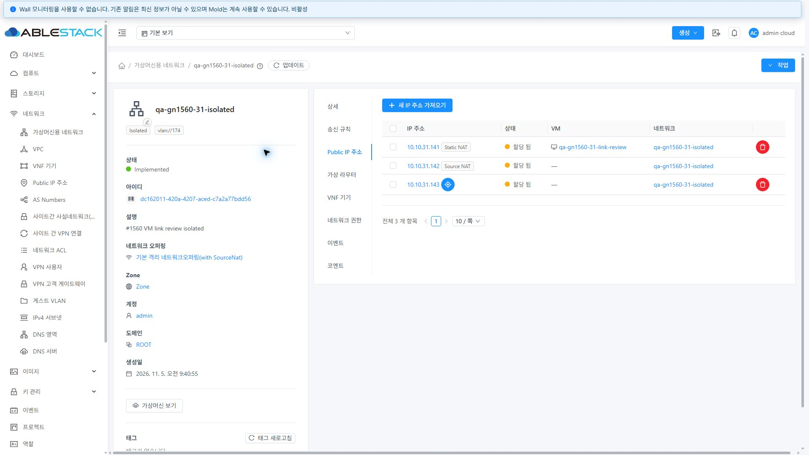
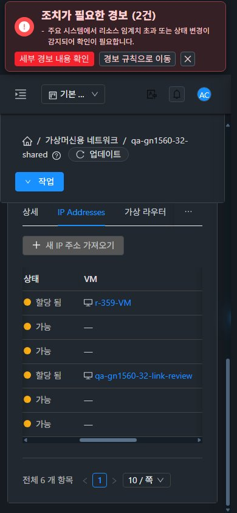

<!--
Licensed to the Apache Software Foundation (ASF) under one or more
contributor license agreements. See the NOTICE file distributed with this
work for additional information regarding copyright ownership. The ASF
licenses this file under the Apache License, Version 2.0 (the "License");
you may not use this file except in compliance with the License. You may
obtain a copy at http://www.apache.org/licenses/LICENSE-2.0 . Unless required
by applicable law or agreed to in writing, software distributed under the
License is distributed on an "AS IS" BASIS, WITHOUT WARRANTIES OR CONDITIONS.
-->

# #1560 구현·31/32 배포·UI 검증

상위 Epic #1554 · 같은 브랜치 `dhslove/epic-1554-guest-networks` · Draft PR #1577 유지. 생산 소스 `a9f56a9736a971a99ac2cfa165177ddddcfd7def` / `df254b0400ac264aea8baca3ab3c805f67267df1`. 검증일 2026-11-05 KST.

## 결과와 설계

Source NAT와 미연결 Public IP는 정상적으로 VM ID가 없다. 기존 IP 탭이 빈 셀에 `#/vm/undefined`와 빈 키보드 포커스 대상을 만들었다. 31/32 전용 IP에서 재현한 뒤 공통 IP VM 참조 컴포넌트로 수정했다.

- ID는 문자열·공백·sentinel·경로 문자를 검사한다. 유효한 ID와 확인된 타입이 함께 있을 때만 링크를 만든다. User → `/vm/`, DomainRouter → `/router/`, ConsoleProxy/SecondaryStorageVm → `/systemvm/`.
- 이름만 있으면 일반 텍스트, ID만 있고 타입이 유효하면 ID 라벨 링크, 모두 없으면 `—`다. 알 수 없는 타입·잘못된 ID는 이름/ID를 일반 텍스트로 표시한다. 빈 anchor·tabindex·VM 아이콘을 남기지 않는다. 표시 이름 → 호스트 이름 → ID 순으로 읽는다.
- 기존 Shared 사용자 NIC 응답은 VM 타입을 생략했다. 정상 이름 두 개와 `forvirtualnetwork=false`, `issystem=false`인 제한된 구계약만 호환한다. 서버도 primary/secondary 사용자 VM 응답에 `User` 타입을 명시하도록 보완했다.
- 31 Shared 조회의 간헐 530/NPE도 해결했다. 정상 라우터 placeholder NIC와 실제 NIC가 같은 IP를 가질 때 기존 조회가 placeholder를 선택했다. 기존 DAO의 `findNonPlaceHolderByIp4AddressAndNetworkId`로 실제 NIC를 선택한다. **placeholder는 고아 NIC가 아니며 유지한다.** VM ID 없는 IP 때문에 조회 API를 추가하지 않는다.
- IP 할당·해제·NAT 쓰기 계약과 네트워크 엔진은 그대로다. Source/Static NAT 태그와 유효한 네트워크 링크를 보존했다.

## 변경 UI와 가상머신 표준

| 화면 | 변경 내용 | 표준 반영·확인 |
|---|---|---|
| 네트워크 > 상세 > Public IP 주소 / Shared IP Addresses | 공통 VM 참조, 빈 셀 `—`, 타입별 링크 | VM 상세의 아이콘+링크·14px·공통 light/dark 색상, 장식 아이콘 aria-hidden, 빈 포커스 제거 |
| 같은 IP 탭 도구 모음·표 | 주 작업 버튼을 위에, 일괄 작업을 옆에 배치하고 실패 안내를 아래에 표시 | 실제 VM 볼륨 탭의 버튼→안내→표 순서, flex wrap/gap 8px, 표 내부 가로 스크롤 860px와 열 너비로 긴 이름 압축 방지 |
| Public IP 전체 목록 | VM 이름 열에 같은 참조 규칙 적용 | 기존 ListView·검색·pagination·breadcrumb 스타일 유지. 다른 자원은 기존 경로 사용 |
| Public IP 요약·상세 탭 | 같은 타입·라벨·빈 값 정책 적용 | 공통 InfoCard/DetailsTab 배치 유지. User만이 아니라 실제 시스템 VM 상세 이동 확인 |
| 대화상자·breadcrumb | 폼 구성 변경 없음 | 새 IP 가져오기 열기/취소를 desktop·390px light/dark에서 회귀 확인. breadcrumb 목록 복귀와 browser back의 원래 IP 탭 복귀 확인 |

VM 메뉴의 실제 목록·상세·볼륨 탭을 먼저 관찰하고 [표준 캡처](screenshots/31-vm-volume-standard.jpg)를 남겼다. 작은 화면은 표 영역만 가로로 움직이고 페이지 전체 너비는 viewport 안에 있다. 테마 전환은 새로고침 없이 즉시 적용된다.

## 실행 검증

| 범위 | 실제 확인 | 근거 |
|---|---|---|
| Isolated | Source NAT/미연결 셀의 비대화형 `—`, Static NAT User 링크, 태그/연관 망 보존, 31/32 Tab 키가 빈 VM을 건너뜀 | [UI 동작](ui-actions.json), [31 계약](31-isolated-ip-contract-final.json), [32 계약](32-isolated-ip-contract-final.json) |
| Shared | 게스트 IP는 Public IP 상세 링크가 없고 가져오기 비활성. User/DomainRouter 이동, 미할당 4개 `—` | [31 유지 자원](31-retained.json), [32 유지 자원](32-retained.json), UI 동작 |
| 정상 placeholder | 삭제하지 않은 채 page size 10/20/40/500으로 클러스터별 20회 조회. 매회 6행·User 타입·라우터 링크 정상, 530 없음 | [31 20회 응답](31-shared-runtime-20-lookups.json), [32 20회 응답](32-shared-runtime-20-lookups.json) |
| L2 | IP 탭 비노출, 잘못된 직접 IP 탭 URL은 상세로 복귀 | UI 동작, `*-l2-no-ip-tab.jpg` |
| VPC | 기존 VPC를 읽기만 수행. Source NAT VM 비어 있음 처리와 IP 탭 분기 확인 | `*-vpc-public-ip-readonly.jpg` |
| 시스템 VM | 실제 Public IP 응답의 ConsoleProxy/SecondaryStorageVm 링크로 양쪽 실제 시스템 VM 상세 진입 | UI 동작, `*-public-ip-list-real-system-vms.jpg` |
| 불완전 응답 | 양쪽 한 번씩 읽기 응답만 합성: ID만 존재/이름만 존재/알 수 없는 타입/literal undefined. 링크는 유효한 ID-only User 1개만 생성 | `*-synthetic-id-only-name-only-unknown-type.jpg`, UI 동작. 서버 쓰기 0, 실제 3행 복원 확인 |
| 추가 조회 | 32 IP 탭 합성 시험의 Network 관측에 VM/Router/SystemVm 조회 없음 | UI 동작의 apiCommands |
| 화면·테마 | 2클러스터 × Isolated/Shared × 1280×900, 768×1024, 390×844 × light/dark = **24조건**. 긴 이름은 키보드/가로 스크롤로 전체 표시 | [배치·색상·포커스](layout-checks.json), [스크롤](scroll-proof.json), [이미지 해시·크기](screenshot-manifest.json) |

읽기 합성은 CDP로 해당 QA 네트워크의 조회 한 번만 대체했다. 합성 상태를 실서버 개체로 보고하지 않는다. 마지막에 합성 interception과 viewport override를 제거하고 양쪽 light 테마·검토용 IP 탭을 유지했다. [최종 브라우저 상태](browser-final.json).

## 빌드·배포·보존

- WSL ext4 `/home/ablecloud/work/dhslove/cloud-epic-1554`에서 **변경 server 모듈만** `mvn -pl server -Dcheckstyle.skip=true -DskipITs -Dtest=ApiResponseHelperIpVmTest,ApiResponseHelperTest package`: **29 tests, 실패/오류/skip 0, package 성공**. [로그](server-build.log).
- UI 단위/통합 **82 tests / 4 suites 성공**. 실제 IpAddressesTab의 NAT 태그·네트워크/VM 링크, Shared 분기, 추가 조회 없음, 실패 시 기존 링크 보존과 재시도 교체도 시험했다. [로그](ui-tests-final.log).
- 변경 UI lint와 minified production build 성공. production source map만 외부 설정으로 비활성화했고 제품 minification은 유지했다. [lint](ui-lint.log), [build](ui-build.log).
- server Checkstyle은 모듈 기존 **62건**으로 실패했다. 변경한 ApiDBUtils/ApiResponseHelper/새 테스트의 오류는 **0건**이다. [요약](checkstyle-summary.json), [로그](server-checkstyle.log).
- 전체 Cloud/qemu/다른 Maven 모듈·수동 Actions 빌드를 시작하지 않았다. 소스 `df254b0400a`의 [자동 License Check](https://github.com/ablecloud-team/ablestack-cloud/actions/runs/41945196793)는 기존과 같은 unapproved **3,540건** 실패이며 [자동 Lint](https://github.com/ablecloud-team/ablestack-cloud/actions/runs/41945196781)는 소스 검증 시점 진행 중이다. 로컬·실환경 결과를 전체 CI 성공으로 표시하지 않는다.
- 활성 `/usr/share/cloudstack-management/webapp`의 정적 **650개, 29,810,982 bytes**를 allowlist로 업데이트했다. index SHA `82885e22590fc45755474a192d44b1b218e9164c9ab2e8bd39eba348f0883779`. WEB-INF/META-INF·운영 설정·대용량 이미지 보존 및 HTTP 200, 전체 manifest SHA 일치를 확인했다. [31](31-deployment.json), [32](32-deployment.json).
- 관리 JAR는 server 모듈의 **ApiDBUtils.class/ApiResponseHelper.class 두 개만** 교체했다. 다른 **204,655개 엔트리**는 바이트가 같다. JAR SHA `623e7c2d738347b9e1eb3ef630cb3e2cd4a94ef3e1aff6aaa206db003ac52350`. 31/32 재시작·로그인·실제 API 결과로 확인했다. 현재 배포 manifest의 JS만 대상으로 새 UI 표식과 기존 FTCTL `blockingLoadingState`/`fetchSyncProgress`/`extractJobId`도 확인했고 10:01 KST 이후 해당 instanceId 오류는 0건이다. [31 활성 검증](31-active-runtime-verification.json), [32 활성 검증](32-active-runtime-verification.json). [교체 증명](server-patch-proof.json), [31](31-server-deployment.json), [32](32-server-deployment.json).
- 기존 운영 네트워크 **31개(22+9)**의 이름·유형·오퍼링·VLAN·CIDR·게이트웨이·ACL과 사용자 VM **176대(121+55)**의 이름·상태·호스트 비교 항목은 동일하다. 주 FT dirty 작업의 HEAD와 staged/unstaged diff hash도 같다. [이전](protected-before.json), [이후](protected-after.json).
- 이전 #1564 자원 활성 NIC/볼륨 등 잔여 0. [31 정리](31-cleanup-done.json), [32 정리](32-cleanup-done.json). 이번 QA의 31 Shared 망 재생성도 공식 API만 사용했다. DB 직접 수정·정상 placeholder 삭제는 하지 않았다.

## 사용자 검토·후속 범위

[새 네트워크 6개·VM 2대·라우터 4대의 정확한 UUID와 링크](resources.ko.md)를 별도 삭제 지시까지 유지한다. 네트워크 이름 `qa-gn1560-31-*`, `qa-gn1560-32-*`로 확인한다. UI/캡처는 원본 JPEG **46개**이며 각 파일의 실제 viewport·디코딩 크기·SHA를 검증했다.

VPC Source NAT의 **연관 네트워크 셀**에는 기존 빈 `#/guestnetwork/undefined` 링크가 별도로 남아 있다. VM 참조와 다른 경로이며 #1573 Public IP 상세/연관 링크 후속 검토에 증적을 연결한다. VPC/IPv6·전체 역할·NAT/PF/LB/VPN·실제 패킷 전 구간 회귀는 각 Epic 하위 이슈 범위다.

#1560 구현 범위 종료 후 Epic **11/23 완료·Open 12**. 다음 구현은 **#1567 관리자 강제 삭제·CIDR·사용자 지정 ID 변경 API의 UI 노출 정책 설계**다. PR #1577은 같은 Epic Draft로 유지하며 PR 병합·Epic 종료·다음 이슈 자동 착수를 하지 않는다.

## 되돌림

WSL ext4 `/home/ablecloud/work/guest-network-1560-validation/server-backups/{31,32}-management-before.jar`는 이전 JAR SHA `0817a8f2e74fe03a4ba268a20f8a610492d2c81d3b1818ba708b5e785f0c02a0`다. SHA 검증 후 같은 파일시스템 임시 파일→원자적 교체→Mold 재시작→HTTP/로그인/API 재검증 순으로 복구한다.

이번 작업 전 UI는 `backups/20261105-094827/{31,32}/static-backup.tar.gz`, 최종 UI 직전 백업은 `backups/20261105-095804/{31,32}/static-backup.tar.gz`다. static allowlist만 복구하고 index.html을 마지막에 교체한다. webapp 루트·WEB-INF를 삭제하거나 dist로 통째 대체하지 않는다. 운영 config와 대용량 이미지를 보존하고 전후 WEB-INF·HTTP 200을 다시 확인한다.
