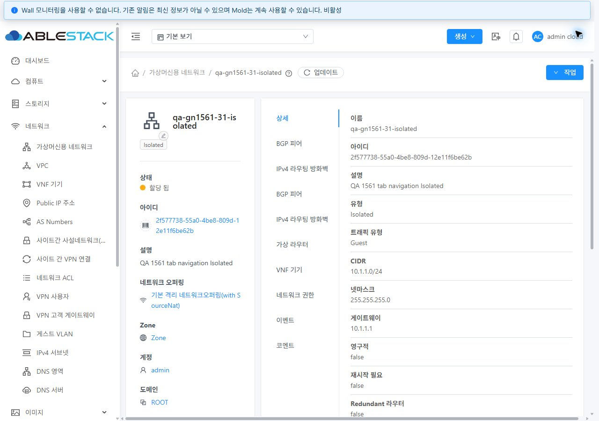
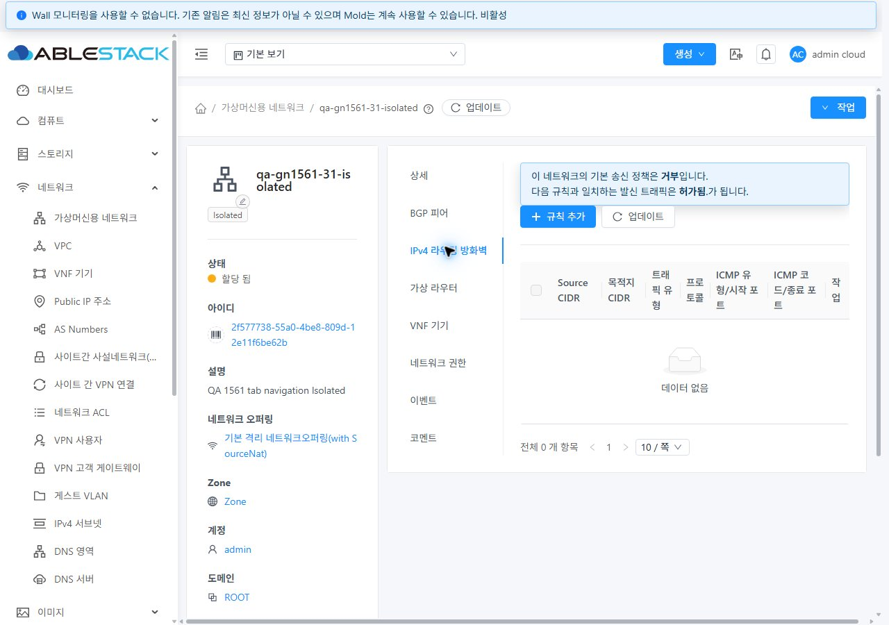
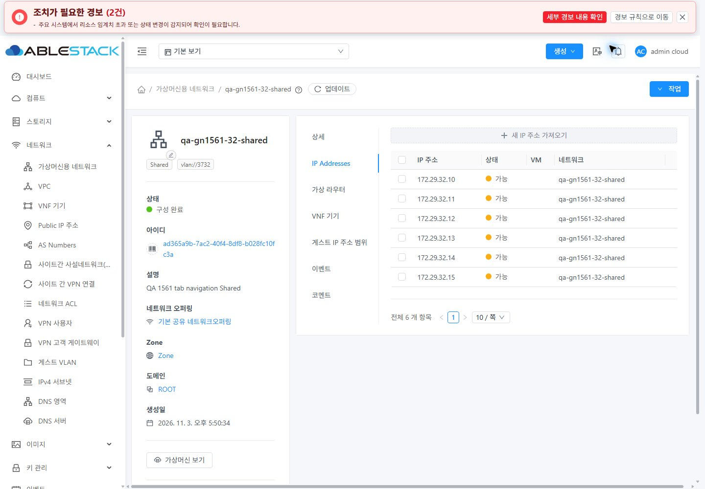
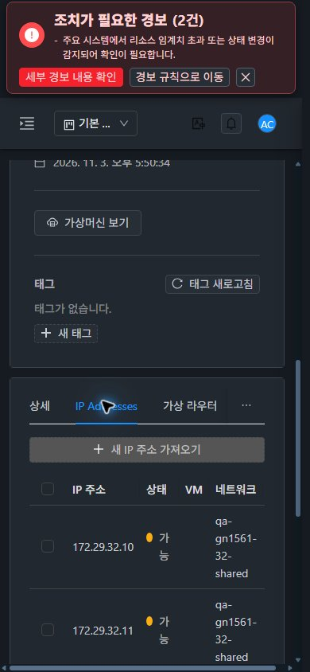
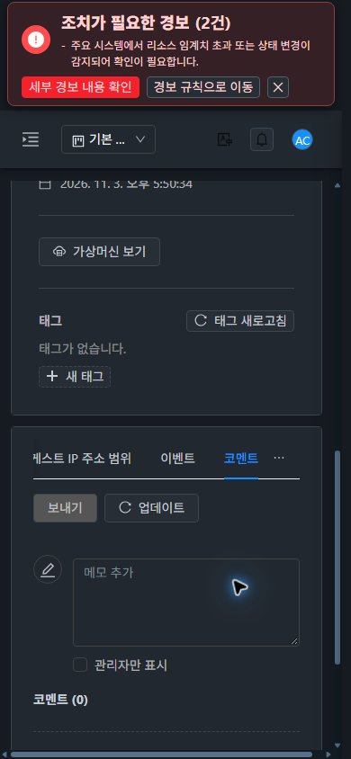
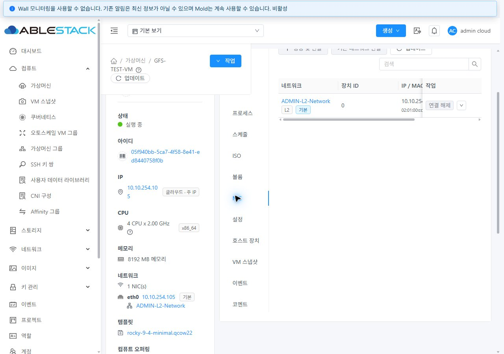
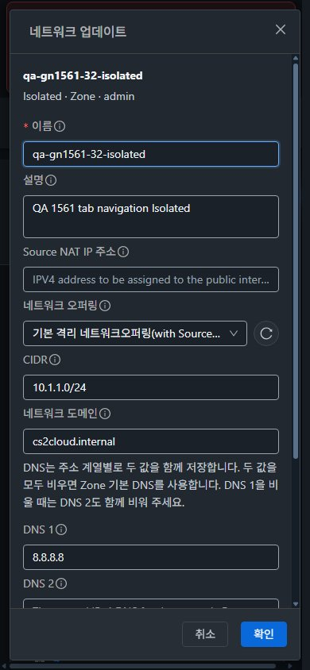
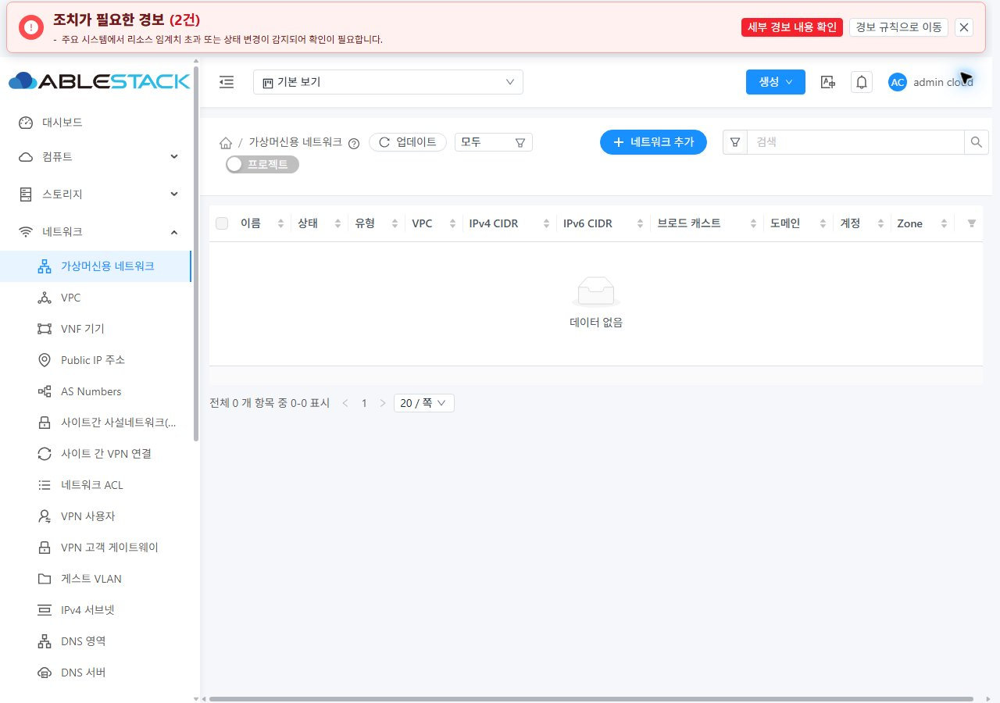

<!--
Licensed to the Apache Software Foundation (ASF) under one
or more contributor license agreements. See the NOTICE file
distributed with this work for additional information
regarding copyright ownership. The ASF licenses this file
to you under the Apache License, Version 2.0 (the
"License"); you may not use this file except in compliance
with the License. You may obtain a copy of the License at

  http://www.apache.org/licenses/LICENSE-2.0

Unless required by applicable law or agreed to in writing,
software distributed under the License is distributed on an
"AS IS" BASIS, WITHOUT WARRANTIES OR CONDITIONS OF ANY
KIND, either express or implied. See the License for the
specific language governing permissions and limitations
under the License.
-->

# #1561 네트워크 조건부 탭·고정 URL 개선 검증

2026-11-03 · Epic [#1554](https://github.com/ablecloud-team/ablestack-cloud/issues/1554) · 이슈 [#1561](https://github.com/ablecloud-team/ablestack-cloud/issues/1561) · Draft PR [#1577](https://github.com/ablecloud-team/ablestack-cloud/pull/1577)

**구현·31(GFS2)/32(Glue RBD) 반영·UI 검증을 완료했다.** 같은 `dhslove/epic-1554-guest-networks` 브랜치와 Draft PR에 누적한다. Epic 전체 회귀·병합은 진행 중이며 다음 구현은 **#1562 → #1557**이다.

## 변경 UI와 VM 표준 반영

| 화면 | 변경 또는 검증 내용 | VM 표준 |
|---|---|---|
| 네트워크 상세 탭 | 중복 BGP/IPv4 routing firewall 정의 제거. 17개 선언을 15개 고정 키로 정리 | VM과 같은 ResourceView·Ant Tabs·테마 토큰 |
| Isolated/Shared IP 주소 탭 | 키 `public.ip.addresses` 고정, Shared 표시명은 `IP Addresses` 유지. 표시명 함수가 URL로 들어가지 않음 | 기존 번역·타이포그래피·선택 표시 유지 |
| Public IP 하위 탭 | 기존 7개 문자열 키 유지. 서비스와 조회 API 권한을 함께 확인 | 같은 공통 탭, 데스크톱/태블릿 좌측·모바일 상단 및 더보기 |
| 탭 이동·직접 진입 | Vue Router push/replace, 숨겨진/잘못된/레거시 키 복구, 다른 query 보존 | breadcrumb·목록/상세 경로와 브라우저 이력 연계 |
| 자원/권한 전환 | 이전 record로 목적지 URL을 고치지 않음. 늦은 associated-network/VPC 응답 차단. 자원·역할/API/project별 탭 인스턴스 분리 | 화면 전환 중 기존 자원 내용 혼입 방지 |
| 목록·대화상자·breadcrumb | 스타일 변경 없음. 목록 복귀·업데이트 열기/취소·기존 오퍼링 우측 재조회 아이콘 회귀 검증 | 기존 VM 표준 MoldDialog 및 공통 목록/경로 유지 |

탭만 바뀌면 부모 네트워크 상세를 다시 조회하지 않는다. 같은 자원의 진행 중인 탭 조회는 tab query 변경 때문에 폐기하지 않으며, 실제 자원/필터 변경은 조회 범위에 남긴다. 기존 VM·스토리지·오퍼링의 정적 이름 탭은 기존 경로를 유지한다.

## 실제 UI 실행 결과

| 항목 | 31 | 32 | 판정 범위 |
|---|---|---|---|
| 전용 네트워크 | NAT Isolated, L2, Domain Shared, no-SourceNat Isolated 4개 | NAT Isolated, L2, Domain Shared 3개 | API로 전용 fixture 생성, UI로 상세·탭 검증 |
| 표시된 전체 탭 클릭 | 28회 | 20회 | 중복 key/표시 탭 0, 함수 문자열 URL 0 |
| 부모 listNetworks 재조회 | 0회 | 0회 | 위 탭 클릭 구간. 헤더 tags/icon 조회와 구분 |
| Public IP 하위 탭 | 7개 전체 클릭 | 7개 전체 클릭 | details/firewall/portforwarding/loadbalancing/vpn/events/comments |
| 네트워크 경로 | invalid, 과거 함수 문자열, Shared 별칭, L2 숨김 키, 직접 진입·reload·back/forward | 동일 | URL과 선택 탭 일치, keyword 보존 |
| Public IP 경로 | 직접 진입·reload·back/forward, SourceNat IP→Free IP | 동일 | Free IP의 PF 키가 details로 정규화되고 3개 기본 탭만 표시 |
| 실제 VPC | 기존 tier 읽기 | 기존 tier 읽기 | non-VPC용 egress/Public IP 탭 제외, details로 복구 |
| 공통 회귀 | VM 목록→NIC→볼륨 상세, 오퍼링 상세 | 동일 | 기존 정적 탭 URL과 화면 이동 유지 |
| 대화상자·breadcrumb | 밝음/다크 열기·취소→목록 | 동일 | 4조건, updateNetwork POST 0 |

전체 조건과 적용 제외/미검증 구분은 [15개 네트워크 탭·7개 Public IP 탭 행렬](tab-matrix.ko.md)에 기록했다. `evidence/*-nav-*.json`, `*-route-*.json`, `*-publicip-*.json`, `*-compatibility.json`에 선택 키·URL·요청을 보관한다. 전체 reload에서는 이벤트 버퍼가 새로 시작하므로 새 cursor로 관측하고 DOM/URL을 별도로 대조했다. back/forward는 router 반영 완료와 선택 탭을 함께 확인했다.

## 조건부 탭: 합성 UI와 실제 서비스 검증 구분

기존 UI의 Dynamic 응답에서 BGP 피어와 IPv4 라우팅 방화벽이 각각 두 번 표시되는 것을 재현했다. 수정 후 양쪽 클러스터에서 Dynamic/Static/DualStack의 읽기 응답만 전용망에 제한적으로 변형해 확인했다.

- Dynamic: BGP와 routing firewall 각각 1개. BGP는 record의 `bgppeers`를 사용하므로 별도 listBgpPeers 요청 0회가 정상이다.
- Dynamic/Static routing firewall와 DualStack IPv6 firewall: 최초 탭 클릭의 해당 목록 GET이 각각 **1회, HTTP 200**였다.
- API/role·owner/project·서비스·Tungsten·CustomAction·vpcid/vpcname의 누락/null/빈 값/실제 값·protocol 경계, 지연 응답 역전은 집중 단위 시험으로 확인했다.
- 응답 변형을 해제하고 실제 IPv4 응답으로 reload한 뒤 조건부 탭이 사라지고 유효한 기본 탭으로 복귀하는 것을 확인했다. 캐시·viewport·테마도 복구했다.

이것은 실제 BGP 세션, 라우팅/IPv6 패킷, 외부 제공자 또는 각 탭 CRUD 성공을 뜻하지 않는다. 현재 inventory에 ip4routing이 설정된 오퍼링 및 IPv6/DualStack 오퍼링이 없다. 실제 UI 역할은 Root Admin이며 DomainAdmin/User/프로젝트 경계는 단위 시험이다. 후속 기능 실행은 #1570~#1576/#1569에 남긴다.

## 반응형·즉시 테마 전환·가독성

양쪽 × Isolated/L2/Shared × 1440×1000·768×1024·390×844 × light/dark **36조건**을 확인했다. 데스크톱·태블릿 좌측 탭과 모바일 상단 탭은 VM의 `resourceTabPosition` 정책과 일치하며 document 가로 넘침은 0이다. 모바일에서는 실제 탭 영역으로 스크롤한 캡처를 추가하고, 더보기의 이벤트/코멘트 항목을 클릭해 URL과 선택 상태를 확인했다.

| 글자 | 밝음 | 다크 | VM 참조와 비교 |
|---|---|---|---|
| 일반 탭 최소 유효 명암비 | 7.55:1 | 9.17:1 | 동일 |
| 선택 탭 최소 유효 명암비 | 3.24:1 | 4.58:1 | 동일 |

밝은 테마 선택 탭의 3.24:1은 기존 VM 공통 파란색 값이다. 전체 접근성 적합 판정으로 확대하지 않으며 공통 테마 개선 참고 사항으로 남긴다. 다크모드는 실제 화면과 색상 수치로 확인했다. [계측 결과](evidence/style-verification.json), [VM 참조](evidence/vm-standard.json), [31](evidence/31-style-matrix.json), [32](evidence/32-style-matrix.json).

## 배포·로컬 검증

- UI 배포 소스: `09d032e9d05d3bfd9170620dddbc91e28dc5fad1`. 이후 `077cf45df41b7cdd260c4bd6015c3537af76338d`는 시험 확장만 포함한다. 두 커밋의 `ui/src` tree는 `f2145316440218b0a0e9a8b8a50a2bc8be0e0db4`로 같다.
- WSL ext4 복제본에서 Node 20.20.2 로컬 UI production build·전체 UI lint·최종 시험 파일 lint 통과. Java 변경 없음. 전체 Cloud 또는 수동 Actions 빌드는 시작하지 않았다.
- 로컬 회귀 실행 **7 suites 168/168**, 공통 추가 **5 suites 99/99**, 최종 네트워크/VPC 전용 **1 suite 41/41** 통과. 실행 간 중복을 포함하며 합산한 고유 시험 수로 표시하지 않는다. [로그 요약](evidence/local-validation.json).
- 양쪽 `/usr/share/cloudstack-management/webapp`의 정적 **650개, 29,585,726 bytes** 전체 해시 일치. [manifest](evidence/manifest.json), [31 배포](evidence/31-deployment.json), [32 배포](evidence/32-deployment.json).
- index SHA256: `de69bb9966b25ee69927dc4f64d920534fb2c567c9331d3f990b048acc0267fc`.
- WEB-INF/META-INF·운영 config·대형 image·관리 PID 보존, `/client/` HTTP 200. 새 `networkTabsReady/networkTabScope` 및 기존 FTCTL `blockingLoadingState/fetchSyncProgress/extractJobId`를 실제 자산에서 확인했다. [31 최종](evidence/31-runtime-ui-final.json), [32 최종](evidence/32-runtime-ui-final.json).
- 정적 백업은 WSL ext4에 보관하며 작업용 tmpfs staging만 제거했다. 자동 GitHub Checks는 로컬 검증·실환경 결과와 별도이며 전체 Cloud CI 성공을 주장하지 않는다.

## 정리와 후속 항목

전용망 7개를 클러스터별로 순차 API 삭제하고 UI의 전용 이름 필터가 빈 것을 확인했다. 양쪽 활성 DB network/NIC/router/volume 잔여물 0, 관련 VM/라우터 생성 이력 0이다. 기존 9종 inventory의 UUID/핵심 속성과 계정 자원 카운터를 최종 대조했다. [31](evidence/31-cleanup-db.json), [32](evidence/32-cleanup-db.json), [31 보존](evidence/31-cleanup-preservation.json), [32 보존](evidence/32-cleanup-preservation.json).

31번 혼합 유형 삭제 뒤 admin networktotal이 3→2가 되는 별도 계수 불일치를 관찰했다. 서버의 countNetworksUserCanCreate와 같은 조건으로 DB 기대값 3을 확인하고 **공식 updateResourceCount API의 해당 계정·network 유형만 재계산하여 3으로 복구**했다. 직접 DB 수정이나 운영망 변경은 없었다. 증가/감소와 Domain Shared 재계산 호출 경계의 원인 추적·수정은 #1568에 남긴다. [복구 증적](evidence/31-counter-reconciliation.json).

보호된 기존 FTCTL 작업트리의 HEAD·staged/unstaged diff 해시는 시작/종료가 같다. [전](evidence/protected-before.json), [후](evidence/protected-after.json).

- **다음 구현 #1562:** 32 기본 no-SourceNat 생성은 `VpcVirtualRouter ... Firewall ... physical network id=200`으로 동일하게 거부됐다. 기존 제공자 설정은 변경하지 않았다. GFS2/RBD 차이로 단정하지 않는다.
- **#1557:** no-SourceNat IP 범위 `.count` 판정은 이 이슈 범위 밖으로 보존한다.
- **#1560:** Shared의 VM 없는 IP 행에 `/vm/undefined`가 남는 기존 결함은 별도 수정 대상이다.
- **#1573/#1574/#1575/#1576 및 #1569:** 중첩/조건부 탭의 CRUD·제공자 엔진·게스트 통신·전 역할과 전체 Epic 회귀는 계속 추적한다.

## 캡처

검증된 원본 JPEG **53개**와 해상도·SHA256을 [캡처 인덱스](evidence/screenshot-index.json)에 보관한다. [전체 캡처 폴더](screenshots).

### 조건부 중복: 변경 전 → 변경 후 (합성 Dynamic)

### Shared IP 주소와 모바일 더보기

### 기존 표준 회귀 및 정리

