<!--
Licensed to the Apache Software Foundation (ASF) under one
or more contributor license agreements. See the NOTICE file
distributed with this work for additional information
regarding copyright ownership. The ASF licenses this file
to you under the Apache License, Version 2.0 (the
"License"); you may not use this file except in compliance
with the License. You may obtain a copy of the License at

  http://www.apache.org/licenses/LICENSE-2.0

Unless required by applicable law or agreed to in writing,
software distributed under the License is distributed on an
"AS IS" BASIS, WITHOUT WARRANTIES OR CONDITIONS OF ANY
KIND, either express or implied. See the License for the
specific language governing permissions and limitations
under the License.
-->

# #1561 후속: VM 기준 탭 본문 순서·규칙 추가 입력 재배치

2026-11-03 · Epic [#1554](https://github.com/ablecloud-team/ablestack-cloud/issues/1554) · 이슈 [#1561](https://github.com/ablecloud-team/ablestack-cloud/issues/1561) · Draft PR [#1577](https://github.com/ablecloud-team/ablestack-cloud/pull/1577)

**31(GFS2)·32(Glue RBD)에 배포하고 UI 검증을 완료했다.** 기존 #1561 검증은 탭 선택·URL·전환을 중심으로 확인하여 탭 본문의 버튼/리본 순서를 놓쳤다. 실제 가상머신 볼륨 탭의 배치를 다시 확인하고 아래와 같이 수정했다. 이어서 사용자가 요청한 규칙 추가 대화상자 입력을 세로 한 열로 통일했다.

**시험 네트워크와 송신 규칙을 삭제하지 않았다. 사용자 최종 UI 확인을 기다리며 별도 삭제 지시가 있을 때만 정리한다.** Epic과 PR은 진행 중이고 완료 수는 5/22다. 다음 예정 이슈는 #1562 → #1557이며 자동으로 시작하지 않는다.

## 변경한 UI와 표준 반영

| 화면 | 변경 사항 | 가상머신 표준과 대조한 항목 |
|---|---|---|
| 송신 규칙 | 하단 인라인 입력을 규칙 추가 대화상자로 이동. 상단 작업 버튼 → 실패 안내/정책 리본 → 목록 순서 | 실제 VM 볼륨 탭 및 `VmVolumesTab.vue`·`VmNicsTab.vue`의 작업 → 안내 → 목록 순서. 작업 간격 8px, 작업 영역 아래 20px, 마지막 안내 아래 12px |
| IPv4 라우팅 방화벽 | 리본 아래 작업 버튼을 위로 이동. 기존 모달을 MoldDialog lg로 변경 | 같은 순서와 간격, 공통 960px 대화상자·포커스 가드·스크롤·고정 푸터 |
| IPv6 방화벽 | 인라인 입력을 MoldDialog lg로 이동. 작업 버튼을 안내 위에 배치 | 같은 순서와 공통 대화상자 동작 |
| Public IP 방화벽·포트 포워딩·부하 분산 | 조회 실패 안내를 작업 버튼 아래로 이동. 선택 삭제 버튼을 상단 작업 영역에 통합 | 텍스트 주 작업을 앞에, 업데이트 아이콘을 뒤에 배치하는 기존 toolbar 유지. 모바일 선택 작업의 넘침 확인 |
| 위 여섯 종류의 규칙 추가 대화상자 | `.network-rule-dialog .form`을 모든 화면 크기에서 세로 한 열, 항목 간격 12px로 통일 | 공통 MoldDialog의 세로 라벨·32px 컨트롤·본문 스크롤·하단 작업 버튼과 테마 토큰 사용. 범위의 시작/끝처럼 같은 항목 안의 입력 쌍은 함께 유지 |

송신/라우팅/IPv6 대화상자는 작업 중 닫기·취소를 막고 **비동기 job 성공이 확인된 뒤** 닫힌다. 요청·job 실패는 대화상자를 열어 둔다. 기존 입력 초기화 동작과 API 인자는 유지했다. 입력값이 오류 후 보존된다고 주장하지 않는다.

공통 CSS의 대상은 `.network-rule-dialog .form`이다. ACL 규칙의 `a-form-item` 배치나 `.add-tags` 같은 다른 폼 구조는 이 한 열 grid 선택자의 대상이 아니다. 본문 순서 감사에는 IP 주소/범위·권한·라우터·VNF·BGP·VPN 및 공통 이벤트/코멘트도 포함했으며, 해당 화면에 새 CRUD를 구현한 것은 아니다.

## UI 검증 결과와 경계

| 검증 | 결과 | 증거 |
|---|---|---|
| 배포 전 실제 VM 볼륨 탭 | 작업 → 리본 → 목록. 버튼 간 8px, 작업 아래 20px, 리본 아래 12px | [VM 좌표](evidence/vm-layout-standard.json), 아래 기준 캡처 |
| 배포 전 네트워크 3종 × 2클러스터 | 리본 위 toolbar 조건 실패를 확인 | [변경 전 좌표](evidence/layout-before.json), `*-before-*.jpg` |
| 최종 송신/라우팅/IPv6 본문 | 2클러스터 × 3종 × light/dark × 1280×900/768×1024/390×844 = **36조건 통과** | 아래 4개 matrix JSON |
| 최종 송신/라우팅/IPv6 대화상자 | 같은 조합 **36조건 통과**. 입력 한 열, 가로 넘침 0, 하단 버튼 화면 내 유지 | 아래 matrix JSON, 데스크톱/모바일 캡처 |
| 최종 Public IP 방화벽/PF/LB 추가 대화상자 | 2클러스터 × 3종 × 밝은 데스크톱/다크 모바일 = **12조건 통과**. 열기·취소만 수행 | [31](evidence/31-publicip-dialogs.json), [32](evidence/32-publicip-dialogs.json) |
| 조회 실패·복구 | 전용 송신 목록의 GET에만 합성 HTTP 500 주입. 기존 행 유지, 작업 → 경고 → 정책 → 목록 순서, 실제 재조회로 경고 해제 | [2건](evidence/read-failure-recovery.json) |
| 선택 행 작업 | 양쪽 다크 390px에서 삭제 버튼이 상단 toolbar에 있고 화면 안에 유지. 선택 해제, 삭제 실행 0 | [2건](evidence/selected-toolbar.json) |
| 실제 UI 규칙 생성 | 양쪽 전용망에서 각각 한 번 생성, `createEgressFirewallRule` POST 및 jobstatus=1·최종 목록/API/DB 대조 | [31 요청/job](evidence/31-create-egress-ui.json), [32 요청/job](evidence/32-create-egress-ui.json) |
| 실제 CIDR 검증 오류 | 31에서 guest CIDR 밖 Source CIDR의 HTTP 431 거부. job/개체 생성 없음, 대화상자 유지. 올바른 CIDR로 수정하여 정상 생성 | [거부 요청](evidence/31-source-cidr-rejected.json) |
| 최종 실제 화면 복귀 | 합성 응답 제거·캐시 설정/viewport 원복·light 전환·reload 후 실제 송신 규칙 행 확인. 실제망에서 routing/IPv6 숨김 복귀 | 검토용 브라우저 2개 탭 유지 |

최종 안내문과 대화상자 라벨의 계산된 색상/실효 배경 기준 최소 명암비는 **10.31:1**이다. 전체 UI 접근성 인증을 뜻하지 않는다. 테마는 실제 페이지 스타일 메뉴로 즉시 전환했다. 모바일 탭은 상단, 데스크톱/태블릿은 좌측의 기존 공통 탭 배치를 확인했다. 이번 수정은 ResourceView·목록·breadcrumb 공통 CSS를 변경하지 않으며 기존 #1561의 URL/전환 41개 회귀도 통과했다.

**실제 적용은 NAT Isolated·Root Admin 기준이다.** 라우팅 Dynamic과 IPv6 DualStack 노출은 전용망의 `listNetworks` **읽기 응답만 합성**하여 UI를 확인했다. 오퍼링/네트워크의 실제 routing·IPv6 설정을 바꾸지 않았다. 실제 BGP 세션·IPv6 패킷·라우팅 엔진, 다른 역할과 서비스 전체 조합, 방화벽/PF/LB 전체 CRUD·패킷 검증은 #1570/#1573/#1574/#1575/#1576 및 #1569의 후속 범위다. 실제 송신 규칙 생성은 기능 소스 `026551b7`에서 수행했고 최종 `970016ec`는 한 열/12px의 LESS 두 줄만 추가 변경했다. 최종 화면 행렬은 모두 `970016ec` 배포 후 실행했다.

- [31 밝은 행렬](evidence/31-matrix-light.json) · [31 다크 행렬](evidence/31-matrix-dark.json)
- [32 밝은 행렬](evidence/32-matrix-light.json) · [32 다크 행렬](evidence/32-matrix-dark.json)
- [요약](evidence/summary.json) · [원본 JPEG 50개 크기/해시](evidence/screenshots.json)

## 사용자 검토용으로 유지한 개체

| 클러스터 | 네트워크 | 직접 확인 |
|---|---|---|
| 31 · GFS2 | `qa-gn1561layout-31-isolated` | [송신 규칙 화면](http://10.10.31.10:8080/client/#/guestnetwork/d7e5f610-7ca4-420b-a562-5646f73f3cd3?tab=egress.rules) |
| 32 · Glue RBD | `qa-gn1561layout-32-isolated` | [송신 규칙 화면](http://10.10.32.10:8080/client/#/guestnetwork/1da0930c-3896-46f1-989c-af06da33c5d8?tab=egress.rules) |

각 망은 `Allocated`, CIDR `10.1.1.0/24`이며 송신 규칙 **10.1.1.0/24 → 198.51.100.0/24, TCP 18080–18080** 한 개씩 유지한다. NIC 0, 관련 VM/라우터 생성 이력 0이다. VM 연결이나 트래픽 엔진 배포는 수행하지 않았다.

기존 9종 인벤토리는 전용망 1개와 admin의 예상 networktotal +1을 제외하고 전후 동일하다. 네트워크·VM·라우터·오퍼링·공인 IP·범위·Zone·SSH 키·계정을 대조했다. 기존 운영망에는 규칙을 제출하지 않았다. FTCTL 변경이 있는 주 작업트리의 HEAD·staged/unstaged diff 해시도 동일하다.

[31 유지 검증](evidence/31-retained-verification.json) · [32 유지 검증](evidence/32-retained-verification.json) · [별도 삭제 지시 정책](evidence/retention-policy.json) · [기존 작업트리 보존](evidence/protected-worktree.json)

## 빌드·배포·자동 검사

- 기능 소스 `026551b7ade9af76a214ced563f0901972d3e31c`, 최종 배포 소스 **`970016ec1112d0a190737c6da68bb93d03b17c82`**. 기존 Epic 브랜치 `dhslove/epic-1554-guest-networks`에서 관리한다.
- WSL ext4 `/home/ablecloud/work/dhslove/cloud-epic-1554/ui`에서 Node 20.20.2 로컬 UI production build 성공. `NODE_OPTIONS="--openssl-legacy-provider --max-old-space-size=6144" npm run build` 사용. 전체 Cloud·Maven·수동 Actions 빌드는 시작하지 않았다.
- 변경 파일 lint·전체 UI lint 성공. `NetworkRuleLayout` 15개, 기존 `KubernetesNetworkUi` 14개, `NetworkTabs` 41개, **3 suites 70/70** 성공. 버튼/경고 순서·선택 toolbar·열기/취소·권한/API 차단·정확한 요청·job 성공/실패 닫힘을 확인했다.
- 31/32 활성 `/usr/share/cloudstack-management/webapp`의 정적 **650개·29,586,719 bytes** 전체 해시 일치. index SHA256 `68d52a297e0f8899efeff36af3b6536de078fcdfa8d91a7543cb8591e4aa9cd1`. WEB-INF/META-INF·운영 설정·이미지·관리 PID 보존, `/client/` HTTP 200. 기존 FTCTL `blockingLoadingState`/`fetchSyncProgress`/`extractJobId` 및 이번 UI 마커 확인. 임시 tmpfs 업로드만 제거했고 배포 백업과 시험 개체는 유지했다.
- 최종 소스 자동 [License Check](https://github.com/ablecloud-team/ablestack-cloud/actions/runs/41647533400)는 기존 **3,494 Unknown Licenses**로 실패했다. 새 테스트·변경 소스는 승인된 헤더다. 자동 [Lint](https://github.com/ablecloud-team/ablestack-cloud/actions/runs/41647533582)는 저장소 전반의 기존 pre-commit(BOM/줄바꿈/공백/codespell/flake8/markdownlint) 실패가 있다. [Merge Conflict Check](https://github.com/ablecloud-team/ablestack-cloud/actions/runs/41647533363)는 성공했다. 자동 전체 검사와 로컬 집중/실환경 검증을 구분한다.

[31 배포](evidence/31-deployment.json) · [32 배포](evidence/32-deployment.json) · [31 최종 runtime](evidence/31-runtime-ui-final.json) · [32 최종 runtime](evidence/32-runtime-ui-final.json)

## 캡처

캡처는 네이티브 JPEG이며 50개 모두 파일 시그니처·디코딩 크기·SHA256을 확인했다. 전후 본문, 세 종류의 새 대화상자, 세 종류의 Public IP 대화상자, 실패/선택 상태와 실제 생성 결과를 포함한다. 라우팅/IPv6 캡처는 위에서 설명한 합성 읽기 응답 UI다.

실제 VM 볼륨 탭 기준:

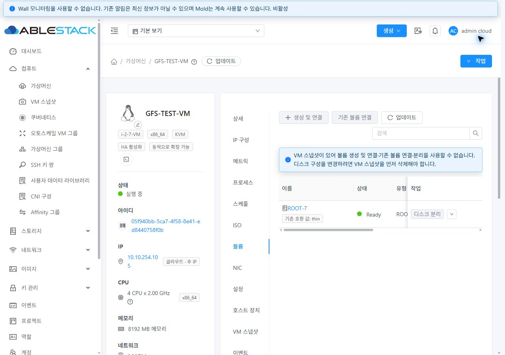

변경 전 송신 규칙:

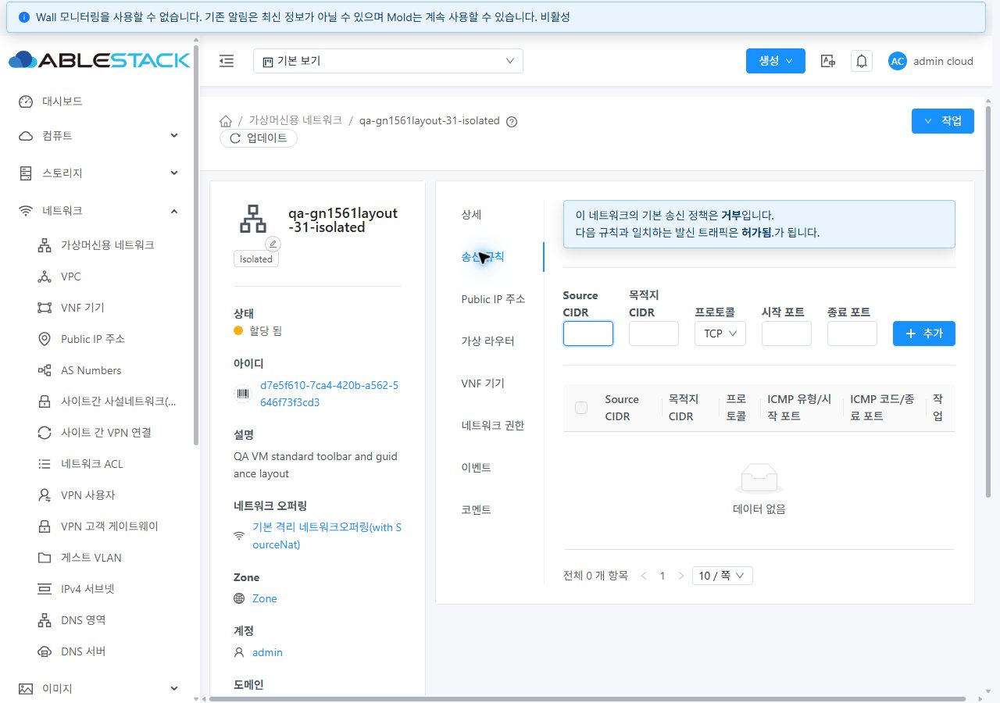

변경 후 송신 규칙:

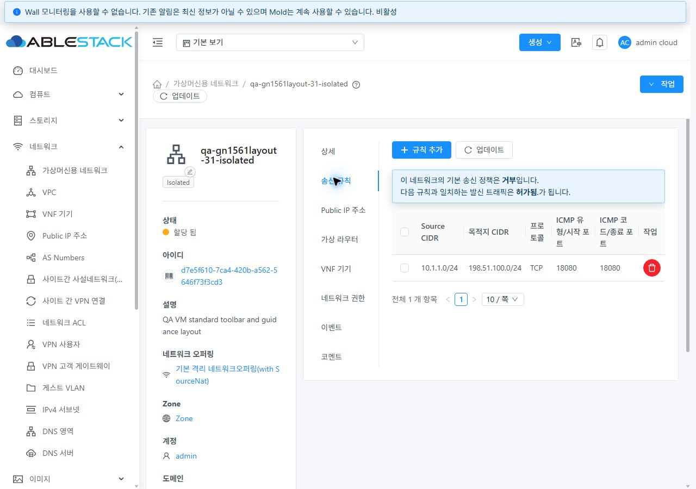

규칙 추가 — 세로 한 열:

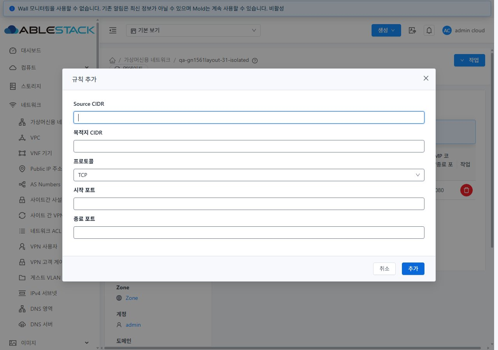

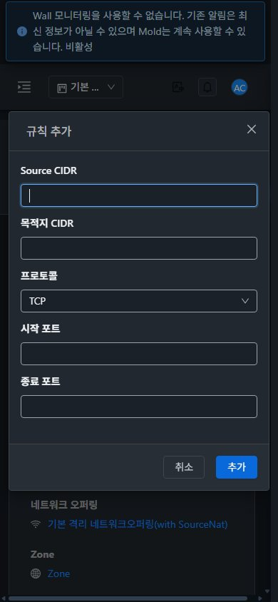

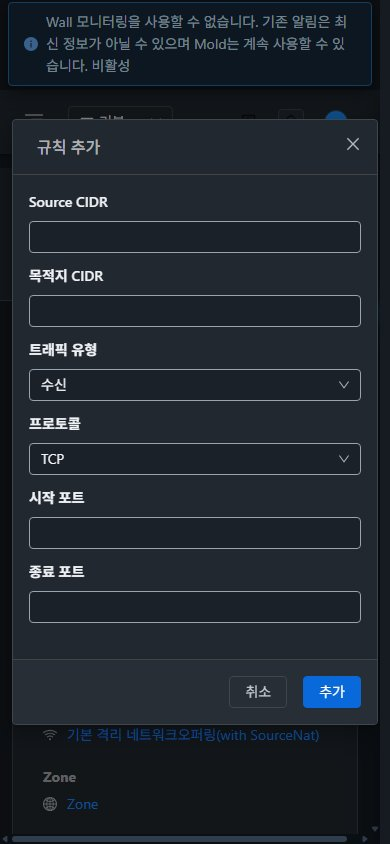

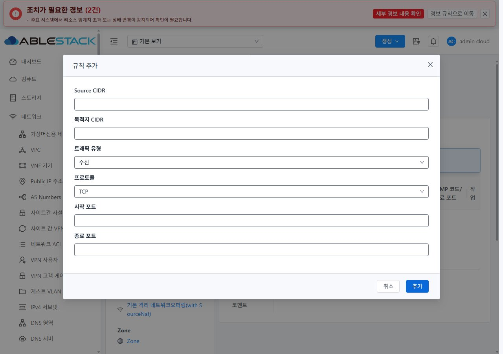

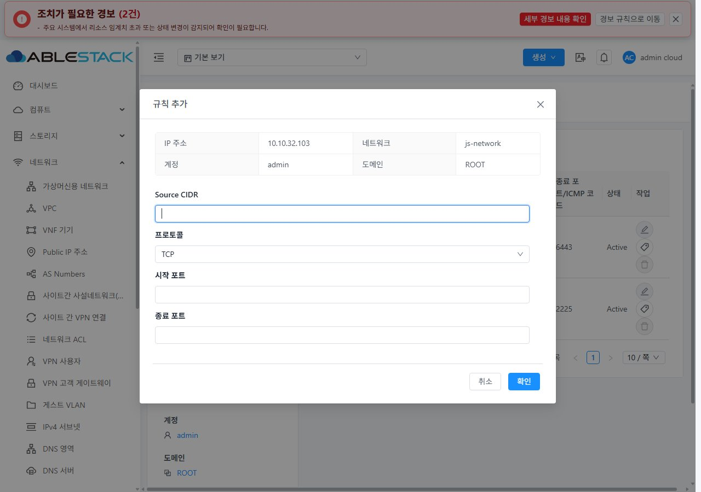

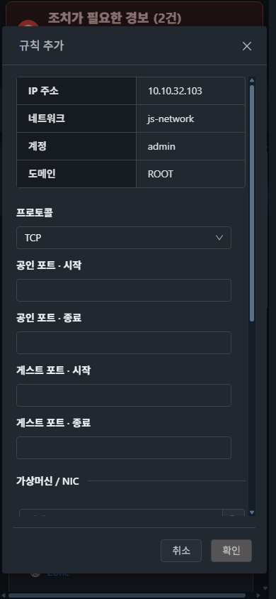

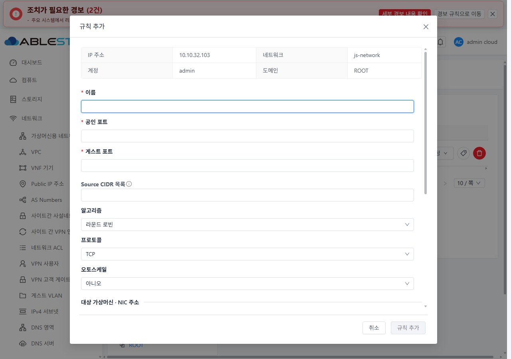

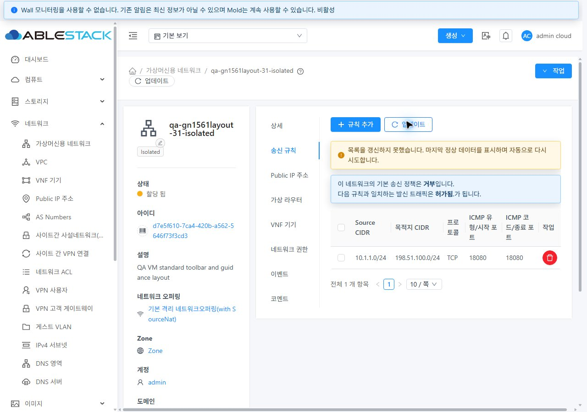

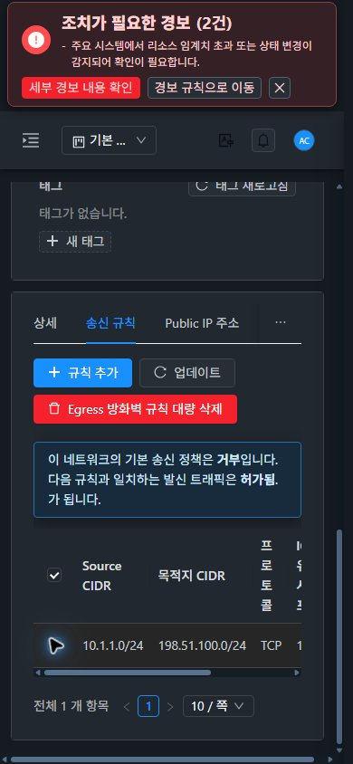

전체 파일은 [screenshots 디렉터리](screenshots/)와 [목록/해시](evidence/screenshots.json)에서 확인한다.
