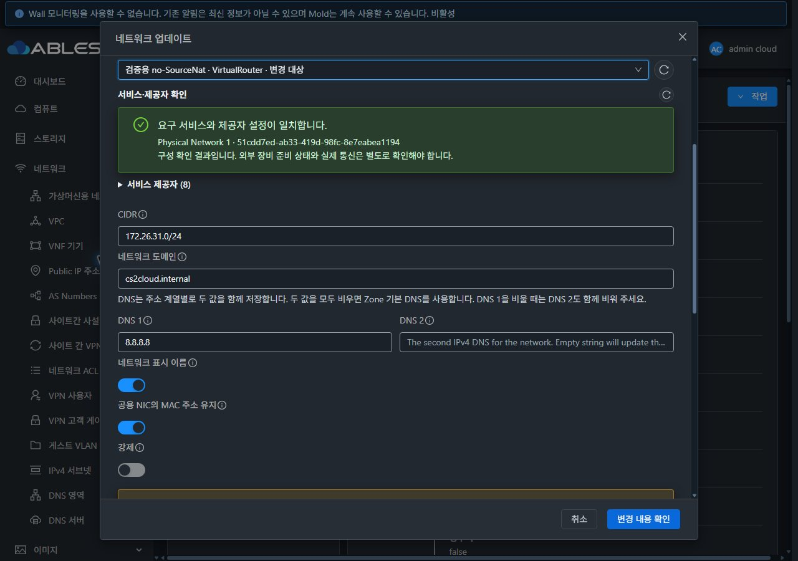
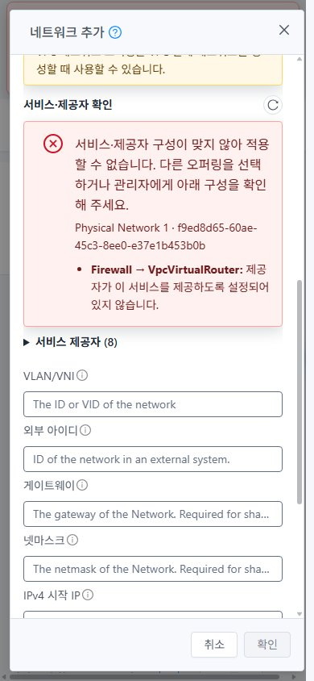
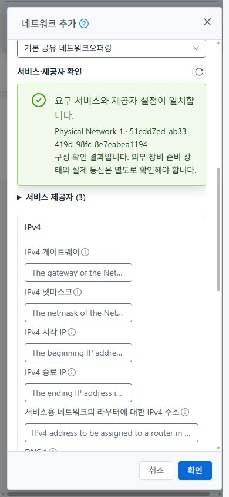

<!--
Licensed to the Apache Software Foundation (ASF) under one
or more contributor license agreements.  See the NOTICE file
distributed with this work for additional information
regarding copyright ownership.  The ASF licenses this file
to you under the Apache License, Version 2.0 (the
"License"); you may not use this file except in compliance
with the License.  You may obtain a copy of the License at

  http://www.apache.org/licenses/LICENSE-2.0

Unless required by applicable law or agreed to in writing,
software distributed under the License is distributed on an
"AS IS" BASIS, WITHOUT WARRANTIES OR CONDITIONS OF ANY
KIND, either express or implied.  See the License for the
specific language governing permissions and limitations
under the License.
 -->

# #1562 제공자 적합성 진단과 no-SourceNat 복구 검증

검증일: 2026-11-03~04 KST. [Epic #1554](https://github.com/ablecloud-team/ablestack-cloud/issues/1554), [구현 이슈 #1562](https://github.com/ablecloud-team/ablestack-cloud/issues/1562), [Epic Draft PR #1577](https://github.com/ablecloud-team/ablestack-cloud/pull/1577).

31 GFS2·32 Glue(Ceph) RBD에 UI와 변경 Java 모듈을 반영했다. 32번의 잘못된 기본 no-SourceNat 조합은 생성 전 구체적인 이유와 함께 차단하고, 전용 VirtualRouter 오퍼링으로 생성·VM 배포·동일 호스트 DHCP/양방향 ICMP를 확인했다. 기존 공유 제공자 설정과 운영 개체는 보존했다. **검토용 네트워크 6개·VM 4개·오퍼링 4개를 유지한다. 별도 삭제 지시를 기다린다.**

## 원인과 구현

- 양쪽 기본 `DefaultIsolatedNetworkOffering`은 forvpc=false인데 노출 서비스 8개가 VpcVirtualRouter로 연결되어 있었다. 31번은 그 제공자의 Firewall 서비스가 활성이고, 32번은 빠져 있어 동일 생성 요청의 결과가 달랐다. 스토리지 드라이버 차이로 분류하지 않는다.
- 초기 기본 오퍼링 설정의 Map/Set 공유로 후속 VPC용 변경이 앞선 독립/Shared 매핑에 섞일 수 있었다. `NetworkOrchestrator.defaultOfferingProviders`로 유형·SourceNat·VPC별 독립 Map/Set을 만들고 회귀 시험을 추가했다. **이미 존재하는 DB 오퍼링을 기동 시 자동으로 재작성하지 않는다.**
- UI는 오퍼링 재조회 → Guest 물리망/태그 식별 → 제공자 존재·Enabled·서비스별 지원·VirtualRouter element 상태를 기존 읽기 API로 확인한다. 목록 페이지 누락/중복, 변경·삭제·Disabled 오퍼링, 늦게 도착한 이전 scope 응답을 처리한다.
- 생성과 오퍼링 변경의 저장 직전에 다시 진단한다. 생성 입력·소유자·Zone·오퍼링이 확인 중 바뀌면 중단하며 중복 저장을 방지한다. 업데이트는 변경 검토/실제 적용 전에 재확인한다. 현재 오퍼링을 유지하는 이름·설명·DNS 편집의 기존 계약은 유지한다.
- 조회 권한이 없는 경우는 확인 불가로 구분하고 관리자 API를 몰래 호출하지 않는다. 서버의 최종 검증을 우회하지 않는다. 실제 클러스터 실행 역할은 Root Admin이며 역할/프로젝트 및 페이지·응답 역전 경계는 단위 시험이다.
- UI의 성공 표시는 **구성 일치** 판정이다. 세부 LB capability·외부 NSX/Tungsten/Netris 장비 준비·IPv6/BGP 엔진/패킷까지 성공한 것으로 표시하지 않는다. 실제 통신을 별도로 확인하라는 안내를 함께 표시한다.

## 변경한 UI와 VM 표준 반영

| 변경 UI | 적용 내용·표준 |
|---|---|
| Isolated/L2/Shared 생성 폼 | 오퍼링 아래 서비스·제공자 진단, 재확인 아이콘, 서비스별 사유와 접이식 매핑 목록. L2의 서비스 없는 오퍼링에 NAT/VR 요구를 만들지 않는다. |
| 네트워크 생성 대화상자 | VM 공통 MoldDialog lg 960px, 본문 스크롤과 고정 푸터, 32px 버튼. 취소/확인을 활성 유형에서만 표시하고 저장 중 유형 전환을 막는다. 각 유형의 초안은 유지한다. |
| 유형별 입력 연결 | 고유 폼/입력 ID와 라벨 연결. 공통 푸터 확인 버튼의 대상 form을 연결해 Enter 제출을 지원한다. 숨겨진 다른 유형의 입력으로 라벨이 연결되지 않는다. |
| 네트워크 업데이트 | 오퍼링 선택·기존 우측 재조회 아이콘 아래에 동일 진단을 추가했다. 변경 전/후 서비스 비교와 검토·적용 절차를 함께 사용한다. Shared/L2는 기존 계약상 오퍼링 변경을 노출하지 않아 해당 업데이트 진단도 적용 제외다. |
| 테마·모바일 | VM 공통 테마 색상, 본문 줄바꿈, 모바일 폭과 고정 푸터를 사용한다. 실제 페이지 스타일 설정으로 즉시 light/dark 전환을 확인했다. |

실제 VM 목록·상세·볼륨/NIC 탭·생성 및 연결 대화상자와 비교했다. 네트워크 목록→유형별 상세→탭, 상세→오퍼링, 가상머신 보기→VM NIC→네트워크, breadcrumb 이동도 실행했다. 이 작업의 주된 시각 변경은 생성/업데이트 대화상자와 공통 진단이다.

## 실제 실행 결과

| 검증 | 결과·범위 |
|---|---|
| 생성 화면 | 2클러스터 × Isolated/L2/Shared × light/dark × 1280×900·768×1024·390×844 = **36조건 통과**. 중복 ID 0, 라벨 대상 1개, 푸터 2버튼·화면 내 유지, 문서/본문 가로 넘침 0. |
| 오퍼링 변경 화면 | 2클러스터 × light/dark × 3크기 = **12조건 통과**. 기존 오퍼링 재조회 아이콘 우측 배치도 보존. |
| 32 실제 잘못된 오퍼링 | light/dark × 3크기 = **6조건**. `Firewall → VpcVirtualRouter` 미지원 사유, 확인 비활성. 유효 입력 후 Ctrl+Enter에도 생성 POST 없음. |
| 진단 글자 가독성 | 실제 계산 색상·배경의 sRGB 명암비 **최소 9.10:1**, 210개 표본. 진단 텍스트를 대상으로 한 값이며 모든 기존 UI 텍스트의 전수 측정은 아니다. |
| UI 실제 생성 | 양쪽 Isolated no-SourceNat VLAN 631/632, L2 681/682, Shared 691/692 성공. API·DB·상세 화면 대조. 최종 폼 ID 반영 후 31 L2 Enter 제출과 32 Shared 고정 푸터 제출도 실제 생성 POST 각 1개로 확인하고, 이 두 추가 제출 시험망만 정리했다. |
| UI 실제 오퍼링 변경 | 양쪽 전용 no-SourceNat VR → 동일 서비스의 전용 대체 VR 오퍼링. 검토→적용·각 updateNetwork POST 1개·jobstatus=1·최종 오퍼링 ID 일치. VM UUID/NIC/IP 보존. |
| 제출 전 재진단 | 31의 적용 직전 읽기 응답에서 VR Firewall 지원만 합성 제거: 편집 화면으로 복귀·사유 표시·update POST 0. 실제 제공자는 변경하지 않았다. |
| 조회 실패/복구 | 32 provider GET에 합성 HTTP 500: 실패 안내·적용 차단·입력 유지. 실제 재조회로 복구 후 오퍼링 변경 성공. 주입은 브라우저의 비문서 XHR 응답에만 적용했고 해제했다. |
| 게스트 실행 | 양쪽 VM 2개씩 Running, DHCP IPv4가 API NIC와 일치. 실제 게스트 SSH로 주소/경로를 읽고 VM↔VM 양방향 ICMP·라우터→VM ICMP 성공. 31 GFS2·32 Glue RBD 실제 루트 디스크 경로 대조. |

증적: [생성 행렬](evidence/creation-ui-matrix.json), [변경 행렬](evidence/update-ui-matrix.json), [부적합 행렬](evidence/32-invalid-provider-matrix.json), [명암비](evidence/contrast.json), [화면 이동·유형별 탭](evidence/network-detail-navigation.json), [89개 원본 JPEG의 크기·해시](evidence/images-index.json).

### 통신 판정의 한계

호스트가 다른 첫 배치에서 일부 VM의 DHCP 수신이 확인되지 않았다. 외부 trunk/스위치 설정을 바꾸지 않았고 그 원인을 스위치 문제로 단정하지 않는다. 이후 Cloud API로 시험 VM을 라우터 호스트에 모아 DHCP·통신을 확인했다. 오퍼링 변경은 라우터를 재배치할 수 있어, 변경 성공 후 **시험 라우터만 VM과 같은 호스트로 이동**하고 통신을 다시 검증했다. 게스트에 수동 IP를 넣거나 운영 VM을 이동하지 않았다.

따라서 이 보고서의 통신 PASS는 **동일 호스트의 내부 경로**다. 호스트 간 VLAN/격리, 외부 라우팅·DNS 실제 질의, L2/Shared VM 종단 통신, VPC/PVLAN/ConfigDrive·IPv6/BGP·외부 제공자 전체 조합은 #1570/#1571/#1572/#1574/#1575/#1576 및 #1569에 남긴다.

32에서 VLAN 3832로 실제 VM/라우터 시작 시 `brens1f0np0-3832`가 Linux 인터페이스 이름 제한 15자를 넘는 별도 결함도 재현했다. [#1580](https://github.com/ablecloud-team/ablestack-cloud/issues/1580)에 재현·기존 #1568 사례·코드 근거·호환성 설계·완료 기준을 게시하고 Epic 하위 이슈로 연결했다. 31의 VLAN 3831 DHCP 미수신을 같은 이름 오류로 단정하지 않는다.

no-SourceNat 생성과 IP 범위 API 데이터는 확인했지만 상세의 **게스트 IP 주소 범위 탭은 여전히 숨겨져 있다**. Shared에서는 해당 탭과 생성 범위를 직접 확인했다. 이 차이를 다음 구현 **#1557**로 유지한다. 해결 순서는 #1562 → #1557 → #1580 → 기존 후속 순서다.

## 소스·로컬 빌드·실행 산출물

같은 Epic 브랜치 `dhslove/epic-1554-guest-networks`와 Draft PR #1577을 사용한다.

- Java 빌드 소스: `60ac6deebda7409280076fae71d20ea15c2899c7`.
- 최종 UI 빌드·배포 소스: `1c3e9e1f21cc52cd91414cee20448ca6eacbabf0`.
- 후속 소스: `7b73c11f72854b90b2ada2b88cc62ba4c3c9527f`. 신규 Vue 컴포넌트의 라이선스 주석만 저장소 형식으로 정리했다. 빌드 커밋과 `<template>` 이후 내용이 동일함을 확인했고 해당 파일 lint 통과. 기능·배포 산출물은 동일하다.
- WSL ext4 `/home/ablecloud/work/dhslove/cloud-epic-1554`에서 변경 모듈만 로컬 빌드: `mvn -pl engine/orchestration -Dtest=DefaultOfferingProvidersTest,NetworkOrchestratorTest -Drat.skip=true package`. **65/65**, Checkstyle·package 통과.
- UI 집중 4 suites **121/121**, 전체 UI/변경 파일 lint, Node20 로컬 production build 통과. [빌드·시험 요약](evidence/build-and-tests.json).
- 전체 Cloud 빌드, 수동 Actions 빌드, qemu 빌드는 시작하지 않았다. 기존 자동 검사의 1c3e9e1 시점 License 실패는 미승인 **3,494건**, 전체 저장소 pre-commit에도 기존 오류가 있다. 신규 Vue 주석 형식까지 추가 정리했다. 자동 전체 검사와 위 로컬/실환경 성공을 구분한다.

양쪽 active webapp `/usr/share/cloudstack-management/webapp`에 정적 파일 **648개**만 반영했다. 전 파일 해시 일치, index SHA256 `e911d4addd8efa52cf9c3e572f112c08e0bbd5965802c0bb498945a17171bfa3`. WEB-INF/META-INF·운영 config·기존 이미지·관리 PID를 보존했고 `/client/` HTTP 200이다. 신규 진단/폼 ID 및 기존 FTCTL `blockingLoadingState`·`fetchSyncProgress`·`extractJobId` 마커를 확인했다.

변경 모듈 JAR SHA256은 `5dac65cf7812b2733c209d714c37627c9b6f57e97ae83755d875c8ea766379bc`다. 실행 fat JAR의 대상 기존 18개 클래스가 Maven 기준과 일치함을 확인한 뒤 그 계열 18개만 덮었고 **나머지 ZIP 항목 204,639개는 보존**했다. 최종 fat JAR SHA256은 양쪽 `df0f900602bc90d5e11a7dd327ea16d5f917d8507001b85ed7464708dd5e5f10`. 서비스 active, 새로운 linkage/class 오류 없음. 관리 재시작 후 PID는 31 `497588`, 32 `613723`이다.

[31 최종 실행 검증](evidence/31-final-runtime.json) · [32 최종 실행 검증](evidence/32-final-runtime.json) · [UI 정적 manifest](evidence/manifest.json) · [18개 클래스 해시](evidence/classes.json).

### 백업·되돌림

31의 Java 원본은 `/var/lib/ablestack/qa-backups/gn1562-jar-20261103-233427/`에 있다. 32는 루트 여유 공간 부족으로 최초 백업/임시 복사가 실패했으며 그때 active 원본/PID는 유지됐다. 이 작업의 불완전한 임시 파일만 제거한 후 원본을 WSL로 옮겨 검증하고 tmpfs에서 배포했다. 영속 원본은 WSL `/home/ablecloud/work/guest-network-1562-validation/backups/original-cloudstack.jar`, SHA256 `878054400f56c243449021f5bbe32be45522a2cbe2aaa7a3371652b0fe4bb525`다. 32의 `/dev/shm/gn1562-jar-20261103-233707/backup/` 복사본은 재부팅 시 사라질 수 있으므로 영속 백업을 기준으로 한다. 무관한 서버 파일은 정리하지 않았다.

UI 최초·중간·최종 배포 직전 백업은 같은 WSL 디렉터리 `backups/20261103-234427/`, `backups/20261104-000309/`, `backups/20261104-002156/` 아래 31/32별 `static-backup.tar.gz`로 유지한다. 되돌릴 때는 해당 정적 백업의 파일만 복구하고 WEB-INF 등 서버 디렉터리를 보존한다. Java 원본의 SHA를 확인해 fat JAR를 원자적으로 복구한 뒤 관리 서비스를 재시작하고 HTTP/API·클래스/로그를 재확인한다. 기존 DB 오퍼링/공유 제공자를 변경하지 않았으므로 이 작업에 의한 DB 매핑 되돌림은 없다. 검토용 오퍼링은 사용 네트워크를 정리한 뒤 공식 API로 제거하며 사용자 삭제 지시를 먼저 기다린다.

## 정리·기존 자원 보존·최종 검토 자원

이전에 유지한 `qa-gn1561layout-31-isolated` / `qa-gn1561layout-32-isolated`와 TCP 18080 규칙은 이번 삭제 지시에 따라 정리했다. API/비동기 job·DB와 UI 빈 목록을 확인했다.

실패한 VLAN 3831/3832 초기 시험망과 VM/라우터도 정리했다. 31 GFS2 루트 3개는 호스트에서 부재다. 32 실패 라우터 볼륨 `d44147d5-e5e5-44f2-9a55-079f4c44b4cd`는 모든 도메인의 미사용·open fd 없음 확인 후 해당 RBD 매핑만 해제하고 공식 deleteVolume으로 삭제해 Glue 이미지 부재를 확인했다. 실패망의 실제 VM NIC는 0개지만, **각 DB에 instance_id=NULL인 PlaceHolder NIC 1개가 삭제된 부모망 아래 Reserved로 남아 있다**. 실행 VM/NIC·RBD 잔여물과 구분하며 이 정리 계약은 #1568에 인계한다. 직접 DB 수정은 하지 않았다.

기존 9종 인벤토리의 비교 필드·공유 제공자/물리망·VPC·ACL 목록은 유지됐다. 새 자원에 따른 admin VM/volume 합계만 각각 +2다. network resource_count는 양쪽 3이며 실제 집계 조건의 DB 기대값 3과 일치한다. VLAN 지정 오퍼링 시험망의 수를 단순히 networktotal에 더하지 않았다. 보호한 주 작업트리의 HEAD/dirty FT 변경도 유지한다.

| 클러스터 | 유지한 네트워크 | UUID·대역 |
|---|---|---|
| 31 GFS2 | [qa-gn1562-31-nosnat](http://10.10.31.10:8080/client/#/guestnetwork/c00cbfae-a846-4071-af4d-eaa24f4d5a5b?tab=details) | c00cbfae-a846-4071-af4d-eaa24f4d5a5b · VLAN 631 · 172.26.31.0/24 |
| 31 GFS2 | qa-gn1562-31-l2 | 91cfc778-d172-4918-9360-7774d6476029 · VLAN 681 |
| 31 GFS2 | qa-gn1562-31-shared | 63343ad6-9a1c-4f51-95ad-175c515d60e1 · VLAN 691 · 172.27.31.0/24 |
| 32 Glue RBD | [qa-gn1562-32-nosnat](http://10.10.32.10:8080/client/#/guestnetwork/5449857d-5504-4c40-b749-fdccfb09b527?tab=details) | 5449857d-5504-4c40-b749-fdccfb09b527 · VLAN 632 · 172.26.32.0/24 |
| 32 Glue RBD | qa-gn1562-32-l2 | cb9d2af7-4f01-4729-91d9-ad8771e5cf3d · VLAN 682 |
| 32 Glue RBD | qa-gn1562-32-shared | f4029961-1511-4147-a15a-c8315cd94183 · VLAN 692 · 172.27.32.0/24 |

각 no-SourceNat 망의 `qa-gn1562-31/32-vm-a`, `-vm-b`는 각각 `.18`, `.19`로 Running이다. 31은 ablecube31-2, 32는 ablecube32-1에 라우터와 함께 있다. 각 클러스터의 `qa-gn1562-31/32-nosnat-vr`, `-alt` 오퍼링도 유지하며 현재 망은 `-alt`를 사용한다. [31 유지 자원](evidence/31-retained-resources.json) · [32 유지 자원](evidence/32-retained-resources.json) · [31 보존 검증](evidence/31-final-preservation.json) · [32 보존 검증](evidence/32-final-preservation.json).

브라우저는 light 테마와 정상 viewport/cache 상태로 복원하고 두 no-SourceNat 상세 화면을 남겼다. **다음 구현 대상은 #1557**이며 이 작업에서 자동으로 시작하지 않는다. Epic과 Draft PR은 진행 상태로 유지한다.
