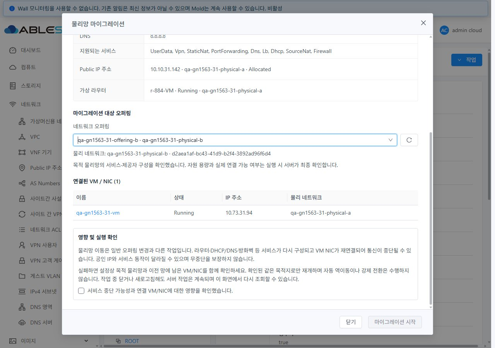
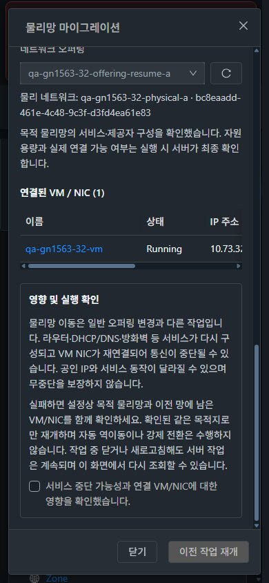

<!--
Licensed to the Apache Software Foundation (ASF) under one
or more contributor license agreements.  See the NOTICE file
distributed with this work for additional information
regarding copyright ownership.  The ASF licenses this file
to you under the Apache License, Version 2.0 (the
"License"); you may not use this file except in compliance
with the License.  You may obtain a copy of the License at

  http://www.apache.org/licenses/LICENSE-2.0

Unless required by applicable law or agreed to in writing,
software distributed under the License is distributed on an
"AS IS" BASIS, WITHOUT WARRANTIES OR CONDITIONS OF ANY
KIND, either express or implied.  See the License for the
specific language governing permissions and limitations
under the License.
 -->

# 이슈 1563 물리망 마이그레이션·실패 재개 검증

2026-11-05~06 KST. Epic #1554 / 누적 Draft PR #1577 / `dhslove/epic-1554-guest-networks`.
물리망 이동 전용 UI와 서버 안전 검증을 구현하고 31 GFS2·32 Glue RBD에 반영했다. 실제 UI 시작·실패·동일 목적지 재개·정상 이동과 VM/NIC 통신을 검증했다. [설계·유형별 실행 범위](policy-design.ko.md), [확인용 자원](resources.ko.md), [전체 캡처 행렬](capture-matrix.ko.md).

## 변경 UI와 VM 표준 반영

| 화면 | 변경 내용·표준 |
|---|---|
| 네트워크 상세 작업 메뉴 | Root Admin 및 API 권한이 있는 Isolated/Guest에 물리망 마이그레이션 추가. 기존 목록·상세·탭·breadcrumb 구조 사용 |
| 전용 대화상자 | VM 편집과 같은 MoldDialog lg, 14px·테마 토큰, 고정 제목/푸터·본문 스크롤 |
| 본문 배치 | 현재 설정·실제 라우터/공인 IP → 대상 오퍼링 → VM/NIC → 영향·확인을 의미별 세로 구획으로 구성. 상태와 업데이트를 같은 행에 배치 |
| 대상 오퍼링 | 다른 물리망 후보를 별도 조회하고 드롭다운 바로 오른쪽에 새로고침 아이콘 배치. 실패 재개 시 기존 목적지 고정 |
| 진행·실패 | 서버 job ID와 실제 물리망 상태 재조회. 이전 망에 남은 VM/NIC·라우터·IP 구분, 중복 쓰기 차단, 새로고침 복구·읽기 재시도 |
| 화면 이동·모바일 | VM 링크 이동 시 대화상자 즉시 닫힘·늦은 응답 폐기, VM breadcrumb/NIC 탭 확인. 모바일은 본문/표 내부 스크롤, 테마 즉시 전환·푸터 가독성 확인 |

## 실제 실행 결과

- 31·32 전용 A/B 물리망에서 Running Linux VM과 라우터를 같은 호스트에 배치했다. 정상 이동과 자원 부족 실패 뒤 같은 network/offering/physical로 `resume=true` 재개가 완료됐다. UUID·IP·MAC이 유지되고 실제 NIC 브리지, SSH, 게이트웨이 ping이 일치했다.
- 31·32 정상 시작의 이중 클릭은 POST 한 번만 발생했다. 목적 망 비활성화 후 제출은 새 POST 없이 차단했다. 진행 중 새로고침 뒤 같은 job을 복구했고 완료 상태는 서버 결과·실제 네트워크로 재검증했다. 마지막 UUID 정리 중 일시적인 읽기 불일치도 새 POST 없이 제한된 자동 재조회로 복구했다.
- 양쪽에서 체크포인트 없는 resume, 같은 물리망으로 새 migration, 체크포인트 중 신규 시작, 다른 목적 offering의 resume를 거부했으며 network/NIC 값이 유지됐다. 일반 User는 자기 망에서도 UI 동작이 없고 직접 호출은 job 접수 전에 거부됐다. 완료 작업 조회 옵션도 기존 계정 ACL을 유지한다.
- Root가 일반 User 소유 망을 이동한 뒤 소유권·망 UUID가 유지됐고 처음 사용한 VLAN 3102/3202의 원래 예약 식별자에 해당하는 예약이 해제됐다. 두 클러스터의 QA VLAN 예약 2개씩은 실제 활성 망과 일치하며 활성 숨김 복사본은 0이다.
- 최종 24개 반응형·테마 조건과 48개 캡처를 검사했다. 가로 넘침 0, 고정 푸터·14px 안내, 점검한 문자 최저 대비 7.13을 확인했다. 전체 68개 JPEG의 해상도·해시를 검사했다.

## 발견·수정한 엔진 결함

초기 API 성공은 통신 PASS로 계산하지 않았다. KVM이 재연결 후 새 tap 이름을 부여했는데 이전 tap 이름으로 링크를 갱신해 NIC가 내려간 결함을 실제 XML·agent 응답으로 확인했다. 실제 tap 이름 적용, 부정 ReplugNicAnswer 시 이전 NIC/체크포인트 보존, 성공 뒤 NIC UUID·서비스 전달을 구현했다.

반복 이동 중 이전 VLAN 예약 식별자 누락과 라우터 구현의 빈 결과 NULL 역참조도 수정했다. 최초 시험에서 남은 QA 전용 VLAN 1개씩은 활성 참조 0을 조건으로 복구했다. QA NIC 링크 수동 복구·기존 예약 복구는 정상 이동 결과에 합산하지 않았으며 수정 뒤 정상 이동·재개·통신·예약 해제를 다시 검증했다.

## 로컬 시험·빌드 및 배포

| 항목 | 결과 |
|---|---|
| API 모듈 | 1,135 시험 PASS / install |
| server 변경 모듈 | 90 시험 PASS / package; 시험 import 정리 후 해당 NIC 실패 회귀 1개 재확인 |
| schema 모듈 | 441 시험 PASS / package; 실제 async_job_view의 Network UUID 매핑·다른 job 행 보존 검증 |
| KVM 변경 모듈 | 재연결 enabled/disabled 및 새 tap 이름 2개 시험 PASS / package |
| UI | 4 suite / 95 시험 PASS, 변경 파일 lint 및 production build PASS |

전부 WSL ext4의 변경 모듈·UI 로컬 빌드다. 전체 Cloud·qemu 빌드와 수동 Actions 빌드는 실행하지 않았다.

실행 로직·최종 UI 빌드는 `15e73de0834b61b29b79c376fecf1e744f783b78`이다. 이후 `666675987b1a6b24e01382924311dd147b799429`는 Vue 라이선스 주석과 시험 import만 정리했으며 template/script/style 본문 해시는 동일하다. [실행 코드 동등성](evidence/nonruntime-style-proof.json).

- 두 관리 서버 JAR: `488e7dbd7c89081108db157ce1fbc656646cd9e26671a9624498707cdd2283a4`
- 활성 UI index.html: `6858db7755568a151ffbcda6ff92c24e8160d384d6e0f9276b94ffdab9af6c56`
- 정적 파일 654개를 allowlist로 반영하고 WEB-INF·서버 디렉터리·구성을 보존했다. 양쪽 HTTP 200 및 FT UI marker를 확인했다. KVM agent 여섯 호스트에는 해당 클래스만 반영하고 실행 VM XML·기존 hook/FTCTL 파일 해시를 보존했다.
- [빌드·배포 증적](build/) · [시험 로그 요약과 원문 해시](build/test-results.json), [실제 최종 31 상태](evidence/31-final-state.json), [32 상태](evidence/32-final-state.json), [UI 요청 기록](evidence/ui-actions.json), [시각 검증 요약](evidence/visual-summary.json).

## 정리·보존 및 제한

이전 #1566 시험 망 2개, VM 2대, 라우터 2대, LB/방화벽 각 2개, 네트워크 오퍼링 10개를 공식 API로 정리했다. 이전 network/NIC/VM/router/volume/offering 활성 잔여는 0이다. 기존 운영 망 31개와 VM 176대의 비교 필드 및 원래 물리망·오퍼링을 보존했다. 주 작업 트리의 기존 FT HEAD·staged/unstaged diff 해시도 동일하다.

새 확인용 망 4개·VM 2대·라우터 4대 및 관련 자원은 별도 삭제 지시까지 유지한다. 실제 범위는 [자원 문서](resources.ko.md)를 따른다. VLAN 스위치가 구성되지 않아 VM/라우터는 31-2·32-3의 같은 호스트를 사용했다. 호스트 간 trunk·IPv6·외부 제공자·VPC/no-SourceNat migration·규칙 전수 패킷 전달·백엔드 부하 분산은 이번 실환경 PASS 범위에 포함하지 않는다. L2는 읽기 UI와 유형 가드, Shared는 소스·단위 시험 검토 수준이다.

자동 License Check는 검증 코드 head에서 기존 3,544개 미승인 파일로 실패했고, 전체 pre-commit도 기존 다수 파일의 license/Markdown/기타 정리 항목으로 실패했다. 새 Vue의 요구 주석 형식과 시험 import는 별도로 정리했다. 변경 Java 파일 Checkstyle 오류는 0이다(API 전체 6/server 62/KVM 19개는 변경하지 않은 파일). 새 소스·증적 239개 파일에 저장소와 같은 RAT 설정을 적용한 별도 라이선스 감사는 미승인 0으로 통과했다. 원문 .log는 로컬에 보관하고 원격에는 원문 해시와 시험 요약을 게시했다. 최종 자동 CI 상태는 PR Checks에서 확인한다. 로컬/실환경 PASS를 전체 Cloud CI 성공으로 표현하지 않는다.

다음 구현은 **#1568 네트워크 비동기 작업·삭제 의존성·상태 안내 및 UI 사용성 표준화**다. 진행 중 체크포인트 설명의 구분, 완료 직후 자원 집계의 일시적 지연, 공통 조회/실패 UX를 인계한다. 32번에서 새로고침 후 1회 계정 제한 탭으로 이동한 관찰도 재현·입력 영향 분리가 끝나지 않은 항목으로 인계하며 확정된 제품 결함으로 분류하지 않았다. 32 User 망 count 2→실제 1 관찰은 이후 공식 집계에서 1로 일치했으며 직접 DB 카운터 수정은 하지 않았다. PR은 Draft·Open, Epic은 Open으로 유지한다.
