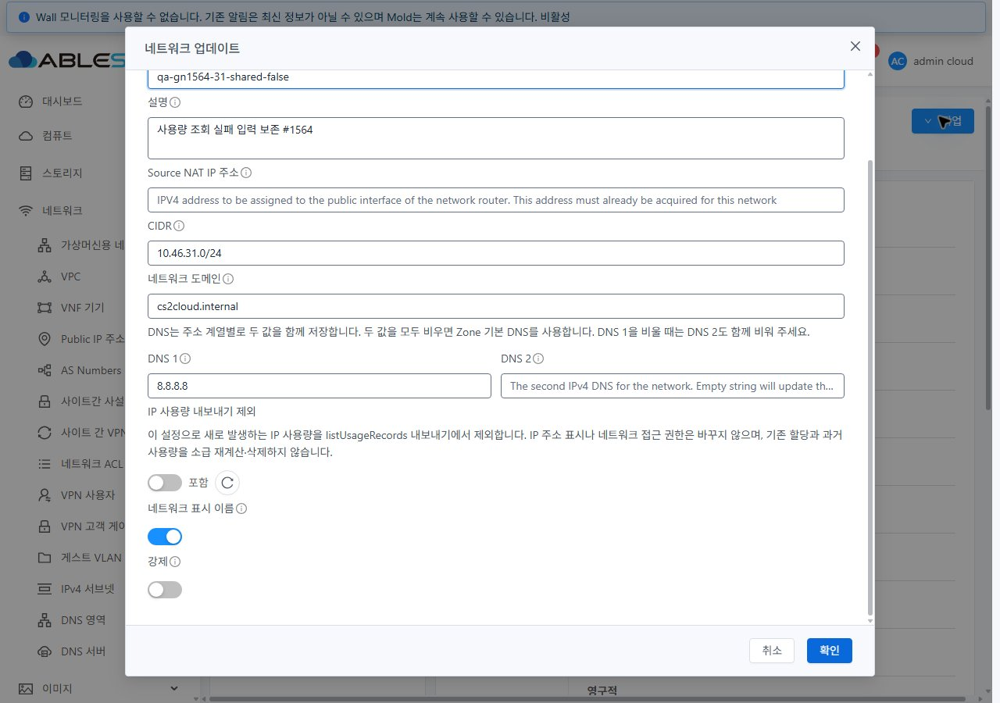
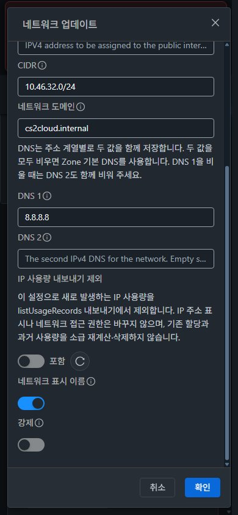

<!--
Licensed to the Apache Software Foundation (ASF) under one
or more contributor license agreements.  See the NOTICE file
distributed with this work for additional information
regarding copyright ownership.  The ASF licenses this file
to you under the Apache License, Version 2.0 (the
"License"); you may not use this file except in compliance
with the License.  You may obtain a copy of the License at

  http://www.apache.org/licenses/LICENSE-2.0

Unless required by applicable law or agreed to in writing,
software distributed under the License is distributed on an
"AS IS" BASIS, WITHOUT WARRANTIES OR CONDITIONS OF ANY
KIND, either express or implied.  See the License for the
specific language governing permissions and limitations
under the License.
-->

# #1564 Shared IP 사용량 제외 수정 UI와 집계 정합성

31(GFS2)·32(Glue/Ceph RBD)에 수정 UI·API·Usage 클래스를 반영했다. **현재 실제 일일 Usage 집계 확인 대기 중이며 이슈는 Open이다.** 설정 저장만으로 내보내기 효과를 PASS 처리하지 않는다. 각 서버의 기존 정책은 Asia/Seoul·1,440분·00:15이며 다음 실행은 **2026-11-05 00:15 KST**다. 전역 집계 정책·실행 시각·과거 이벤트/Usage 데이터는 수정하지 않았다.

- [이슈 #1564](https://github.com/ablecloud-team/ablestack-cloud/issues/1564) · [Epic #1554](https://github.com/ablecloud-team/ablestack-cloud/issues/1554) · [기존 Draft PR #1577](https://github.com/ablecloud-team/ablestack-cloud/pull/1577)
- 같은 `dhslove/epic-1554-guest-networks` 브랜치. UI 실행 소스 `230588add5fc62db1c99e243dbc0b033436f0e82`, API 소스 `44466c2ecfd3b285590edb8532d3ee8d8771520d`, Usage 소스 `2e0dc070d0a64a25fadf2737c14ebdb961ca23a0`.
- 이전 #1565 시험망 16개·오퍼링 8개·VPC/라우터 2개와 소유/프로젝트 자원은 정리했다. **새 네트워크 14개·VM 2대·자동 생성 라우터 2대 및 QA 도메인/계정/프로젝트는 별도 삭제 지시까지 유지**한다. 새 전용 오퍼링은 없다. [검토 자원과 직접 링크](resources.ko.md).

## 변경 UI와 실제 VM 표준 대조

| 화면 | 개선 내용 | 컴퓨트 > 가상머신 표준 반영·확인 |
|---|---|---|
| Shared 네트워크 업데이트 | 현재값을 별도 조회하고 포함/제외 스위치·상태 문구·우측 재조회 아이콘 추가. 미확인 시 스위치를 false로 표시하지 않고 오류·재시도 제공 | 기존 VM `MoldDialog` lg 960px, 세로 입력 구역, 본문 스크롤·고정 푸터·32px 버튼을 사용. VM의 글자 없는 스위치 옆에 14px 상태 문구 배치 |
| Shared 상세 탭 | `IP 사용량 내보내기 제외` 읽기 전용 값과 도움말 추가 | VM 공통 상세 목록의 라벨/값·테마 변수·줄바꿈 사용. 별도 상단 리본이나 탭 도구 모음 추가 없음 |
| Shared 생성 | 수정과 같은 명칭·도움말 및 Root Admin/API 인자 노출 조건 적용 | 기존 생성 `MoldDialog` 유지. 화면 열기·도움말/기본 false 확인. 실제 true 생성 호환성은 API로 확인했으며 이번 생성 버튼의 전체 UI 제출을 새로 실행한 것으로 세지 않음 |
| 목록·breadcrumb·관련 VM | 기존 공통 UI 재사용 | 실제 VM 목록·상세·볼륨/NIC·수정 대화상자를 대조. 네트워크 목록 검색→상세→breadcrumb 복귀에서 검색 조건 유지, 관련 VM 목록→VM 상세→망 링크 이동 확인 |
| 모바일·즉시 테마 변경 | 390px에서 세로 배치와 내부 스크롤, light/dark 상태 문구 가독성 | 31/32 × 1280×900·768×1024·390×844 × light/dark, 총 12조건에서 off/on 초안/상세의 **36개 최종 프레임** 확인. 양쪽 모바일 실제 저장도 확인 |

기준 화면: [VM 목록](screenshots/31-vm-list-standard.jpg) · [상세](screenshots/31-vm-detail-standard.jpg) · [볼륨 탭](screenshots/31-vm-volumes-standard.jpg) · [VM 수정 대화상자](screenshots/31-vm-edit-dialog-standard.jpg). [네트워크 수정 전](screenshots/31-network-edit-before.jpg)과 비교할 수 있다.

최초 구현의 스위치 안 12px 문구는 모바일 다크 off에서 대비 3.529:1이었다. 실제 VM처럼 스위치 밖으로 옮겼고 최종 36프레임의 새 상태 문구·도움말 **84회 측정 최소 6.978:1**이다. rgba alpha를 배경에 합성해 계산했다. 이는 새 글자 영역의 측정이며 앱 전체 WCAG 인증을 뜻하지 않는다. [측정](contrast-check.json) · [화면 크기/본문/푸터 검사](layout-checks.json) · [12조건 결과](final-style-matrix.json).

총 **76개 원본 JPEG**를 게시한다. `*-final.jpg`는 최종 UI2305, 나머지는 실제 VM 기준·변경 전·초기4446의 오류 진단 화면이다. 모든 JPEG 서명·실제 디코딩 크기·sidecar의 viewport 및 SHA256을 확인했다. [전체 캡처 색인](screenshots.ko.md) · [무결성](image-integrity.json). 원본을 재인코딩하거나 PNG 확장자로 바꾸지 않았다.

## API·상태 보존과 발견된 서버 결함

1. Root Admin + Shared + `updateNetwork`/`hideipaddressusage` 지원 조건에서만 수정 항목을 표시한다. User/DomainAdmin API 메타데이터에도 인자가 나타나지만 그것을 권한으로 판단하지 않는다. 실제 해당 역할의 Shared(specifyvlan=true) 업데이트는 기존 정책에 따라 531로 거부된다. UI 작업도 비활성화되며 상세에 Root 전용 값이 노출되지 않는다.
2. 관리자 전체 `details`의 키 부재는 서버 기본 false다. details 자체 부재/비정상 값은 unknown이다. 문자열/boolean true·false를 정규화하고 읽기 실패를 false로 전환하지 않는다.
3. **기존 Admin API getter는 인자 생략을 false로 바꿨다.** 이 때문에 무변경/설명 수정이 저장된 true를 지울 수 있었다. nullable 값을 그대로 반환하게 고쳐 NetworkService의 기존 null guard가 동작하도록 했다. 명시 false는 여전히 저장된다.
4. UI는 바뀐 경우만 true/false를 명시한다. 저장 전 현재값 재확인, 충돌 안내, 비동기 성공 후 재조회/대조, 실패·불일치·pending 시 초안/작업 ID 보존을 적용했다. 전후 GET은 원자적 compare-and-set을 제공하는 서버 트랜잭션으로 확장한 것이 아니다.
5. 자원·역할·API·프로젝트 scope와 요청 세대를 확인해 이전 응답이 다음 화면을 덮지 못하게 했다. 조회 재시도는 관련 사용량 필드만 갱신하며 다른 입력을 유지한다.

`displaynetwork`, IP 가시성, 네트워크 사용 권한과 구분한 도움말을 생성/수정/상세에 넣었다. 현재 할당과 과거 이력은 설정 토글만으로 재계산하지 않는다. 제외를 켠 상태에서도 양쪽 관련 VM 목록과 VM NIC의 `10.46.31.18` / `10.46.32.18`이 보인다.

## UI/API 실행 결과

| 검증 | 31 | 32 | 근거·실행 수준 |
|---|---|---|---|
| 기존 true·false / details 키 부재 기본값 | 확인 | 확인 | API 생성·실제 수정/상세 표시·DB 일치 |
| false→true→false | 확인 | 확인 | 실제 POST·비동기 job·재조회. 최종 모바일 false 저장까지 확인 |
| true 상태의 무변경 저장 | 확인 | 확인 | 요청에 hideipaddressusage 없음, 서버 true 유지 |
| 읽기 실패에서 false 덮어쓰기 방지 | 확인 | 확인 | CDP 합성 GET500. 31은 설명만 저장해 true 보존, 32는 설명 초안 유지한 실제 재조회/저장 복구 |
| 쓰기 권한 오류·job 실패 | 확인 | 확인 | 합성 POST403 각1·가짜 jobstatus2 각1, 해당 요청의 서버 쓰기0. false 초안 보존·실제 재시도 성공. 실제 역할 API 거부531은 별도 기록 |
| User·DomainAdmin UI/서버 제한 | 확인 | 확인 | 각각 실제 로그인. 상세 항목 없음/업데이트 비활성, 직접 API531 뒤 Root 값 true 유지 |
| Shared account·domain·all·project | 확인 | 확인 | 각 범위 현재값. 프로젝트 무변경 실제 저장과 projectid 요청 확인 |
| Isolated·L2 비적용 | 확인 | 확인 | 수정 항목/상세 값 없음. Isolated 무변경 실제 저장에 인자 없음 |
| 목록·상세·탭·VM 링크·breadcrumb | 확인 | 확인 | 검색 조건 복귀, 관련 VM1대와 NIC IP 표시, VM NIC/볼륨 이동 |
| 반응형·즉시 테마 변경 | 6조건 | 6조건 | 각 조건 off/on 초안·상세. 가로 넘침0, 본문 스크롤·화면 내 푸터. 최종 역할 로그인 이후 콘솔 error0 |

[실제 요청](ui-requests.json) · [합성 오류 구분](fault-results.json) · [역할 UI](role-ui.json) · [31 역할 API](31-role-api.json) · [32 역할 API](32-role-api.json) · [범위](scope-ui.json) · [유형](type-ui.json).

scope 변경/응답 역전·현재값 충돌·async 후 값 불일치/읽기 실패·중복 저장 차단은 전용 단위 시험에서도 확인했다. 해당 항목 전부를 실서버 장애로 재현한 것으로 합산하지 않는다. 초기 관리 서버 재시작 중 이전 UI 번들 세션의 zones.filter/CSS 오류는 최종 역할 재로그인·VM→망 이동에서 재현되지 않았다. 합성 HTTP 오류와 JS 콘솔 오류를 구분한다.

## 실제 Usage 집계·내보내기

**일일 집계 결과 대기 중. 다음 절은 준비/소스·단위 검증 결과이며 실제 집계 PASS가 아니다.**

같은 IP를 실제 실행 중 QA VM의 Shared NIC에 포함(false)→제외(true)→포함(false)으로 할당·반납·재할당했다. Cloud 이벤트의 hidden 플래그는 각각 0/1/0이며 마지막 NIC는 유지한다. 설정만 토글했을 때 기존 할당의 플래그가 소급 변경되지 않음도 구분한다.

| 클러스터 | IP / 내부 ID | 첫 할당/반납 | 제외 할당/반납 | 최종 포함 할당 |
|---|---|---|---|---|
| 31 | 10.46.31.18 / 429 | 9548 / 9553 | 9554 / 9559 | 9561 |
| 32 | 10.46.32.18 / 464 | 5212 / 5216 | 5217 / 5222 | 5224 |

이 경로를 검토하며 기존 `IPAddressUsageParser`가 IP ID 하나로 세 구간을 합치고 마지막 hidden 값으로 전체 내보내기를 결정하는 결함을 발견했다. 실제 파서를 호출하는 회귀 시험4개 중 전환3개가 수정 전 실패했다. 집계 키를 **IP ID + hidden**으로 나눠 포함/제외 합계를 분리했다. 기존 단일 정책 합산·기간 clipping은 유지한다. 수정 후 Usage 모듈22개 시험이 통과했다.

실제 주기 후에는 helper에 3구간(0/1/0), 일별 Usage에 2합계(포함0·제외1)가 생성되어야 한다. **listUsageRecords(type=4, usageid=QA IP UUID, 11/4 날짜)는 포함 합계1개만 반환**해야 한다. 구간 시간으로 계산한 포함/제외 시간과 DB/API 시간을 대조하고 기존 이력 해시도 다시 확인한다. 전역 정책 변경, 과거 이벤트 날짜 조작, Usage DB 직접 수정·수동 generateUsageRecords는 하지 않았다.

과거 이력의 baseline: 31번 id≤30395의 30,395건 `a7d494b4adda5a29e327b64f0a339e14cb53f2b091fe6fd36ea4868ee6efeb49`, 32번 id≤13485의 13,485건 `973c44d2be907de3182d771c18469c8720be5b6f8f25bc794437baf391bd407e`. 정렬된 고정 필드의 해시이며 집계의 quota bookkeeping 필드는 제외했다. 전체 운영 이력 내용은 게시하지 않는다. 배포 직후 같은 해시를 확인했다. [31](31-usage-history-after.json) · [32](32-usage-history-after.json).

## 로컬 검증과 배포

| 검증 | 결과 |
|---|---|
| API 변경 모듈 | WSL ext4 `mvn -pl api -Dcheckstyle.skip=true -DskipTests=false -DskipITs package`, **1127/1127 성공**. 새 null/false/true 회귀3개 포함 |
| Usage 변경 모듈 | WSL ext4 `mvn -pl usage -Dcheckstyle.skip=true -DskipTests=false -DskipITs package`, **22/22 성공**, `mvn -pl usage checkstyle:check` 성공 |
| API 전체 Checkstyle | 변경 파일2개 오류0·캐시 스캔 확인. 전체 모듈은 변경하지 않은5개 파일의 기존 star-import6건으로 실패. 필터 CLI가 root pom includes를 덮지 못한 실행도 PASS로 세지 않음 |
| UI 집중 회귀 | NetworkIpUsageUpdate·UpdateNetworkOffering·NetworkDnsUpdate·GuestNetworkDescription, **4 suites·86/86 성공** |
| UI lint/build | 전체 lint, 최종 변경 Vue lint, minified production build 성공. 임시 외부 빌드 설정으로 source map만 끔. Browserslist/기존 번들 크기 경고 별도 |
| 빌드 범위 | 전체 Cloud·qemu·다른 Maven 모듈/수동 Actions 빌드 없음. 로컬에 없던 quota 의존 JAR은 31번에 이미 설치된 동일 버전 artifact를 SHA 검증해 로컬 저장소에 등록해 사용했고 quota 소스는 빌드/배포하지 않음 |

[API build](api-build.log) · [Checkstyle 실제 실패](api-changed-checkstyle.log) · [분석](checkstyle-summary.json) · [Usage 수정 전 실패](usage-red.log) · [Usage 성공](usage-green.log) · [Usage Checkstyle](usage-checkstyle.log) · [UI86](ui-unit-contrast.log) · [UI build](ui-build.log).

UI 정적 **650개 /29,808,042 bytes**, 양쪽 manifest 전 항목 SHA 일치. `/usr/share/cloudstack-management/webapp`의 정적 허용 항목만 갱신하고 WEB-INF·운영 config/이미지 설정·기존 hash asset을 보존했다. index SHA `e88f9bd95419cd950ddd2c9031ce05bb00630d8668c75ad8fdbe54885b313bee`.

관리 JAR에서는 `UpdateNetworkCmdByAdmin.class` 하나만 교체하고 **204,656개 다른 엔트리의 내용은 보존**했다. 최종 JAR SHA `0817a8f2e74fe03a4ba268a20f8a610492d2c81d3b1818ba708b5e785f0c02a0`, 클래스 SHA `3d0347c056e6109824adf1e34e0cbb707e9d90f1ffb064eb9b32c5ca2a01faf6`. 양쪽 관리 서버를 한 번씩 재시작하고 UI 로그인/API를 검증했다.

Usage JAR에서도 `IPAddressUsageParser.class` 하나만 교체하고 **49개 다른 엔트리 내용은 보존**했다. 내부 IpInfo 클래스의 javap bytecode/서명 일치를 확인하고 원래 엔트리를 유지했다. 최종 클래스 SHA `78acd2b8558beff69911564c8284fd2bd5bfe0c056af902d1924294acbf98cf5`, 31 JAR `248e9291c6e463515a8917824322a8e71714cd19d1c8141ac5222f899e6a4d2e`, 32 JAR `6fd9be1aab59987368217c8f589fc4440f3fb5b2303ed1ef5adb63a45809f6fd`. Usage만 재시작한 뒤 관리 PID/index·WEB-INF·HTTP200 유지, 파서가 들어 있는 유효 classpath JAR 각1개·오류0·다음 00:15 스케줄을 확인했다.

[API 엔트리 증명](api-patch-proof.json) · [Usage 엔트리 증명](usage-patch-proof.json) · [정적 manifest](manifest.json) · [31 최종 런타임](31-runtime-final.json) · [32 최종 런타임](32-runtime-final.json). FTCTL 마커도 현 manifest의 JS에서 확인했다. Agent·호스트 qemu 패키지는 변경하지 않았다.

## 보존·복구와 후속 범위

이전 #1565 자원의 활성 network/VPC/offering/domain/project/account 잔여0을 재확인했다. baseline 운영 네트워크·VM·오퍼링 정의는 차이0이다. 오퍼링 service 배열은 응답 순서만 바뀌어 정규화 비교했다. [31 보존](31-baseline-preservation.json) · [32 보존](32-baseline-preservation.json).

복구 원본은 WSL ext4 `/home/ablecloud/work/guest-network-1564-validation/` 아래 보관한다.

- 최초 UI 이전 정적 백업: `backups/20261104-195206/{31,32}/static-backup.tar.gz`. SHA31 `346977e97a59fc666b625fa1c7d31794579c30524e332b6fab8e705e3c908775`, SHA32 `8f9f93e80c46489e2e6d66fc835bab26e6d614b952e3df99d455c18865f9fe78`. 이전 index SHA `09292173dcf0d0fb8c1efc5651b146657658d7c335c895e85adf80779595238c`.
- API 이전 원본: `api-backups/{31,32}-management-before.jar`, SHA `58d8aaf66db1c5c68dca70bfdac064dfce55a9928ef764e3279ab2a56f674561`.
- Usage 이전 원본: `usage-backups/{31,32}-usage-before.jar`. SHA31 `8235a6f81ec8f4dadd93055ed536d26d9d6816dbaf99f1ca4f925a3214851d64`, SHA32 `e81d7807b5b7dfdf65daa7de9047911a9f1debd4b238ecc56c7cf2e4c45abef8`.

복구 시 각 SHA/현재 경로를 확인하고 원본 JAR만 원자적으로 복원한 뒤 해당 서비스만 재시작한다. UI는 정적 파일만 복원하고 index를 마지막에 반영한다. 과거 index가 참조하는 hash asset 존재를 확인하고 WEB-INF/META-INF/운영 config를 삭제하거나 webapp 전체를 교체하지 않는다. Usage 과거 집계는 복구 과정에서 재작성하지 않는다. 이번에 rollback을 실행한 것은 아니다.

이번 검증은 Shared IP 사용량 설정·할당·내보내기 범위다. IPv6/BGP/외부 trunk/패킷 전달·전 역할/오퍼링·Epic 전체 통합 회귀 성공을 주장하지 않는다. 다음 해결 순서는 **#1560 VM 없는 Public IP 행의 잘못된 VM 링크 제거**다. 다음 이슈 자동 착수·PR 병합·Epic 종료는 하지 않는다. 실제 집계 확인 전까지 #1564를 닫지 않는다.
