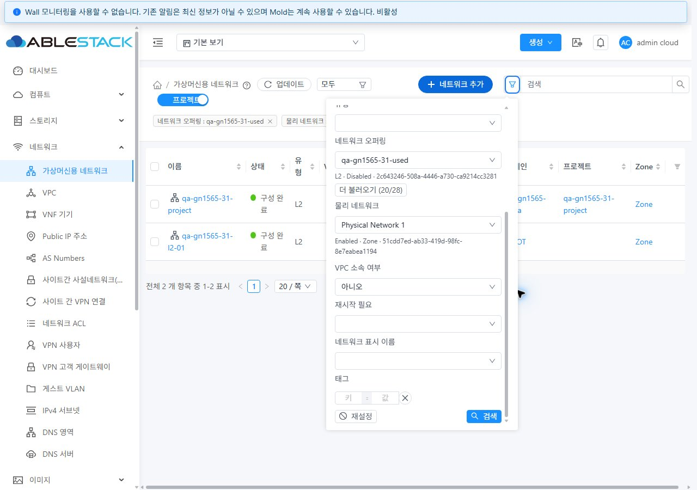
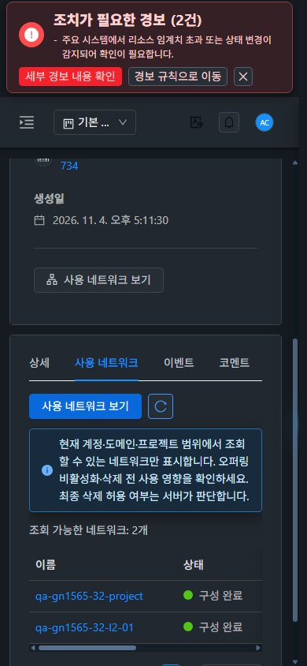

# #1565 가상머신용 네트워크 고급 검색과 오퍼링 사용 현황 검증

2026-11-04, 31(GFS2)·32(Glue/Ceph RBD)에 반영하고 실제 UI/API로 검증했다. 이전 #1580 시험 자원을 정리했다. 이번 **네트워크 16개·전용 오퍼링 8개·VPC 라우터 2대와 소유/프로젝트 자원은 별도 삭제 지시까지 유지**한다. 새 사용자 VM은 생성하지 않았다.

- 최종 실행 UI 소스: `0599e57c9d286d54f423f3728c37091d2dfce459`
- 최초 구현: `333fb4af7c6c08e28f4c9e80d918b8a71d8786da`, 조회/URL/표시 보완: `b7630a7c02e7b38c45c977ddb9db355c655aedad`
- [이슈 #1565](https://github.com/ablecloud-team/ablestack-cloud/issues/1565) · [Epic #1554](https://github.com/ablecloud-team/ablestack-cloud/issues/1554) · [기존 Draft PR #1577](https://github.com/ablecloud-team/ablestack-cloud/pull/1577)
- 기존 `dhslove/epic-1554-guest-networks` 브랜치에서 관리한다. 이번 완료 후 **9/23 완료·Open 14개**, 다음은 **#1564 Shared IP 사용량 집계 제외 설정 수정 UI**다.

## 변경 UI와 VM 표준 반영

| 화면 | 변경 내용 | 실제 컴퓨트 > 가상머신 표준과 대조 |
|---|---|---|
| 네트워크 목록·고급 검색 | 오퍼링 UUID·물리망 UUID·VPC 전체/예/아니오 추가. Disabled 오퍼링 참조 조회, 서버 검색·20개씩 더 불러오기·선택 UUID 복원·재시도 | VM 공통 SearchView 세로 폼과 팝오버 재사용. 320px 상한·화면 너비 제한·본문 스크롤·긴 이름/UUID 줄바꿈 |
| 목록·칩·URL | false 유지, 조건 변경/초기화 시 1쪽, 부모 범위 변경 시 종속 조건 해제. 직접 URL·상세 복귀에서 선택 유지 | 공통 목록·칩·페이지 UI와 VM 테마 재사용. VM 상세에서 즉시 이동할 때 목록 헤더 너비가 고정되는 문제도 수정 |
| 오퍼링 상세·사용 네트워크 탭 | 권한/프로젝트 범위의 서버 전체 건수·페이지·상태·소유 정보·망 링크. 관련 목록 링크 추가 | 실제 VM 볼륨 탭의 **텍스트 주 버튼 → 오른쪽 갱신 아이콘 → 안내 → 목록** 순서. 모바일 탭·표 내부 가로 스크롤 |
| 망 상세·breadcrumb·관련 VM | 검색 목록으로 복귀. 프로젝트 UUID를 상세 외부 URL과 복귀 URL 모두에 보존 | 공통 InfoCard·ResourceView·breadcrumb 유지, 직접 URL/이력/관련 VM 이동 확인 |
| 실패·권한 전환 | 같은 조건의 읽기 실패는 기존 자료+오래된 정보 안내·재시도. 조건/권한/프로젝트 변경은 이전 이름·건수 제거, 늦은 응답 무시 | 공통 Alert·버튼·다크 변수 사용. 화면 이동으로 취소된 조회의 후속 요청과 response.headers 접근 차단 |

새 대화상자는 추가하지 않았다. 고급 검색은 VM과 같은 팝오버이며 기존 생성/업데이트 MoldDialog는 변경하지 않았다. 선택은 이름 대신 UUID를 전송한다. 사용 망 0건은 **현재 권한 범위의 성공 응답**이며 최종 삭제 허용 여부는 서버가 판단한다.

기준: [실제 VM 검색](screenshots/31-vm-search-standard.jpg) · [VM 볼륨 탭](screenshots/31-vm-tab-standard.jpg) · [다크](screenshots/31-vm-tab-dark-standard.jpg) · [모바일](screenshots/31-vm-tab-mobile-standard.jpg). [변경 전 검색](screenshots/31-search-before.jpg)과 비교할 수 있다.





## 유형·화면·권한별 실제 실행

| 범위 | 31·32 결과 |
|---|---|
| Isolated | 일반 망/VPC tier의 type·오퍼링·물리망·VPC 필터, 상세/breadcrumb 복귀. VPC=true는 tier 1개, false는 tier 제외 |
| L2 | 사용 중 Disabled 오퍼링 **21개 망을 20+1**로 표시, 서버 total=21 유지. 망 상세/복귀·ConfigDrive 오퍼링 참조·관련 VM 이동 |
| Shared | type·오퍼링·물리망·VPC=false 결합, CIDR 표시·상세/복귀 |
| URL·칩·페이지 | 개별/3필터 결합, false/전체/true, 기본 검색·해제/초기화, 2쪽·50개 페이지 크기·현재 페이지 정렬·cold URL·상세/이력 복귀. 정렬은 기존 현재 페이지 동작이며 미지원 서버 sort 인자를 추가하지 않음 |
| 오퍼링 영향 조회 | 사용 중 Disabled 참조 표시, 미사용 Disabled는 0건. 사용 중 삭제 시 서버 431 거부와 오퍼링 존속 확인 |
| DomainAdmin·User | 실제 로그인으로 private-a 2개/1개 대조. 다른 도메인 private-a는 0개이며 이름 비노출. User의 물리망/관리자 전용 필드 숨김 |
| 프로젝트 | 소유자 User/Root에서 1개. 직접 URL·관련 링크·상세·breadcrumb에 project UUID 보존. 비회원 API 거부 531 확인 |
| 범위 조합 | account/domain/Zone/VPC=false 결과 1개. 전체 프로젝트 used 오퍼링은 초기 22개(일반21+프로젝트1), 최종 2개(일반1+프로젝트1) |
| 실패·복구 | 목록 동일 조건 500에서 기존 자료+오래된 정보 안내 및 복구. 사용 망 탭 500의 명시적 재시도. 후보 500에서 UUID·물리망·false 유지 후 이름 복구 |
| 지연·화면 이동 | 소유자 조회를 지연한 동안 true→false로 바꿔도 입력 유지. 최종 소스에서 listZones/listDomains/listAccounts 각각 지연 후 다른 화면으로 이동: **양쪽 3개씩 6개 PASS**, 최종 콘솔 오류 0 |

500·지연 시험은 브라우저의 **해당 읽기 응답만** 합성/보류한 오류 복구 시험이다. 정상 목록/역할/건수/삭제 거부/자원 생성·정리는 실제 서버 응답이다. 시험 후 응답 보류·합성·캐시·화면 크기 설정을 해제하고 light 테마로 돌렸다.

초기 페이지 시험용 망은 각 28개(기본 범위27+프로젝트1)였다. 검증 뒤 L2 20개씩 정리해 **각 8개**만 유지했다. 초기 21개와 최종 2개 캡처는 시점이 다르다. [초기 API 31](31-api-matrix.json) · [32](32-api-matrix.json) · [범위별 31](31-scope-counts.json) · [32](32-scope-counts.json) · [최종 31](31-final-inventory-check.json) · [32](32-final-inventory-check.json).

관련 VM은 새 망에 사용자 VM이 없어 0개인 경로/필터 이동만 확인했다. IPv6·외부 trunk 패킷·실제 VM 배포·PVLAN/VNI 전체 조합·BGP/서비스/제공자 전체·전체 ACL/공유 권한 회귀는 이번 조회 UI 완료에 포함하지 않는다. 유형/교차 후속 #1570~#1576·#1569의 범위를 유지한다.

## 반응형·즉시 전환·다크 검증

- **31/32 × 1280×900·768×1024·390×844 × light/dark = 12조건**, 고급 검색/사용 탭 각 1개씩 **24프레임**을 `b763`에서 확인했다. 즉시 테마 전환, 메뉴/VM 상세→목록, 관련 VM, 직접 URL/뒤로 가기, 모바일 탭·내부 스크롤도 실행했다.
- 마지막 `0599`는 SearchView 취소 처리 스크립트와 시험만 변경했다. 템플릿·스타일 선언·locale은 같고, 생성 CSS의 Vue `data-v-*` 범위 ID를 정규화하면 텍스트가 동일하다. **CSS 원본 바이트가 같다는 뜻은 아니다.** 정규화 SHA256 `c8e403c28884494bfb4ca481050c2959b4c1f0a77c9c0c7d1e728bd2edd48d53`([기록](css-scope-check.json)).
- 최종 `0599`에서 양쪽 desktop light/mobile dark **4조건×2화면=8프레임**과 취소 6개를 다시 확인했다. 12조건 전체를 최종 커밋에서 다시 촬영한 것은 아니다.
- 문서 전체 가로 넘침 0, 팝오버 화면 내 너비, 폼 내부 스크롤/하단 버튼 접근, 텍스트 주 버튼 왼쪽·갱신 아이콘 오른쪽·안내가 아래인 배치를 측정했다. 긴 표는 표 내부 스크롤, 상태/링크는 실제 dark 화면에서 확인했다.
- **원본 JPEG 88개**의 서명·디코딩 크기·SHA256을 확인했다. [캡처 색인](screenshots.ko.md) · [파일별 소스/해시](screenshot-manifest.json) · [최종 관측 배치 46개](layout-checks.json) · [최종 UI](final-ui-summary.json) · [취소 6개](cancellation-ui-check.json) · [콘솔](browser-console-summary.json).

## 로컬 시험·빌드와 자동 CI

WSL rocky ext4 `/home/ablecloud/work/dhslove/cloud-epic-1554/ui`에서 실행했다.

- 관련 **8 suites·109/109 통과**, 실패 0, 23.571초. 검색/사용 탭 및 공통 CNI·Affinity·Snapshot·SearchFilter·VolumeSearchSelect 회귀 포함([출력](unit-final-tail.txt)).
- 전체 UI lint 및 최종 변경 파일 lint 통과([전체](lint-final-tail.txt), [최종](lint-cancel-tail.txt)).
- 로컬 production build exit 0([출력](build-final-tail.txt)). Java/KVM/Agent 변경 없음. Maven/전체 Cloud/수동 Actions 빌드 미실행.
- Vue stub·Browserslist·번들 크기 경고는 실패와 구분한다.
- 일반 production 소스맵 조합이 장시간 진행되어 외부 임시 config로 **productionSourceMap/minifier sourceMap만 끈 production minification 빌드**를 사용했다. 의존성·저장소 빌드 설정은 수정하지 않았고 소스맵은 배포하지 않는다.

재현 명령:

```bash
cd /home/ablecloud/work/dhslove/cloud-epic-1554/ui
npm run test:unit -- --runInBand --runTestsByPath \
  tests/unit/utils/guestNetworkSearch.spec.js \
  tests/unit/components/view/NetworkSearch.spec.js \
  tests/unit/views/AutogenGuestNetworkSearch.spec.js \
  tests/unit/views/AutogenCniSearch.spec.js \
  tests/unit/views/AutogenAffinitySearch.spec.js \
  tests/unit/views/AutogenStorageSnapshotSearch.spec.js \
  tests/unit/components/view/SearchFilter.spec.js \
  tests/unit/components/view/VolumeSearchSelect.spec.js
npm run lint -- --no-fix
NODE_OPTIONS=--openssl-legacy-provider \
VUE_CLI_SERVICE_CONFIG_PATH=/home/ablecloud/work/guest-network-1565-validation/ui-build.config.js \
npm run build
```

임시 config:

```js
const config = require(process.cwd() + '/vue.config.js')
config.productionSourceMap = false
for (const plugin of config.configureWebpack.optimization.minimizer || []) {
  if (plugin.options && Object.prototype.hasOwnProperty.call(plugin.options, 'sourceMap')) {
    plugin.options.sourceMap = false
  }
}
module.exports = config
```

소스 `0599`의 자동 [License Check](https://github.com/ablecloud-team/ablestack-cloud/actions/runs/41809971504)는 **unapproved 3,540건 실패**([로그](license-final-tail.txt)). 모두 기존 문제로 판정하지 않았다. [pre-commit](https://github.com/ablecloud-team/ablestack-cloud/actions/runs/41809971831)은 작성 시 실행 중이다. 로컬/실환경 성공을 전체 Cloud CI 성공으로 표현하지 않는다. 자동 PR 검사는 수동 전체 Cloud 빌드와 별개다.

## 배포·보존·복구

| 항목 | 31·32 결과 |
|---|---|
| 대상 | `/usr/share/cloudstack-management/webapp`의 허용된 정적 파일만 원자 교체, index 마지막 적용 |
| 최종 파일 | **650개 / 29,798,670 bytes**, [manifest](manifest.json) 전체 SHA 일치 |
| index SHA256 | `09292173dcf0d0fb8c1efc5651b146657658d7c335c895e85adf80779595238c` |
| 서버 영역 | WEB-INF 존재·해시 보존, META-INF는 전후 모두 없음. 운영 config·cloud-image-templates·monitoring 이미지·Mold PID 보존 |
| 런타임 | /client/ HTTP 200. 신규 검색/사용 탭 및 `blockingLoadingState`·`fetchSyncProgress`·`extractJobId` 마커 존재 |
| 관리 JAR | 전후 동일 SHA `58d8aaf66db1c5c68dca70bfdac064dfce55a9928ef764e3279ab2a56f674561`. 관리 재시작/Agent·호스트 패키지 변경 없음 |

[31 배포](31-deployment.json) · [32 배포](32-deployment.json) · [31 runtime 전](31-runtime-before.json)/[후](31-runtime-after.json) · [32 전](32-runtime-before.json)/[후](32-runtime-after.json). 전후 runtime은 최초/최종 단계를 구분하며 실행 확인 기준은 최종 receipt와 manifest다.

최초 정상 UI의 영속 백업: WSL ext4 `/home/ablecloud/work/guest-network-1565-validation/backups/20261104-175337/{31,32}/static-backup.tar.gz`. SHA256은 31 `5f0f873adee448de19bdb78ca99b5e4ba9f3e1da5804dc43e610a276202ca3d6`, 32 `88f681f6d9517981dd1e3ec730feef0154c607a3f6b10c1d6e516fe181e047ad`. 중간 보완 버전이 아닌 이 최초 백업을 복구 기준으로 사용한다.

복구 시 SHA·안전한 상대 경로/정적 허용 목록을 검사하고 운영 서버 영역을 보존하며 백업에 있는 공통 정적 파일을 되돌린다. 이전 해시 자산은 삭제하지 않았다. **이전 index의 참조 파일 존재를 확인한 뒤 index를 마지막 적용**한다. 이전 index SHA는 `186bfefb5d738ff26b7bfc62adb5421989f80e1a37360a9a1c281ada302d0f43`. 이후 WEB-INF·설정·HTTP 200·새 로그인/목록을 확인한다. webapp 전체 삭제/교체나 `rsync --delete`는 사용하지 않는다. 복구는 이번에 실행하지 않았다.

## 자원 정리·유지·기존 데이터 보존

이전 #1580 시험 **망 8개·VM 8대·오퍼링 4개**와 부속 라우터/범위를 삭제했다. 양쪽 각 3개 호스트에서 이전 VM 도메인·GFS2 root·RBD root/mapping 부재를 확인했다([요약](previous-cleanup-summary.json)).

현재 각 `qa-gn1565-31-*` / `qa-gn1565-32-*` **8개 망(5 L2+2 Isolated/VPC+1 Shared)**·오퍼링 4개·VPC/라우터 1개·도메인 2개·계정 3개·프로젝트 1개를 유지한다. [UUID·직접 링크·계정명](resources.ko.md). 페이지 시험 L2 20개씩만 추가 정리했다([31](31-pagination-cleanup.json), [32](32-pagination-cleanup.json)). 별도 지시 전까지 유지하며 비밀번호·세션·API 키는 게시하지 않는다.

| 기존 보존 | 31 | 32 |
|---|---|---|
| 망 | 기존 22개 보존, 기본 범위 최종29 | 기존 9개 보존, 기본 범위 최종16 |
| 오퍼링 | 기존 24개 보존, 최종28 | 기존 15개 보존, 최종19 |
| 사용자 VM | 기존121개/상태 보존, 증감0 | 기존55개/상태 보존, 증감0 |
| 라우터 | 기존12개/상태 보존, 시험1개 추가 | 기존3개/상태 보존, 시험1개 추가 |

비교한 ID/이름/유형/오퍼링/범위/CIDR/서비스/상태 등 안정 필드 차이 0. 기본 범위는 프로젝트 망을 제외한다. 보호 중인 주 Windows FT 작업 트리의 HEAD·staged/unstaged diff 해시를 작업 전후 비교한다.

## 후속

이번 완료는 #1565 조회 계약과 해당 UI 경로다. Epic 63행 전체 회귀 완료를 뜻하지 않는다. 다음은 **[#1564 공유 네트워크 IP 사용량 집계 제외 설정의 수정 UI 추가](https://github.com/ablecloud-team/ablestack-cloud/issues/1564)**다. 자동 착수하지 않으며 동일 Epic 브랜치/Draft PR을 유지하고 Epic은 Open으로 둔다.
