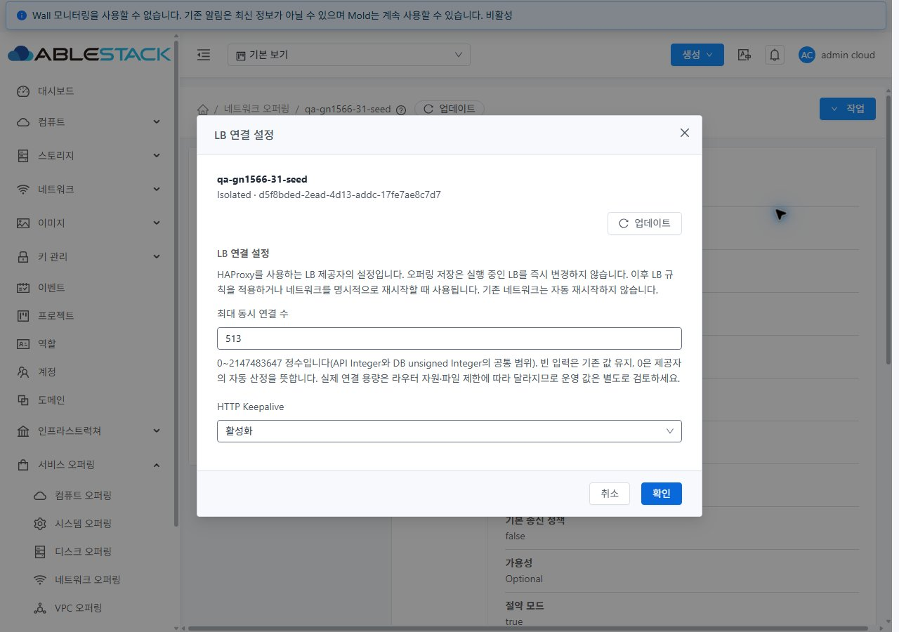
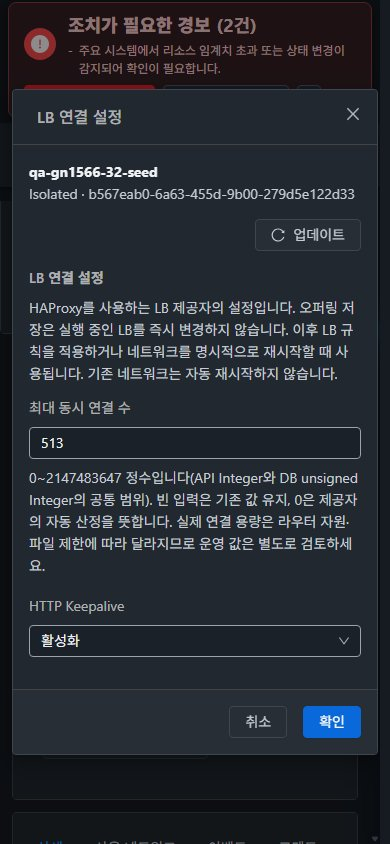

<!--
Licensed to the Apache Software Foundation (ASF) under one
or more contributor license agreements. See the NOTICE file
distributed with this work for additional information
regarding copyright ownership. The ASF licenses this file
to you under the Apache License, Version 2.0 (the
"License"); you may not use this file except in compliance
with the License. You may obtain a copy of the License at

  http://www.apache.org/licenses/LICENSE-2.0

Unless required by applicable law or agreed to in writing,
software distributed under the License is distributed on an
"AS IS" BASIS, WITHOUT WARRANTIES OR CONDITIONS OF ANY
KIND, either express or implied. See the License for the
specific language governing permissions and limitations
under the License.
-->

# #1566 네트워크 오퍼링 LB 설정 개선·31/32 검증

2026-11-05. Epic #1554 / Draft PR #1577 / 브랜치 `dhslove/epic-1554-guest-networks`. **#1566 구현 범위의 UI·API·저장·실제 HAProxy 적용 검증을 완료했다.** 배포 기능 소스는 `59a5c92934f9c09535755a3bbaacf7366cdf4367`이며 이후 보고서와 검사 결과 파일 형식을 정리했다. [지원·기본값·값 범위·적용 시점 설계](policy-design.ko.md), [유지 자원·확인 경로](resources.ko.md).

## 수정한 문제

- listNetworkOfferings 응답의 Keepalive 누락과 false 단독 수정 미반영을 수정했다. 생략은 보존하고 true/false를 정확히 저장·조회한다.
- LB capability 입력이 없어도 생성 시 명시한 maxconnections를 보존한다. API/DB 공통 범위(0~2147483647)를 UI와 서버에서 검증한다.
- HAProxy 2.6.12가 거절하던 `no option forceclose`를 지원되는 `no option httpclose`로 교체했다. 관리 JAR와 31·32의 agent 6대에 해당 class를 배포했다.
- 실제 생성·복제 POST 대조 중 공통 form 정리가 중첩 LB 값을 누락시키는 문제를 찾아 수정했다. 테스트에서 실제 mixin을 사용하고, 최종 UI 생성·복제 요청과 조회값을 대조했다.

## 변경 UI와 VM 표준 반영

| 화면 | 변경 | 표준·실제 확인 |
|---|---|---|
| 오퍼링 생성 | 지원되는 Lb/HAProxy 조합에 연결 수·Keepalive 세로 필드와 적용 시점 안내 | MoldDialog lg, 본문 스크롤·고정 제목/취소/확인 푸터, 100% 입력 폭, 작은 화면 1열 |
| 오퍼링 복제 | 원본 숫자·Boolean 표시/전송, 미확인과 false 구분 | 생성과 같은 공통 필드·lg 대화상자, 입력 검증/중복 제출 방지 |
| 오퍼링 상세의 작업 메뉴 | **LB 연결 설정** 액션 추가 | MoldDialog md, 대상 이름/ID, 현재값 재조회, 변경 필드 저장·재조회, 실패 시 초안 보존 |
| 목록·상세·탭·breadcrumb | 기존 VM 계열 ResourceView를 사용 | 실제 목록→상세→사용 네트워크/이벤트→상세·breadcrumb 복귀, Public IP LB 탭 이동 확인. 목록·탭 자체를 새로 재설계하지 않았다. |

실제 **컴퓨트 > 가상머신 목록·상세·NIC 탭·편집 대화상자**를 열어 기준을 확인했다. [기준 목록](screenshots/31-vm-list-standard.jpg), [기준 상세](screenshots/31-vm-detail-standard.jpg), [기준 NIC 탭](screenshots/31-vm-nic-standard.jpg), [기준 편집](screenshots/31-vm-edit-dialog-standard.jpg).

14px 본문·공통 테마 색상·구획별 세로 배치·고정 제목/푸터·본문 스크롤을 반영했다. 두 클러스터 × 생성/복제/수정 × 밝음/어두움 × 1280/768/390 폭의 **36조건**을 확인했고, 제출 로직만 추가 보완한 뒤 최종 생성·복제 화면 4개 및 설정 화면을 재캡처했다. 모달 가로 넘침/푸터 이탈0, 측정한 본문 최소 명암비6.978:1이다. 테마 즉시 전환, 유형 변경 시 필드 즉시 제외, Tab으로 연결 수→Keepalive 이동, Escape 취소를 확인했다. 임시 viewport·요청 차단은 해제하고 밝은 테마로 복원했다.

**57개 JPEG**의 실제 디코딩 크기·메타데이터·SHA를 대조했다. [캡처 목록](screenshot-manifest.json), [36조건/47모달 캡처 결과](visual-validation.json), [배치/색상 측정](layout-checks.json), [UI 행동·인증정보 제외 실제 요청](ui-actions.json). 초기 수집의 빈 요청 배열은 성공 근거로 사용하지 않았으며 `UI-create-fixed-final` / `UI-clone-fixed-final` 항목에 최종 실제 POST가 있다.

## 검증 결과와 범위

- 31 GFS2·32 Glue(Ceph) RBD: 생성321/false, 복제513/true, 수정 false/true 단독 변경, 무변경/공백 입력 쓰기 없음, 음수·소수·overflow 입력 보존/거절, 조회 실패 후 복구를 확인했다. UI 생성·복제 후 API 값을 재조회했다.
- 전용 미사용 오퍼링에서 API 생성(capability Lb 입력 없음), 0/1/2147483647, true/false와 생략 보존, 음수/소수/overflow 거절을 확인했다. 큰 값은 실행 중인 LB에 적용하지 않았다. [31](31-api-boundaries.json), [32](32-api-boundaries.json).
- 저장 직후와 이후 LB 규칙 적용을 나눠 실제 HAProxy 설정을 대조했다. **오퍼링 저장만으로 즉시 적용되었다고 표시하지 않는다.** [31 저장 직후](31-haproxy-save-only.json), [31 false 적용](31-haproxy-applied-false.json), [31 true 저장 직후](31-haproxy-true-save-only.json), [31 true 적용](31-haproxy-applied-true.json), [32 true 적용](32-haproxy-applied-true.json).
- 최종 공통값: maxconn513 / Keepalive true / HTTP 규칙80→8080 Active / 연결 VM1대. 사용자의 VLAN 조건에 맞게 라우터와 같은 호스트의 VM으로 초기 HTTP 접근을 확인했다. **분배 성능이나 다중 백엔드 분산 여부는 완료 판정에 포함하지 않는다.**
- L2/Shared/외부 제공자 제외 안내·입력/저장 차단을 확인했다. VPC/InternalLB는 소스·판정 시험만 확인했고, Shared ELB·외부 장비·SSL/health/AutoScale·전체 역할/프로젝트는 실환경 미검증이다. 후속 #1573/#1576 및 Epic 전체 회귀 범위로 남는다.

## 빌드·정적 검사·배포 증적

| 검증 | 결과 |
|---|---|
| WSL ext4 api 모듈 install | 1,129 tests 통과 |
| WSL ext4 server 모듈 package | 29 tests 통과 |
| WSL ext4 core 모듈 package | 8 tests 통과 |
| UI 단위 시험 | 최종 68 tests / 3 suites 통과. 반복 실행 수를 합산하지 않음 |
| 변경 UI lint / minified production build | 통과 |
| Checkstyle | 기존 api6/core3/server62건으로 모듈 검사는 실패. 이번 변경 Java 파일 오류0건 |
| 수동 전체 Cloud / qemu / Actions 빌드 | 실행0 |

[로컬 검증 집계](local-validation.json), [API](api-build.log), [server](server-build.log), [core](core-build.log), [UI 시험](ui-tests-final.log), [lint](ui-lint.log), [UI 빌드](ui-build.log). 자동 CI는 로컬/실환경 결과와 구분하며 [소스 CI 수집](ci-source.json)을 참조한다. 기능 소스의 License Check 3551건에서 이번에 추가된 미승인 항목은 scalar exit 파일7개였다. 이 파일들을 제거하고 종료 결과를 JSON에 기록했다. 나머지는 직전 커밋의 기존3544건과 일치한다. [정확한 전후 경로 비교](ci-license-comparison.json). 이후 자동 CI 결과는 PR에 별도로 기록한다. 기존 전체 저장소 License/Checkstyle 실패를 전체 Cloud 성공으로 표시하지 않는다.

관리 서버 최종 JAR SHA256: `248d2a84be0cc7eda8f58f9475720dd473727d3afbb318971ab96c358bf238dd` (양쪽 동일). 4개 class 패치와 후속 검증 class1개 교체 외 모든 ZIP 엔트리를 보존했다. [최초 패치](server-patch-proof.json), [최종 패치](server-refinement-patch-proof.json). 6대 agent는 HAProxyConfigurator class1개만 교체하고 나머지 엔트리·실행 VM XML/기존 hook·FT 스크립트를 보존했다.

활성 webapp 정적652개 / 29,847,607bytes SHA 불일치0, index SHA `2e65c308503ca1dfdae9a923f4ddfbac0870849cbafb2c08cde5e9bddf287e6e`. WEB-INF·META-INF(존재 시)·운영 config/서버 파일 보존, `/client/` HTTP200. 현재 manifest JS320개 SHA 및 FTCTL 표식3개, 관리/agent 서비스·Cloud 호스트6대 Up 확인. [31 최종 상태](31-final-health.json), [32](32-final-health.json), [31 정적 배포](31-deployment.json), [32](32-deployment.json).

## 보존·복구·후속

이전 #1567 시험 네트워크8개·VM2대·자동 라우터4대·역할4계정/2도메인을 공식 API로 정리했다. 양쪽 활성 network/NIC/VM/router/volume/account/domain 잔여0. [31](31-cleanup-done.json), [32](32-cleanup-done.json). 기존 운영 망31개·VM176대·기존 오퍼링의 비교 대상 주요 필드 변경0. [31](31-operational-preservation.json), [32](32-operational-preservation.json). 주 FT dirty 작업의 HEAD·staged/unstaged diff hash도 [전](protected-before.json)·[후](protected-after.json)가 일치한다.

새 검토 자원은 삭제하지 않았다. **2망·Running VM2대·Running 라우터2대·Active LB2개·방화벽 규칙2개·전용 오퍼링10개**를 유지한다. [자원과 UI 진입 경로](resources.ko.md). 별도 삭제 지시 후 정리한다.

복구 백업은 WSL ext4 `/home/ablecloud/work/guest-network-1566-validation/server-backups/`, `server-refinement-backups/`, `backups/`와 각 host receipt의 원격 agent backup 위치에 있다. UI 복구도 webapp 전체 교체/삭제 없이 정적 allowlist만 복원한다. JAR 복구 시 원본 SHA와 서비스/HTTP·API 계약을 재확인한다. 실제 rollback은 실행하지 않았다.

같은 Epic 브랜치와 Draft PR #1577을 유지한다. #1566 완료 후 **13/23 완료·Open10**, 다음 구현 대상은 기존 순서의 **#1563 관리자 네트워크 물리망 마이그레이션 및 실패 재개 UI 설계·구현**이다. Epic 전체 회귀·PR 병합·Epic 종료는 이 완료 보고에 포함하지 않는다.
