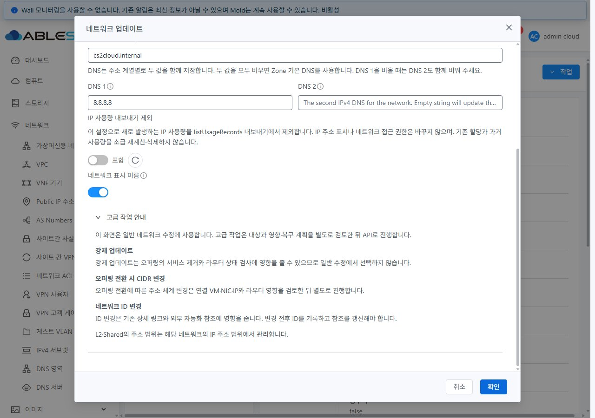
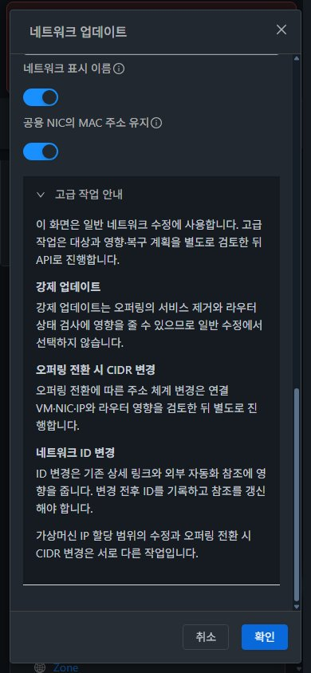
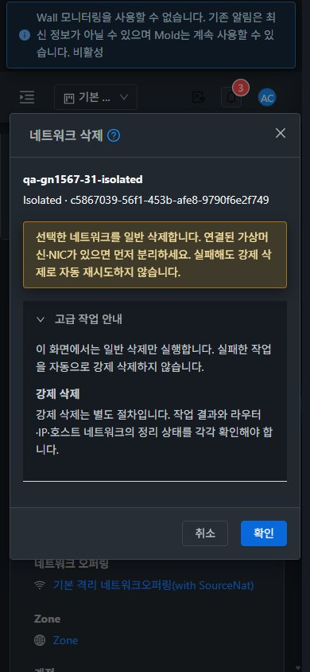

<!--
Licensed to the Apache Software Foundation (ASF) under one or more
contributor license agreements. See the NOTICE file distributed with this
work for additional information regarding copyright ownership. The ASF
licenses this file under the Apache License, Version 2.0 (the "License");
you may not use this file except in compliance with the License. You may
obtain a copy at http://www.apache.org/licenses/LICENSE-2.0 . Unless required
by applicable law or agreed to in writing, software distributed under the
License is distributed on an "AS IS" BASIS, WITHOUT WARRANTIES OR CONDITIONS.
-->

# #1567 구현·31/32 배포·UI 검증

Epic #1554 / NET-13. 검증일 2026-11-05 KST. 같은 브랜치 `dhslove/epic-1554-guest-networks`와 [Draft PR #1577](https://github.com/ablecloud-team/ablestack-cloud/pull/1577)을 유지한다. 생산 변경 커밋은 `229c24f282673ea0c4695f7ad648359694622cae`, `c8763badb80fa13eff6278ed23a418c355d27ae9`다.

## 결과·정책

**강제 삭제·강제 수정·오퍼링 전환 시 CIDR 변경·사용자 지정 ID 변경을 API 전용으로 유지**하고 일반 UI 경계를 구현했다. 각 인자의 서버 의미·Root/DomainAdmin/User 권한·Isolated/L2/Shared 적용·허용 상태·완료/실패·복구/감사·물리 정리 소유 범위를 [정책 설계](policy-design.ko.md)에 명시했다. 일반 수정 폼에 있던 Root Admin의 강제 스위치를 제거했다. 위험 인자를 일반 CRUD 누락으로 보고 모두 노출하지 않는다.

`deleteNetwork.forced`는 모든 VM/정리 검사를 무시하는 기능이 아니다. Root 전용이며 shutdown 후 상태 gate를 건너뛸 수 있지만 사용자 VM 보호와 자원/provider 정리 검사 등은 남는다. 최초 이슈의 넓은 설명을 실제 소스로 정밀화했다. `changecidr`는 Isolated의 오퍼링/제공자 전환 플래그이며 임의 CIDR 재주소 API가 아니다. `guestvmcidr` IP 예약과 분리해 안내한다.

이번에는 **강제 API 호출·CIDR 전환·customid 변경·외부 제공자 장애 주입을 실행하지 않았다**. 이슈 자체의 산출물은 노출 정책·상태도·검증/복구 계획이고, 채택한 일반 UI 변경과 실제 정상/거절 경로를 배포·검증했다.

## 변경 UI와 VM 표준

컴퓨트 > 가상머신의 실제 상세/NIC 화면과 기존 MoldDialog를 확인하고 [VM 표준 캡처](screenshots/31-vm-nic-standard.jpg)를 남겼다.

| 화면 | 변경 UI | 표준 반영·확인 |
|---|---|---|
| 네트워크 업데이트 | 기존 강제 스위치 제거. 폼 하단에 접을 수 있는 **고급 작업 안내**: 강제 업데이트·CIDR 전환·ID 변경 | 기존 VM MoldDialog·본문 스크롤/고정 제목·푸터 유지. 새 상단 리본/작업 버튼 추가 없음. 안내 14px·공통 light/dark 색상·긴 문장 wrapping |
| Isolated 업데이트 | 기존 CIDR 입력에 VM IP 예약임을 설명 | 세로 폼 흐름 유지, 오퍼링 전환 CIDR과 구별 |
| L2/Shared 업데이트 | 지원되지 않는 guestvmcidr 입력과 요청 제외. 범위 관리 경로 안내 | 기존 유형별 필드/권한/서비스 조건 유지 |
| 단일 네트워크 삭제 | 이름·유형·UUID를 항상 표시. 일반 삭제/사용 중 연결 분리/자동 강제 재시도 없음 안내와 접기 영역 | 해당 네트워크 삭제만 **MoldDialog md(720px)**로 적용. 모바일 calc 너비·본문 스크롤·고정 푸터, 다른 자원의 일반 삭제 대화상자는 기존 방식 유지 |
| 목록 일괄 삭제 | 기존 선택 개수·대상 목록 뒤에 같은 일반/강제 작업 경계 안내 | 같은 md 대화상자, 선택 표 내부 가로 스크롤·모바일 푸터 확인. 실제 일괄 삭제는 실행하지 않고 취소 |
| 목록·요약/상세·탭·breadcrumb | 새 배치를 만들지 않음 | 실제 세 유형의 상세↔이벤트 탭, breadcrumb 목록 복귀·검색·목록 링크 상세 이동, 취소 후 다른 유형 즉시 진입·초안 분리를 회귀 확인 |

일반 수정은 허용 목록으로 요청을 구성한다. 기존 정상 인자의 빈 문자열/false를 보존하고 `forced/changecidr/customid` 및 변형·알 수 없는 필드를 제거한다. 일반 삭제는 단일/선택 매핑 모두 ID만 사용한다. 접기 영역에는 고급 API 실행 버튼·링크·입력이 없다.

## 실행 검증

| 범위 | 실제 결과 | 근거 |
|---|---|---|
| Root 일반 수정 | 31·32 × Isolated/Shared/L2, **6개 추적 사례 jobstatus 1**, 실제 설명 재조회 | [UI 요청](ui-actions.json), [22건 job/실제 상태 대조](ui-api-job-verification.json) |
| User/DomainAdmin | 클러스터별 User 소유 Isolated에서 각 역할 일반 수정, **4건 jobstatus 1**. 두 역할 UI에 고급 실행 입력 없음 | 같은 UI/job 증적, `*-user-update-dark-1280.jpg`, `*-domainadmin-update-dark-1280.jpg` |
| 사용 중 일반 삭제 | 2클러스터 × 세 유형 **6건 jobstatus 2 예상 거절**, 망과 연결 VM/3 NIC 유지. ID 외 forced 인자/자동 강제 재시도 없음 | job 대조, [거절 화면](screenshots/31-in-use-delete-refused.jpg) |
| 빈 망 일반 삭제 | 2클러스터 × 세 유형 **6건 jobstatus 1**. 활성 network/NIC 잔여 0 | job 대조, [31 최종 자원](31-retained.json), [32 최종 자원](32-retained.json) |
| API 역할 계약 | Root/DomainAdmin/User × updateNetwork/deleteNetwork 메타데이터 수집 | [31](31-role-api-contracts.json), [32](32-role-api-contracts.json). delete.forced의 메타데이터 노출과 서버 Root 검사 구별 |
| 화면·테마 | 2클러스터 × 업데이트 3유형/삭제 × 1280×900·768×1024·390×844 × light/dark = **48조건**. 최종 삭제 대상 표시 반영 후 12개 삭제 프레임 재캡처 | [57개 고유 안내 프레임](layout-checks.json), [요약](layout-summary.json), [원본 JPEG 64개 해시/크기](screenshot-manifest.json) |
| 가독성·반응형 | 안내 14px, 최소 명암비 **7.557:1**, 대화상자 본문 가로 넘침 0·푸터 viewport 밖 0. 새로고침 없이 테마 즉시 전환 | 배치 JSON·실제 JPEG. 단일 삭제의 이름/유형/ID는 작은 화면에도 표시 |
| 이동·초안·일괄 확인 | 유형별 상세/이벤트 탭·목록 breadcrumb/검색/상세, Isolated 취소 초안이 Shared에 남지 않음. 양쪽 선택 삭제 확인창 열기/취소, 32 모바일 선택 표 확인 | [화면 이동](navigation-checks.json), `*-bulk-delete-policy-*.jpg` |
| 감사 이벤트 | 전용 대상의 NETWORK.UPDATE/NETWORK.DELETE 및 관련 자원 이벤트 수집 | [31](31-network-events.json), [32](32-network-events.json). 이 이벤트만으로 old/new UUID 감사가 충분하다고 간주하지 않음 |

여기서 22건은 캡처한 쓰기 요청과 job을 최종 재조회하여 대조한 사례 수다. 중간 화면 관측·자동화 증적 재수집을 포함한 서버의 모든 요청 횟수 집계는 아니다. 역할별 일반 수정 뒤 같은 망을 다음 역할로 수정한 경우, 각 job 성공과 마지막 실제 설명 값을 분리해 검증했다.

실행 범위는 Root 세 유형, User/DomainAdmin 소유 Isolated다. project·계층 공유·전체 L2/Shared 역할 조합, 실제 CIDR/UUID 전환·강제 장애 복구, IPv6/BGP/PVLAN/ConfigDrive/외부 제공자·패킷 전 구간을 PASS로 확장하지 않는다. 유형별 정책 결정은 소스/API 계약 기반이며 실행 시험과 구분한다.

## 빌드·배포·보존

- 로컬 WSL ext4 UI **131 tests / 5 suites 성공**. 요청 허용 목록·세 유형·세 역할의 오래된 고급 draft 인자 차단과 오퍼링/DNS/사용량/탭 관련 회귀를 포함한다. 최종 전용 9개 재실행도 성공했으며 131개에 포함된 재실행이므로 합산하지 않는다. [131개 로그](ui-tests.log), [최종 9개](policy-tests-final.log).
- 변경 UI lint와 최종 대상 요약 template lint, minified production build 성공. production source map만 외부 설정으로 비활성화하고 minification은 유지했다. [lint](ui-lint.log), [대상 요약 lint](summary-lint.log), [build](ui-build.log).
- **Java/JAR 소스·qemu·Maven 모듈 변경 없음**. 전체 Cloud·qemu·수동 Actions 빌드를 시작하지 않았다. 자동 PR License Check는 기존과 같은 **3,540건** 미승인으로 실패했고 [소스 CI 스냅샷](ci-source.json)의 Lint는 수집 시 진행 중이다. 로컬/실환경 성공을 전체 CI 성공으로 표시하지 않는다. [License run](https://github.com/ablecloud-team/ablestack-cloud/actions/runs/41953530035), [Lint run](https://github.com/ablecloud-team/ablestack-cloud/actions/runs/41953530004).
- 활성 `/usr/share/cloudstack-management/webapp`의 정적 **650개·29,819,020 bytes**, index SHA `7714cdac56915b91627be9b172e4e9685e6fa9c5cd7b9f10de5c92d4e517c182`. allowlist만 배포하고 WEB-INF/META-INF·운영 config·대용량 이미지 등 보호 경로를 보존했다. HTTP200·전체 manifest SHA 일치. [31 배포](31-deployment.json), [32 배포](32-deployment.json).
- 현재 manifest에 포함된 JS만 스캔해 `network-operation-policy`와 기존 FTCTL `blockingLoadingState/fetchSyncProgress/extractJobId`를 확인했다. 관리 JAR SHA `623e7c2d738347b9e1eb3ef630cb3e2cd4a94ef3e1aff6aaa206db003ac52350`, PID 31=722928·32=858022로 변경 전과 같다. [31 활성 검증](31-active-runtime-verification.json), [32 활성 검증](32-active-runtime-verification.json).
- 기존 운영 네트워크 **31개(22+9)**의 이름·유형·오퍼링·VLAN·CIDR·게이트웨이·ACL, 사용자 VM **176대(121+55)**의 이름·상태·호스트 비교 항목을 보존했다. 주 FT dirty 작업의 HEAD·staged/unstaged diff hash도 같다. [보호 전](protected-before.json), [보호 후](protected-after.json).
- 이전 #1560의 **6망·VM2대·라우터4대** 정리 완료, 활성 network/NIC/VM/router/volume 잔여 0과 Public IP 반환 확인. [31 정리](31-cleanup-done.json), [32 정리](32-cleanup-done.json). 이번 임시 삭제 시험 망 6개도 활성 network/NIC 잔여 0이다. SQL 직접 수정·강제 삭제 없음.

## 사용자 검토·후속 진행

**새 네트워크 8개·Running VM2대(각 3 NIC)·Running 라우터4대·역할 계정4개/도메인2개를 별도 삭제 지시까지 유지한다.** [정확한 UUID와 UI 링크](resources.ko.md). Root 목록에서 `qa-gn1567-31`, `qa-gn1567-32`로 검색한다. 양쪽 검토 상세 탭을 열어 두었고 light 테마와 viewport 기본값으로 복원했다. [최종 브라우저 상태](browser-final.json).

#1567의 일반/고급 경계 구현과 정책 산출물을 종료한다. Epic은 **12/23 완료·Open 11**이며, 기존 해결 순서의 다음 이슈는 **[#1566 네트워크 오퍼링 LB 연결 수·Keepalive 수정 설정의 지원 범위 정합성](https://github.com/ablecloud-team/ablestack-cloud/issues/1566)**이다. 삭제 의존성/비동기·복구 진단 보완은 관련 소유 이슈 #1568, 유형·권한·통합 전 구간은 정책 문서의 #1570~#1576/#1569에 연결한다. PR #1577은 Open Draft로 유지하고 PR 병합·Epic 종료·다음 이슈 자동 착수는 하지 않는다.

## 되돌림

이번 작업 전 UI 백업은 WSL ext4 `/home/ablecloud/work/guest-network-1567-validation/backups/20261105-105302/{31,32}/static-backup.tar.gz`다. 최종 대상 요약 직전 백업은 `backups/20261105-111200/{31,32}/static-backup.tar.gz`이며 SHA는 각 배포 receipt에 있다. 백업 manifest/파일을 검증한 뒤 **정적 allowlist만 복구하고 index.html을 마지막에 교체**한다. webapp 루트·WEB-INF/META-INF를 삭제하거나 dist로 통째 대체하지 않는다. JAR와 관리 서비스를 변경하지 않은 UI 작업이며, 복구 전후 보호 경로·HTTP·로그인·활성 JS를 다시 검증한다.
