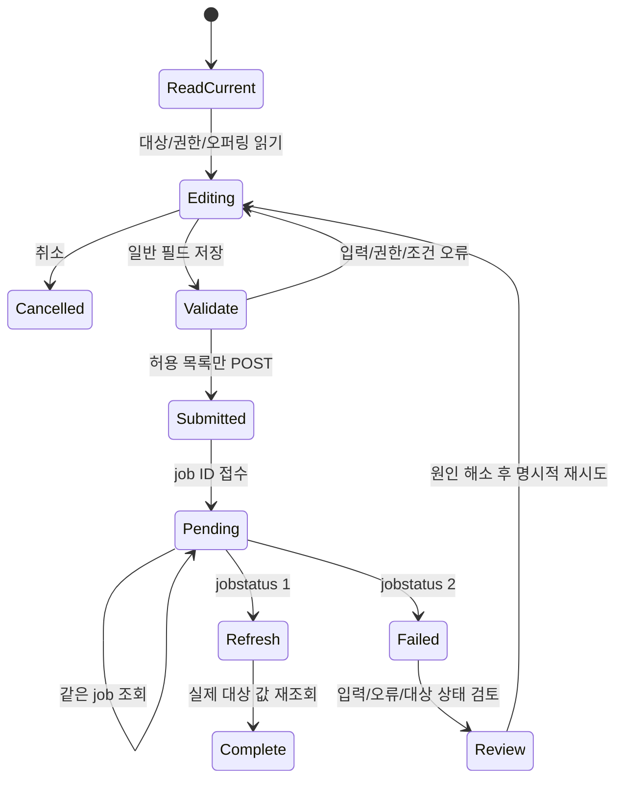
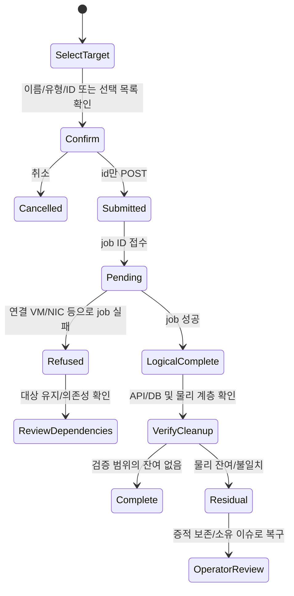
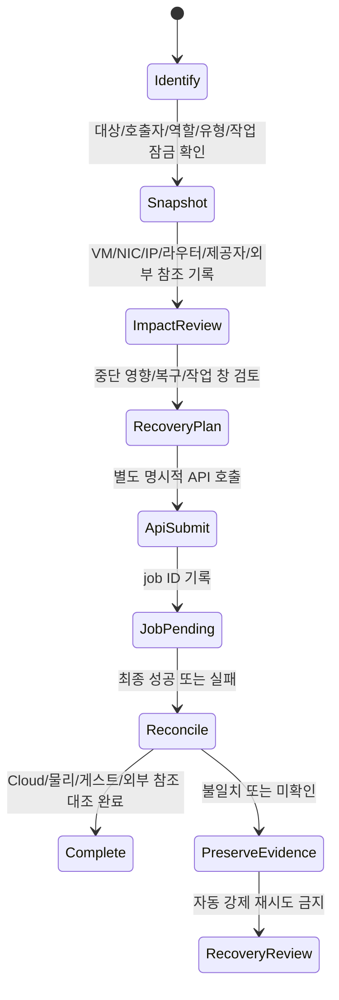

<!--
Licensed to the Apache Software Foundation (ASF) under one or more
contributor license agreements. See the NOTICE file distributed with this
work for additional information regarding copyright ownership. The ASF
licenses this file under the Apache License, Version 2.0 (the "License");
you may not use this file except in compliance with the License. You may
obtain a copy at http://www.apache.org/licenses/LICENSE-2.0 . Unless required
by applicable law or agreed to in writing, software distributed under the
License is distributed on an "AS IS" BASIS, WITHOUT WARRANTIES OR CONDITIONS.
-->

# #1567 고급 네트워크 API 운영 정책

Epic #1554 / NET-13. 2026-11-05, 소스 `c8763badb80fa13eff6278ed23a418c355d27ae9` 및 31·32 실서버 API 메타데이터 기준이다.

## 결정

**네 가지 인자를 모두 일반 UI에서 실행하지 않고 API 전용으로 유지한다.** 고급 API의 서버 권한이나 동작을 확대하지 않는다. 기존 Root Admin 일반 수정 폼의 `forced` 스위치를 제거하고 일반 수정 요청을 허용 목록으로 구성한다. 일반 삭제도 ID만 보내며 실패 후 강제 재시도를 하지 않는다. 복구 전용 UI를 새로 만드는 결정은 하지 않았다.

고급 API가 발견된다는 사실과 해당 호출자가 실제 실행할 수 있다는 사실은 다르다. 31/32의 `listApis`에서 DomainAdmin/User에게도 `deleteNetwork.forced`가 보이지만 서버의 Root Admin 검사는 남아 있다. UI에 스위치를 추가할 근거로 사용하지 않는다. [31 역할별 계약](31-role-api-contracts.json), [32 역할별 계약](32-role-api-contracts.json).

## 인자별 의미·권한·상태·운영 계약

| API 인자 | 정확한 서버 의미와 권한 | 상태·조건 | 영향·완료·복구 및 감사 | UI 결정 |
|---|---|---|---|---|
| `deleteNetwork.forced` | 기본 false. **Root Admin만 true 가능**. destroyNetwork에서 shutdown 뒤 Allocated/Setup이 아니면 중단하는 상태 검사를 건너뛸 수 있다. | 시스템 망/연관 망·접근 검사, 활성 사용자 VM 및 Basic 시스템 VM 보호, 자원 정리·provider.destroy·guru/VLAN 정리의 실패 검사는 여전히 존재한다. 모든 보호나 호스트 정리 실패를 무시하는 옵션이 아니다. | 강제 호출 자체가 물리 정리를 보증하지 않는다. NETWORK.DELETE job 결과, 활성 DB/API 개체와 라우터·IP·호스트/외부 제공자 잔여를 각각 확인한다. 실패 시 같은 ID·job으로 상태를 먼저 재조회하고 의존성을 해결한다. 자동 true 재시도/SQL 삭제 없음. | 세 유형·전 역할 일반 삭제에서 미노출. 별도 영향·복구 검토 후 API만 사용. |
| `updateNetwork.forced` | API 파라미터 권한 Root Admin, 기본 false. 오퍼링 변경에서 제거될 서비스가 있으면 거절하는 검사를 생략할 수 있다. 이중화 순차 갱신에서 UNKNOWN 라우터 상태 검사에도 영향을 준다. | 일반 updateNetwork의 Guest/비시스템/Destroy 제외·OperateEntry·오퍼링 및 제공자 조건은 유지된다. 오퍼링 변경 자체는 Isolated만 가능. 순차 갱신의 VirtualRouter 조건 등까지 제거하지 않는다. | 규칙/서비스 제거와 라우터 갱신으로 통신 영향 가능. NETWORK.UPDATE와 job 결과, 새 오퍼링/서비스·라우터·규칙·게스트 통신을 대조한다. 실패는 원상복구 완료를 뜻하지 않는다. 이전 값과 제공자 상태를 비교한 뒤 지원되는 역변경/정리 절차를 별도 판단한다. | 기존 일반 수정의 강제 스위치 제거. 별도 API 운영 절차. |
| `updateNetwork.changecidr` | 파라미터 자체 Root 전용 제한 없음. updateNetwork 실행 권한·대상 접근 검사가 필요하다. **오퍼링/외부 제공자 범주 전환의 주소 체계 변경 플래그**다. 임의 새 CIDR 문자열 입력이나 모든 NIC의 자동 재주소 API가 아니다. | 의미 있는 분기는 Isolated의 실제 오퍼링 변경. 외부 제공자 범주가 바뀌면 true 요구, true인 전환에서는 사용자 VM 전체 Stopped 검사, canUpgrade·VPC/IPv6 등 검사. L2/Shared의 오퍼링 변경은 서버가 거절한다. | DHCP/DNS·게이트웨이·기존/새 NIC/IP·라우터와 외부 주소 계획, VM 내부 고정 IP·보안 규칙을 검토한다. NETWORK.UPDATE/job 성공 후 실제 주소와 연결·통신을 따로 검증한다. 실패/역변경 시 주소 충돌과 제공자 잔여를 먼저 조사한다. | 전 역할 일반 폼에 미노출. Isolated도 별도 API 검토. L2/Shared에 적용 가능한 기능으로 안내하지 않는다. |
| `updateNetwork.customid` | BaseAsyncCustomIdCmd의 **Root Admin 전용**. UUID 검증 후 network UUID 변경. 내부 숫자 PK의 대체나 데이터 이동 기능이 아니다. | updateNetwork의 Guest/비시스템/Destroy 제외·접근 검사 및 UUID 검증 필요. 진행 중인 작업·외부 소비자가 없는 안정 구간에서만 운영 검토한다. 이 안정 구간은 추가 정책이며 서버가 모든 외부 참조를 검사한다는 뜻은 아니다. | 기존 상세 URL·북마크·자동화·CMDB·감사 연계가 끊길 수 있다. 자동 리다이렉트/외부 참조 일괄 갱신은 없다. old/new UUID·내부 식별자·호출자·job/time을 별도 감사 기록으로 연결한다. 실패 시 old/new 양쪽 조회와 작업 결과를 확인한 뒤 역변경 가능성을 판단한다. | 세 유형 모두 Root의 API 전용. DomainAdmin/User는 권한 불가. 일반 UI/대량 수정에 추가하지 않는다. |

최초 이슈의 “forced는 호스트 정리 명령 실패 상황에도 논리 삭제 진행”이라는 요약을 위 실제 구현 범위로 정밀화한다. 실제 강제 장애 주입으로 그 문장을 검증한 결과가 아니다.

### 일반 CIDR 입력과의 구분

일반 Isolated 폼의 `guestvmcidr`는 **기존 networkCidr 안에서 VM IP 할당 범위를 예약하는 별도 기능**이다. Advanced Zone·Allocated/Implemented, 유효 CIDR·기존 NIC가 새 범위 밖에 없어야 하는 검사, 오퍼링 변경과 동시 사용 금지가 있다. 네트워크 전체 주소 전환인 `changecidr`와 혼동하지 않도록 도움말을 추가했다. L2/Shared에서는 이 입력을 숨기고 요청에서도 제거한다. Shared의 IP 범위는 별도 범위 관리 경로를 사용한다.

## 유형 × 역할 결정표

표의 “API”는 호출을 무조건 허용한다는 뜻이 아니다. 대상 소유/공유/project 접근, API role, 상태·제공자 검사를 모두 통과해야 한다. 운영자는 다른 계정의 연결 VM을 보지 못한다는 이유로 연결이 없다고 판정하면 안 된다.

| 유형 / 역할 | forced 삭제 | forced 수정 | changecidr | customid | 일반 UI |
|---|---|---|---|---|---|
| Isolated / Root | API·별도 복구 검토 | API·서비스/라우터 영향 검토 | API·오퍼링 전환/Stopped 검토 | API·참조 갱신 검토 | 일반 수정·일반 삭제·기존 IP 예약 |
| Isolated / DomainAdmin | true 서버 거절 | 파라미터 권한 불가 | API 계약상 가능, 대상/전환 조건 검토 | 권한 불가 | 권한 내 일반 수정·삭제·기존 IP 예약 |
| Isolated / User | true 서버 거절 | 파라미터 권한 불가 | API 계약상 가능, 소유/전환 조건 검토 | 권한 불가 | 소유/허용 범위의 일반 수정·삭제·기존 IP 예약 |
| L2 / Root | API·VM/NIC/외부 구성 검토 | API에 있으나 오퍼링 변경 미지원, 일반 폼 미노출 | 오퍼링 전환 미지원·사용하지 않음 | API·참조 갱신 검토 | 지원되는 일반 필드·일반 삭제, guestvmcidr 없음 |
| L2 / DomainAdmin | true 서버 거절 | 권한 불가 | 지원되는 주소 전환으로 취급하지 않음 | 권한 불가 | 대상 접근·지원되는 필드/삭제만 |
| L2 / User | true 서버 거절 | 권한 불가 | 지원되는 주소 전환으로 취급하지 않음 | 권한 불가 | 소유/공유/project 조건 내 일반 작업 |
| Shared / Root | API·모든 공유 사용자 영향 검토 | API에 있으나 오퍼링 변경 미지원, 일반 폼 미노출 | 오퍼링 전환 미지원·사용하지 않음 | API·참조 갱신 검토 | 지원되는 일반 필드·IP 범위 관리·일반 삭제 |
| Shared / DomainAdmin | true 서버 거절 | 권한 불가 | 지원되는 주소 전환으로 취급하지 않음 | 권한 불가 | 대상 접근·specifyvlan 등 기존 제약 유지 |
| Shared / User | true 서버 거절 | 권한 불가 | 지원되는 주소 전환으로 취급하지 않음 | 권한 불가 | 소유/공유/project·specifyvlan 등 기존 제약 유지 |

실환경 역할 실행은 Root의 세 유형, DomainAdmin/User의 소유 Isolated 일반 수정이다. L2/Shared의 DomainAdmin/User·project·상속 공유 범위 전체 실행을 완료했다고 표시하지 않는다. 위 전체 정책표는 소스·역할 API 계약에 기반한 결정이며 실행 범위는 [완료 보고](README.ko.md)와 분리한다.

## UI 흐름과 상태도

각 작업은 접수/진행/최종 결과를 구분한다. 현재 UI가 모든 실패·scope 경합을 해결했다는 뜻은 아니다. 남은 비동기 입력 보존·종속 자원 진단·scope 경합 보완은 #1568 소유다.

### 일반 수정

새 sanitizer는 일반 필드의 false/빈 문자열을 보존하며 `forced/changecidr/customid` 및 대소문자 변형·알 수 없는 필드를 제외한다. 현재 UI가 만드는 DNS/MTU/표시/사용량/순차 갱신 등 기존 정상 인자는 허용한다. 고급 안내는 폼 하단 접기 영역이며 별도 실행 버튼이 없다.

### 일반 삭제

Refused/Residual에서 forced로 가는 자동 경로는 없다. 이번 빈 망 삭제 시험의 job 성공·활성 network/NIC 부재와 이전 QA 정리는 검증했다. 모든 종류의 외부 제공자 장애/물리 정리 완료를 검증한 것은 아니다.

### 강제 삭제·강제 수정·CIDR 전환·ID 변경: API 전용 절차

| 고급 작업 | 호출 전 추가 확인 | 성공 후 확인 | 실패 후 확인 |
|---|---|---|---|
| 강제 삭제 | 활성 VM/NIC 및 연관 망, 모든 계정/project 의존성·제공자 정리 경로 | NETWORK.DELETE job·network/범위/IP/라우터 제거와 호스트/외부 잔여 대조 | 동일 job·대상·라우터/주소를 조회. 일부 정리 여부를 판단하기 전 재호출 금지 |
| 강제 수정 | 제거될 서비스/규칙, 라우터 상태·순차 갱신·이중화, 이전 오퍼링 기록 | NETWORK.UPDATE·오퍼링/서비스/규칙·라우터·통신 | 이전/새 오퍼링과 서비스 상태를 따로 대조. 실패를 자동 rollback으로 간주하지 않음 |
| CIDR 전환 | Isolated 실제 오퍼링 전환·모든 사용자 VM Stopped, 새 주소/고정 IP/규칙 계획 | 새 주소 할당·게이트웨이/DHCP/DNS·NIC/IP·게스트/외부 연결 | 새/기존 주소의 충돌·잔여, 제공자 상태, 지원되는 역전환 조건 |
| ID 변경 | old/new UUID 유효/충돌, 실행 중 작업, 링크/자동화/CMDB 소비자 목록 | old/new 조회·새 상세 URL·외부 참조·감사 연계 | UUID 양쪽 조회·job 결과로 실제 적용 여부 판단, 필요 시 참조 또는 지원 역변경 복구 |

## 물리 정리 검증과 담당 범위

검증자는 테스트 소유 자원만 정리한다. 기존 운영 네트워크·정상 placeholder NIC·공용 브리지·공유 VLAN을 이름 유사성만으로 삭제하지 않는다. DB는 읽기 증적용이다.

| 계층 | 확인 항목 | 유형별 차이 / 소유 |
|---|---|---|
| Cloud API/job/event | 접수 job ID와 최종 status/result, NETWORK.UPDATE/NETWORK.DELETE 호출자·시간·대상, 재조회한 실제 값, 오류 원인·재시도 중복 없음 | #1568 작업/삭제 의존성·실패 흐름, #1575 권한/이벤트/메타데이터 |
| DB 논리 개체 | active networks/nics/VM/router/volume·범위·IP 할당, UUID 전후·참조, 계정 자원 카운터 | #1568 잔여·계수, #1569 통합 보존 검증. 정상 Shared placeholder를 고아로 판정하지 않음 |
| Isolated | VR 상태/공용 IP·VLAN/규칙·NAT/PF/LB/VPN·VPC/IPv6·게스트 IP/DNS/통신 | #1570 유형 경로, #1573 Public IP, #1574 조건부 제공자 |
| L2 | 사용 VM/NIC·libvirt 인터페이스·브리지/포트·VLAN/PVLAN·ConfigDrive·외부 DHCP/주소 주체 | #1571 유형 전 구간, #1580 기존 KVM 소속/충돌/정리 계약 재사용 |
| Shared | 공유 사용자/project의 VM/NIC, IP 범위/DHCP/DNS/라우터·associated network·범위/권한, 공용 사용 중 여부 | #1572 유형 경로, #1575 소유/공유/권한 |
| host/provider | virsh/bridge/VLAN 포트·iptables/외부 장비 상태와 Cloud 소유 ID, 공유 자원 재사용 여부 | #1568 복구 진단 + #1569 31 GFS2/32 Glue RBD 교차 계층, 외부 제공자는 #1574/#1576 |
| 게스트/외부 참조 | NIC/IP/route/DNS·고정 IP·실제 패킷, old/new UUID 링크/자동화·운영 기록 | 유형 #1570~#1572, #1575 참조/권한, #1569 통합 종료 |

#1567은 정책과 일반 UI 경계의 구현을 종료한다. 강제 장애 주입·외부 제공자 파괴/복구·UUID 실제 변경·CIDR 실제 전환을 수행하지 않았다. 새 복구 UI가 필요해지면 위 사전/완료/실패 계약을 범위로 삼아 별도 설계하며, 현재 API 전용 결정을 일반 CRUD 누락으로 다시 분류하지 않는다.

## 소스 근거

다음 링크는 검토한 소스에 고정했다. Java 변경은 없다.

- [DeleteNetworkCmd](https://github.com/dhslove/ablestack-cloud/blob/c8763badb80fa13eff6278ed23a418c355d27ae9/api/src/main/java/org/apache/cloudstack/api/command/user/network/DeleteNetworkCmd.java): forced 기본값·NETWORK.DELETE·deleteNetwork.
- [UpdateNetworkCmd](https://github.com/dhslove/ablestack-cloud/blob/c8763badb80fa13eff6278ed23a418c355d27ae9/api/src/main/java/org/apache/cloudstack/api/command/user/network/UpdateNetworkCmd.java): forced 권한·changecidr/guestvmcidr·checkUuid·NETWORK.UPDATE.
- [BaseAsyncCustomIdCmd](https://github.com/dhslove/ablestack-cloud/blob/c8763badb80fa13eff6278ed23a418c355d27ae9/api/src/main/java/org/apache/cloudstack/api/BaseAsyncCustomIdCmd.java): customid Admin 권한.
- [NetworkServiceImpl](https://github.com/dhslove/ablestack-cloud/blob/c8763badb80fa13eff6278ed23a418c355d27ae9/server/src/main/java/com/cloud/network/NetworkServiceImpl.java): deleteNetwork 2983~3014, updateGuestNetwork 3220 이후, UUID·오퍼링 전환·VM Stopped·IP 예약·forced 서비스 검사.
- [NetworkOrchestrator](https://github.com/dhslove/ablestack-cloud/blob/c8763badb80fa13eff6278ed23a418c355d27ae9/engine/orchestration/src/main/java/org/apache/cloudstack/engine/orchestration/NetworkOrchestrator.java): destroyNetwork의 VM/정리/provider 검사·forced 상태 gate, canUpdateInSequence.
