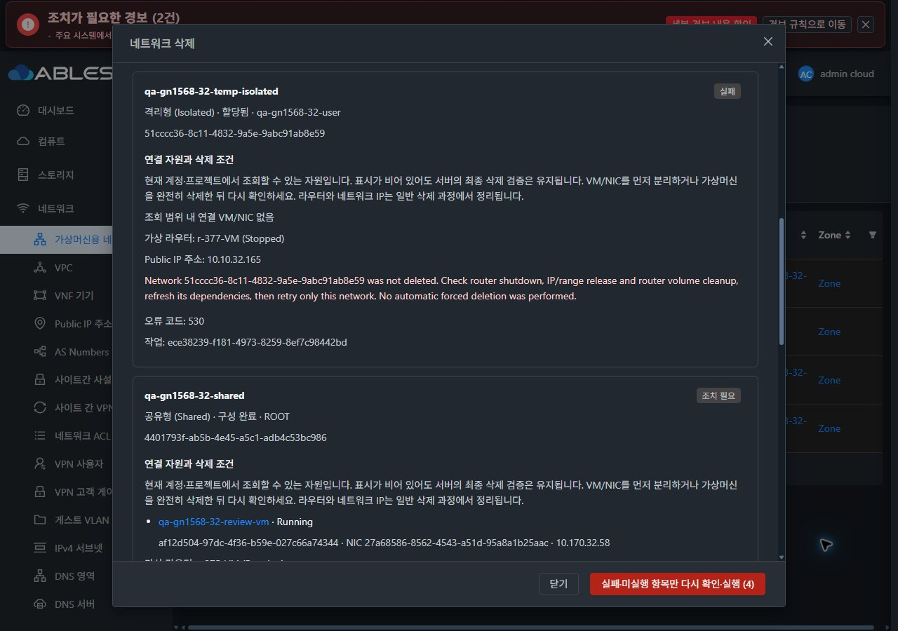
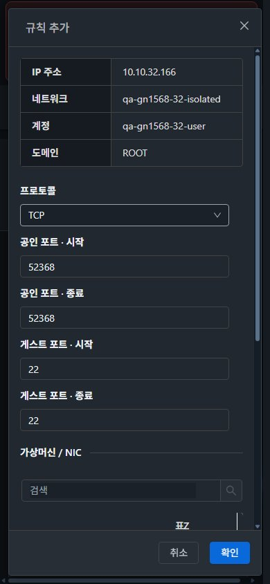

<!--
Licensed to the Apache Software Foundation (ASF) under one
or more contributor license agreements.  See the NOTICE file
distributed with this work for additional information
regarding copyright ownership.  The ASF licenses this file
to you under the Apache License, Version 2.0 (the
"License"); you may not use this file except in compliance
with the License.  You may obtain a copy of the License at

  http://www.apache.org/licenses/LICENSE-2.0

Unless required by applicable law or agreed to in writing,
software distributed under the License is distributed on an
"AS IS" BASIS, WITHOUT WARRANTIES OR CONDITIONS OF ANY
KIND, either express or implied.  See the License for the
specific language governing permissions and limitations
under the License.
-->

# #1568 비동기 작업·삭제 의존성·UI 상태 안내 검증

2026-11-06 KST. Epic #1554 / 동일 브랜치 `dhslove/epic-1554-guest-networks` / Draft PR #1577.

네트워크의 작업 접수와 실제 완료를 분리하고, 삭제 전 연결 자원 진단·부분 성공·실패 항목 재시도·입력 보존·유형/상태 한국어 표기를 구현했다. 31 GFS2와 32 Glue(Ceph) RBD에 변경 Java 클래스와 UI를 반영해 실제 UI 경로를 검증했다. **32 libvirt/RBD 물리 정리 결함은 별도 #1586으로 Open 유지**한다. 그 수동 복구를 자동 정상 삭제 전체 경로 PASS로 계산하지 않는다.

[상태·유형·권한·실패 설계](design.ko.md) · [확인용 자원](resources.ko.md) · [70개 캡처](capture-matrix.ko.md) · [배포/시험 증적](evidence/).

## 변경 UI와 가상머신 표준 반영

| UI | 변경과 표준 |
|---|---|
| 네트워크 목록·요약·상세 | 유형/상태를 격리형·공유형·구성 완료·구현 완료 등으로 통일. Shared IP 탭을 IP 주소로 표시. 공통 목록·상세·작업 메뉴·breadcrumb·탭 key와 검색 복귀 유지 |
| 목록 일괄 작업 | 실제 검증에서 발견한 누락을 수정해 선택 시 네트워크 삭제/재시작 텍스트 버튼 표시 |
| 전용 삭제 대화상자 | VM MoldDialog lg, 의미별 세로 배치, 14px·테마 토큰, 본문/표 내부 스크롤·고정 footer·포커스 기준. VM/NIC·라우터·IP·관련 망·권한 범위와 다음 조치 제공 |
| 삭제 결과/재진입 | 망별 진행·오류 코드·상세·job ID 표시. 서버 이력 복구, 완료 대상 제외, 실패·미실행 항목만 재확인. VM 링크 이동 시 즉시 닫기 |
| 송신·방화벽·PF·IP 획득 | 공통 작업 상태 표시, 입력 보존, 알려진 job 읽기 재시도. 방화벽/PF/IP 팝업을 MoldDialog로 통일. Public IP와 연결 Network 식별자 분리 및 관리자 IP 작업 클래스 바인딩 수정 |
| 재시작·물리망 이동 | 서버 pending job 복구와 자원/명령 검증. 정상 이동 중 이전 망 checkpoint를 실패 재개 문맥과 구분 |

VM 목록·상세·NIC·편집 팝업을 실제로 먼저 열어 표준을 비교했다. 두 테마 즉시 전환, 390/768/1280 화면, 긴 한국어 안내와 UUID 줄바꿈, 키보드 메뉴·대화상자 이동을 확인했다. 검사한 화면/팝업 가로 넘침은 0이다. 알파 배경 합성 후 측정한 활성 문자 대비는 `evidence/contrast-checks.json`에 기록하며, disabled 컨트롤은 활성 문자 기준에서 제외한다.

## 실제 실행과 범위

| 항목 | 결과/한계 |
|---|---|
| 이전 #1563 자원 정리 | 망4·VM2·라우터4, 관련 볼륨·물리망4·네트워크 오퍼링6·시스템 오퍼링4·계정2 정리. 활성 잔여0. 시스템/컴퓨트 전용 디스크 Inactive 이력은 공식 계약대로 유지 |
| 사용 중 망 삭제 | 양쪽 Isolated/L2/Shared의 실제 API 삭제 job 6건 거부. 오류에 VM UUID/상태·다음 조치 표시. VM/NIC 보존 및 UI 의존성/실행 차단 확인 |
| 혼합 일괄 삭제 | 31: 빈 망3 성공, 사용 중3 차단. 32: L2/Shared2 성공, Isolated의 실제 스토리지 실패 전달, 사용 중3 차단. 이중 클릭과 직렬 완료 계약 검증 |
| 부분 실패/재시도 | 32 실패 이력 재진입 복구. 마지막 재시도는 해당 Isolated에 POST1, 이미 성공한 두 망 POST0·강제 옵션0. temp 망6/NIC/라우터/볼륨 활성 잔여0 |
| 32 별도 스토리지 결함 | 읽기 전용 header watcher 추가 조건과 해제 후 모두 libvirt 삭제가 ENOENT를 반환. **rbd info에는 이미지가 존재**, 해제 후 watcher0/snapshot0. 모든 호스트에 도메인 부재를 확인한 뒤 전용 시험 이미지에 일반 rbd rm·pool cache refresh로 운영자 정리. DB 직접 수정/강제 삭제0. 이 조치가 있어 #1586은 수정 완료로 처리하지 않음 |
| 실제 물리망 이동 | 양쪽 Root가 User 소유 Isolated A→B 실행, pending 중 닫기/새로고침·같은 job 복구. 망/VM/NIC UUID·IP·MAC 유지. VM/VR 같은 호스트·게스트 SSH·gateway ping·실제 인터페이스 확인 |
| 네트워크 집계 | 직접 DB 수정 없이 Root3, 시험 User2를 이동 중/후 유지하고 temp 삭제 뒤 User1. API networktotal·DB resource_count·공식 Account/display/비시스템/!specifyVlan 조건 일치 |
| 실패 입력/조회 재시도 | 32 송신 중복 오류537의 상세와 네 입력값 보존 후 포트 수정 성공. 31 job 조회만 합성500 세 번 → 입력/job 유지·추가 쓰기 차단 → 같은 job 재조회 완료. 서버 job1건 확인 |
| 느린 읽기·화면 이동 | 의존성 읽기 합성500에서도 기존 VM/NIC 표시 보존. 응답 보류 중 VM 링크 이동 시 팝업 닫힘·이전 조회 취소, 후속 VM 조회 해제 후 정상 VM 화면 유지 |
| 역할·탭 | 두 클러스터 Root/User 실제 확인. 라우터 읽기 권한 없음은 0으로 표시하지 않음. Shared User 업데이트/삭제 차단, 재시작 진단에서도 운영 권한 차단. 세 유형의 구성된 전체 탭과 Public IP7탭 조회 |
| 규칙/IP 쓰기 | 관리자 IP 획득을 양쪽 실제 job 완료 후 목록까지 확인. 32 PF52368→VM22 Active 확인. 방화벽은 양쪽 실제 생성 Active. 31 교체 delete→create 충돌537 후 입력 유지·포트52370 수정 성공, delete1/create4로 기존 삭제 단계 미반복 확인 |
| 공통 UI 회귀 | VM 목록/상세/NIC/볼륨·볼륨 연결 팝업 취소·볼륨 상세·컴퓨트 오퍼링 조회. 화면 이동/다크/모바일과 기존 검색·선택 복귀 확인 |

실환경 구성은 IPv4 VR Isolated, 명시 VLAN L2, Domain Shared DHCP/DNS다. no-SourceNat/VPC/IPv6/외부 제공자·BGP·Tungsten·모든 역할/프로젝트의 전체 쓰기 조합은 이번 전체 실행 범위가 아니다. LB/VPN 탭 조회·미구성 안내를 실제 서비스 전달 성공으로 확대하지 않았다. 스위치 VLAN trunk 미구성에 따라 VM/VR를 같은 호스트에 배치했고 **백엔드 부하 분산 트래픽은 시험하지 않았다**. 해당 전 구간은 #1570~#1576 및 최종 #1569에 남는다.

## 로컬 시험·빌드와 배포

| 검사 | 결과 |
|---|---|
| orchestration 변경 모듈 | 집중74 시험 PASS/install: 기존 NetworkOrchestrator61 + 삭제 lifecycle8 + router volume 결과5 |
| server 변경 모듈 | 90 시험 PASS/package: NetworkService72 + migration request17 + NIC failure1 |
| UI | 22 suite/424 시험 PASS, 변경 파일 lint·production build PASS |
| Java 스타일 | 변경 Java Checkstyle 추가 오류0, orchestration 전체0. server 전체62 기존 항목은 별도 기록 |
| 전체 orchestration 시도 | 274 중 기존 VM/volume 시험6 NPE. 원본 c3ef 소스로 VM/volume150 시험에서 동일6 실패 재현 후 변경 소스 복원. 전체 모듈 시험 green으로 보고하지 않음 |

변경 Maven 모듈과 UI는 WSL ext4에서 로컬 빌드했다. 전체 Cloud/qemu 빌드·수동 Actions 빌드는 실행하지 않았다. 소스/시험/배포 증적은 `evidence/*-result.json`, `source-provenance.json`, 로그 발췌를 참조한다. 자동 저장소 전체 CI는 실제 PR Checks와 구분한다.

백엔드는 활성 monolithic JAR의34 class entry만 바꾸고 나머지204,623 entry를 보존했다. 양쪽 활성 JAR SHA256은 `53895b2fa85d4c4ddafe35d870e383108a3861301d3ee3a2b2aa52a2112aed6a`다. UI는 정적 allowlist655개 파일만 갱신하고 WEB-INF/META-INF·기존 config·템플릿 설정·대형 모니터링 이미지와 관리 PID를 보존했다. 최종 index 해시·655개 파일 대조·HTTP200·백업 경로는 양쪽 `*-deployment.json`에 있다. JAR 배포에만 mold를 재시작했으며 UI 배포는 재시작하지 않았다.

운영 망31개와 VM176개의 확인 대상 필드를 보존했다. 주 작업 트리 HEAD/unstaged/staged 해시는 전후 동일하다. 호스트 JAR/스크립트/FTCTL 파일은 수정하지 않았다. 원시 운영 인벤토리와 자격 증명은 게시하지 않는다.

## 후속과 유지 자원

Epic의 기존23개 순서를 유지한다. #1568 구현 범위를 완료한 뒤 다음은 **#1575 유형별 소유·공유·프로젝트 권한과 VM·이벤트·코멘트·태그 UI 연계**다. 별도 발견된 **#1586 Glue RBD/libvirt 삭제 재시도**는 Open이다. #1554와 Draft PR #1577은 Open으로 유지하며 병합/종료하지 않는다.

[확인용 망6·VM2·라우터4·IP/규칙·오퍼링/QA 물리망](resources.ko.md)은 별도 삭제 지시까지 남긴다. 시험 목록 검색어는 `qa-gn1568-31`/`qa-gn1568-32`다.
