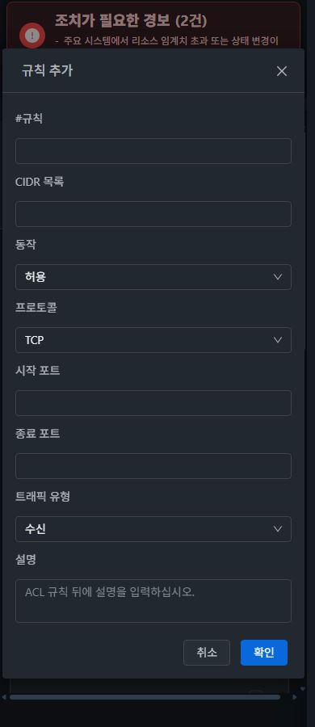
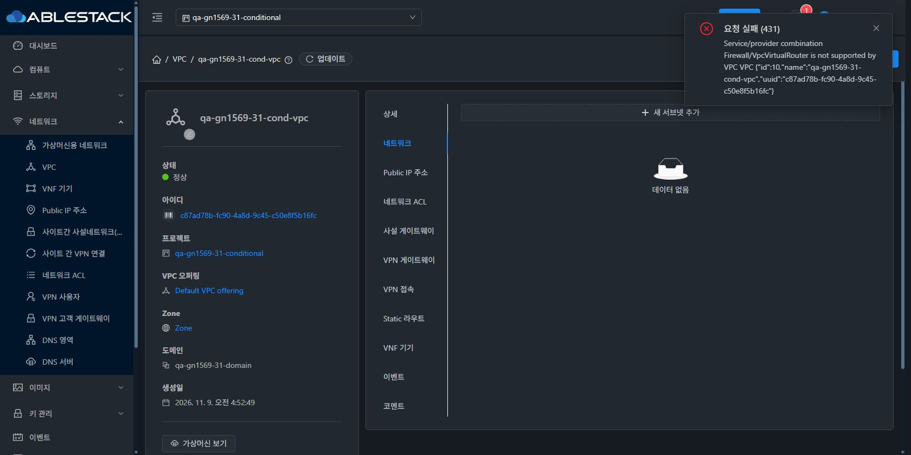

# #1569 L2·ConfigDrive·PVLAN·VPC 역할/조건부 통합 회귀 (2026-11-09)

31 GFS2·32 Glue RBD에서 실제 UI 생성과 API/VM/호스트/패킷을 대조했다. **ConfigDrive·일반 L2·VPC ACL 통신과 서버 권한 경계는 확인했으며, 새 결함3건 때문에 #1569는 Open이다.** Epic #1554의 기존 `dhslove/epic-1554-guest-networks` / Draft PR #1577을 유지한다. 이번은 검증/증적/후속 설계 작업이며 제품 UI/API 소스 수정·빌드·재배포는 수행하지 않았다. 기존 #1598 배포의 정적 번들/마커·JAR·관리 PID·WEB-INF·HTTP200을 실제 서버에서 재확인했다.

## 실제 결과

| 범위 | 31 GFS2 | 32 Glue RBD | 판정의 한계 |
| --- | --- | --- | --- |
| ConfigDrive | owner 실제 UI 망 생성, VM2대 userdata·SSH 성공 | admin 실제 UI 망 생성, VM2대 userdata·SSH 성공 | 모든 VM /dev/sr1 config-2 ISO·DataSourceConfigDrive·고유 marker·cloud-init errors=[]; clone/변경 후 재기동은 남음 |
| 일반 L2 | UI VM11/API member VM12 NIC 연결, ICMP3/3·TCP22 양방향 | 동일 | 라우터와 같은 호스트에서 검증. Cloud 기본 NIC 보존. 호스트 간 VLAN은 스위치 미설정으로 통과 처리하지 않음 |
| PVLAN 3유형 | primary2860, isolated2870/community2880/promiscuous2860 UI·API 값 일치 | primary2861, isolated2871/community2881/promiscuous2861 일치 | 세 유형은 생성·상세 확인. 실제 패킷은 Isolated만 실행 |
| PVLAN 실제 격리 | **실패**, isolated-peer ICMP/TCP22 양방향 통과 | **실패**, 동일 | API/job 성공과 격리 성공은 다름. XML bridge0/allow-all-traffic·Linux port isolated=false, #1599 |
| VPC 기본 NoLB 후보 | owner UI HTTP431 | admin UI HTTP530 | Firewall/VpcVirtualRouter 부적합; 창 닫힘/입력 소실, #1600 |
| 호환 VPC/Tier | VPC UI 생성·기동, 호환 Tier2 API 생성 | VPC 및 호환 TierA 실제 UI 생성, TierB API 생성 | 전역 기본 오퍼링은 보존. 전용 호환 NoLB는 NetworkACL 유지·Firewall 제외 |
| VPC ACL 실제 통신 | 두 Tier ICMP/TCP22 허용 → A→B 차단 → default_allow 복구 성공 | 동일, ACL 차단 적용은 실제 UI/job으로 실행 | 반대 방향 B→A는 계속 허용, 두 L2 대조군도 유지. LB 데이터 평면은 범위 제외 |
| 역할 서버/API | 7역할47사례 기대 일치 | 7역할47사례 기대 일치 | admin/owner/member/DomainAdmin 허용; readonly/peer/outsider 거부. projectid 생략도 거부 |
| 제한 역할 UI | 네트워크 생성/NIC 연결 숨김, Tier 추가/ACL 추가·삭제 비활성. ACL 편집/가져오기 활성 | 동일 | 실제 편집 제출은 양쪽401 거부, 권한 우회 아님. UI 가드 결함 #1601 |

직접 API 역할94사례는 ConfigDrive L2/VPC/ACL-list 생성·L2/VPC 수정35×2, projectid 생략 수정6×2, 명시/생략 NIC 거부6×2다. 모든 역할을 UI 생성으로 반복한 것은 아니며, 이번 UI 성공 쓰기 역할은 owner31/admin32, 제한 UI는 readonly 양쪽이다. 이전 역할 회귀 결과와 혼동하지 않는다.

## 패킷/ConfigDrive 증거

VM은 각2Core/2GB·100GB root, Rocky9.5 cloud image다. 31은 ablecube31-2, 32는 ablecube32-1에 VPC 라우터와 두 VM을 함께 배치했다. 스위치 VLAN 전달에 의존하지 않는 동일 호스트 경로다. Cloud 기본 NIC는 ConfigDrive L2이고 비기본 NIC3개가 일반 L2/VPC/PVLAN이다.

- ConfigDrive L2: `172.30.31.11/12`, `172.30.32.11/12`. 고유 MAC·static IP·qa-cond/SSH키·marker는 ISO userdata에서 적용됐다. ConfigDrive가 DHCP/DNS를 제공한다고 주장하지 않는다. QGA는 인터페이스 읽기만 사용했으며 guest-exec 보안 정책은 변경하지 않았다.
- 일반 L2: `172.31.31.11/12`, `172.31.32.11/12`. 게스트 NetworkManager에 전용 비기본 연결을 설정했다.
- VPC: `10.243.31.0/24`, `10.243.32.0/24`를 /25 두 Tier로 나누고 VPC NIC 주소/게이트웨이와 명시 경로를 설정했다. 따라서 이 결과는 VPC DHCP/DNS 신규 검증이 아니다. ACL10 ICMP/20 TCP22 Ingress Deny(A CIDR),100 Ingress AllowAll,200 Egress AllowAll로 A→B만 차단하고 default_allow로 복원했다.
- Isolated PVLAN: `172.29.31.11/12`, `172.29.32.11/12`를 source-bound ICMP/TCP22로 검사했다. 양방향 성공은 기대한 격리의 실패다. 모든 호스트 OVS 미설치/비활성이 관측됐지만 이를 근거로 API 성공을 정상 처리하지 않는다. BridgeVifDriver의 Pvlan 미분기/guest-bridge fallback은 실제 XML/포트와 일치하는 원인 후보이며 후속에서 배포 agent 흐름까지 확정해야 한다.

[31 허용](evidence/31-traffic-baseline.json) · [31 차단](evidence/31-traffic-deny.json) · [31 복구](evidence/31-traffic-restored.json) · [32 허용](evidence/32-traffic-baseline.json) · [32 차단](evidence/32-traffic-deny.json) · [32 복구](evidence/32-traffic-restored.json) · [31 ConfigDrive](evidence/31-vm11-guest.json) · [32 ConfigDrive](evidence/32-vm12-guest.json).

## UI 표준/전환/테마 검토

31의 실제 일반 VM 목록→상세 이동과 양쪽 VM NIC 탭·기존 네트워크 연결창을 비교 기준으로 사용했다. 네트워크 상세의 summary/탭/상단 작업·breadcrumb, ConfigDrive 설명, ACL 규칙 toolbar/세로 모바일 입력·하단 취소/확인, VPC Tier 입력창을 관찰했다. **새 스타일을 구현했다고 보고하지 않는다.** 기존 UI를 검토했고 후보/실패 복구와 ACL 역할 가드의 보완은 #1600/#1601 설계에 VM 단일 MoldDialog 표준을 명시했다.

ConfigDrive 상세·ACL 규칙 추가창·VPC Tier 추가창의 **36개 폭/테마**를 검증했다. 390px은 입력을 세로 배치하고 취소/확인을 viewport 내에서 표시하며 다크의 라벨/입력/버튼을 시각 확인했다. 모달 콘텐츠 좌우·하단이 viewport를 벗어나지 않는지도 측정했다. 텍스트의 WCAG 수치 평가·전체 키보드 순환·모든 탭/모든 역할을 통과했다고 주장하지 않는다.

양쪽 390 다크에서 조건부→기존 QA→조건부 프로젝트 왕복으로 대시보드/자원 범위가 전환됐고, 열린 VM 연결창에서 네트워크 경로로 이동한 뒤 이전 dialog0을 확인했다. 첫 전환 표본은 이전 DOM이 남는 프레임이 있어 정착 화면과 구분했다. 원자적 첫 프레임 전환/응답 역전 전 범위는 미검증이다. 세션 만료/테마 drawer 전환 중 미적용 표본은 정규36조합에서 제외하고 실제 dark 클래스/viewport/JPEG 크기가 일치하는 최종 표본만 집계했다. 로그인 캡처·인증정보는 게시하지 않는다. 브라우저 임시 viewport override는 해제했다.

캡처 파일 검증에서 viewport와 다른 크기로 반환된 JPEG 15개는 제외했다. 36조합은 DOM 레이아웃 측정 수이며 모든 조합의 이미지가 있다는 뜻은 아니다. 게시한 70개만 실제 viewport/JPEG 크기 일치를 검증했다. [제외 표본](evidence/capture-exclusions.json).

[원본 70개 캡처](capture-matrix.ko.md) · [실제 UI 요청/응답](evidence/ui-wire.json) · [레이아웃 측정](evidence/ui-layouts.json) · [역할94건](evidence/role-results.json).

## 보존/배포 상태

기존 QA 프로젝트의 VM5/21NIC 및 망31=45·32=46, #1597 프로젝트 VM1/NIC1, 기본 보기의 기존 VM/NIC/망 식별·상태·호스트·기본 NIC/연결 MAC을 대조해 유지됨을 확인했다. 개인 VM은31=129·32=61이다. 기존 오퍼링·서비스 제공자·deploy-anywhere=false는 전후 동일하다. 기존 역할을 확장하지 않고 **새 전용 프로젝트/읽기전용 역할에만** list/get/query 허용과 마지막 `* deny`를 구성했다. 이 새 역할을 기존 QA 역할의 일반적 권한이라고 서술하지 않는다.

기존 QA 역할·한도·멤버는 #1597 완료 시점 기록과 다시 대조해 동일함을 확인했다. 더 이른 #1597 실행 전 기록의 멤버4명은 이후 #1597 시험 멤버 추가로5명이 된 과거 기록이므로 현재 전후 기준으로 사용하지 않았다. [31 역할/한도/멤버/공유](evidence/31-old-policy-preservation.json) · [32 역할/한도/멤버/공유](evidence/32-old-policy-preservation.json).

기존 #1598 static662개·마커와 JAR `a3b88784bc6be42b5e95e7a3ef347381653eff78166d4ec379dfeda667bce365`, WEB-INF·HTTP200·mold active·PID를 다시 확인했다. 소스/서버 패키지·운영 브리지·스위치/OVS·QGA 정책 변경, 서비스 재시작, 빌드/CI/Actions 실행은 없다. 현재 runtime 검증은 전체 Cloud CI 성공을 의미하지 않는다.

시험 SSH를 위해 새 ConfigDrive 브리지에 잠시 넣은 host `172.30.x.254/24` 두 주소만 제거했다. 기존 주소·경로와 운영 자원은 변경하지 않았다. 게스트 설정과 확인용 자원은 유지한다. 확인자가 SSH 재검증하려면 동일 호스트의 해당 전용 브리지에 이 시험 전용 probe 주소를 일시 재추가하는 방식이 필요하다. Cloud/NAT/외부 호스트에서 바로 SSH 가능하다고 보고하지 않는다.

[31 보존](evidence/31-preservation.json) · [32 보존](evidence/32-preservation.json) · [31 runtime](evidence/31-runtime-audit.json) · [32 runtime](evidence/32-runtime-audit.json) · [31 host 복원](evidence/31-host-probe-restored.json) · [32 host 복원](evidence/32-host-probe-restored.json) · [최종 ACL 보존31](evidence/31-final-acl-policy.json) · [최종 ACL 보존32](evidence/32-final-acl-policy.json).

## 확인용 시험 자원

Mold admin으로 로그인 후 상단 프로젝트에서 다음을 선택한다. 이 작업에서 새로 남긴 자원은 각 VM2대/8NIC, 망11개, VPC5개(주 VPC1기동/역할검사용4정지), 신규 ACL5개(traffic1/역할4), 오퍼링2개다. ACL 조회7개에는 전역 default_allow/default_deny2개가 포함된다. 기존 보관 시험 자원도 삭제하지 않았다.

| 클러스터 | 프로젝트 | 주 VPC / VM | 네트워크 확인 |
| --- | --- | --- | --- |
|31|qa-gn1569-31-conditional|qa-gn1569-31-cond-vpc / qa-gn1569-31-cond-vm11·vm12|cond-configdrive / cond-basic-l2 / cond-tier-a·b / cond-pvlan-isolated·community·promiscuous|
|32|qa-gn1569-32-conditional|qa-gn1569-32-cond-vpc / qa-gn1569-32-cond-vm11·vm12|동일32 prefix|

VPC TierA/B의 최종 연결 ACL은 default_allow다. 차단 규칙4개는 `qa-gn1569-{31,32}-cond-traffic-acl`에 보관했고 미연결이다. PVLAN 시험 NIC는 **격리 보장 안 됨이 재현된 상태**로 비기본 NIC에 남겼다. 격리 정상 자원으로 오인하지 않는다. 상세 UUID/주소/MAC/호스트는 [31](evidence/31-retained.json)·[32](evidence/32-retained.json)를 따른다.

## 실패/남은 항목과 진행 순서

1. **[#1599](https://github.com/ablecloud-team/ablestack-cloud/issues/1599) P1**: 비지원 driver에서 PVLAN을 일반 bridge로 조용히 연결하지 않도록 차단/원복 또는 지원 경로를 구현하고 실제 격리 전달 행렬을 재검증한다.
2. **[#1600](https://github.com/ablecloud-team/ablestack-cloud/issues/1600) P2**: VPC 전체 service/provider 후보 적합성, 431/530/async 실패의 입력 유지·재시도와 VM 대화상자 표준.
3. **[#1601](https://github.com/ablecloud-team/ablestack-cloud/issues/1601) P2**: readonly ACL 편집·순서/drag·가져오기/API별 UI 가드 통일. 기존 서버 거부 정책은 유지한다.
4. #1569: 위 수정 후 관련 역할/실패 재회귀 → PVLAN community/promiscuous 전달·다른 community/호스트 간(스위치 준비 필요), root overlap bypass 허용·나머지 범위, ConfigDrive clone/userdata 갱신·재기동 → VPC 삭제/서비스 영향·나머지 ACL CSV/순서·LB/TLS/Health/AutoScale·VPN 등의 미실행 조합. LB 실제 백엔드 데이터 평면은 사용자 제외 지시를 유지한다.
5. 환경 준비 후 IPv6/BGP/제공자 조건부. Tungsten/Custom Actions는 현재 구성에서 적용 제외이며 환경이 생기면 별도 실행. #1586 Glue 라우터 볼륨 삭제 복구는 별도 Open 유지.

63행 현재 각 클러스터 **실패5·부분45·미실행4·환경차단6·적용제외3·전체행성공0**. 이번 검증한 하위 절차의 성공을 넓은63행 성공으로 대체하지 않는다. [최신 coverage](../guest-network-1569-integrated/coverage.ko.md).

시험 도구의31 ACL Egress number100 중복 제출은 API가 올바르게431거부한 fixture 준비 실수다. Egress200으로 고치고4규칙을 검증했다. 초기 VM boot 중 SSH NoRoute와 datasource query의 잘못된 key도 도구/준비 표본으로 분리했다. 제품 결함3건과 섞어 계산하지 않는다. 원본 직접 API 기록의 해당 matched=false를 삭제하거나 성공으로 바꾸지 않았다.
