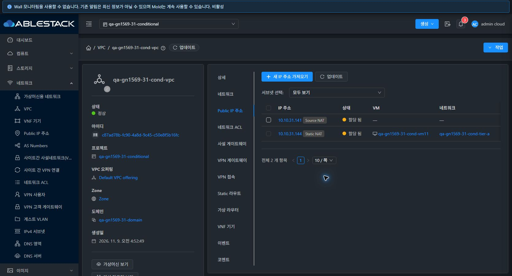
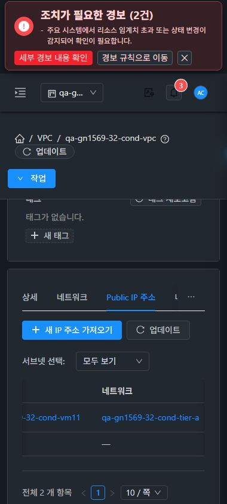

# #1569 VPC Public IP 연결망 링크 수정

31번 GFS2와 32번 Glue RBD에 VPC → Public IP 주소 → 네트워크 열의 수정을 반영했다. 연결망 ID가 있는 공용 IP는 이름으로 상세 링크를 표시하며, 이름이 비어 있으면 ID를 사용한다. 연결망 ID가 없으면 대시를 표시한다. Source NAT 응답에 있는 networkid와 실제 연결망 associatednetworkid를 구분한다. [기존 재현과 통합 검증](../guest-network-1569-resume-20261109/README.ko.md) · [#1569](https://github.com/ablecloud-team/ablestack-cloud/issues/1569)

| 검증 | 31번 | 32번 |
| --- | --- | --- |
| 기존 Source NAT | 10.10.31.141, API 연결망 ID 없음. 빈 링크가 대시로 바뀌고 앵커 0개 | 10.10.32.153, 동일 |
| 연결망이 있는 시험 IP | 10.10.31.144의 Static NAT를 적용한 뒤 Tier A 이름·href·API ID 일치 | 10.10.32.152, 동일 |
| 실제 이동 | 링크를 클릭해 qa-gn1569-31-cond-tier-a 상세와 breadcrumb 확인 | qa-gn1569-32-cond-tier-a, 390px 다크에서 같은 경로 확인 |
| 시험 매핑 해제 | 시험 IP Allocated, 연결망 ID·VM 매핑 해제, UI 대시 | 동일 |

양쪽의 실제 Source NAT 행에 배포 전 빈 #/guestnetwork/undefined 링크가 생성됐다. 배포 후 대시와 정상 Tier 링크를 같은 목록에서 확인했다. 비교에 사용한 시험 Static NAT는 검증 후 원래 할당 상태로 돌렸다. API에서 Source NAT와 기존 망·ACL 연결·VM NIC 식별 및 기본 여부의 해시를 전후 대조했다. [31 API 적용](evidence/31-api-linked.json) · [32 API 적용](evidence/32-api-linked.json) · [31 최종](evidence/31-api-restored.json) · [32 최종](evidence/32-api-restored.json)

## VM 표준, 프로젝트 전환, 반응형

VM NIC 화면의 링크·대시와 기존 네트워크 연결창의 세로 입력·공통 footer를 비교 기준으로 사용했다. VPC의 상단 도구와 표, 상세 breadcrumb에서 대시와 기존 연결망 링크를 확인했다. 양쪽 390×844·768×1024·1280×900 라이트·다크 12개 조합에서 페이지에 가로 넘침이 없었고 표 안쪽에 스크롤이 유지됐다. 32번 390px에서 키보드 초점 이동으로 연결망 열을 표시하고 링크를 클릭했다.

양쪽에서 시험 프로젝트 → 기본 보기 → 시험 프로젝트로 돌아와 VPC의 올바른 행을 다시 조회했다. 기본 보기 헤더가 바뀐 직후 이전 VPC 경로와 표가 잠시 남았고, 정착 후 대시보드에서 이전 표는 0개였다. 전환 중 기존 작업 잠금은 별도 검증 항목이다. [실제 UI 결과](evidence/ui-results.json) · [12개 레이아웃과 JPEG 치수·해시](evidence/layouts-and-captures.json)

[수정 전 31번](screenshots/31-before-empty-link.jpg) · [32번 라이트 목록](screenshots/32-after-vpc-public-ips-light.jpg) · [31번 링크 도착 화면](screenshots/31-linked-tier-1280-light.jpg) · [32번 모바일 링크 도착 화면](screenshots/32-linked-tier-390-dark.jpg)

## 배포와 확인용 자원

WSL ext4 로컬 lint, 집중 테스트 42개, production UI 빌드를 통과했다. 양쪽 활성 웹앱의 정적 파일 662개 해시, WEB-INF, 관리 JAR 해시, /client/ HTTP 200을 확인했다. [로컬 검증](evidence/local-validation.json) · [31 배포](evidence/31-deployment.json) · [32 배포](evidence/32-deployment.json)

두 프로젝트에 기존 VPC, Tier A, 시험 VM, 시험 Public IP를 보관했다. Public IP 탭의 최종 화면에는 연결망이 없는 두 행에 대시가 보인다. 시험 IP를 Tier A의 기존 시험 VM에 다시 매핑하면 정상 링크를 재현할 수 있다. [31번 VPC](http://10.10.31.10:8080/client/#/vpc/c87ad78b-fc90-4a8d-9c45-c50e8f5b16fc?tab=ip) · [32번 VPC](http://10.10.32.10:8080/client/#/vpc/87964ae1-ca02-4224-aa97-126f63b15620?tab=ip)

#1569의 P01을 부분 검증으로 갱신했다. 후속은 Shared 사용량·재시작·공유 철회 영향, VPC 삭제 및 서비스 영향·ConfigDrive 게스트 내부 실행, VPN·LB 조건부 경로 순이다. 호스트 간 PVLAN, IPv6·BGP·DNS는 환경 준비가 필요하다. [통합 검증표](../guest-network-1569-integrated/coverage.ko.md)
