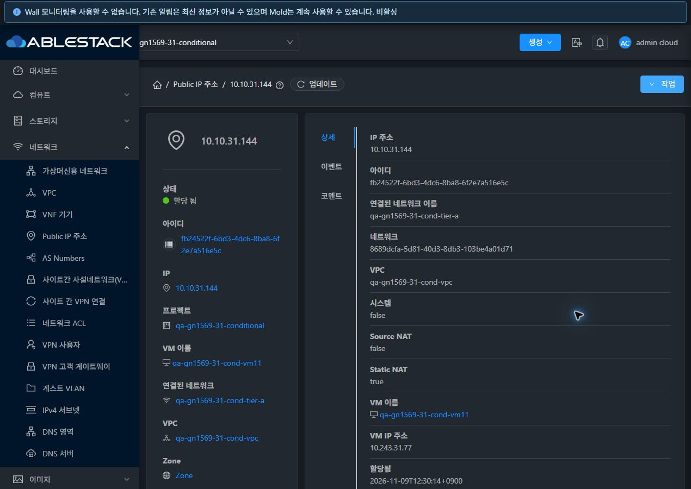
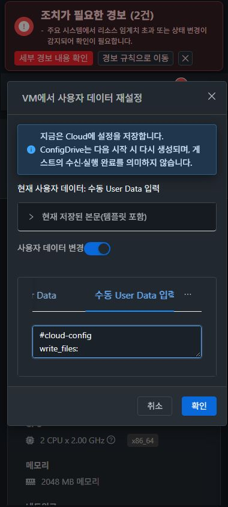

# #1569 역할·조건부 통합 회귀 추가 기록

2026-11-09, 31번 GFS2와 32번 Glue RBD에서 기존 Epic 배포를 사용해 VPC Static NAT와 ConfigDrive 오퍼링 복제·VM 사용자 데이터 갱신을 검증했다. #1601의 VPC ACL 역할별 결과를 행렬에 통합했다. [Epic #1554](https://github.com/ablecloud-team/ablestack-cloud/issues/1554) · [#1569](https://github.com/ablecloud-team/ablestack-cloud/issues/1569) · [Draft PR #1577](https://github.com/ablecloud-team/ablestack-cloud/pull/1577)

| 경로 | 31번 | 32번 |
| --- | --- | --- |
| VPC Public IP 할당 → Static NAT 설정 → 해제 | 10.10.31.144 → Tier A의 VM11, 10.243.31.77 | 10.10.32.152 → Tier A의 VM11, 10.243.32.102 |
| ConfigDrive 오퍼링 복제 → 프로젝트 L2 생성 | L2·UserData/ConfigDrive·VLAN 자동·접근 범위 일치 | 동일 |
| 복제망의 시험 VM → 정지 → UI 사용자 데이터 재설정 → 시작 | 기본 NIC 1개 유지, V2 ISO·QGA 응답 | 동일 |

Static NAT는 VPC 화면에서 추가 IP를 할당하고, 대상 Tier와 VM을 선택해 적용했다. Public IP API의 VM·NIC IP·연결 Tier가 UI와 일치했다. 소유자·멤버·도메인 관리자·읽기 전용 역할은 시험 IP를 조회했다. 읽기 전용 해제 요청은 401, 같은 도메인 및 외부 비회원의 조회·해제는 432였다. 해제 후 양쪽 모두 매핑이 사라지고 IP는 Allocated 상태다. 실제 NAT 패킷 전달과 VPN 클라이언트 연결은 이번에 측정하지 않았다. [31 적용](evidence/31-staticnat-enabled.json) · [32 적용](evidence/32-staticnat-enabled.json) · [31 해제](evidence/31-staticnat-disabled.json) · [32 해제](evidence/32-staticnat-disabled.json)

ConfigDrive 기본 복제에서 원본의 L2·UserData/ConfigDrive, 도메인·Zone·태그, VLAN 자동 여부를 비교했다. 새 오퍼링은 Optional/Enabled였고 프로젝트 L2 생성 후보에서 선택할 수 있었다. 새 VM은 API로 배포하고 UI에서 정상 정지·수동 데이터 재설정·저장 본문 확인·시작을 실행했다. V1과 V2에서 libvirt의 실제 CD-ROM ISO를 대조했고, 재시작 후 V2 표식과 QGA 응답을 확인했다. 이번 시험은 ISO의 데이터 갱신과 재기동까지다. cloud-init의 V2 스크립트 재실행은 후속 범위다. [31 복제](evidence/31-configdrive-clone.json) · [32 복제](evidence/32-configdrive-clone.json) · [31 V2 ISO](evidence/31-configdrive-iso-V2.json) · [32 V2 ISO](evidence/32-configdrive-iso-V2.json)

## #1601 VPC ACL 역할 결과 통합

| 역할 | UI 조회와 작업 | 쓰기 API |
| --- | --- | --- |
| 관리자 | 규칙 조회·추가·편집·삭제·드래그·태그 변경·CSV 가져오기 | 일곱 작업 허용 |
| 프로젝트 소유자·멤버·도메인 관리자 | 규칙 조회·변경·이동·태그 변경 | CSV 가져오기 외 허용 |
| 읽기 전용 | 규칙·태그 조회와 내보내기, 금지 작업 UI 쓰기 0건 | 401 |
| 같은 도메인 비회원·외부 비회원 | 프로젝트와 ACL에 접근 불가, UI 쓰기 0건 | 432 |

98건은 #1601에서 이미 실행한 양쪽 역할별 쓰기 대조 기록이다. 이번에는 작업별 원본과 UI 버튼 상태를 통합했고, 남겨 둔 ACL과 규칙 31번 5개·32번 6개를 다시 API로 확인했다. #1599의 native Bridge 거부와 전용 OvS 동일 호스트 64방향, #1600의 Tier 후보 진단과 재시도도 과거 실패 행에 연결했다. [ACL 행렬](evidence/acl-1601-role-matrix.json) · [#1601 원본 검증](../guest-network-1601-20261109/README.ko.md) · [#1599](../guest-network-1599-20261109/README.ko.md) · [#1600](../guest-network-1600-20261109/README.ko.md)

## VM UI 표준과 범위 전환

컴퓨트 → 가상머신 → NIC의 기존 네트워크 연결과 사용자 데이터 재설정에서 공통 MoldDialog의 제목, 세로 폼, 스크롤 본문, footer를 확인했다. 재설정은 390×844, 768×1024, 1280×900 라이트·다크를 각 클러스터에서 실행했다. 12개 조합에서 폼과 footer가 폭 안에 있었으며, 색상과 본문 수평 넘침을 확인했다. VPC Static NAT 선택과 L2 생성도 모바일 다크로 캡처했다.

양쪽에서 프로젝트 → 기본 보기 → 프로젝트로 복귀했다. 기본 보기 선택 직후 헤더가 바뀌는 동안 이전 VPC 주소가 잠깐 보였고, 정착 후에는 대시보드였다. 첫 프레임에 이전 작업이 잠기는지는 이번 실행에서 판단하지 않았다. VM 연결 창을 연 뒤 네트워크 상세로 이동하면 창이 닫혔다. 복귀 후 VM NIC의 네트워크 링크와 상세 breadcrumb를 통해 네트워크 목록으로 이동했다. [화면 결과](evidence/ui-results.json) · [레이아웃 측정](evidence/ui-layouts.json) · [12장 JPEG 크기·해시](evidence/ui-captures.json)

[31 ConfigDrive L2 생성](screenshots/31-clone-network-768-dark.jpg) · [32 ConfigDrive 복제](screenshots/32-configdrive-clone-390-dark.jpg) · [32 사용자 데이터 라이트](screenshots/32-vm-userdata-1280-light.jpg) · [32 실행 중 VM의 기본 NIC](screenshots/32-vm-nic-running-390-dark.jpg)

## 남은 항목과 순서

1. VPC → Public IP 주소의 Source NAT 행에서 두 곳 모두 연결 네트워크 UUID가 없을 때 빈 링크가 생성됐다. 실제 href는 #/guestnetwork/undefined다. 연결이 없는 행은 대시로 표시하고, Tier와 연결된 시험 Static NAT 행에는 유효한 링크를 유지하는지 재검증한다. [DOM과 API 대조](evidence/ui-results.json)
2. 준비된 IPv4 시험망에서 Shared 사용량·재시작, 공유 철회·삭제의 기존 NIC 영향, VPC 삭제·서비스 영향을 전용 자원으로 확인한다. ConfigDrive V2의 cloud-init 실행은 게스트 내부에서 별도로 확인한다. VLAN 중복 우회는 다른 자원과 격리한 시험 구간을 사용한다.
3. VPN 클라이언트·사이트 간 피어 연결, LB TLS·Health Monitor·AutoScale과 오퍼링 설정은 해당 클라이언트·인증서·제공자 준비 후 진행한다. 사용자 범위에 따라 LB 백엔드 부하 분산 트래픽은 제외한다.
4. 호스트 간 PVLAN과 Shared PVLAN 라우터 전달은 스위치 트렁크 및 지원 경로 준비 후 확인한다. 양쪽 IPv6 플래그 false, IPv6 오퍼링 0, ASN 범위·할당·BGP 피어 0, DNS Zone/Server 0이다. Routed/IPv6/DNS/Tungsten/Custom Actions는 해당 환경을 준비해 별도 실행한다. [31 조건](evidence/31-conditionals.json) · [32 조건](evidence/32-conditionals.json)

## 확인용 자원

상단 프로젝트에서 qa-gn1569-31-conditional 또는 qa-gn1569-32-conditional을 선택한다. 기존 ACL도 해당 프로젝트에서 볼 수 있다. 새로운 Static NAT 시험 IP는 할당 상태이고, 새 ConfigDrive VM은 Running이며 V2 ISO와 기본 NIC가 연결돼 있다.

| 자원 | 31번 | 32번 |
| --- | --- | --- |
| ConfigDrive L2 오퍼링 | [qa-gn1569-31-configdrive-clone](http://10.10.31.10:8080/client/#/networkoffering/c9b236d6-2c61-4462-bf97-683e51d0b2df) | [qa-gn1569-32-configdrive-clone](http://10.10.32.10:8080/client/#/networkoffering/419f4dbd-cd9f-450e-8a70-c5bc5d259752) |
| ConfigDrive L2망 | [31 clone-net](http://10.10.31.10:8080/client/#/guestnetwork/d218e1a0-2445-40f7-91a9-d364697e123c) | [32 clone-net](http://10.10.32.10:8080/client/#/guestnetwork/9cf04f35-ff5f-4959-9749-658d3c826a3b) |
| 새 VM | [31 clone-vm](http://10.10.31.10:8080/client/#/vm/c7f40539-4192-424d-8186-256e58b78318?tab=nics) | [32 clone-vm](http://10.10.32.10:8080/client/#/vm/c6f2ad48-bd55-4620-a579-331316025e68?tab=nics) |
| 추가 Public IP | [10.10.31.144](http://10.10.31.10:8080/client/#/publicip/fb24522f-6bd3-4dc6-8ba8-6f2e7a516e5c) | [10.10.32.152](http://10.10.32.10:8080/client/#/publicip/56cc1d60-9078-4117-b3ea-9b9ee8d03b96) |

기존 프로젝트 VPC·네트워크·ACL 규칙·Source NAT 및 VM/NIC 식별과 연결을 전후 대조했다. 활성 웹앱과 관리 JAR 해시는 #1601 배포 기록과 일치하며 WEB-INF, /client/ HTTP 200, mold active를 확인했다. [31 최종 상태](evidence/31-verified.json) · [32 최종 상태](evidence/32-verified.json)
