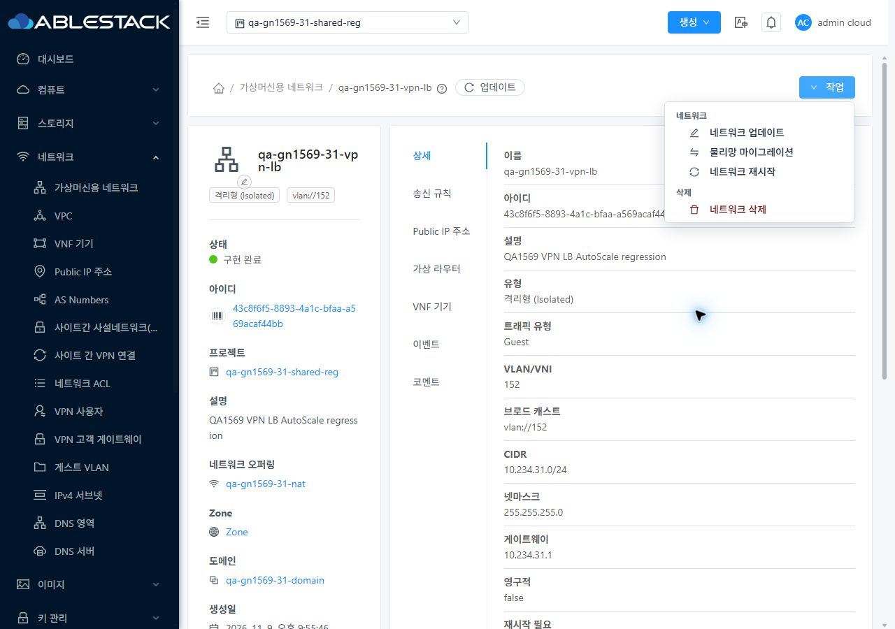
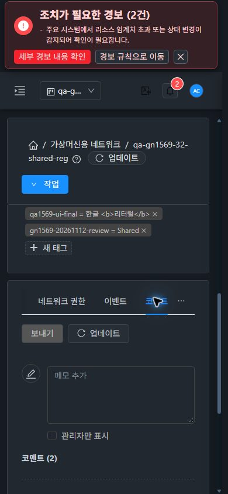

<!--
Licensed to the Apache Software Foundation (ASF) under one
or more contributor license agreements.  See the NOTICE file
distributed with this work for additional information
regarding copyright ownership.  The ASF licenses this file
to you under the Apache License, Version 2.0 (the
"License"); you may not use this file except in compliance
with the License.  You may obtain a copy of the License at

  http://www.apache.org/licenses/LICENSE-2.0

Unless required by applicable law or agreed to in writing,
software distributed under the License is distributed on an
"AS IS" BASIS, WITHOUT WARRANTIES OR CONDITIONS OF ANY
KIND, either express or implied.  See the License for the
specific language governing permissions and limitations
under the License.
 -->

# #1569 잔여 기능 회귀·Epic 종료 준비

2026-11-12. 사용자 지시에 따라 **자원 부족·미구성 환경·잘못된 시험 입력을 제품 오류로 등록하지 않고**, 준비된 기능을31 GFS2·32 Glue RBD에서 검증했다. 확인된 기존 기능 수정 이슈는 모두 CLOSED이며 새 기능 결함은 등록하지 않았다. UI 후속 #1634·#1635는 모두 **P3 비차단 개선**이다. #1586은 독립 자원 정리 이슈로 분리했다.

Epic 브랜치 `dhslove/epic-1554-guest-networks`와 [Draft PR #1577](https://github.com/ablecloud-team/ablestack-cloud/pull/1577)을 유지한다. 이번은 소스 변경·빌드·재배포 없이 실제 배포본을 검증한 작업이다. 활성 백엔드 `f7097be4d98bd94258120694d3a1fcbaf549209e`, UI `22ba7f5eab604aa4840fb7decc686d3e3192ba22` / `app.e01a5204.js`와 사이트별675개 정적 파일·JAR 클래스 해시·HTTP200·WEB-INF를 다시 확인했다.

| 검증 | 31 | 32 |
| --- | --- | --- |
| 역할·메타데이터 API | 6역할223호출 | 6역할223호출 |
| UI 역할/비구성원 직접 URL | 허용20·거부5 | 허용20·거부5 |
| 댓글/이벤트/태그 읽기503 | 기존 값 보존·복구 | 기존 값 보존·복구 |
| 댓글 쓰기503/유효255문자 | 입력 보존·정상 재시도 | 입력 보존·정상 재시도 |
| 새 Shared 기본 VM/L2 기본 NIC 왕복 | API/libvirt 일치·원복 | API/libvirt 일치·원복 |
| 빈/사용 중 L2 독립 삭제 | 성공/거부·NIC 보존 | 성공/거부·NIC 보존 |
| 송신 TCP/UDP/ICMP/ALL | 실제 허용·철회·차단 | 실제 허용·철회·차단 |
| Static NAT primary/secondary IP | TCP/UDP/ICMP 실제 패킷 | TCP/UDP/ICMP 실제 패킷 |
| PF TCP/UDP 포트 범위·보조 IP 변경 | 실제 패킷 | 실제 패킷 |
| PF/LB 공존·알고리즘·backend 해제/복구 | 단일 backend 패킷 | 단일 backend 패킷 |
| VPC nonconserve LB/PF 배타·Static NAT 충돌 | 정상 서비스 전환·충돌 거부 | 정상 서비스 전환·충돌 거부 |
| AutoScale 소유 LB 삭제 보호 | 전용3그룹 거부·규칙 보존 | 전용3그룹 거부·규칙 보존 |
| 서비스 VPN/LB 연결 망 삭제 | job1·IP/실제 VR/디스크 정리 | job1·IP/실제 VR/디스크 정리 |
| 사용 VM 연결된 본망 삭제 | 정상 거부·기존 자원 보존 | 정상 거부·기존 자원 보존 |
| Shared Live Patch | 같은 VR·패치 hash 유지 | 같은 VR·패치 hash 유지 |
| Live Patch 중 기존 NIC DNS/ICMP/SSH | 네 항목 각120/120 | 네 항목 각120/120 |
| 오퍼링 왕복 maxconn/keepalive | 실제 HAProxy4096↔8192·원복 | 실제 HAProxy4096↔8192·원복 |
| 최종 단일 TLS/문법/건강 점검 | chain3·verify0·HTTP200·정상 | chain3·verify0·HTTP200·정상 |

**종료 평가:** 후속 기능 수정 이슈의 미해결 결함은0이며, 현재 준비된 환경의 기능 회귀 결과를 종료 준비 자료로 정리했다. 원래63행의 모든 제공자·프로토콜·배치 조합을 전부 실행했다는 의미는 아니다. 미구성 조건과 실제 미실행 범위는 [종료 평가](closure-preparation.ko.md) 및 [63행 근거](coverage.ko.md)에 남겼다. 이번 요청은 종료 준비이므로 #1554·#1569 OPEN, PR Draft를 유지하며 병합/종료를 실행하지 않는다. UI 두 건이나 자원 부족을 종료 차단 결함으로 올리지 않는다.

**UI 변경:** 이번 소스 변경은0이다. VM 메뉴의 목록·상세·NIC 탭·연결 대화상자 기준과 대조하고, 네트워크/공인 IP의 댓글·이벤트·태그에서 toolbar, breadcrumb, 페이지 이동, 프로젝트 왕복, 반응형·즉시 테마·다크 가독성을 확인했다. 실제76배치·즉시9테마 변경·프로젝트2왕복과 원본 JPEG191개를 감사했다. 모든 유형×탭×역할×크기의 완전 교차 조합으로 확대하지 않았다.

[실제 통신/실패 복구](test-results.ko.md) · [자원/오류 분류](resource-classification.ko.md) · [191캡처](capture-matrix.ko.md) · [확인 자원](resources.ko.md) · [후속](followups.ko.md)

